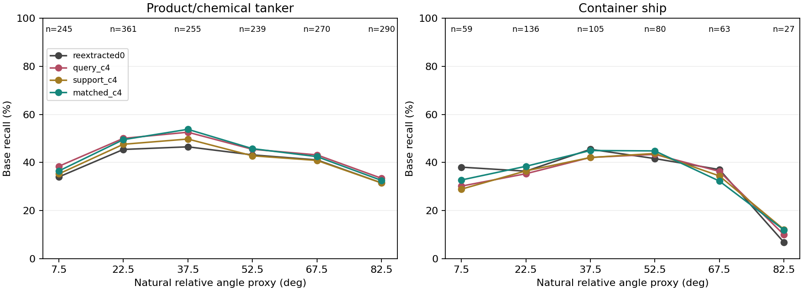

# 四方向平均基础模型：实验结果与文献借鉴

日期：2026-10-09。状态：23 港 × 5 组原有标注抽样全部完成；原主方案未覆盖。

## 结论

这一轮得到可保留的正信号，而不是仅仅让预测看起来更稳定：四方向平均基础模型接回原专家后，完整模型港均 OA 从 60.3271% 到 61.2884%，BA 从 52.1842% 到 53.6353%。12 个实际含齐八类的目标港也同时提升。已有工作支持研究图像方向不变性，但本轮不能宣称发现了物理不变因素或新的旋转不变理论。

自然相对角度造成的性能分组差异仍然存在。化学品船在高角度区间的改善取决于港口，集装箱船的高角度问题也没有解决。因此，计算上的方向敏感性是一个可改善环节，但尚不能解释全部自然观测角差异。

## 实验管线

1. 对全部 38,091 份原有 VV/VH 配对裁片，按原流程缩放至 128×128、归一化；随后同时旋转双极化图像 0、90、180、270 度。直角旋转本身不插值，也不模拟新的 SAR 成像过程。
2. 每个方向通过原冻结 R50，依照原空间特征精度和池化流程提取 2048 维特征，再对四份特征逐维平均。
3. 使用原来的外层源港 PCA、标准化、候选稳定空间 Qs、漂移空间 Qd 和抑制强度。不重挖 Qs/Qd，不更新骨干；这里的“匹配训练”仅指源港基础分类头与目标支持集适配匹配，不是整个表征重新训练。
4. 源港基础分类头在平均特征上重新拟合，沿用类别平衡 ridge=1；目标港沿用同一组 64 个标签、同一组 5 次抽样，在平均特征上拟合 ridge=8 的残差修正。入射角输入和缺失处理不变。
5. 专家保持原始图像特征、原分类头和原目标适配结果。将新基础模型得分与原专家得分送入冻结交接器，重新选择不超过查询集 5% 的样本。
6. 所有港口预测冻结后统一读取查询标签评估。没有根据本轮目标查询标签挑选方向、港口、类别或融合权重。

公式：`x_C4 = mean_k R50(rot90(image, k)), k=0,1,2,3`。

这保证的是平均基础表征对四种直角显示方向的置换不变性，不是任意角度不变性、物理观测不变性或整个专家系统的不变性。入射角和真实相对观测角不随显示旋转而修改。

## 完整模型结果

以下 OA、BA 先在每港每次查询集计算，再平均 5 次抽样、等权平均港口。BA 使用该查询集中实际存在的类别，分类器始终输出八类。

| 评估范围 | 模型 | OA (%) | BA (%) | ΔOA (百分点) | ΔBA (百分点) |
|---|---|---:|---:|---:|---:|
| 全部 23 个目标港 | 原入射角方案 | 60.3271 | 52.1842 | 0 | 0 |
| 全部 23 个目标港 | 四方向基础 + 原专家 | 61.2884 | 53.6353 | +0.9613 | +1.4511 |
| 实际含齐八类的 12 港 | 原入射角方案 | 45.9054 | 39.1294 | 0 | 0 |
| 实际含齐八类的 12 港 | 四方向基础 + 原专家 | 46.8376 | 40.4182 | +0.9322 | +1.2888 |
| 有相对角度的子集，15 港 | 原入射角方案 | 43.7500 | 35.1877 | 0 | 0 |
| 有相对角度的子集，15 港 | 四方向基础 + 原专家 | 45.1028 | 36.8683 | +1.3528 | +1.6806 |

- 全部 23 港：OA 19 港升、4 港降；BA 22 港升、1 港降。
- 5 次支持集抽样的港均 OA、BA 均为正增益。五次抽样共享图像，不是五个独立数据集，不能据此声称独立统计确认。
- Sydney Botany 为 OA/BA 同时退化港：-2.1667/-1.0502 个百分点。Callao、New York、Newcastle 的 OA 下降但 BA 上升，说明类别间取舍仍存在。
- 这些都是历史研发数据上的结果，不是未使用数据上的确认。

## 收益来自哪一步

这里先只看基础模型，不能与上一表完整模型混用。

| 基础模型处理 | 全部 23 港 OA (%) | BA (%) |
|---|---:|---:|
| 原缓存 | 57.7777 | 50.0913 |
| 重新提取原方向，源头/支持集不变 | 57.7906 | 50.0920 |
| 只在预测端四方向平均 | 59.4036 | 51.4577 |
| 预测端与 64 个支持样本都平均 | 59.0292 | 51.5987 |
| 源港基础头、支持样本、预测端均匹配平均 | 58.9130 | 51.7847 |

可确认：只改预测端已带来收益，说明不是完全靠重拟合分类头得到结果。匹配源港和支持集训练进一步提高 BA，但 OA 比只改预测端低，不能说训练匹配对所有指标都有好处。

原基础模型从输入 R50 特征到输出得分的映射是仿射的。因此，在源头和支持集冻结时，特征平均等价于四个方向分类得分的平均。实际缓存检查的最大误差为 1.64e-8。这是计算机制的定位，不是证明被平均掉的方向差异都是纯噪声。

完整模型增益小于基础模型增益：冻结专家和交接器略微改变了收益分配。本轮证明的是该组合仍有净收益，不是交接器已经适配到最优。

## 哪些类别受益

以下为完整模型每类召回率。先对每张图的有效查询抽样求平均，再在该类图像上求平均，因此与港均 BA 的权重不同。`n` 是至少参加一次查询的不同图像数，不是独立船舶数。

| 船型 | n | 原方案 (%) | 新组合 (%) | Δ召回 (百分点) |
|---|---:|---:|---:|---:|
| 散货船 | 11085 | 60.7011 | 62.2831 | +1.5820 |
| 渔船 | 8597 | 91.5802 | 91.5876 | +0.0074 |
| 普通货船 | 5910 | 59.2600 | 60.7115 | +1.4515 |
| 成品油/化学品船 | 5827 | 35.5226 | 37.5862 | +2.0636 |
| 集装箱船 | 2208 | 50.0347 | 50.8431 | +0.8084 |
| 原油轮 | 1757 | 57.1049 | 62.2017 | +5.0968 |
| 拖轮 | 1478 | 19.6482 | 19.2670 | -0.3812 |
| 海工补给船 | 1165 | 42.5007 | 42.7754 | +0.2747 |

在所有图像等权的口径下，救回比例为 5.3163%，误伤比例为 4.0356%，净改善 1.2807 个百分点；不能与港均 +0.9613 个百分点直接相减。原油轮既有 10.1006% 的救回，也有 5.0038% 的误伤。渔船整体几乎不变，拖轮略降，所以“所有类别均衡受益”不成立。

## 对自然相对角的影响

方向轴和相对角仍使用上一轮冻结结果：4,228 张有可用相对角，约占全部 11.1%；未获得相对角的样本并没有从主实验删除。轴来自亮船体代理，不是真实船艏方向；雷达方向来自网格近似。以下均为基础模型，与前面的完整模型结果分开。

化学品船的图像等权召回：

| 相对角区间 | 图像数 | 原方向重提取 (%) | 匹配四方向平均 (%) |
|---|---:|---:|---:|
| 30–45° | 255 | 46.5098 | 53.7843 |
| 75–90° | 290 | 31.5172 | 32.5690 |

两个区间都提高，但低角度区间提高更多，因此差距从约 14.99 扩大到 21.22 个百分点。这直接反驳“消除显示方向敏感性就必然消除自然角度差距”。

在两个区间各至少 20 张图像的三个港口内：

| 港口 | 30–45° 原→新 (%) | 75–90° 原→新 (%) | 两区间图像数 |
|---|---|---|---|
| Jebel Ali | 52.4490 → 60.1531 | 35.7812 → 37.1875 | 98 / 96 |
| Port Klang | 44.6667 → 53.3333 | 34.1837 → 45.9184 | 45 / 49 |
| Singapore | 39.5205 → 44.2466 | 22.8646 → 16.8750 | 73 / 96 |

三个相同港口等权平均，两个区间差距为 14.60 → 19.25 个百分点。不能把小样本港口或不同港口组合造成的差异当成角度规律。

新加坡高角度化学品船进一步分解：原方向 22.8646%，只改预测端平均 19.7917%，支持集同步平均 15.6250%，源港分类头也匹配后 16.8750%。退化在只改预测端时已经出现，支持集再拟合加重了退化，源港重拟合略有救回。这不是简单的“忘记匹配训练”问题。

其 96 张图像中，被预测为拖轮的图像加权次数从 20.70 增到 32.85；正确类别从 21.95 降到 16.20。这里的分数来自同图多次抽样平均，所以不是整数船舶计数。说明具体决策混淆偏向了拖轮，但尚不能确定是尺寸、散射结构、背景还是支持案例组成导致。原始逐图迁移记录已保存，未据此调参。

集装箱船：30–45° 为 45.4762 → 44.9683%，75–90° 为 6.8519 → 11.9753%。高角度略改善，但只有 27 张图像，且没有一个港口在两个区间都达到 20 张。改善不等于已经解决该类别的观测困难。

## 前人工作能借鉴什么

以下为定向检索，不是系统综述。论文之间任务、传感器和评价协议不同，不直接比较其准确率与本项目数值。

| 论文 | 已有做法 | 对我们的用处和边界 |
|---|---|---|
| Zhu 等，2017，An Improved Shape Contexts Based Ship Classification in SAR Images，Remote Sensing 9(2):145，DOI: 10.3390/rs9020145 | 船体主轴参考的散射点形状描述与强度加权匹配 | 借鉴“显示旋转处理”与“方位角改变散射”分开讨论。其 150 个三类舰船样本与本项目不同，不能迁移其性能结论。 |
| Pan 等，2024，TAG-Net: Target Attitude Angle-Guided Network for Ship Detection and Classification in SAR Images，Remote Sensing 16(6):944，DOI: 10.3390/rs16060944 | 姿态角/前景监督和特征调制，检测与分类任务解耦 | 借鉴条件化特征选择。其 TAA 定义为船体与图像水平轴的夹角，并由标注旋转框构建监督；不等同于我们的真实相对雷达观测角，也不是现成跨港八分类验证。 |
| Dieleman、De Fauw、Kavukcuoglu，2016，Exploiting Cyclic Symmetry in Convolutional Neural Networks，ICML/PMLR48:1889–1898 | 将循环旋转对称操作纳入网络 | 当前 C4 平均属于已有对称性利用思路，不应包装成新理论；后续可参考网络内部共享计算。 |
| Cohen、Welling，2016，Group Equivariant Convolutional Networks，ICML/PMLR48:2990–2999 | 群等变卷积 | 区分等变表征与最终不变读出。可作长期架构参考，不因本轮小试成功就立刻替换整个骨干。 |

原始来源：

- https://www.mdpi.com/2072-4292/9/2/145 ，方法 2.2.2 与实验第 3 节。
- https://www.mdpi.com/2072-4292/16/6/944 ，TAFM/TAA map 的定义。
- https://proceedings.mlr.press/v48/dieleman16.html
- https://proceedings.mlr.press/v48/cohenc16.html

核查日期 2026-10-09。出版社页面直接读取曾返回 429；方法和角度定义通过对应出版社的索引全文核查，TAG-Net DOI/题名另由 Crossref 元数据核对。未声称复现上述论文。

## 代价、验证与下一步判断

- 四方向平均对每张查询图需要 4 次 R50 前向，5% 专家交接预算不变并不意味着总计算量不变。全部特征提取本机耗时约 112 秒，仅是此次批处理记录，不是严格部署延迟基准。
- 原骨干重提取与历史特征最小余弦 0.999637、中位数 0.999990；原方案基础得分在 23 港重放误差均为 0。原方向重提取控制显示，收益远大于数值重提取扰动。
- 15 个可测角港口的特征平均/得分平均等价检查通过，最大误差 1.64e-8；64 个标注样本未进入查询，交接数未超过 floor(0.05×查询数)。
- 保留为“方向平均基础模型 + 原专家”的有效研发候选；不覆盖原模型，不宣称因果漂移提取成功，不把常规 C4 平均本身当顶刊核心创新。
- 下一步优先把这个固定设置迁移到公开 SAR 数据核实收益能否重复，之后再考虑低成本实现。对于自然角度效应，聚焦新加坡高角度化学品船与拖轮的具体混淆，不能把所有角度信息一概当噪声抑制。
- 如果今后继续改造，值得保留的设计问题是：如何同时利用方向平均证据与原专家的方向相关强项，并用来源可解释的条件决定信任谁。该机制尚未新增或验证，不应写成已完成贡献。

## 文件索引

- `PROTOCOL.json`：固定实验设置；`EXTRACTED.json`：编码器与计时记录。
- `ports/*/policies.npz`：逐港 5 次抽样的得分、预测与交接记录。
- `summary.csv`、`port_means.csv`：完整模型与基础模型汇总。
- `instance_effects.csv`：同图先平均抽样的救回/误伤。
- `class_effects.csv`、`port_class_effects.csv`：类及港口×类效果。
- `port_class_angle_coverage.csv`：分角度图像/船舶/产品数、效果与入射角。
- `focused_angle_gaps.csv`、`common_port_angle_gaps.csv`：相同港口范围内角度差距。
- `base_prediction_transitions.csv`：原方向重提取对照到各变体的预测迁移。
- `verification.csv`、`affine_checks.csv`：原方案重放和平均操作接入检查。
- 实验代码：`../oof_reliability_check/run_c4_base_trial.py`。
- 诊断代码：`../oof_reliability_check/diagnose_c4_base_trial.py`。
