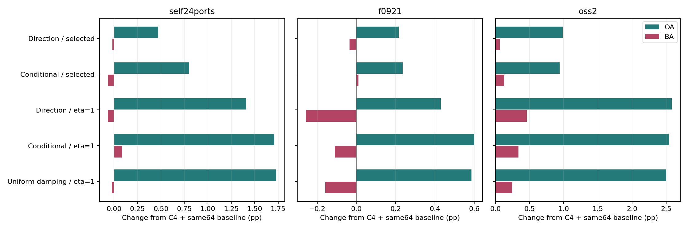
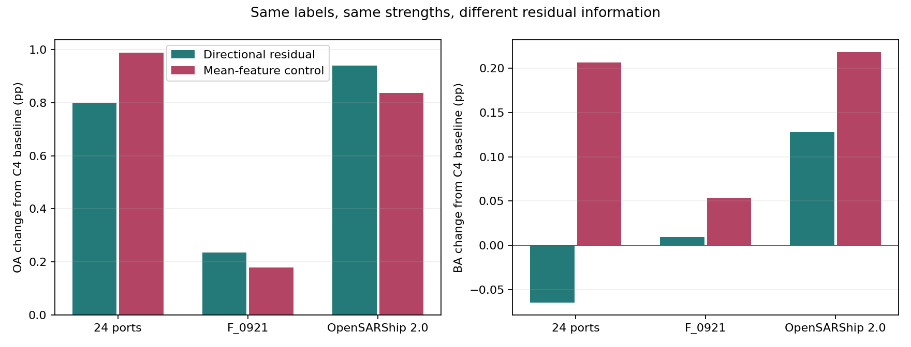

# 条件方向残差：已完成开发及机制实验

日期：2026-10-09。

**结论：额外支持校正确实带来了OA收益，但“恢复被平均丢掉的方向信息”尚不是得到证实的主要收益来源。把方向差换成平均特征后，三个数据集的BA反而都更好。值得保留和发展的是条件支持校正；方向残差保留为候选，不作为已经证实的核心机制。**

## 1. 做了什么

- 已实现条件方向核与原目标适配的联合岭回归，不是原类别分数的加权混合。
- 506个双重留港源任务选择补偿强度，每个外层港22个内层任务；候选0、0.25、1、4，依据源任务BA。
- 自建24港的23个可评估港、F_0921、OpenSARShip 2.0，均完成五次同64标签抽样。原专家、原门控、5%交接上限不变。
- 六个主实验模式：基线、源选无条件、源选条件、固定强度1无条件、固定强度1条件、固定强度1统一衰减。
- 主实验读出后，补做平均特征替代方向差的机制对照；保持同一强度和条件，不重新选参数。全部输出另存，保留最初结果。
- 全部25个目标任务的基线预测与交接名单精确重现；24港基线分数误差为0。五个核心测试与一个错误流统计测试通过。

## 2. 新模块的实际收益

下表都是完整模型，基线已经包含四方向平均与同64标签适配。OA/BA单位为百分数，增量为百分点。

| 数据集 | C4适配基线 OA/BA | 条件方向残差 OA/BA | 额外增量 OA/BA |
|---|---:|---:|---:|
| 24港，23港等权 | 61.4449 / 53.5741 | 62.2452 / 53.5096 | +0.8003 / -0.0645 |
| F_0921 | 30.7147 / 26.2341 | 30.9506 / 26.2438 | +0.2359 / +0.0097 |
| OpenSARShip 2.0 | 33.5018 / 31.7345 | 34.4417 / 31.8625 | +0.9400 / +0.1279 |

外部两个数据集的源选强度均为0.25；24港分别使用各自源任务选定的0、0.25或1。三个数据集OA均在五次抽样中提高；BA分别只有2/5、3/5、3/5次提高。因此不能说各类稳定受益，也不能把极小正值当成已确立的稳定提升。

固定强度1时，完整模型的增量分别为：24港 +1.7074/+0.0834；F_0921 +0.6002/-0.1096；OpenSARShip 2.0 +2.5374/+0.3394。它只是事先指定的机制诊断，不因为目标结果较高就事后替换源选设置。

## 3. 为什么OA升、BA不稳定

逐类统计显示收益分配不均衡。以源选条件方向残差为例：

- F_0921：集装箱船召回 +0.5603pp、散货船 +0.3700pp、成品/化学品油轮 +0.2145pp；海工补给船 -0.8107pp，原油轮 -0.1822pp，渔船 -0.1633pp。
- OpenSARShip 2.0：成品/化学品油轮 +1.5940pp、散货船 +1.4787pp、渔船 +1.4168pp；原油轮 -1.6393pp、拖轮 -1.3406pp、海工补给船 -0.7477pp。
- 24港：逐类跨有该类港口等权后，成品/化学品油轮 +0.9955pp；海工补给船 -0.5634pp、渔船 -0.4166pp、拖轮 -0.3892pp。该逐类汇总与先按每港现有类别求BA再等港汇总的权重不同，不能直接再平均复原总体BA。

按每次64标签中该类实际支持样本数分组，得到下表。数值为任务×抽样×类别单元的平均召回增量，不是模型整体OA/BA：

| 该类支持标签数 | 24港 | F_0921 | OpenSARShip 2.0 |
|---|---:|---:|---:|
| 1–2 | -0.9845 | -0.5357 | -1.7553 |
| 3–7 | -0.8295 | -0.3480 | -0.6851 |
| ≥8 | +0.9325 | +0.3545 | +1.3690 |

同一任务、同一类别内，比较五次抽样中支持数最高与最低的情况，平均增量差在三组也为正：24港 +0.5766pp、F_0921 +0.1048pp、OpenSARShip 2.0 +1.0277pp。但支持数变化伴随其他支持标签、样本难度变化，**这仍是支持证据稀疏的诊断线索，不是“标签少就是唯一原因”的因果证明。** 缺少支持的类别也可因其他类别分数变化而改变预测；不能按标签数直接宣布模块开关。

已有类平衡岭回归权重正确沿用，并非忘记平衡损失。类权重可以改变优化权重，但不能凭空增加该类的支持案例多样性。

## 4. 条件分支到底帮助了什么

源选条件版本相对C4基线的五次累计事件如下。不是不同船舶数量，也不直接对应等港/等类别指标权重。

| 数据集 | 新增纠错 | 新增误改 | 保留原C4纠错比例 | 修复原C4误改比例 |
|---|---:|---:|---:|---:|
| 24港 | 2,365 | 1,139 | 92.59% | 15.45% |
| F_0921 | 4,672 | 3,216 | 94.05% | 7.48% |
| OpenSARShip 2.0 | 284 | 111 | 93.14% | 12.74% |

外部两个数据集的无条件/条件版本强度相同，条件化均减少了纠错和误改，保留原C4纠错的比例更高；因此不能仅凭“误改更少”就认定匹配更准确，它也变得更保守。

为区分具体匹配与一般衰减，本轮预先加入统一衰减对照：用一个支持集平均条件权重替代每对案例的不同权重，方向核对角线保持不变。固定强度1时，真实条件相对统一衰减的完整模型增量为：

| 数据集 | OA差 | BA差 |
|---|---:|---:|
| 24港 | -0.0221 | +0.1090 |
| F_0921 | +0.0146 | +0.0496 |
| OpenSARShip 2.0 | +0.0380 | +0.0980 |

这给出了很小的均衡收益信号，但不足以声称条件机制稳定突破。统一衰减本身已复现了相当一部分OA收益。

## 5. 最关键的根源对照：是否真的需要方向差

主实验后，没有扩大强度搜索，也没有改目标标签。仅将额外核的输入由“原方向减C4均值”换成“C4均值坐标”，两者都为同样的128维、相同逐样本L2归一化、相同条件、同一强度。

| 数据集 | 方向残差 OA/BA | 平均特征对照 OA/BA | 平均特征对照相对C4基线增量 |
|---|---:|---:|---:|
| 24港 | 62.2452 / 53.5096 | 62.4329 / 53.7806 | +0.9880 / +0.2065 |
| F_0921 | 30.9506 / 26.2438 | 30.8931 / 26.2879 | +0.1784 / +0.0538 |
| OpenSARShip 2.0 | 34.4417 / 31.8625 | 34.3385 / 31.9526 | +0.8367 / +0.2180 |

平均特征对照在三组数据的五次抽样中OA均提高、BA均为4/5次提高；24港中18港OA提高、1港下降、4港不变，11港BA提高、8港下降、4港不变。

**最准确的解释是：增加一个利用已有平均表示与图像条件的支持校正，就能获得大部分收益，而且更兼顾各类；尚不需要诉诸“恢复特殊方向判别信息”。** 该对照不能证明方向信息毫无价值，两个外部集方向版本OA仍略高。也没有证明平均特征是唯一或最优输入。

该对照沿用为方向分支选择的强度，是主实验后的开发诊断，不是已独立选择并确认的新主模型。不能混淆两个版本，把平均特征的BA增益记到方向残差头上。

## 6. 目前的研究判断与下一步

1. 保留已经开发的代码、方向版本的OA正信号、全部负结果和逐类机制分析，不因方向独特性未证实就丢弃整个思想。
2. 更值得推进的是“条件支持校正＋少样本类别保护”。现有信息足以有收益，优先解决支持案例稀疏时校正边界容易偏移的问题。
3. 下一次改动应在源任务内验证按支持证据可靠性进行类别/局部收缩；尤其检验能否减少1–2标签类别的损失，同时保住充分支持类别的收益。不能照目标测试表手工指定船型阈值。
4. 平均特征候选需要单独源任务选择后再固定报告，不在本轮事后无止境调参。原主模型与论文数字本轮未被替换。

本轮没有识别物理因果规律或纯噪声；显示旋转不等于真实雷达观测方向变化。24港和外部已有模型结构不完全同构，全部数据有历史研发使用。5%只约束专家交接比例，四方向特征需要额外计算。

## 7. 可追溯文件

- `DESIGN_ZH.md`：公式、数据流、预算和因果边界。
- `RELATED_WORK_ZH.md`：六篇已读正文的邻近方法与可发展差异；另有一篇只核实书目，未拿标题推断方法。
- `source_metrics.csv`、`source_selection.json`：506个源任务与固定选择。
- `summary.csv`、`metrics.csv`、`draw_metrics.csv`、`task_means.csv`：完整主实验读出。
- `event_summary.csv`、`class_metrics.csv`、`condition_class_strata.csv`：错误流、逐类及条件分层。
- `support_count_effects.csv`、`within_task_class_support_diagnostic.csv`：支持数诊断。
- `contrast_summary.csv`：相同强度条件/无条件/统一衰减比较。
- `representation_control_summary.csv`、`representation_control_paired.csv`：方向与平均信息替代对照。
- `targets/`、`mean_representation_control/targets/`：两套分别保存的预测，含支持索引与评估掩码。
- `VERIFICATION.json`：真实基线回放与测试记录。
