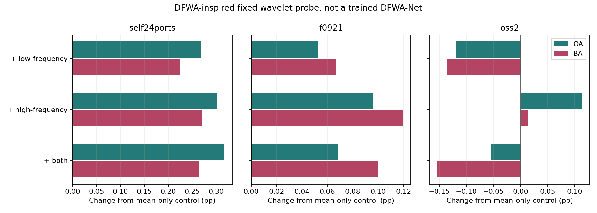

# DFWA-Net 启发的小波信息探针：结果与下一步

日期：2026-10-09。

**这篇论文有用，而且本轮已经获得一组可继续发展的实测信号：固定高频统计在两个自建数据集上补充了现有平均表征；OpenSARShip 2.0上的信号很弱。低频与高频不宜不加区分地混在一起。** 这不是已复现DFWA-Net，也不是已经训练完成的小波注意力模块。

## 1. 文献借鉴的准确范围

DFWA-Net发表于IEEE GRSL，2025，DOI `10.1109/LGRS.2025.3601026`。已读用户提供PDF全部5页，并渲染检查图1–3与消融表。

论文的双域是**空间域与小波域**，不是跨港源域/目标域。原任务是SSDD/HRSID单类舰船检测，我们是少量目标标签下的跨港八分类。不能把检测AP当成分类OA/BA。

最有用的思路是：空间特征保留主干；小波域通过WSA先做子带内建模、WRA再做跨子带交互；经iDWT后与空间域融合。DDF提供动态选择思想，但正文硬比较的门控训练细节不完整，官方仓库当前未取得；不能冒称采用了官方实现。

详细拆解见 `PAPER_ASSESSMENT_ZH.md`，代码可访问性和实现边界见 `OFFICIAL_CODE_REVIEW_ZH.md`。

## 2. 本轮真正实现的内容

在现有VV/VH显示输入上提取两层Haar小波，4x4局部网格统计，四个显示旋转方向平均：LL低频均值64维、轴向和对角高频RMS128维，共192维。使用PyWavelets1.9.0，仅在原ClearSAR实验环境安装该包，未升级其他依赖。

不是在任意排序的128维隐向量上做小波，也没有用高频等同纯噪声。输入仍是128像素uint8显示图，不是定标后的SAR散射强度。固定网格能提供粗略局部结构，但不等于船体分割。

流程：

```text
VV/VH显示图 --> 两层Haar --> 低频网格统计 / 高频网格统计
                                      |
原C4表征 --> 源域标准化和单位化 ------+--> 条件支持核 --> 同64标签残差适配
                                      |
细长程度/中心突出度无标签条件 ----------+
                                         --> 原专家/门控/5%交接 --> 八分类
```

已有平均表示与新增小波块各单位化，再等权组合，总核对角线尺度保持一致。小波归一化只用各任务原有、已排除目标的源样本。目标标签和支持索引与前轮相同。

本轮所有任务统一使用固定补偿强度0.25，来自前轮源任务的共同选择，不按本轮目标结果搜索。**因此24港的平均特征对照不是上一轮逐港分别选择0/0.25/1的版本，不能混用两个版本的数字。**

主实验比较原C4基线、平均特征、平均+低频、平均+高频、平均+全部频段。另做减半平均分支对照，区分加入小波信息与把原平均分支权重减半。没有全局置乱、FUSAR、OSS1或通用域实验。

## 3. 完整模型结果

| 数据集 | 固定强度平均特征对照 OA/BA | 平均+高频 OA/BA | 高频相对平均对照 ΔOA/ΔBA |
|---|---:|---:|---:|
| 自建24港，23港等权 | 61.9889 / 53.6589 | 62.2901 / 53.9302 | +0.3012 / +0.2714 |
| F_0921 | 30.8931 / 26.2879 | 30.9892 / 26.4077 | +0.0961 / +0.1197 |
| OpenSARShip 2.0 | 34.3385 / 31.9526 | 34.4526 / 31.9665 | +0.1141 / +0.0139 |

单位：准确率为%，差值为百分点。

相对更早的原C4适配基线，高频版本完整模型增量分别为：24港 +0.8452/+0.3561；F_0921 +0.2745/+0.1736；OpenSARShip 2.0 +0.9508/+0.2319。但其中包含平均特征校正已有的收益，不能全部算给小波。

与平均对照相比，24港五次抽样OA/BA均提高；F_0921 OA4/5次提高、BA5/5次提高；OpenSARShip 2.0两项均3/5次提高。24港按港均值，OA15港提高、6港下降、2港不变，BA15港提高、8港下降。

固定强度0.25下的其他频段增量：

| 新增内容，相对平均特征对照 | 24港 ΔOA/ΔBA | F_0921 ΔOA/ΔBA | OpenSARShip 2.0 ΔOA/ΔBA |
|---|---:|---:|---:|
| 低频 | +0.2688 / +0.2251 | +0.0525 / +0.0667 | -0.1195 / -0.1365 |
| 高频 | +0.3012 / +0.2714 | +0.0961 / +0.1197 | +0.1141 / +0.0139 |
| 全部频段 | +0.3178 / +0.2650 | +0.0682 / +0.1001 | -0.0543 / -0.1544 |



## 4. 为什么认为新增信息值得继续研究

组合核是 `0.125*Kmean + 0.125*Kwavelet`；单独把平均核从0.25降至0.125，是一个直接的强度对照。高频版本相对该减半对照的完整模型增量为：

| 数据集 | ΔOA | ΔBA |
|---|---:|---:|
| 24港 | +0.5491 | +0.2963 |
| F_0921 | +0.1859 | +0.1430 |
| OpenSARShip 2.0 | +0.4618 | -0.0146 |

因此，两个自建数据集的BA收益不能仅解释为减少平均分支的强度；确有新增高频描述参与校正的正信号。OpenSARShip 2.0相对该对照BA略负，不支持“高频在所有数据集上都改善类均衡”的结论。也尚未证明同样自由度的其他描述符不会达到相近结果。

五次累计纠错/误改事件，高频相对平均对照为：24港1,258/981；F_0921为3,973/3,380；OpenSARShip 2.0为108/87。这些不是独立船舶数，不直接对应等港或等类别加权差值。

## 5. 哪些类别受益，哪里仍失效

24港逐类跨有该类港口等权后，八个类别的平均召回差均为正，其中原油轮约+0.7198pp、拖轮+0.2899pp、杂货船+0.2739pp。该口径与先算每港BA再等港汇总不同；不能再平均逐类值去复原总体BA，更不能说每个港的每类都提高。

F_0921中，成品/化学品油轮+0.7933pp、原油轮+0.4247pp、拖轮+0.3356pp、海工补给船+0.1544pp；散货船-0.4836pp。不同船型确实没有均衡受益。

OpenSARShip 2.0中，高频使集装箱船+0.7525pp、原油轮+0.6878pp、拖轮+0.5333pp，但海工补给船-1.1329pp，渔船-0.3324pp。这使总体BA增量接近零。低频版本的纠错少于误改（87/109），且对减半平均对照仍降BA约0.1650pp，故不能只归咎于原分支被稀释。

**已经定位：不同子带统计造成不同的类别边界变化；尚未证明：低频负迁移具体来自背景、亮度、尺度还是支持覆盖。** 不把未验证的物理解释写成根因。四个实现测试检查了高低频响应、能量守恒、C4旋转一致性、极化顺序、组合核尺度以及源统计不受目标改变；25个任务的主实验与减半对照都精确回放原C4基线，当前没有发现这些方面的接入错误。

## 6. 下一步应怎样开发

建议沿用DFWA的“子带分开处理，再做交互和融合”思想，优先发展**支持证据约束的子带补偿**：

1. 保留当前平均表征主干，先把高频作为候选补充，不全局删除低频，也不把全部子带固定等权加入。
2. 下一轮在源任务中学习低/高频的可靠性与融合强度，目标端仅用原64标签适配；重点保护支持不足的类别，不根据本轮目标表手工指定船型权重。
3. 若需要更强表示，再在保留空间位置的浅层特征图上实现可学习WSA/WRA式分组；本轮固定统计的结果不能替代这一步，也不能把未来可学习模块的收益预先记账。
4. 采用可导软融合时明确它是我们的实现选择，而非宣称复现了论文DDF。相较原检测论文的实质差异，应体现在跨港、少量标签、类别可靠性与预算交接的联合问题上，而不是更换模块名称。

这是可继续推进的方向，不要求绝对原创；但本轮只获得初步信息价值证据，未证明新的因果不变量或顶刊级核心机制。

## 7. 交付与状态

- `features/`：三组数据共165,325张输入的小波缓存和样本索引，避免重复读图。
- `targets/`：五个主实验模式的完整预测、支持索引、查询掩码、源归一化参数。
- `half_mean_control/targets/`：另存的减半强度对照；实际强度0.125，见 `HALF_MEAN_CONTROL.json`。
- `summary.csv`、`draw_metrics.csv`、`task_means.csv`、`class_metrics.csv`、`event_summary.csv`：可追溯数值。
- `PAPER_ASSESSMENT_ZH.md`、`OFFICIAL_CODE_REVIEW_ZH.md`：原文方法对照及实现边界。

所有实验已完成，无训练进程遗留。当前主模型和稿件未替换。全部仍属历史研发数据，外部已有模型不完全同构；不是独立新数据确认。5%限制专家交接，不能代表全部计算开销。
