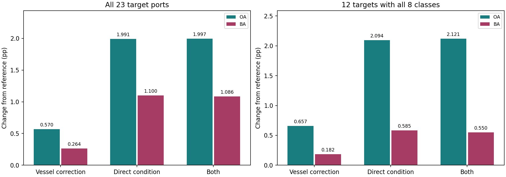

# 同船响应校正与直接条件输入：同信息对照

2026-10-09。固定四方案、23目标港、原5组64标签、5%交接。所有目标预测先冻结再统一评价，原主模型保持不变。

## 要回答什么

有入射角带来收益，不自动说明同船配对学到的响应有额外价值。本轮比较原联合版本、同船校正、直接条件输入，以及二者结合。原方案和校正方案直接复用已冻结结果，另外两组重新拟合源分类头与原同组64标签适配。
四组条件可用性相同，t=(angle-38)/5及t平方，缺失时两维置0；无额外缺失指示或角度插补。同船校正仍用既有源同船回归的角度分量，强度1。
直接条件方案在两个源分类头增加独立的两维条件系数，源岭回归强度1；基础适配追加u/sqrt(2)，专家核追加0.25*u*u_support.T/2，适配岭参数仍为8。权重固定，未搜索。
这里的同信息指推理侧入射角字段与标注预算一致；同船校正训练另使用源船身份与位置配对。不是等参数或等假设空间对照。直接条件增加自由系数；同船校正还改变视觉度量的交叉项，不能仅凭胜负唯一识别物理去噪机制。门控参数、几何、骨干、R18和原标注/交接预算均保持一致。

## 完整识别

OA/BA先按每港5组划分平均，再按港等权。23港共享八个输出类别，但不是每港八类齐全；另外报告八类齐全12港。BA平均查询实际出现类别召回。

| 目标范围 | 方案 | OA (%) | BA (%) | 相对原OA变化pp | 相对原BA变化pp |
|---|---|---:|---:|---:|---:|
| all23 | 原联合版本 | 58.3361 | 51.0838 | +0.0000 | +0.0000 |
| all23 | 同船响应校正 | 58.9059 | 51.3476 | +0.5698 | +0.2638 |
| all23 | 直接输入入射角 | 60.3271 | 52.1842 | +1.9910 | +1.1003 |
| all23 | 校正+直接条件 | 60.3326 | 52.1696 | +1.9965 | +1.0857 |
| all8_target12 | 原联合版本 | 43.8109 | 38.5449 | +0.0000 | +0.0000 |
| all8_target12 | 同船响应校正 | 44.4682 | 38.7274 | +0.6573 | +0.1824 |
| all8_target12 | 直接输入入射角 | 45.9054 | 39.1294 | +2.0945 | +0.5845 |
| all8_target12 | 校正+直接条件 | 45.9318 | 39.0947 | +2.1209 | +0.5498 |

## 最重要的机制比较

| 比较 | 23港OA差pp | 23港BA差pp | OA提高港数 | BA提高港数 |
|---|---:|---:|---:|---:|
| correction_given_direct | +0.0055 | -0.0146 | 13/23 | 10/23 |
| correction_without_direct | +0.5698 | +0.2638 | 19/23 | 14/23 |
| direct_given_correction | +1.4267 | +0.8219 | 20/23 | 14/23 |
| direct_minus_correction | +1.4212 | +0.8366 | 21/23 | 15/23 |
| direct_without_correction | +1.9910 | +1.1003 | 22/23 | 15/23 |

correction_given_direct检验已直接输入入射角后，同船校正还增加多少收益；direct_minus_correction直接比较两种利用同一信息的方式。

## 标注划分差异

| 划分 | 方案 | 港均OA (%) | 港均BA (%) |
|---|---|---:|---:|
| 0 | 校正+直接条件 | 60.3193 | 51.7868 |
| 0 | 直接输入入射角 | 60.3436 | 51.8997 |
| 0 | 原联合版本 | 58.4844 | 51.0678 |
| 0 | 同船响应校正 | 59.2422 | 51.7032 |
| 1 | 校正+直接条件 | 59.1643 | 52.1035 |
| 1 | 直接输入入射角 | 59.1041 | 51.9885 |
| 1 | 原联合版本 | 57.1211 | 50.7734 |
| 1 | 同船响应校正 | 57.9684 | 51.2297 |
| 2 | 校正+直接条件 | 60.8627 | 52.8288 |
| 2 | 直接输入入射角 | 60.9034 | 52.9467 |
| 2 | 原联合版本 | 58.1206 | 51.6488 |
| 2 | 同船响应校正 | 58.7164 | 51.8389 |
| 3 | 校正+直接条件 | 61.2433 | 51.8590 |
| 3 | 直接输入入射角 | 61.1428 | 51.7552 |
| 3 | 原联合版本 | 59.5027 | 50.9586 |
| 3 | 同船响应校正 | 59.7717 | 50.9235 |
| 4 | 校正+直接条件 | 60.0734 | 52.2697 |
| 4 | 直接输入入射角 | 60.1416 | 52.3309 |
| 4 | 原联合版本 | 58.4515 | 50.9706 |
| 4 | 同船响应校正 | 58.8307 | 51.0428 |

## 保留的边界

这是重复使用的开发数据，不是独立确认；候选选择来自历史研发。固定门控没有随新接收模型重训，因此另存基础/专家指标区分接收模型与路由变化。不能把平均提点写成所有港都提高，也不能把同信息对照写成已经证明因果漂移。
5项新增测试覆盖相同条件编码、原变换保留、零条件源拟合复现、独立原始空间加权岭公式及零条件预测复现。所有23港原方案/校正方案首组分数重放误差见verification.csv。

逐港数值见port_means.csv，配对差异见paired_effects.csv，逐类召回见class_recalls.csv。结论与处置见DECISION_ZH.md。

