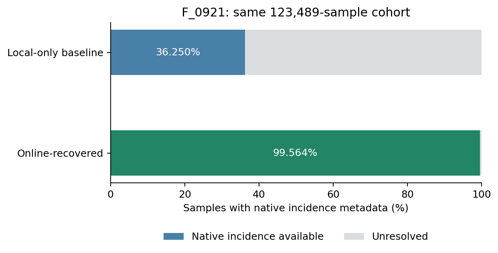

# F_0921入射角在线恢复

日期：2026-10-10。原36.25%版本和实验完全保留。

## 结果

| 项目 | 数值 |
| --- | ---: |
| 固定目标队列 | 123,489 |
| 恢复前有效角度 | 44,765（36.25019%） |
| 恢复后有效角度 | 122,950（99.56352%） |
| 新增有效角度 | 78,185 |
| 剩余缺失 | 539 |
| 保存的在线产品网格 | 12,872 |

## 如何恢复

1. 从既有采集记录取得卫星编号、观测开始时间和产品末段编号，按日期查询公开Sentinel-1 GRD目录。只接受三者精确匹配的完整产品名。
2. 下载对应annotation/iw-vv.xml的HTTP Range片段，提取完整geolocationGrid。优先取文件尾256KiB，不足时扩大；不下载measurement影像。
3. 直接解析原生latitude、longitude、incidenceAngle，用现有逐船经纬度在对应网格凸包内插值。没有场景平均角度替代、没有越界外推、没有新增目标标签。
4. 保存原XML网格压缩片段、产品URL、HTTP Content-Range及下载时间。旧有44,765条有效角度保持不变。

成功缓存网格记录的接收量为3.374 GB；不含目录、验证、失败和重试请求，不作为精确网络总流量。

验证实物：首个完整XML为1,584,014字节；262,144字节的尾部请求得到210个网格点，与完整XML解析结果逐项完全相同。最终逐样本ID顺序及旧有效角度保持不变的检查通过。

## 剩余项

- outside_grid: 389条。
- ambiguous_acquisition: 139条。
- missing_remote_grid: 11条。

两个公开镜像缺口已通过ASF目录确认精确完整产品名；对应11条样本的原生网格未获取，ASF元数据端点返回401，未提供凭据或使用其他场景替代。详见catalog_fallback.json。
坐标歧义另外核对了原生MMSI/经纬度记录；139条中113条没有唯一匹配，26条匹配到两个采集时刻，故没有凭旧行号任选一次采集。该限制仅影响角度来源归属，不用它解释分类性能。
outside_grid只表示船只查询位置不在对应原生网格凸包内，保持缺失；没有为凑覆盖率外推角度。

## 文件

- f0921_incidence.csv：新版本逐样本角度。
- COVERAGE.json：覆盖率与状态统计。
- download_inventory.csv：在线文件来源。
- coverage_transitions.csv：原状态到新状态。
- remaining_samples.csv：剩余样本。
- grids/和xml_grid/：数值网格及原始XML片段。
- ../incidence_recovered_experiment_20261010/：同64标签、固定超参数的新覆盖对照。

## 来源

- AWS Open Data Registry: https://registry.opendata.aws/sentinel-1/
- 数据结构文档: https://roda.sentinel-hub.com/sentinel-s1-l1c/GRD/readme.html
- 公开对象目录: https://sentinel-s1-l1c.s3.amazonaws.com/
- ASF目录: https://api.daac.asf.alaska.edu/services/search/param
