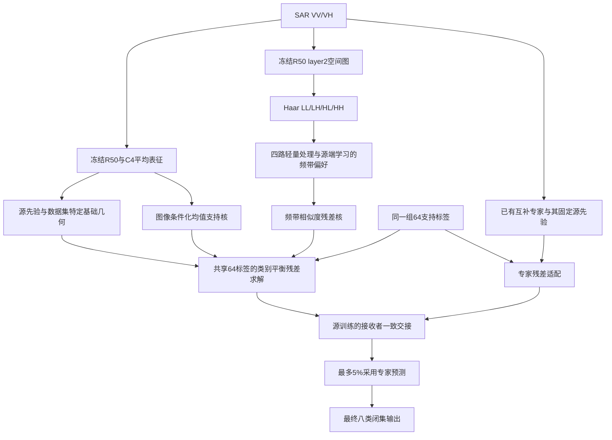

# 研究收口：固定主方案，保留有效扩展，停止频带选择器搜索

日期：2026-10-10。状态：本轮研发已完成。25任务、125组支持抽样及最终原因分解全部结束，不再追加新选择器、阈值网格或神经训练。文献方法核读、指标和固定版本入口一并归档。

同日按用户“补对比实验”要求完成独立验证批次，主模型仍冻结。新增的是强基线、预算重放和比较方法的源端元头训练，不是重启主模块研发。[补测报告](E:/Hermes/paper_tracking/sensitivity/frozen_comparison_20261010/FINDINGS_ZH.md)显示：同5%预算下现有路由优于简单随机/置信度排序，但不限预算的全量融合在三个集合OA/BA均更高。不得据早期收口表述声称5%绝对精度最高或已证明节省算力。完整公开SAR与OvA方法比较仍有缺项。

## 1. 最终决定

**正文主版本保留已完成验证的“条件支持校正 + 可学习分频残差 + 原专家预算交接”，即 learned_frequency_residual_20261009 的 selective。** 最新校准器保留为BA取向扩展，不覆盖主版本。近期局部正结果进入消融和机制分析，不按每个数据集事后挑最好候选拼成主模型。

这个决定不是说近期探索没有价值：我们已区分“存在互补纠错机会”“选择器能识别机会”“完整交接系统能兑现收益”三个不同环节。保护、连续证据、二类margin及最终校准分别补充了这些环节的证据，但尚未形成同时优于已有各项结果的新统一主方案。

## 2. 本轮参考了哪些研究

五篇最接近的方法已整理到 RELATED_WORK_ZH.md，并提供 references.bib：

1. Mozannar与Sontag，ICML2020，Consistent Estimators for Learning to Defer to an Expert。
2. Verma与Nalisnick，ICML2022，Calibrated Learning to Defer with One-vs-All Classifiers。
3. Verma等，AISTATS2023，Learning to Defer to Multiple Experts。
4. Cruz等，Pattern Recognition2015，META-DES。
5. Jitkrittum等，NeurIPS2023，When Does Confidence-Based Cascade Deferral Suffice?

借鉴的主线是：选择应围绕候选之间的预期纠错收益；多个候选可以同时正确，不宜把各自正确性当成互斥类别概率；平均置信度与是否值得交接是两件事。已有研究是设计依据，不意味着在我们的64标签跨港协议中必然有效。七参数拟合只是借鉴后的有界实现，不是上述论文完整复现，更不继承其一致性、校准或共形覆盖定理。

## 3. 最后一个对照及结果

本轮只增加一臂：使用64个支持案例的主头/四频带严格留一分数，拟合两个共享置信度斜率、四个收缩频带偏置和一个截距，共7参数。每个标签展开五条相关记录，每条训练权重除以五，总权重仍64。编码器和频带神经头不新训练，校准器目标查询标签不可见。

需要区分：基础/频带支持分数是LOO；校准器用这64组OOF分数及标签作元拟合，不是嵌套LOO评估校准器，也不是新增独立校准集。推理比较频带与主模型的估计正确性差，阈值固定0，外层专家仍最多接手5%。采用已有preserved头意味着部署扩展时需额外保留这一套头，不能称整个系统只增加7参数或没有额外计算。

源验证只在原主模型和新增校准臂间接受/拒绝，目标成绩不参与选择。以下为完整模型OA/BA百分数，增量为百分点：

| 数据集 | 固定主版本 OA / BA | 本轮源选择扩展 OA / BA | OA增量 | BA增量 | BA正增益抽样 |
|---|---:|---:|---:|---:|---:|
| 自建24港（23任务） | 63.2084 / 54.2383 | 63.3049 / 54.3111 | +0.0965 | +0.0728 | 4/5 |
| 自建 F_0921 | 31.1072 / 26.3593 | 31.0316 / 26.4011 | -0.0755 | +0.0417 | 3/5 |
| OpenSARShip 2.0 | 35.3545 / 32.3724 | 35.3545 / 32.3724 | 0 | 0 | 完全回退 |

24港10任务启用校准、13任务保留主模型；F_0921启用，OSS2拒绝。若强制所有任务启用，三个数据集完整BA分别54.2098、26.4011、32.1760，对主版本为-0.0284、+0.0417、-0.1965。因此不能省略源端接受/回退，更不能只报告校准器的正结果。

源选择扩展在24港的BA仅比更早standalone_local的54.3053高0.0058；F_0921的26.4011低于已有连续证据的26.4887，OSS2回退值也低于已有候选。它是可记录的BA取向结果，不是全面刷新。

## 4. 为什么有些地方有用，有些没有

### 动态判断并非在所有数据上优于固定偏好

用每个任务/支持抽样已拟合的频带身份偏置构造固定优先级，去掉查询置信度对内部选择的影响。保留相同源端启用规则及原校准版本的外层交接位置，只作机制干预，不生成新的部署候选。

| 数据集 | 动态判断比固定偏好多出的完整BA（固定相同路由） |
|---|---:|
| 24港 | +0.02835 |
| F_0921 | -0.05034 |
| OSS2 | 0，源端均拒绝启用 |

24港确有一部分增益需要查询相关信息，不能全部说成静态频带偏好；F_0921则是动态部分损失了一些固定偏好收益。此控制冻结了原交接位置，不代表固定偏好重新路由后的可部署成绩，也不是新规则选择依据。

### 平均正确性接近，不等于能辨别哪个候选更会纠错

F_0921主模型在真实评估集合上的类平衡正确性为0.26035，校准器平均估计为0.25944，均值接近；但其“救回/误改”事件上的相对收益AUC仅0.4883。24港和OSS2相应AUC为0.4901、0.5027，也没有优于之前连续证据。

这是本轮最直接的失效定位：低参数正确性拟合能得到接近的平均量，但尚不能可靠地区分相近候选在具体查询上的纠错差异。不能因为用了sigmoid和适当损失，就宣称输出已在目标域正确校准或风险得到保证。本文记录的是观察到的估计能力边界，不将其泛化为绝对定律。

### 外层交接与基础分类仍有交互

源选择扩展相对主版本的完整BA变化，可分为固定原主模型交接名单时的分类变化，加上重新路由变化：

- 24港：-0.02469 + 0.09753 = +0.07283。
- F_0921：+0.01151 + 0.03024 = +0.04175。
- OSS2：均为0。

24港基础阶段本身BA +0.06802，但固定原交接名单时变负，再重新路由后恢复正增益。因此只看内部选择器或固定名单，都不能替代完整系统评估。这也是不将校准器单独包装成已经解决问题的核心新模块的原因。

## 5. 固定主版本怎样组成

论文可按四个功能部分组织，不把四个部分都称为独立原创算法：

| 部分 | 作用 | 收口定位 |
|---|---|---|
| A 源先验锚定的共享预算适配 | 保留源类别先验，基础与专家共享同一64目标标签，拟合类别平衡残差 | 稳定框架基础 |
| B 条件化支持证据 | C4平均表征及源几何构成基础核，图像条件调节查询与支持案例的相关性 | 保留，有匹配对照 |
| C 源任务训练的分频残差 | R50空间图经Haar四带、独立轻量处理、学习频带偏好，进入同一支持求解器 | 本阶段主要表征增量 |
| D 接收者一致的预算交接 | 读取适配后基础与专家输出，按资格/收益排序，交接不超过5% | 保留原主线 |

流程如下：

这里的频带是空间特征图分解，不是新增雷达射频观测。学习门控主要形成任务级频带偏好，已有均值门控替换实验几乎不改变输出；正文不应称其为已验证的灵活动态注意力。

**数据集接口边界必须保留。** 24港主版本的基础几何包含已固定的候选稳定/漂移坐标处理及入射角条件；外部F_0921/OSS2沿用各自源PCA基础几何和已保存联合专家。三个集合共用条件/分频残差接口，不是所有上游模块、维数和物理输入完全相同。不能声称完整24港几何已原样跨数据集验证。

5%约束专家预测接管的数量，不代表只对5%计算专家特征，更不能直接声称节省95%算力。当前两路/频带输出已预计算。C4数字旋转也不是改变真实雷达观测方向。

## 6. 保留、补充、停止

| 内容 | 位置 | 原因 |
|---|---|---|
| 条件支持校正与可学习分频主版本 | 正文主模型 | 三个当前SAR任务有完整匹配证据，机制相对清楚 |
| standalone_local轻量专门化 | 补充/消融候选 | 三集平均BA有小增益，但支持抽样稳定性有限 |
| 独有纠错保护 | 机制分析 | 目标端保留和互补机会扩大确有证据，完整净增益未兑现 |
| 连续支持证据 | 扩展实验 | F_0921和OSS2有小正结果，24港不一致 |
| 二类margin条件化 | 扩展实验 | 24港相同阈值对照有小正信号，不是统一赢家 |
| 最后七参数校准与源端回退 | BA取向扩展 | 24港及F_0921 BA提升，F_0921 OA下降；无校准保证 |
| 单纯类别相关性加权及继续堆选择器 | 本轮停止 | 没有清晰新增收益，不加入主模型 |
| 更多阈值/注意力/损失搜索 | 本轮停止 | 已达到本轮收口目标，转向固定证据写作 |

之前暂停的FUSAR、OSS1扩展、通用域新实验及全局置乱不在本轮重新启动。历史结果留存，但不能替代当前固定主版本的对应数据集验证。

## 7. 论文该怎么讲创新

可采用的中心表述：**在少量目标标签与有限专家接管预算下，围绕基础模型和互补专家的部署一致适配，利用源任务训练的条件/频带证据增强识别，并区分可用互补信息与实际可兑现交接收益。**

区别不在于首创小波、岭回归、专家选择或sigmoid校准，而在于这些信息如何进入同一个真实少样本求解和有限交接过程，以及用匹配实验揭示何种证据能增加判别能力、何种额外选择反而不能兑现收益。新模块应由独立增量和机制证据支撑，不能靠命名凑四项原创。

允许写：源端知识/几何、部署求解器对齐、条件支持校正、分频残差信息、有限预算交接，以及相应作用边界。

不写成已证明：纯因果不变量、纯噪声漂移提取、所有频带学会不同物理散射因素、动态注意力普遍有效、正式风险/共形保证、各类各港普遍受益、顶刊创新已被自动满足。

这是可转入论文写作的研发收口，不等于已完成投稿所需全部比较或保证顶刊录用。已有数据反复参与开发；五组支持抽样不是五个训练种子，F_0921有历史无标签编码器接触，不称独立盲外测。

## 8. 固定交付与复核入口

- [COMPARISON_SCOPE_ZH.md](E:/Hermes/paper_tracking/sensitivity/frequency_closeout_20261010/COMPARISON_SCOPE_ZH.md)：现有方法对比、预算对比与自身消融的已完成/待补范围。研发收口不等于论文对比实验齐备；旧版预算和旧缓存基线不能混入当前主表。
- [INTERPRETABILITY_ZH.md](E:/Hermes/paper_tracking/sensitivity/frequency_closeout_20261010/INTERPRETABILITY_ZH.md)：主模型逐项决策解释、已有六张正负案例、信息干预证据和未解决的解释边界。可解释性纳入收口；不将分数归因写成物理因果，也不为此重启模型搜索。
- FREEZE.json：主版本、扩展、数据范围、预算和禁止混算项。
- FINAL_MODEL_TABLE.csv：固定主模型、最终BA扩展、历史候选的完整数值和原始位置，不使用事后跨数据集拼接。
- summary.csv、draw_metrics.csv、class_metrics.csv：最终对照的全结果。
- fixed_preference_summary.csv：固定偏好的同路由干预。
- utility_summary.csv、correctness_summary.csv：相对收益排序和正确性估计诊断。
- RELATED_WORK_ZH.md、references.bib：五篇一手相关研究及阅读记录。
- DESIGN_ZH.md、PROTOCOL.json：运行前设计；EXPERIMENT_REPORT_ZH.md：预设所有模式。

本轮4项新校准测试通过，原参考预测与源选择一致性验证通过。全部25任务的预测冻结后才读取目标查询真值；无需再跑训练来完成这次收口。
