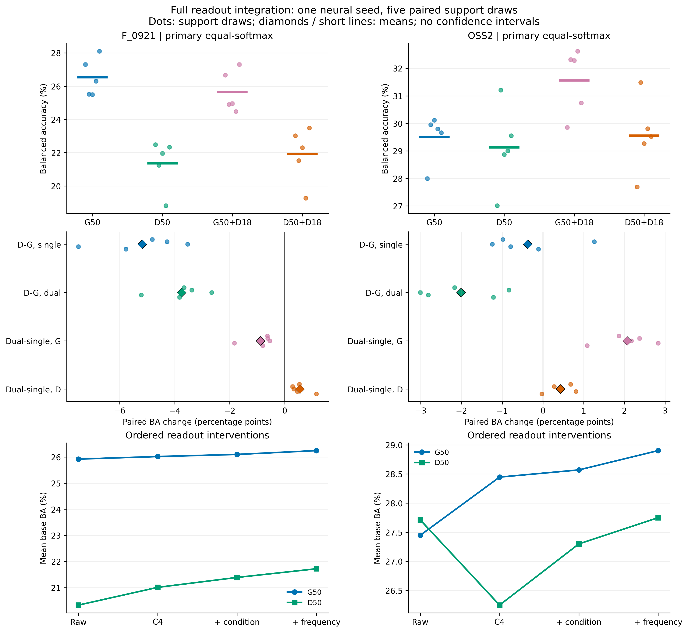

# 通用/领域骨干：完整外部读出配平实验

本轮比较 G50/D50 × 单路/固定同一D18双路。主结果为预先固定的等权 softmax 融合；统一核/先验读出为次要结果，不按目标成绩另选读出。以下均为原5组64标签支持抽取的均值。

- F_0921：D50单路相对G50单路 ΔOA -3.636、ΔBA -5.182 个百分点（BA正向 0/5）；在D50上加入D18后 ΔOA +0.614、ΔBA +0.552 个百分点（BA正向 5/5）。
- OSS2：D50单路相对G50单路 ΔOA +1.798、ΔBA -0.376 个百分点（BA正向 1/5）；在D50上加入D18后 ΔOA +0.636、ΔBA +0.428 个百分点（BA正向 4/5）。

## 四组主比较与次要读出

| 数据 | 骨干 | 主OA % | 主BA % | 统一OA % | 统一BA % |
| --- | --- | --- | --- | --- | --- |
| F_0921 | G50 | 30.466 | 26.547 | 30.520 | 26.404 |
| F_0921 | D50 | 26.830 | 21.365 | 26.885 | 21.320 |
| F_0921 | G50+D18 | 30.210 | 25.666 | 30.283 | 25.565 |
| F_0921 | D50+D18 | 27.445 | 21.917 | 27.474 | 21.868 |
| OSS2 | G50 | 31.986 | 29.503 | 32.073 | 29.351 |
| OSS2 | D50 | 33.784 | 29.127 | 33.942 | 29.329 |
| OSS2 | G50+D18 | 34.127 | 31.565 | 34.567 | 31.840 |
| OSS2 | D50+D18 | 34.420 | 29.555 | 34.741 | 29.817 |

单路也保留 base 与 original-view expert 两个头；不是删掉完整算子的弱单路。两组双路共用冻结的源域SSL D18。单路 retained/discarded 分别按128/2048维归一化，双路按192/2560维归一化。

## 配对误差流

下表均为“后者减前者”。救回=原错后对，误伤=原对后错；BA救回/误伤先在每个查询类别内除以其样本数，再对查询中出现的类别等权平均，因此每组抽取严格满足 ΔBA=救回BA-误伤BA。数量是每组抽取的均值，不是独立船舶数。

| 数据 | 对照 | ΔOA pp | ΔBA pp | OA正向 | BA正向 | 救回/误伤条数 | 救回/误伤BA pp |
| --- | --- | --- | --- | --- | --- | --- | --- |
| F_0921 | D50-G50，单路 | -3.636 | -5.182 | 0/5 | 0/5 | 12161.0/16648.8 | 8.708/13.889 |
| F_0921 | D50-G50，固定D18双路 | -2.766 | -3.749 | 0/5 | 0/5 | 11223.4/14637.0 | 8.182/11.931 |
| F_0921 | 加入D18，G50固定 | -0.256 | -0.881 | 2/5 | 0/5 | 4198.2/4514.0 | 2.976/3.857 |
| F_0921 | 加入D18，D50固定 | +0.614 | +0.552 | 5/5 | 5/5 | 3168.6/2410.2 | 2.434/1.882 |
| OSS2 | D50-G50，单路 | +1.798 | -0.376 | 5/5 | 1/5 | 488.4/422.2 | 11.185/11.560 |
| OSS2 | D50-G50，固定D18双路 | +0.293 | -2.011 | 2/5 | 0/5 | 387.2/376.4 | 8.446/10.456 |
| OSS2 | 加入D18，G50固定 | +2.141 | +2.063 | 5/5 | 5/5 | 219.4/140.6 | 5.699/3.636 |
| OSS2 | 加入D18，D50固定 | +0.636 | +0.428 | 4/5 | 4/5 | 78.6/55.2 | 1.803/1.375 |

逐次配对值及正向抽取数见 paired_deltas.csv；主/次要与阶段对照的完整误差流见 errorflow.csv。perclassdelta.csv 保留元数据中的类别名称、逐类召回变化及其BA贡献，包含全部负变化。

## 阶段与频率诊断

| 数据 | 骨干 | 原视图BA | C4 BA | +条件BA | +频率BA | 无频率单路BA | 无频率双路BA | 频率Δ单路 | 频率Δ双路 |
| --- | --- | --- | --- | --- | --- | --- | --- | --- | --- |
| F_0921 | G50 | 25.921 | 26.018 | 26.099 | 26.245 | 26.516 | 25.596 | +0.031 | +0.070 |
| F_0921 | D50 | 20.328 | 21.008 | 21.388 | 21.719 | 21.194 | 21.760 | +0.171 | +0.157 |
| OSS2 | G50 | 27.448 | 28.447 | 28.570 | 28.902 | 29.179 | 31.385 | +0.324 | +0.180 |
| OSS2 | D50 | 27.712 | 26.250 | 27.300 | 27.750 | 28.980 | 29.362 | +0.147 | +0.193 |

阶段变化是按固定顺序干预的计算结果，可能含交互；不能当作相互独立的因果贡献。频率分支以base支持校正任务训练，不等于对最终双头融合进行了端到端优化。

## 实施与边界

- 源池为两套外部任务共同允许的 28,856 行；PCA、尺度与全部分类先验重新拟合，频率分支固定训练 6 轮，eta=0.25、beta=0.25，源ridge1/支持ridge8。
- 原视图/C4 R50及D18均在本次 consistent_replay 中重新提取，统一 deterministic=True、benchmark=False、TF32关闭；读取的是当前CACHE，未混用旧GAP/频率特征。旧尝试保留，旧SSL检查点仅作为冻结编码器初始化。
- 已修复实现问题：源缓存map在Haar前由bf16经half转为float32，目标曾直接用bf16做Haar，导致训练/推理算术不一致。frequency_embedding现统一在Haar前转float32，目标与计时路径同步修正并加入回归测试。修正前G/OSS2特征归档于pre_haar_alignment，F未完成特征重新提取；没有已完成预测受影响。这是数值路径修正，不是已证实的模型增益或历史退化根因。
- 输入为112像素 RGB=[VV,VH,均值]；G/D及单/双路输入权限配平。未复用历史F暴露R18，也没有重训历史监督layer4尾部。因此名称是“完整读出集成”，不是旧完整训练模型的等价复现。
- 神经种子仅 20261011 一个；5组支持抽取重叠，不能当成5个神经种子或独立重复。正向次数不是显著性检验。
- 全部配置预测冻结后才读查询真值；目标数据已有开发历史，不是独立确认集。源episode的PCA共享允许源池，频率训练episode不是独立验证；共享SSL编码器也不能直接声称严格23港LOPO。
- 历史模型的输入、训练与源池不同，跨历史表格相减不是受控增益。本报告不拼接历史成绩；任何双路收益只说明当前决策下的增量预测价值，不证明两路对应物理上互斥的线索或双骨干必需。

## 先验与核交叉诊断

直接列示 path_summary.csv；定义与测量范围以该实验协议为准。这里只展示原文件前12行，全部32行见CSV，未按收益筛选。

| dataset | contrast | cell | oa | ba |
| --- | --- | --- | --- | --- |
| f0921 | second_D | P0K0 | 26.8302 | 21.3652 |
| f0921 | second_D | P0K1 | 26.8542 | 21.4636 |
| f0921 | second_D | P1K0 | 27.4348 | 21.8565 |
| f0921 | second_D | P1K1 | 27.4447 | 21.9175 |
| f0921 | second_G | P0K0 | 30.4663 | 26.5469 |
| f0921 | second_G | P0K1 | 30.4817 | 26.5983 |
| f0921 | second_G | P1K0 | 30.1351 | 25.5569 |
| f0921 | second_G | P1K1 | 30.2104 | 25.6663 |
| f0921 | ssl_dual | P0K0 | 30.2104 | 25.6663 |
| f0921 | ssl_dual | P0K1 | 28.5307 | 25.3272 |
| f0921 | ssl_dual | P1K0 | 30.0302 | 22.8846 |
| f0921 | ssl_dual | P1K1 | 27.4447 | 21.9175 |

## 计算成本

直接列示 cost_summary.csv；定义与测量范围以该实验协议为准。

| dataset | batch | architecture | batch_ms | per_image_ms |
| --- | --- | --- | --- | --- |
| f0921 | 1 | dual | 41.6388 | 41.6388 |
| f0921 | 1 | single | 37.6907 | 37.6907 |
| f0921 | 16 | dual | 41.676 | 2.60475 |
| f0921 | 16 | single | 38.7543 | 2.42215 |
| oss2 | 1 | dual | 40.2168 | 40.2168 |
| oss2 | 1 | single | 36.1845 | 36.1845 |
| oss2 | 16 | dual | 38.8663 | 2.42914 |
| oss2 | 16 | single | 35.5695 | 2.22309 |

交叉组合是决策路径诊断，不自动等于可部署单骨干；计时不超出其实际覆盖范围解释，不将神经特征提取耗时称作端到端部署延迟。
