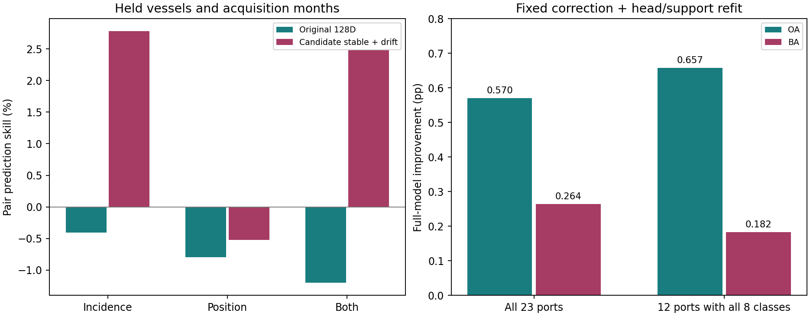

# 入射角相关漂移：识别与校正实验

2026-10-09。结论：发现可在留出船与留出月份上复现的入射角相关隐空间响应；固定条件校正使完整联合模型平均BA/OA同时小幅提高。它是有效候选，不是已识别的纯噪声或物理因果分量。

## 从哪里来

代表性SAFE的复用由原导出脚本明确记录，不适合逐产品读取时间和轨道。此次改用已有独立缓存：fetch_s1_grid.py通过完整产品编号访问公开AWS annotation，提取经纬度与入射角网格；现有sidecar按裁片位置插值。生产路径已核查，本轮没有重新逐景下载XML。
全38091行中28628行有获准位置来源和有效入射角，约75.16%。历史坐标、缺失坐标不填补。returned_georef_center是VV/VH均值或单可用视图的参考位置，不宣称两视图完全共注册。

## 识别流程

源数据排除目标港、目标身份和产品；按同港同MMSI相邻时相配对。用入射角及其平方的变化预测隐特征差，同时加入位置位移对照。固定保留约1/3船身份、3/6/9/12月份进行外推诊断。
在同时换船和换月份的诊断中，候选稳定/漂移联合空间的平均预测skill：入射角2.7805%，位置-0.5249%，二者联合2.4844%。联合比仅位置多3.0093个百分点；这不是分类BA/OA，也不是已确认的因果解释比例。入射角及联合模型在23个重叠源划分均为正。
仅换船的结果更弱：角度平均0.9187%，联合平均0.2886%，分别18/23和13/23为正。原128维保留特征的同时换船换月skill为负，未复制同样的泛化。23个源划分高度重叠，不是23项独立证据。

## 校正怎么接入

令t=(入射角-38)/5。源同船差分拟合得到角度/位置联合响应W，只取角度两行计算shift=[t,t^2]W_angle，校正z_new=z-shift。参考角度38度、强度1固定，不依据目标查询标签搜索；不删除整片子空间，不校正位置项。
通过既有线性映射将同一校正同步传到源/目标R50路径，重新拟合两个源分类头，并用原同一组64标签重新适配基础模型与专家。R18、骨干、几何及归一化不变。没有有效入射角的行不直接移动特征，但共享分类头变化仍可能改变其预测。
重算置信度与5%交接；原门控参数未重训。因此这不是全系统所有组件都重训的最终版本。基础和专家的独立指标也提高，收益不只是交接排名变化。全部23港预测冻结后才统一读查询标签评价。

## 完整八输出识别

先平均每港5组划分，再按港等权。23港并非每港都有八类；另外单列查询八类齐全的12港。BA按各查询集实际出现类别平均召回，不给模型目标类别真值白名单。

| 目标范围 | 方案 | OA (%) | BA (%) | OA变化pp | BA变化pp |
|---|---|---:|---:|---:|---:|
| all23 | reference | 58.3361 | 51.0838 | +0.0000 | +0.0000 |
| all23 | incidence_corrected | 58.9059 | 51.3476 | +0.5698 | +0.2638 |
| all8_target12 | reference | 43.8109 | 38.5449 | +0.0000 | +0.0000 |
| all8_target12 | incidence_corrected | 44.4682 | 38.7274 | +0.6573 | +0.1824 |

23港基础分支OA/BA分别提高0.6439/0.3437个百分点，专家分支分别提高0.3370/0.2578个百分点。平均交接数量仍为79，没有放宽预算。
OA逐港19升4降，BA逐港14升9降；5组标签划分的港均OA全部提高，BA为4升1降。Port Said的BA下降1.0036个百分点、Sydney Botany下降0.5571个百分点，不能称为所有港都有效。

| 港口 | OA变化pp | BA变化pp |
|---|---:|---:|
| Port Said | +1.3763 | -1.0036 |
| Sydney Botany | +0.5833 | -0.5571 |
| Tanger Med | +0.0998 | -0.2645 |
| Ningbo-Zhoushan | +0.0281 | -0.2349 |
| Shanghai | -0.1290 | -0.1769 |
| Antwerp-Bruges | -0.0487 | -0.1169 |
| New York | +0.4433 | -0.0929 |
| Fujairah | -0.2194 | -0.0341 |
| Rotterdam | +0.1179 | -0.0087 |
| Los Angeles | +0.1156 | +0.0228 |
| Port Klang | +0.1250 | +0.0498 |
| Richards Bay | +0.7647 | +0.1829 |
| Busan | +0.1487 | +0.2209 |
| Houston | -0.0811 | +0.2316 |
| Hamburg | +0.1929 | +0.2664 |
| Santos | +0.4893 | +0.4091 |
| Newcastle | +1.1064 | +0.4135 |
| Singapore | +0.2271 | +0.6268 |
| Qingdao | +0.7407 | +0.9369 |
| Callao | +1.4078 | +0.9554 |
| Port Hedland | +2.3396 | +0.9636 |
| Jebel Ali | +2.3358 | +1.6290 |
| Mombasa | +0.9412 | +1.6476 |

## 什么已经成立，什么还没有

- 已有证据：同船差分中的入射角相关响应可在部分严格留出组合中复现；源端拟合的固定响应校正在既有跨港识别流程中有平均正收益。
- 尚无证据：响应是纯随机噪声、入射角的无混杂物理因果效应、所有船型共享相同响应、或完整跨数据集泛化。船舶姿态、状态、背景等未测因素仍可能混杂。
- 入射角是外部条件信息，不是只凭原隐空间无监督发现因果变量。线性源分类头对校正特征的读出，也可等价写成原特征加受约束的角度条件项；因此收益还不能唯一归因为去除了物理噪声，而非利用了条件信息。
- 给定表示的响应留出验证，不是整个表示学习流程独立验证。既有几何使用了外层源留出船/月份；全部数据也属于历史开发数据。

## 实现与后续

19项针对性测试通过，覆盖身份/月划分、非线性差分、日期变更线位移、已知响应、缺失/参考角度恒等及原联合预测器重放。23港第一组支持划分的原分数重放误差均为0。
保留本候选和原主模型，不自动合并。下一步应优先区分条件信息收益与校正机制收益：同一入射角信息、同一标注预算下的直接条件读出对照，可回答同船响应估计是否提供额外价值；若要更强因果结论，还需要观测几何/姿态的更充分测量或受控成像干预。

详表：summary.csv、port_means.csv、metrics.csv、class_recalls.csv；识别阶段见../conditioned_vessel_drift_20261009/FINDINGS_ZH.md。

