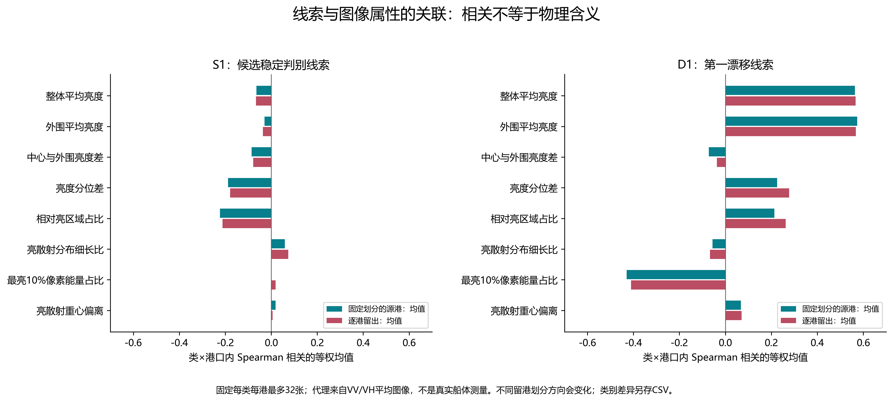
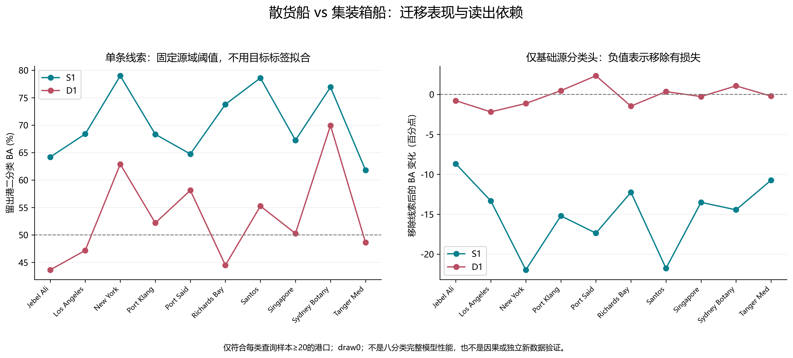
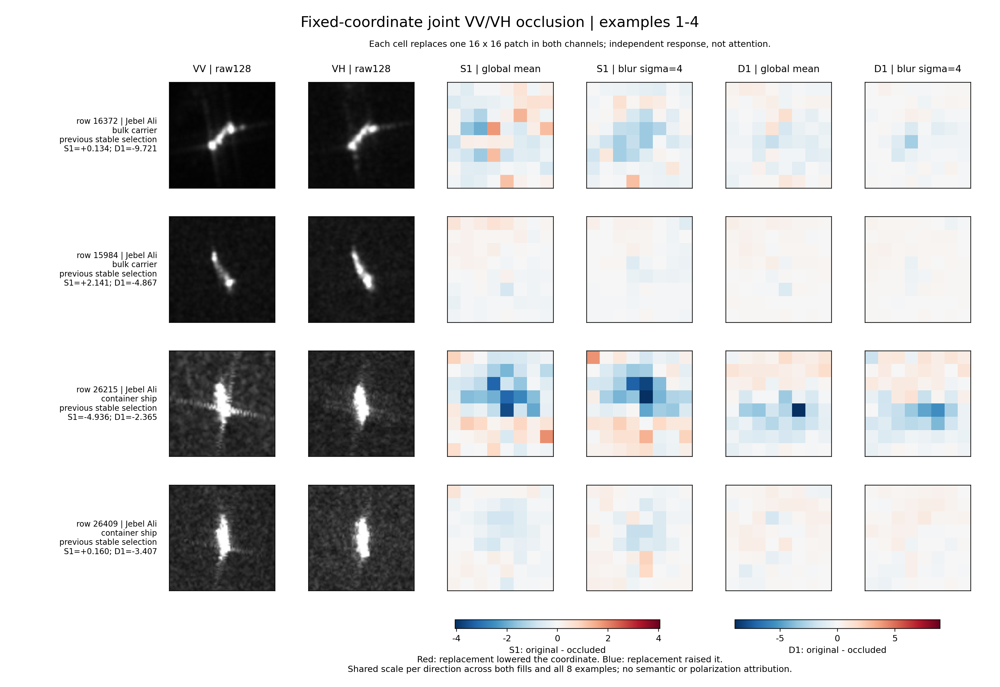

# 两条隐线索的行为说明书

日期：2026-10-08。基于现有24港开发数据；没有训练新主模型，没有更改论文主结果。

## 先说结论

这次已经不只是知道“某个隐空间有用”，而是得到两条具体线索的画像：

- **S1：候选跨港判别组合。** 它确实参与散货船与集装箱船的区分，拿掉后现有源分类头明显受损；但不能简单命名为船长、轮廓或亮度。
- **D1：整体及外围亮度相关的漂移线索。** 它与这些亮度属性的关联在留出港口上仍然存在，但不能认定它只看背景或是纯噪声。

这里的 S1、D1 各是一条固定规则得到的方向，不代表完整稳定或漂移子空间。S1 是先前已经选定的散货船/集装箱船候选判别方向，不是本轮按目标结果挑出来的；D1 是第一可分离漂移方向。候选空间不是严格不变空间。

## 说明卡一：S1 在看什么、有什么用

| 问题 | 当前证据 | 能说到哪一步 |
|---|---|---|
| 能否跨港区分船型？ | 10个符合条件的留出港口，单坐标固定源阈值 BA=70.29%，AUC=0.7941；各港 BA 均高于50% | 对这个船型对存在可迁移判别信息，不是完整八分类成绩 |
| 原模型是否在用？ | 基础源分类头的二分类 BA 从72.88%降至57.95%，平均下降14.93个百分点；10/10港均下降 | 已有读出确实依赖这条方向；不是整套模型重训后的消融 |
| 是否只是整体亮度？ | 留出港类内相关均值：整体亮度 -0.067，外围亮度 -0.036 | 没有发现强的单调亮度关联；不能因此排除非线性或混合依赖 |
| 是否对应亮散射形态？ | 相对亮区域占比相关 -0.212，分位亮度差 -0.179，亮散射细长比 +0.074 | 有一定散射分布关联，但不足以叫作“船体形状轴” |
| 作用位置？ | 中心与外围均有响应；按输入变化幅度归一化后，中心响应不再更大 | 未发现足以支持“只看船体”的区域选择性 |

移除实验使用保留的历史主方案基础源分类头，不包括64标签适配、专家和交接。只把这一坐标置回源域特征均值，其他方向、分类头与偏置保持不变。它证明固定读出依赖，不证明14.93个百分点全部来自“稳定性”，也不能把这个降幅加到主模型准确率上。

## 说明卡二：D1 在看什么、有什么用

| 图像属性 | 固定参考划分的源港相关 | 逐港留出相关 |
|---|---:|---:|
| 整体平均亮度 | +0.564 | +0.567 |
| 外围平均亮度 | +0.574 | +0.568 |
| 最亮10%像素能量占比 | -0.430 | -0.411 |
| 亮度分位差 | +0.225 | +0.277 |
| 相对亮区域占比 | +0.213 | +0.263 |

相关均在同一船型、同一港口内计算，再对有效单元等权平均，不是把不同船型或港口混在一起直接求相关。

116个有效留出类×港口单元中，114个单元的整体/外围亮度相关为正；与该划分源域同类平均关联的符号一致率同为98.28%。八个类别的外围亮度相关均值都为正，约0.413–0.647。

因此可以暂称为**“整体及外围亮度相关漂移方向”**，但不能改称“海面背景噪声”。整体亮度与外围亮度自身也可能相关，本轮未分离它们各自的独立贡献。

只用 D1 做同一船型对的固定源阈值分类，平均 BA=53.24%，AUC=0.5264。移除 D1 后，基础源分类头 BA 平均下降0.18个百分点，6港下降、4港上升。它对这个船型对的平均读出作用较小，不代表所有16条漂移方向都没有价值。

## 换港后是否仍然成立

| 单条线索 | 源域拟合 BA | 留出港 BA | 留出港 AUC | 类条件归一化W1 |
|---|---:|---:|---:|---:|
| S1 | 75.08% | 70.29% | 0.7941 | 0.2754 |
| D1 | 59.67% | 53.24% | 0.5264 | 0.4189 |

每个外层划分都只用原有源域拟合的方向、方向符号和源阈值；目标标签仅用于这次结果统计，不用于拟合。D1 的符号用于分类时由源域类别均值确定。W1 使用精确经验 Wasserstein 距离，源域在类内对港口等权，尺度为源域两类总方差均值的平方根。

S1 与 D1 的源域判别能力本来就不同，所以这不是匹配判别力的稳定性因果对照。二者的差距不能全部归因于稳定性。已有的匹配对照研究结论仍然保留，不被本轮替代。

10个港口为 Jebel Ali、Los Angeles、New York、Port Klang、Port Said、Richards Bay、Santos、Singapore、Sydney Botany、Tanger Med。规则为原 draw0 查询集中这两个类别各至少20例；其余港口不满足本项二分类统计条件，不是表现差被删掉。图像属性分析仍覆盖23个留出港。

## 如何看空间响应图

每行前两幅是输入VV/VH，随后是 S1 和 D1 在两种替换方式下的响应。每次只替换一个16×16区域，两个极化通道一起操作。数值为“同次运行原始坐标减去替换后坐标”：红色表示替换使坐标下降，蓝色表示替换使坐标上升。

这不是模型自带的注意力，也不是把图像反解成物理成分。两种替换方式分别是该图各通道的平均值、原图高斯模糊后的对应区域。两种填充值的8例响应图平均有符号相关只有 S1=0.521、D1=0.465，不能把某一个像素格的颜色当成唯一解释。全部8例和数值均保留。

另以固定种子从37个源域类×港口单元各取2例，共74例，比较同样大小32×32的中心区域和四个角落区域。原始坐标变化的中心/单角平均响应比：S1为4.40（均值填充）、4.22（模糊填充）；D1为4.21、2.71。

进一步发现：均值填充时，中心区域的实际输入变化L2范数是单角平均的6.78倍；模糊替换时为3.61倍。相同扰动面积不等于相同输入变化强度。因此不能将原始响应较大直接理解为“更关注船体”。

先逐样本逐区域计算“坐标变化绝对值 / 输入变化L2范数”，再按类×港口等权汇总，中心/外围比变为：

| 线索 | 均值填充：幅度归一化后 | 模糊替换：幅度归一化后 |
|---|---:|---:|
| S1 | 0.595 | 0.868 |
| D1 | 0.621 | 0.715 |

**按输入变化幅度归一化后，两条线索的中心平均响应都不再大于外围。** 这纠正了“中心原始响应更强，所以一定主要看船”的可能误读，不支持把 S1 称为已经提纯的船体物理线索。该比值只是有限扰动下的描述性敏感度，不是严格局部导数或因果贡献；中心与船体、外围与背景也不能直接画等号。

## 补充：真的调亮、调暗会怎样

亮度关联出现后，固定在同一74张图上做一次后续探针：两通道像素统一加8或减8，并截断到0–255。该探针是在观察到关联后设计的，不冒称整轮研究开始前预注册。没有调参或训练，也不把这种合成变化当成真实SAR物理成像变化。

| 线索 | 调整 | 平均有符号变化 / 源标准差 | 平均绝对变化 / 源标准差 | 单元均值方向 |
|---|---|---:|---:|---|
| D1 | 加亮8级 | +0.090 | 0.120 | 31/37单元上升 |
| D1 | 调暗8级 | +0.010 | 0.086 | 18/37单元下降、19/37上升 |
| S1 | 加亮8级 | -0.069 | 0.101 | 29/37单元下降 |
| S1 | 调暗8级 | -0.034 | 0.129 | 24/37单元下降 |

**D1会响应亮度调整，但它不是一个“越亮越高、越暗越低”的简单亮度计；S1也并非对亮度不敏感。** 这保留并限制了前面的语义命名：只能称亮度相关漂移方向，不能称已分离的纯亮度因素。

对不对称响应做了最小实现核对：实际平均像素变化为+7.845和-7.998；加亮截断比例2.083%，调暗0.177%；同批次1554组重复原输入比较的两坐标差均为0；与前一探针原始重算坐标最大差约1.28e-13。没有发现偏移没有执行或比较基线错位。截断、网络非线性和特征混合的相对作用尚未区分，不能从本次结果认定唯一根因，也没有继续搜索偏移幅度来追求单调结果。

## 覆盖范围与复现边界

- 图像属性取样：固定种子20261008，各船型×港口最多32张，共3718张、143个单元，覆盖八类。图像属性使用原始VV/VH按原流程缩放后平均，未借用覆盖不全的旧几何字段。
- 有效相关分析：单元至少12例且变量非恒定；固定参考划分源域118个单元，逐港留出116个单元。表中为单元等权平均，类别分层明细已保存。
- 外层划分的方向重新按各自源数据形成，不能把每个划分的D1当成完全相同的物理轴。在上述10个二分类港口中，D1与参考方向的原始特征协向量余弦中位数0.985，最低0.567。
- 基础源分类头的方向移除由特征扰动与分数相减两种实现交叉验证；候选坐标重建与原缓存最大误差约1.24e-5。
- 图像探针使用原始本地 ImageNet R50 V2 权重、原两通道处理和BF16/float16缓存路径。74例当前重算与历史缓存特征平均相对L2差0.81%，最大1.18%；所以扰动效果只比较同批次原图与扰动图，不拿历史缓存直接相减。同输入重复运行的坐标变化为0。
- 原编码器的VV/VH首层核相同。本轮不能据此声称分别识别了两种极化机理。
- 本轮是已有开发数据的解释性分析，不是独立新数据确认、完整八分类新成绩或因果发现。主模型未改变。

## 对下一步设计的含义

已经有理由保护 S1 这类实际被读出使用的判别组合，也有理由进一步区分 D1 中与亮度相关、与中心目标响应相关的成分。**还没有理由把整个漂移空间删除，也没有理由把 S1 直接包装成某种已发现的船体物理机制。**

最有价值的后续问题是：在尽量保留中心目标证据时，降低对亮度变化的依赖能否改善跨港判断。当前只是给这个问题提供了方向和可测坐标，尚未证明这样的新模块会提点。

## 文件索引

- SUMMARY.json：本轮坐标、属性、读出诊断汇总。
- held_port_pair_metrics.csv：10港逐坐标的二分类迁移指标。
- source_prior_direction_removal.csv：固定源分类头的逐港移除结果。
- image_proxies.csv：3718张图的可解释属性代理。
- class_port_proxy_correlations.csv / source_target_association.csv：类、港口和外层划分的关联明细。
- reference_source_coordinates.csv / reference_target_coordinates.csv：参考划分逐样本坐标。
- image_probe/summary.json：遮挡规则、数值复现误差和区域敏感性。
- image_probe/example_maps.npz：8例、2种替换、2条线索的8×8响应图。
- image_probe/example_montage.pdf：全部8例的原图及响应图。
- image_probe/center_periphery_per_row.csv / center_periphery_per_cell.csv：区域扰动明细。
- image_probe/brightness_protocol.json / brightness_summary.json：后续固定幅度亮度探针及不对称结果。
- image_probe/brightness_per_row.csv / brightness_per_cell.csv：亮度变化、截断比例和逐样本/单元坐标响应。
- 生成代码：../oof_reliability_check/latent_clue_cards.py 和 latent_coordinate_image_probe.py。
