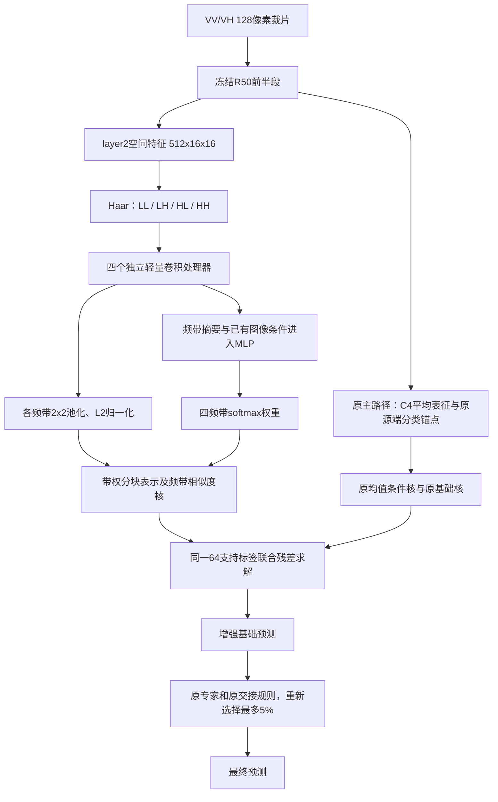

# 可学习频带残差：完整实验与机制诊断

日期：2026-10-09。状态：全部25个任务完成，包含24港数据的23个可评估留港任务、
F_0921、OpenSARShip 2.0；每任务五次64支持标签抽样，交接上限5%。

## 结论

值得保留这条路线。可学习的分频残差在三个数据集上都获得了全模型OA/BA的平均正增量，
24港和OpenSARShip2的收益明显高于未分频可学习分支；F_0921的收益较小。
不过，当前神经门控主要学到近乎固定的频带偏好，逐样本变化没有体现可观的独立收益。
因此可称为“源任务训练的频带残差/频带选择”，暂不把“动态条件融合有效”作为核心结论。
原来的条件支持校正仍在使用，并未因此被否定。

## 接入的是哪一版

接入 `conditional_direction_residual_20261009/mean_representation_control` 的
`conditional_selected`，即已有平均特征的条件支持校正，而不是原方向残差。
24港保留源端逐港选择的eta，外部数据集eta=.25；不拿后来统一eta=.25的小波统计对照
冒充本轮基线。25任务的五组基础预测、最终预测及交接名单均逐样本精确复现。

## 完整模型结果

以下均为全模型OA/BA百分数，已包含专家交接。增量为百分点。

| 数据集 | 原改进基线 OA / BA | 分频学习融合 OA / BA | OA增量 | BA增量 |
|---|---:|---:|---:|---:|
| 24港，23个可评估任务等权 | 62.4329 / 53.7806 | 63.2084 / 54.2383 | +0.7755 | +0.4577 |
| F_0921 | 30.8931 / 26.2879 | 31.1072 / 26.3593 | +0.2141 | +0.0714 |
| OpenSARShip 2.0 | 34.3385 / 31.9526 | 35.3545 / 32.3724 | +1.0160 | +0.4199 |

OA五次抽样均提升，三个数据集均为5/5；BA分别为5/5、4/5、4/5。
24港的23个任务OA均提升；BA有16港提升、7港下降。
这些是同一源训练检查点下的五次支持抽样，不是五个独立训练种子。

## 关键对照

| 新增分支 | 24港 OA / BA | F_0921 OA / BA | OpenSARShip2 OA / BA |
|---|---:|---:|---:|
| 不分频，可学习空间分支 | 62.9847 / 53.9855 | 31.0229 / 26.3643 | 34.8275 / 31.9887 |
| 分频分别处理，固定等权融合 | 63.1178 / 54.1356 | 31.0650 / 26.4069 | 35.0503 / 32.0829 |
| 分频分别处理，学习融合 | 63.2084 / 54.2383 | 31.1072 / 26.3593 | 35.3545 / 32.3724 |
| 同一学习融合检查点，强制等权 | 63.0577 / 54.0638 | 31.0454 / 26.4068 | 34.9796 / 31.9687 |

不分频和固定分频分支的主处理器参数量匹配。每个分支均额外加入beta=.25的单位对角核，
原均值核强度不变；因此不是减弱原模块后得到的比较。
24港学习融合相对不分频额外提升OA +0.2237、BA +0.2528；OpenSARShip2为
+0.5270、+0.3837。F_0921学习融合BA略低于不分频，也低于固定等权，因此不宣称普遍最优。

## 实际模型管线

每带处理器为1x1卷积降至16通道、GroupNorm、GELU、深度3x3卷积、GroupNorm、GELU。
条件融合器使用四带通道摘要和原有伸长程度/中心响应秩，66维输入、32维隐藏层、4维输出。
每带64维单位向量乘权重平方根后分块组成256维表示；这是相似度核层面的融合，不是
把一组固定小波统计简单拼到原128维向量后。新分支可训练参数35,876。

同一64支持标签通过一次类别平衡ridge=8联合求解旧校正项和新增频带项。旧源端锚点固定，
但目标校正系数可以重新平衡，并非对旧模型的支持集内残差连续拟合两次。
源端用模拟港口的查询分类损失反传经过支持求解，固定六轮，末轮输出；目标端不微调神经网络。
第一版没有WSA/WRA、Gabor或逆小波重建，不是DFWA-Net复现；也没有新增样本级残差幅度gamma。

## 为什么提点，哪里没有达到预期

### 1. 收益首先出现在基础模型

| 数据集 | 基础模型OA增量 | 基础模型BA增量 | 完整模型OA增量 | 完整模型BA增量 |
|---|---:|---:|---:|---:|
| 24港 | +1.0168 | +0.7305 | +0.7755 | +0.4577 |
| F_0921 | +0.2481 | +0.0911 | +0.2141 | +0.0714 |
| OpenSARShip2 | +1.2171 | +0.5016 | +1.0160 | +0.4199 |

这说明不是单靠重新路由制造了增量。部分收益在交接后变小，但原专家交接仍对增强基础
模型有平均正贡献，不能把差额全部认作交接错误。
例如Callao的基础BA增量约+0.3931，完整BA增量-0.2790；固定原交接名单时完整BA约+0.2796，
说明该港确有交接对象变化抵消基础增益。但全体数据上重新路由仍优于统一冻结旧名单：
24港BA 54.2383对53.9887，F_0921 26.3593对26.3388，OpenSARShip2 32.3724对32.2997。
所以不能据单港结果全局回退交接策略。

### 2. 学到了频带偏好，但几乎没用到门控的逐样本变化

25任务中22个偏向LH；New York、Rotterdam、Sydney Botany偏向LL。
多数任务主频带平均权重超过99.8%；F_0921为99.9184%，OpenSARShip2为99.9781%。
LH仅表示特征图采样坐标下的一个方向子带，不等于已识别的雷达观测方向或物理因子。

用同一检查点的全体无标签目标样本平均权重替换逐样本权重后：

- F_0921和OpenSARShip2，五次抽样全部预测完全不变。
- 24港全部23任务五次抽样，合计仅1个最终预测不同；原门控仅多出OA +0.0036、BA +0.0078。

因此当前主要起作用的是分频表示及其源端学到的频带偏好，而非显著的样本自适应。
这不否定原有条件支持核；该核在上述两种门控对照中始终保留。

### 3. F_0921并不适合一味强化单频带

同一学习融合检查点强制等权，F_0921 BA从26.3593升至26.4068，OA从31.1072降至31.0454。
学习融合相对等权，近海供应船召回下降约0.8977个百分点、原油油轮下降0.2683；同时散货船、
渔船、杂货船等若干类上升。因此差异确实涉及类别取舍，并非所有船型均衡获益。
这定位了偏置出现的模块和类别，尚未证明为什么该数据集的物理频率信息需求不同。

### 4. 仍有明确的负结果

24港BA下降包括Port Hedland -0.4266、Callao -0.2790、Jebel Ali -0.1866等7港。
OpenSARShip2杂货船召回下降1.6080个百分点，尽管成品/化学品油轮和集装箱船分别提升
1.9927、1.8810。F_0921相对旧基线近海供应船-0.6756、散货船-0.3811。
各类值按出现该类的港口等权，不能直接与“先按港口求BA再平均”混算。

全模型累计救对/改错：24港2592/1528，F_0921 6699/5378，OpenSARShip2 347/160。
这是五次支持抽样的预测事件，不能当作独立船只数量。

## 实现检查与资源

18项针对性测试通过，包括Haar可逆性/能量/方向模式、配对编码器一致、梯度传递、
单位核尺度以及零新增项与独立原始ridge解的一致性。
25任务的五组旧基线及路由精确重放；源训练行均在原协议允许集合中；新查询标签不进入拟合。
没有发现本轮接入或梯度实现错误。门控趋于近常数是当前优化结果，不直接等同代码错误；
现有证据不足以认定其物理原因或因果不变量。

训练实际抽样图缓存到显存后，每个分频模型六轮约2秒，另有一次源缓存装载成本。
大数据集多模型推理共享一次读盘；这些只改变数据搬运，不改变抽样和损失。
全量使用神经分支bfloat16、归一化与训练求解float32、目标求解float64。
最初单港float32试跑保留在`float32_pilot`，不混入上述完整结果。

## 保留与下一步

随后完成了信息消除、同预算源端匹配重训、数字旋转及可靠性控制的根因追踪，见
[本轮根因结论](E:/Hermes/paper_tracking/sensitivity/frequency_information_content_20261009/ROOT_CAUSE_ZH.md)。
局部有符号变化在24港/OpenSARShip2的受控训练对照中有判别价值；无符号版本虽然更
不怕数字旋转，但两者BA下降。F_0921存在不同的类别取舍，不能一刀切视为纯噪声。
新可靠性控制的收益很小，瓶颈已定位为查询效用预测不足及缩放撤销有效类别翻转，
没有升级为新的已验证主模块。

2026-10-09追加了完整决策机制追踪，见
[机制报告](E:/Hermes/paper_tracking/sensitivity/learned_frequency_residual_20261009/mechanism_20261009/FINDINGS_ZH.md)。
固定已拟合系数、将查询频带嵌入替换为支持均值后，24港/F_0921/OpenSARShip2完整BA分别
下降0.3748/0.0061/0.4903个百分点。F_0921虽净变化小，实际查询频带仍救对5593次、
改错5308次，存在明显正负抵消，不能说完全没有信息。新增条件核对照也有部分收益，
不能把全部提升归因于频带图像证据。六张案例图将原分数、系数重拟合、直接频带项和
交接变化逐项核算；本轮不重训、不替换已报告主模型。

保留本轮分频残差作为有效增量候选，原主模型与论文未覆盖。优先发展“源任务引导的
频带可靠性与残差补充”，而不是强行把近乎固定的权重解释成动态注意力成功。
后续如研究动态融合，应引入可区分频带对当前分类是否有帮助的支持证据，并与本轮
已有有效的近静态频带选择直接比较；不为追求动态形式而放弃已有正收益。

全部为历史开发数据，不是独立确认。外部数据集沿用原简化模型，不能称为24港全部
Qs/Qd/入射角堆栈的同构复制。5%只限制专家交接，不等于仅5%样本计算频带特征。

## 文件与复现

完整数值：`summary.csv`、`metrics.csv`、`task_means.csv`、`draw_metrics.csv`、
`class_metrics.csv`、`event_summary.csv`。机制：`mechanism_summary.csv`、
`mechanism_metrics.csv`、`gate_collapse.csv`。配置：`PROTOCOL.json`、`DESIGN_ZH.md`。
每任务`tasks/...`中保存源模型、训练日志、支持划分、嵌入、频带权重与完整预测。

代码位于`E:/Hermes/paper_tracking/sensitivity/oof_reliability_check`：
`prepare_learned_frequency.py`、`extract_learned_frequency_maps.py`、`learned_frequency_model.py`、
`train_learned_frequency.py`、`evaluate_learned_frequency.py`、`diagnose_learned_frequency.py`、
`plot_learned_frequency.py`。清晰分离CPU准备/评估和GPU训练环境；不要用GPU环境导入POT依赖链。
