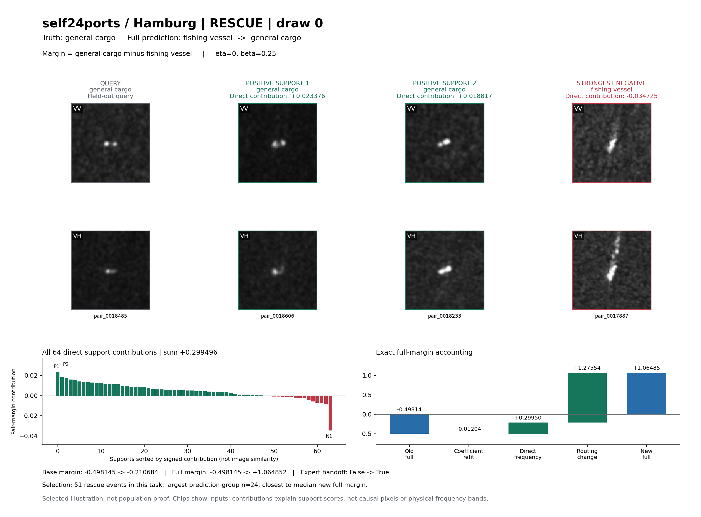
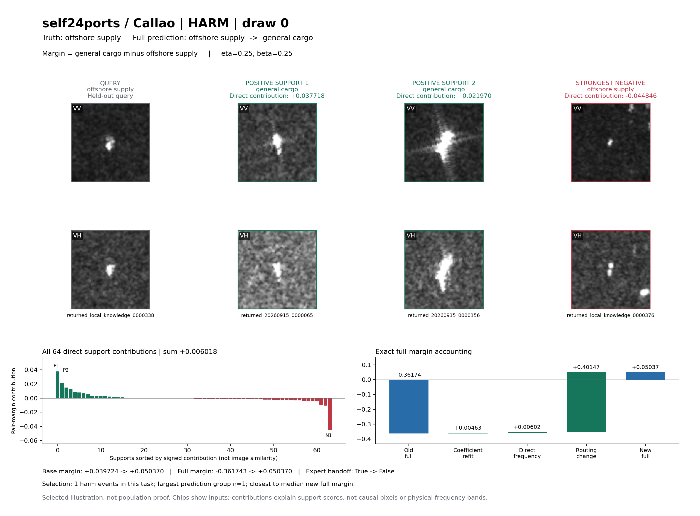
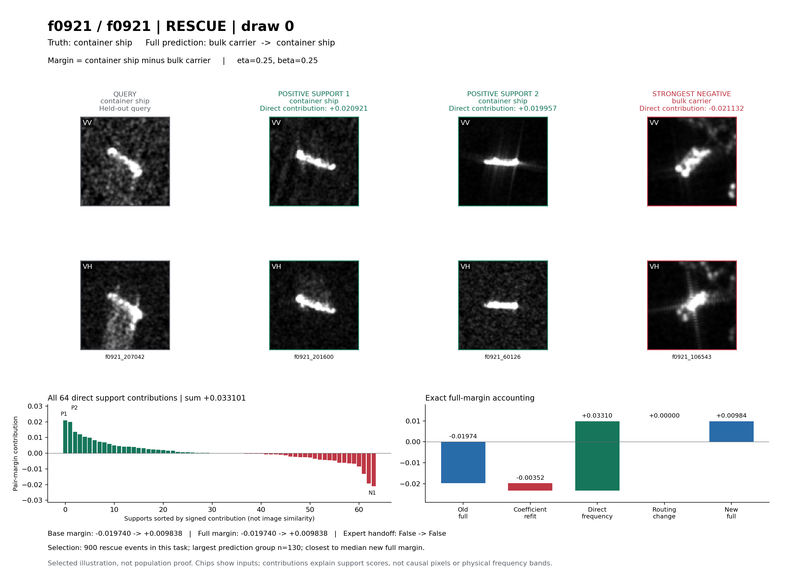
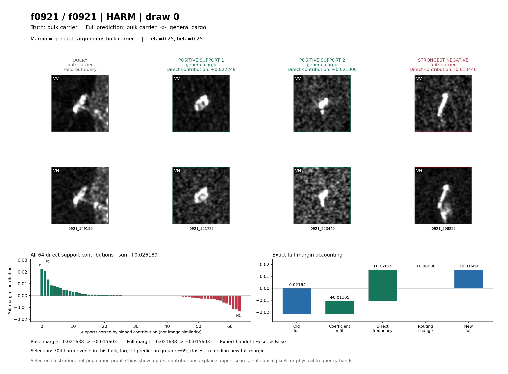
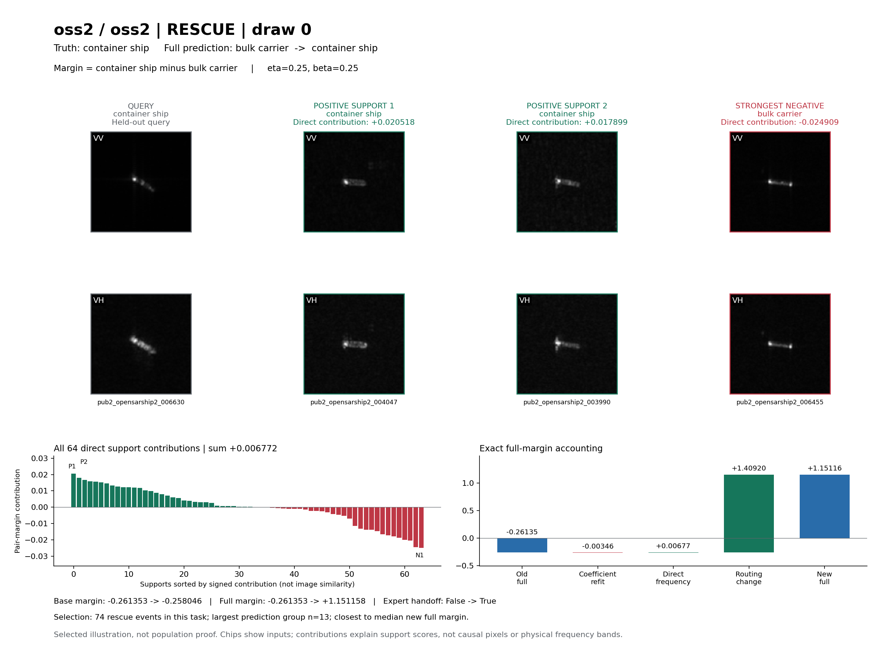
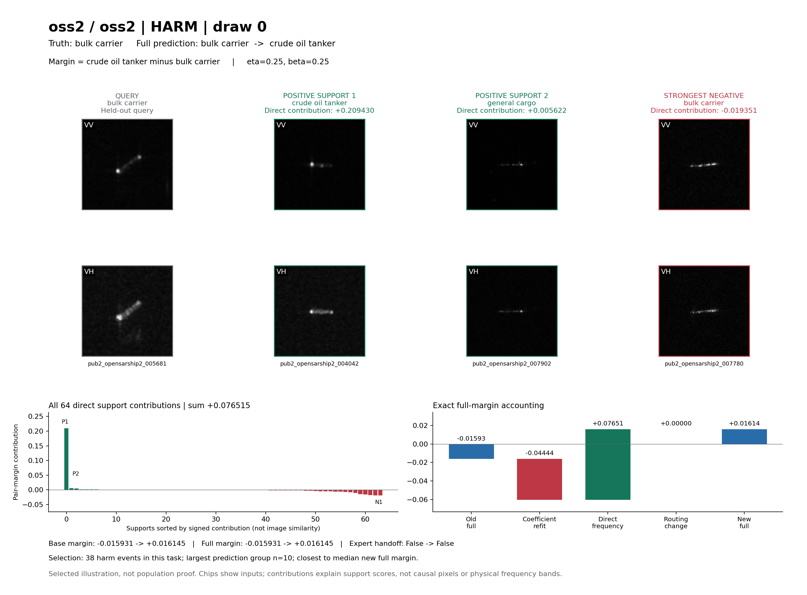

# Learned Frequency Residual: Six Selected Cases

These cards visualize the completed model, using draw 0 only. No neural training, parameter search, new model selection, feature extraction, or all-task control experiment was performed. The existing 64-support closed-form solve is replayed to recover its exact coefficients. Parent files and completed outputs are read-only.

The self24ports examples use Hamburg for rescue and Callao for harm, as specified for this illustration; they are not pooled across ports. F0921 and OSS2 each contribute one rescue and one harm. Target outcomes are used only for retrospective illustration. These selected examples are not population-level evidence or independent confirmation.

## Selection

For each event type, use all draw-0 evaluation rows whose final prediction changes from wrong to correct (rescue) or correct to wrong (harm). Choose the largest (old full prediction, new full prediction) group, breaking group-size ties by ascending class IDs. Select the row closest to the median new full pair margin within that group, breaking ties by exact sample ID. Do not filter by image appearance, attribution sign, or routing state. IDs, counts and selection distances are recorded in each JSON.

## Exact Decomposition

`K0(q,s) = phi(q) phi(s)^T + eta * mean_cosine(q,s) * RBF(q,s)`

`Kfreq(q,s) = learned_embedding(q) learned_embedding(s)^T * RBF(q,s)`

`alpha = W^(1/2) [W^(1/2) (K0_SS + 0.25 Kfreq_SS) W^(1/2) + 8I]^-1 W^(1/2) (Y - prior_S)`

`W_ss = 64 / (number_of_observed_support_classes * count_of_support_class_s)`; `Y` is +1 for the support class and -1 otherwise. The RBF bandwidth is the existing 0.5. `eta` is read from each PREPARED.json, including Hamburg eta=0.

For rescue, `(a,b) = (truth, old wrong full prediction)`. For harm, `(a,b) = (new wrong full prediction, truth)`. Each direct contribution is exactly `0.25 * Kfreq(q,s) * (alpha[s,a] - alpha[s,b])`. Positive support contributions favor a; they need not come from class-a supports because coefficients are jointly solved residual corrections, not label votes.

`new base margin = old base margin + coefficient-refit margin + sum(direct support contributions)`

The refit term is the change in the existing-kernel correction under the new support coefficients. It excludes the frequency term; the source prior stays fixed. Computing it as the existing-kernel score under new alpha minus the exact baseline score also preserves the eta=0 evaluator path. Direct frequency is an additive accounting term with the actual joint alpha, not an independently fitted branch or causal ablation.

The final pipeline can hand off to its saved expert. A full margin here uses the score vector actually selected by the saved route. Thus `new full - old full = refit + direct + (new route offset - old route offset)`, where each route offset is full margin minus base margin. Scores from different heads are not calibrated probabilities; the routing term is arithmetic bookkeeping of the final decision, not a learned additive feature.

The replay matches evaluate_learned_frequency.predict before rounding, then exactly matches saved float32 scores, base predictions and final predictions using the saved routing masks for all rows of each of the four inspected tasks. Both scalar decompositions are checked against unrounded scores. This sidecar does not rerun gate admission or the main all-25-task controls.

## Cases

| Dataset / task | Event | Query ID | Full prediction | Direct | Refit | Routing delta | Full margin old -> new |
|---|---|---|---|---:|---:|---:|---|
| self24ports / Hamburg | rescue | pair_0018485 | fishing_vessel -> general_cargo | +0.29949612 | -0.01203503 | +1.27553536 | -0.49814470 -> +1.06485175 |
| self24ports / Callao | harm | returned_local_knowledge_0000338 | offshore_supply -> general_cargo | +0.00601822 | +0.00462796 | +0.40146761 | -0.36174343 -> +0.05037037 |
| f0921 / f0921 | rescue | f0921_207042 | bulk_carrier -> container_ship | +0.03310102 | -0.00352291 | +0.00000000 | -0.01974010 -> +0.00983801 |
| f0921 / f0921 | harm | f0921_349180 | bulk_carrier -> general_cargo | +0.02618943 | +0.01105153 | +0.00000000 | -0.02163843 -> +0.01560253 |
| oss2 / oss2 | rescue | pub2_opensarship2_006630 | bulk_carrier -> container_ship | +0.00677174 | -0.00346463 | +1.40920465 | -0.26135337 -> +1.15115839 |
| oss2 / oss2 | harm | pub2_opensarship2_005681 | bulk_carrier -> crude_oil_tanker | +0.07651470 | -0.04443941 | +0.00000000 | -0.01593068 -> +0.01614461 |

### self24ports / Hamburg: rescue

The new pipeline admits the saved expert, whose prediction is correct. The new base prediction remains wrong; its negative pair margin shows that the direct frequency and refit terms do not themselves complete this rescue. This is a changed-handoff rescue, with the direct term and refit contribution shown separately. The card does not localize the gate-ranking reason for admission.

The direct frequency term favors the new winning class relative to the old class. Coefficient refitting contributes -0.01203503; the change in route offset contributes +1.27553536. The three displayed supports sum to +0.00746809; the remaining 61 sum to +0.29202802. The full 64-term list and all score vectors are in `self24ports_Hamburg_rescue_draw0.json`.

### self24ports / Callao: harm

The old pipeline used the correct expert prediction, while the new pipeline no longer hands off this query. Both old and new base predictions are already wrong. The full-policy harm is therefore a loss of the correct expert handoff; it is not a base prediction newly flipped by the frequency term. The card does not localize the gate-ranking reason for losing admission.

The direct frequency term favors the new winning class relative to the old class. Coefficient refitting contributes +0.00462796; the change in route offset contributes +0.40146761. The three displayed supports sum to +0.01484199; the remaining 61 sum to -0.00882377. The full 64-term list and all score vectors are in `self24ports_Callao_harm_draw0.json`.

### f0921 / f0921: rescue

Neither policy hands off this query. The displayed full prediction change is the base prediction change, and the sum of direct frequency and coefficient-refit terms crosses the zero pair-margin boundary. This is exact additive score accounting, not a counterfactual claim about individual pixels or support deletion.

The direct frequency term favors the new winning class relative to the old class. Coefficient refitting contributes -0.00352291; the change in route offset contributes +0.00000000. The three displayed supports sum to +0.01974602; the remaining 61 sum to +0.01335500. The full 64-term list and all score vectors are in `f0921_f0921_rescue_draw0.json`.

### f0921 / f0921: harm

Neither policy hands off this query. The displayed full prediction change is the base prediction change, and the sum of direct frequency and coefficient-refit terms crosses the zero pair-margin boundary. This is exact additive score accounting, not a counterfactual claim about individual pixels or support deletion.

The direct frequency term favors the new winning class relative to the old class. Coefficient refitting contributes +0.01105153; the change in route offset contributes +0.00000000. The three displayed supports sum to +0.02981481; the remaining 61 sum to -0.00362538. The full 64-term list and all score vectors are in `f0921_f0921_harm_draw0.json`.

### oss2 / oss2: rescue

The new pipeline admits the saved expert, whose prediction is correct. The new base prediction remains wrong; its negative pair margin shows that the direct frequency and refit terms do not themselves complete this rescue. This is a changed-handoff rescue, with the direct term and refit contribution shown separately. The card does not localize the gate-ranking reason for admission.

The direct frequency term favors the new winning class relative to the old class. Coefficient refitting contributes -0.00346463; the change in route offset contributes +1.40920465. The three displayed supports sum to +0.01350768; the remaining 61 sum to -0.00673594. The full 64-term list and all score vectors are in `oss2_oss2_rescue_draw0.json`.

### oss2 / oss2: harm

Neither policy hands off this query. The displayed full prediction change is the base prediction change, and the sum of direct frequency and coefficient-refit terms crosses the zero pair-margin boundary. This is exact additive score accounting, not a counterfactual claim about individual pixels or support deletion.

The direct frequency term favors the new winning class relative to the old class. Coefficient refitting contributes -0.04443941; the change in route offset contributes +0.00000000. The three displayed supports sum to +0.19570094; the remaining 61 sum to -0.11918624. The full 64-term list and all score vectors are in `oss2_oss2_harm_draw0.json`.

## Image And Interpretation Boundaries

Query and support chips are the actual model input pairs. self24ports and OSS2 use c4_condition_descriptors.load_manifest/read_pair; F0921 uses inputs128.npy in read-only mmap mode, with feature_rows.npy checked against manifest source rows. IDs are checked against task ordering. VV and VH use fixed grayscale [0,255], without individual stretching. The two strongest positive contributors and strongest negative contributor are displayed; all 64 are present in JSON.

These are support-level score explanations, not saliency maps. Resized display chips and learned embedding similarities do not identify physical scattering mechanisms, spatially causal pixels, calibrated radiometry, or universally useful frequency bands. A routed harm must not be described as a direct-frequency-caused harm. Population support matching and no-image controls belong to the separate main analysis.

Outputs: six PNG cards, six PDF cards, six per-case JSON files, cases.json, VERIFICATION.json and this README. JSON numbers retain full Python float precision; displayed numbers are rounded only for readability.
