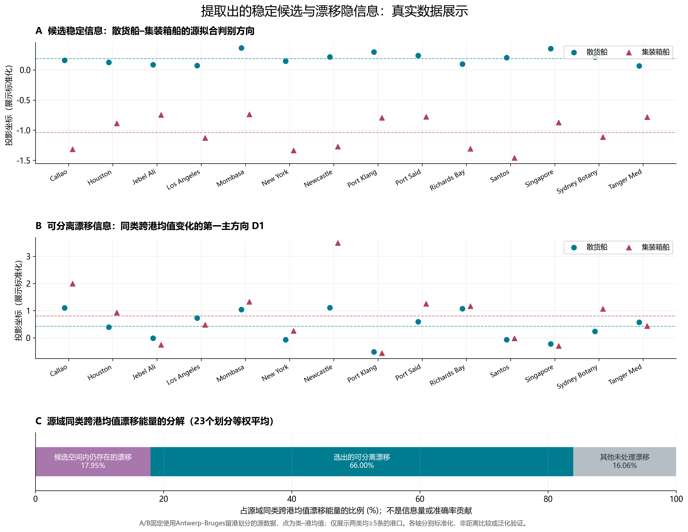
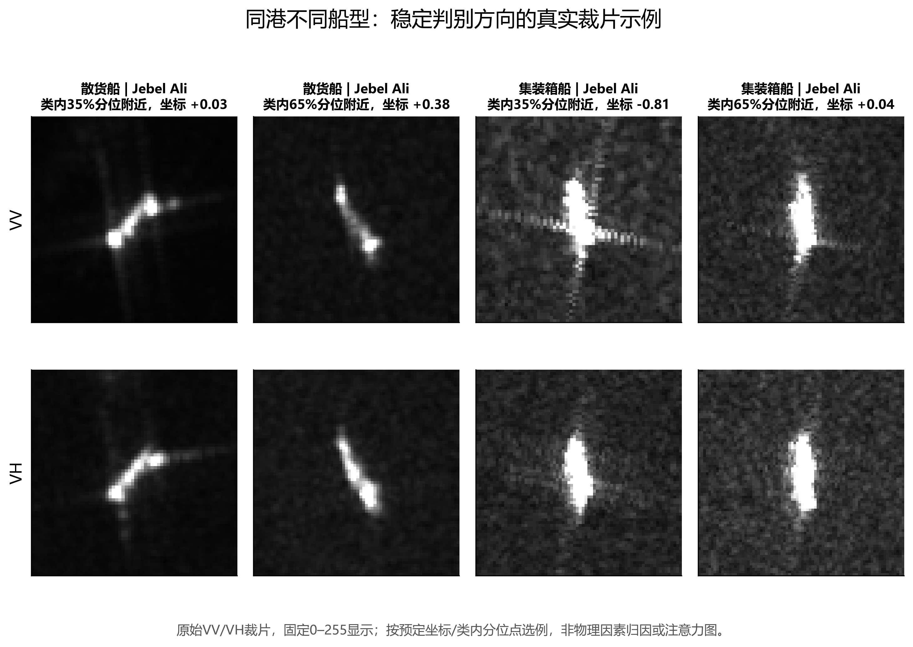
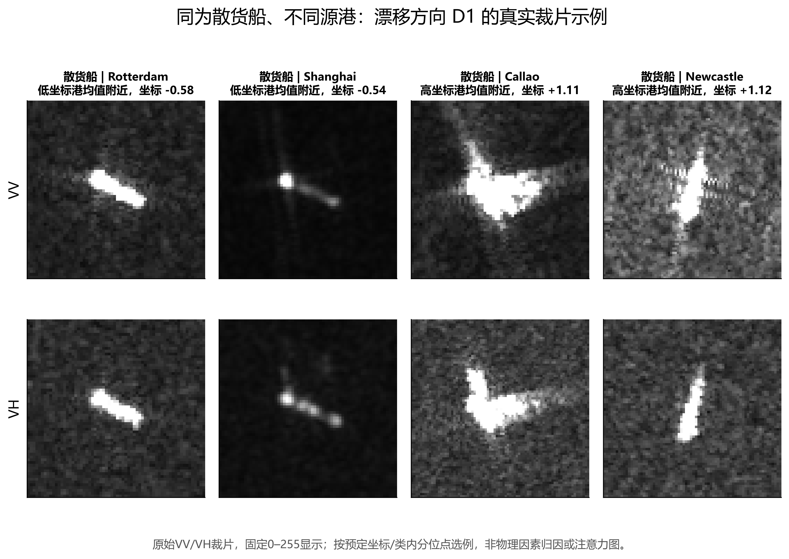

# 稳定候选与漂移隐信息：提取结果及可视化

日期：2026-10-08。基于已完成实验的缓存，不增加训练，不替换主模型。

## 结论

两部分已经有实际的投影矩阵和逐样本坐标，不只是概念。它们目前是统计定义的特征组合，而非已识别的物理因素或因果变量。“稳定”应保留“候选”限定。

| 项目 | 候选稳定信息 | 可分离漂移信息 |
|---|---|---|
| 操作性含义 | 保留类别差异，同时惩罚源域同类跨港均值变化的方向组合 | 在候选稳定空间之外，源域同类跨港均值变化的主要方向 |
| 投影矩阵 | Qs，2048 × r，各留港划分 r=23–27 | Qd，2048 × 16 |
| 单样本坐标 | zs = x @ Qs | zd = x @ Qd |
| 不能直接命名为 | 船体形状、船型本质、严格不变量 | 纯背景、纯噪声、全部域偏移 |

x 是使用该划分源域均值和尺度标准化的 R50 特征。Qs、Qd 按外层留港划分分别拟合，不是一套跨所有数据集通用的固定坐标。不同基向量可以旋转或变号，不能把坐标序号当成固定物理概念。

## 提取方式

源域按船型和港口计算特征均值，同类港口均值去中心化后构成 U。先对类别判别方向施加 U 对应的均值漂移惩罚，再对这些候选方向做 SVD，得到 Qs。

为保护候选判别空间，先计算 U_perp = U - (U @ Qs) @ Qs.T，再取 U_perp 的前 16 个右奇异向量作为 Qd。因此 Qs 与 Qd 的正交是构造结果，不是自然因素已经独立的证据。

特征可写成 x = (x @ Qs) @ Qs.T + (x @ Qd) @ Qd.T + x_rest。还有未处理的剩余空间，不能将全部信息简单分成稳定和漂移两类。U 仅描述同类跨港均值变化，未穷尽方差、非线性及其他分布变化。

## 图一：坐标行为

A/B 固定使用 Antwerp-Bruges 留港划分的源数据，不含该目标港样本。A 为预先固定的散货船与集装箱船候选判别方向，B 为第一漂移方向 D1。展示同时具有每类至少 5 个样本的 14 个源港口。点是类×港口均值，不是所有单船都分开的证据。A/B 分别标准化，只用于观察模式，不能由两图纵轴直接比较迁移距离。

A 中各源港均值维持船型区分，B 中同类均值随港口有明显变化。这是源拟合行为示例，不是独立的跨港泛化验证。

C 是 23 个留港划分的等权平均：源域同类跨港均值漂移能量中，17.95% 仍落在候选稳定空间内，66.00% 被选入可分离漂移方向，16.06% 属于其他未处理漂移。这些比例不是信息量、像素占比或准确率贡献。候选稳定空间仍有漂移，不能称为严格不变空间。

## 图二、三：对应原始裁片

固定 Jebel Ali 港、散货船和集装箱船，分别取类内坐标第 35% 和 65% 分位附近样本，并要求不同 MMSI。

固定散货船，选择 D1 类均值最低的两个源港与最高的两个源港，取各港均值附近样本，并要求不同 MMSI。

两图均直接读取已有 VV/VH PNG，固定 0–255 显示，不做逐图拉伸。样本来源、全局行号和选择理由见 example_selection.csv。这些是坐标对应的实例，不是注意力图，也不能凭少量图像把坐标归因为亮度、尺寸或背景。

## 几何代理的探索性核对

固定同一源划分，源样本共 36,544。以下六个元数据代理均仅覆盖 c0/c1/c2，共 24,109 行；缺失 12,435 行（34.03%），c3–c7 全部缺失，包括集装箱船。下表是三个可用类别的等权类内 Spearman 平均，不是八类结果。

| 几何代理 | D1 类内相关 | 候选 c0–c4 方向类内相关 |
|---|---:|---:|
| target_long_side_vv | 0.1506 | 0.0805 |
| target_occupancy_vv | 0.1473 | 0.1593 |
| crop_side_vv | 0.1270 | -0.0859 |
| center_distance_px | 0.1608 | -0.0747 |
| width_vv | 0.1590 | 0.0048 |
| height_vv | 0.0982 | 0.0833 |

进一步对类内秩减去类×港口单元均值后，D1 与六项代理的等权平均残差相关依次为 0.1132、0.1272、0.0789、0.1521、0.1082、0.0805；候选方向依次为 0.0773、0.1567、-0.0965、-0.0739、0.0146、0.0796。该补充分析覆盖 24,022 行、58 个 n>=20 的单元，是残差秩的 Pearson 相关，不是单元内重新排名的 Spearman。

类别差异明显：候选方向与 target_long_side_vv 的类内相关，散货船为 -0.1758，渔船为 0.3381，杂货船为 0.0791。不能将其统一解释为尺寸轴。这里只核对两个预定坐标，既不代表整个子空间，也没有给出统计显著性或物理因果结论。

## 与已完成实验的关系

联合激活候选稳定信息并软抑制漂移，相对同流程重训基线，最终 OA 提升 0.8602 个百分点、BA 提升 0.3494 个百分点；收益主要在基础模型。单独漂移抑制 BA 下降 0.0790 个百分点，说明不能把提取出的漂移直接当作应全部删除的有害信息。

上述是已有开发数据上的效果，不证明增益专属于跨域稳定性，也不是因果发现。完整实验见上级目录 PROTECTED_DRIFT_ACTIVATION_FINDINGS_ZH.md。

## 交付文件

- latent_vectors_AntwerpBruges.npz：Qs、Qd、标准化参数、源/目标样本行号，以及两类逐样本坐标。该示例 Qs 为 2048×26，Qd 为 2048×16；源样本 36,544、目标样本 886。
- source_class_port_coordinates.csv：源域类×港口均值及样本数。
- example_selection.csv：原始裁片选择记录。
- VISUALIZATION_PROTOCOL.json：可视化范围与固定选择规则。
- 三组 PNG/PDF：统计概览、候选稳定坐标实例、漂移坐标实例。
- 生成脚本：../../oof_reliability_check/visualize_protected_latents.py。

对外推荐表述：已经从原有表征中显式提取出候选跨港稳定判别子空间，以及与其正交的主要同类跨港均值漂移子空间；已能展示坐标行为和对应真实样本，但尚未将其识别为独立的物理因素或因果不变量。
