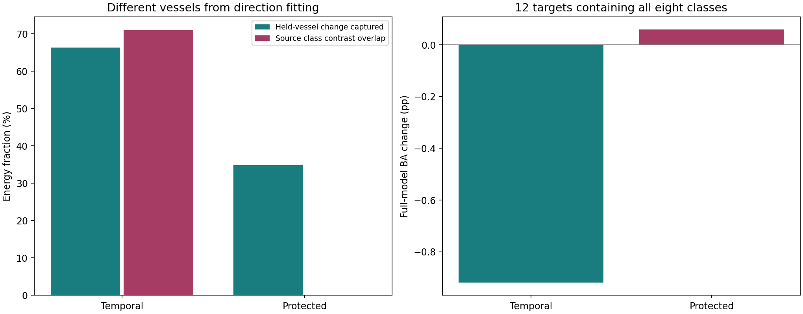

# 同船多时相：哪些变化值得抑制

日期：2026-10-09。原23港、五组64标签；本轮识别方向并诊断，不重训或替换主模型。

## 方法与真实边界

先在每个外层源划分中，保留有效9位MMSI、同一身份源标签一致、可解析采集时间的记录。同港、同身份、同一采集时刻的重复记录先取特征均值，再将同港同船相邻时相配对。不同港口之间不直接配对。
源样本沿用原目标身份/产品排除；实际断言确保目标MMSI未进入源观测库。MMSI仍是身份代理，未逐一确认物理身份。一次同船差分也可能包含姿态、状态及成像变化，不自动等于纯噪声。
按船身份随机固定划分约2/3拟合、1/3留出，同一MMSI在不同港的观测也只能落入一侧。不是按影像随机拆分。
各外层源划分有7143至9196对拟合观测、3529至4769对留出观测。各划分重叠，不能累加为独立样本量。
方向搜索只在已有源标准化R50的[Qs,Qd]联合正交空间中进行，维数为39至43；不是在原始影像或全部2048维中挖掘。它可以发现原候选稳定空间内部仍存在的重复观测变化。
差分二阶矩为0.5*E[delta delta^T]，不按天数除法、不减去平均差分。类别等权、类内港等权、港内船等权、船内相邻对等权，避免拍摄次数最多的船主导。
两种固定候选：直接取二阶矩最大的8个正特征方向；或者先投影掉拟合船8类中心差异张成的7维空间，再取8个方向。类别中心按每类港口等权，港内聚合观测等权。后一种只保护源类中心差异，不保证保护全部判别信息，也不保证保护目标类中心。
Qs/Qd和既有源分类头仍来自全部外层源域，包含本轮留出船。留出船结果是给定现有表示的方向重现诊断，不是几何和分类器完全独立的内层OOF验证。

## 提取了什么

| 候选8方向 | 拟合船时相变化覆盖 | 留出船时相变化覆盖 | 拟合源类别中心差异重合 | 25%抑制后留出时相能量比 | 方向能量落在Qs的比例 |
|---|---:|---:|---:|---:|---:|
| 类别中心保护的8方向 | 37.51% | 34.84% | 0.00% | 0.8476 | 37.02% |
| 同船变化最大8方向 | 68.44% | 66.37% | 70.99% | 0.7097 | 32.22% |

这些比例是特征几何的能量比例，不是准确率贡献率。留出船捕获率高说明这些变化并非只出现在拟合船中；不能由此确认具体物理因素。类别中心保护的源重合接近零是构造保证，不是独立实证发现。

## 作用到完整八输出识别

固定减弱25%，不搜索强度。查询特征沿候选方向向拟合源类中心的总均值收缩，同时改变基础与专家对应的R50分数路径。支持样本、64标签适配系数、R18及门控参数均保持不变；重算八列分数、置信度、交接资格及5%排序。
所有23港策略先冻结，再统一读取查询标签。没有依据目标结果挑方向、类别或强度。这是计算干预，不是协调重训后的新模型性能；不能把一次负结果解释成该方向永远无用。

| 已有模型 | 干预 | 全23港OA | 全23港BA | OA变化pp | BA变化pp |
|---|---|---:|---:|---:|---:|
| 联合版本 | 类别中心保护的8方向 | 58.1745% | 51.2129% | -0.1616 | +0.1290 |
| 联合版本 | 不干预 | 58.3361% | 51.0838% | +0.0000 | +0.0000 |
| 联合版本 | 同船变化最大8方向 | 58.4421% | 50.7248% | +0.1060 | -0.3590 |
| 同流程基线 | 类别中心保护的8方向 | 57.4124% | 51.0207% | -0.0635 | +0.2863 |
| 同流程基线 | 不干预 | 57.4759% | 50.7345% | +0.0000 | +0.0000 |
| 同流程基线 | 同船变化最大8方向 | 57.8154% | 50.6274% | +0.3395 | -0.1071 |
| 显式稳定读出 | 类别中心保护的8方向 | 58.3931% | 51.1580% | -0.0673 | +0.1883 |
| 显式稳定读出 | 不干预 | 58.4604% | 50.9696% | +0.0000 | +0.0000 |
| 显式稳定读出 | 同船变化最大8方向 | 58.6222% | 50.6745% | +0.1618 | -0.2951 |

全23港包含12个八类齐全港、8个三类港、2个七类港、1个六类港；模型始终输出八类。BA按查询实际出现类别平均召回，再按港等权。下面单列查询均具备八类的12港，不按表现筛选。

| 已有模型 | 干预 | 八类齐全12港OA | 八类齐全12港BA | OA变化pp | BA变化pp |
|---|---|---:|---:|---:|---:|
| 联合版本 | 类别中心保护的8方向 | 43.6765% | 38.6039% | -0.1345 | +0.0590 |
| 联合版本 | 不干预 | 43.8109% | 38.5449% | +0.0000 | +0.0000 |
| 联合版本 | 同船变化最大8方向 | 43.4879% | 37.6256% | -0.3231 | -0.9193 |
| 同流程基线 | 类别中心保护的8方向 | 43.5054% | 38.5812% | +0.1306 | +0.3191 |
| 同流程基线 | 不干预 | 43.3749% | 38.2621% | +0.0000 | +0.0000 |
| 同流程基线 | 同船变化最大8方向 | 43.2551% | 37.7186% | -0.1198 | -0.5436 |
| 显式稳定读出 | 类别中心保护的8方向 | 43.9064% | 38.4387% | +0.0132 | +0.1496 |
| 显式稳定读出 | 不干预 | 43.8932% | 38.2892% | +0.0000 | +0.0000 |
| 显式稳定读出 | 同船变化最大8方向 | 43.7638% | 37.4712% | -0.1294 | -0.8180 |

## 变化变小是否等于分类变好

下表只看留出源船的冻结源先验，不是64标签适配后的完整模型。时相分数能量先去掉八类分数的公共偏移，以免无关的共同logit变化主导。BA按留出聚合观测实际类召回平均，时相能量按上述层级权重；二者不是同一种加权。

| 联合版本分支 | 干预 | 时相分数能量比 | 源先验BA变化pp |
|---|---|---:|---:|
| base | 类别中心保护的8方向 | 0.9957 | -0.4175 |
| base | 同船变化最大8方向 | 0.8652 | -0.1749 |
| expert | 类别中心保护的8方向 | 0.9987 | -0.2224 |
| expert | 同船变化最大8方向 | 0.9277 | -0.0356 |

### 源类别保护能否推广到目标

仅作事后解释：对各查询集每类至少5条的类别计算中心（至少两类），并与相同类别集合的拟合源中心比较。目标标签不用于拟合或调整候选方向。

| 候选方向 | 相同类别集合的源中心差异重合 | 目标中心差异重合 |
|---|---:|---:|
| 类别中心保护的8方向 | 0.00% | 10.71% |
| 同船变化最大8方向 | 66.25% | 65.71% |

目标中心包含有限样本波动，重合不等于该比例的有效判别信息会丢失，更不是某种物理因素贡献率。它用于检查“只保护源均值就足以保护目标类别差异”的假设是否可靠。

## 文件和验证

17项同船配对/权重/已知方向测试通过。各港原分数重放最大误差1.03e-14，任意联合空间扰动的解析响应与直接原始特征变换差异最大1.38e-08；原门控分数重放差异最大0。
每港保存train_pairs.csv、held_pairs.csv、directions.npz、policies.npz和FROZEN.json；所有模式及逐港负结果保留。主目录有geometry/directions/held_source_readout/metrics/class_recalls/port_means/coverage_group_means等CSV。
后续结论与处置见同目录DECISION_ZH.md。本报告不把重复观测变化称为纯噪声、物理因果因子或已验证新模块。

