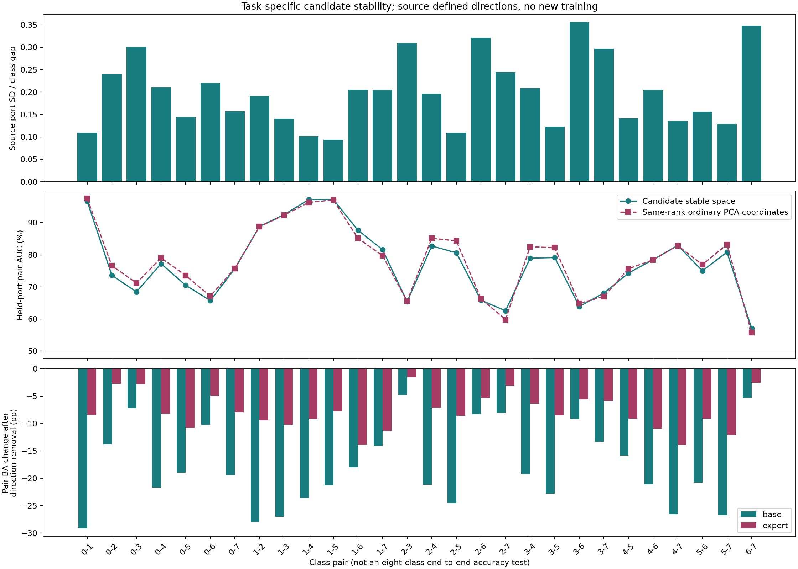

# 候选稳定空间的任务敏感性诊断

日期：2026-10-09。已完成23个可评估目标港，沿用5组64标签的查询排除掩码；无新增训练、无新增目标标注、主模型不变。

## 结论

这是相对稳定、任务相关的候选空间，不是绝对不变空间。它在部分船型区分上保留了较强的跨港判别信息，但并非对所有类别对同样可靠。基础模型和专家也不是以相同强度依赖这些信息。

本轮发现三点：

1. 渔船与散货船、集装箱船、原油油轮的固定方向，在留出港上仍有很强的两类排序能力。拖轮与海工供应船、杂货船与海工供应船，以及若干货船/油轮与拖轮的区分明显较弱。
2. 候选空间内“源港同类均值变化/类别间距”的平均比值比同维普通PCA坐标低，但本轮固定均值差方向的目标AUC、固定源阈值BA并没有整体更好。稳定性与任务效用仍不能画等号。
3. 对显式稳定读出版本，逐对删除一个源定义的判别方向，基础模型的两类BA平均下降17.8548个百分点，专家下降7.7318个百分点。这是计算依赖，不是稳定性的因果贡献，也不是八分类最终准确率下降。

## 为什么不能称为绝对稳定

原方向求解为 W=(I+U^T U)^(-1)W0，之后逐列归一化。W0来自源港类别对差异，U来自源港同类均值偏移。它是在保留类别差异的同时软惩罚均值漂移，并没有强制U W=0，更没有约束所有港口上完整类条件分布相同。

Qs由该候选矩阵SVD得到，秩23至27。原来单条候选方向的稳定性，也不能自动推广到Qs中的任意线性组合。

已有匹配判别能力的精确W1实验，在191个港口-类别对、22港上，候选漂移比匹配对照低5.19%，但两类BA仅高0.1614个百分点，11港升11港降。因此已有证据支持相对稳定候选，而不是无条件的不变量。

已有保护式漂移分析还发现，源同类跨港均值漂移总能量平均有17.95%投影进Qs。这不是“17.95%的特征无效”，而是均值偏移的能量投影比例。有限样本均值还含估计波动，不能把它全部认作真实港口因果作用。

## 本轮如何测量

- 几何：保持Qs和源标准化固定，使用原始正交坐标z=((x-mean)/scale)Qs，不额外学习投影。
- 任务方向：对每个类别对，只使用两类共同出现且各至少5条的源港；至少3个共同源港。分别等港平均类中心，取两中心差的单位方向。共构造23×28个源划分-类别对。
- 源港变化：沿上述任务方向计算两类各自的港口均值波动标准差，再除以源类别间距。数值越小，表示该任务方向对已见源港均值变化相对不敏感；不是概率或信息百分比。
- 目标判别：方向与源中点阈值保持不变，在留出目标港查询样本上测AUC、两类BA、均值差保留比例。目标每类至少5条，不满足的港口-类别对不计入该对汇总。
- 实用对照：相同维数r的前r个原有标准化PCA坐标，执行相同源均值差读出。它是同维实用对照，不是匹配所有判别属性、尺度结构的稳定性因果对照。
- 决策敏感性：复用同流程基线、显式稳定读出、联合抑制/激活三组已冻结模型。保持支持特征、64标签适配系数和R18不变，将查询R50沿该任务方向移到源类别对中点，再比较基础/专家对两类分数的判断。
- 每个方向都从源数据定义。真实目标类别仅用于事后分组、评价，不用于拟合方向、阈值或模型。以真实类别对定义的诊断不是可部署的类别对选择器。

共得到两空间3614条有效目标“抽样-港口-类别对”记录和三版本、两分类头10842条决策记录。先平均每港每对的有效抽样，再对该对有效港口等权平均，最后对28个类别对等权平均。该口径不同于原八分类等港BA，不能直接相减。

## 类别对结果

下表为候选空间内源定义方向的目标诊断，不是完整模型的八分类准确率。AUC衡量两类排序；类别间距保留比例是目标均值差在源方向的有符号投影除以源间距，不是准确率。

| 类别对 | 有效目标港 | 源港变化/类别间距 | 留出港AUC | 固定源阈值BA | 目标类别间距保留比例 |
|---|---:|---:|---:|---:|---:|
| 散货船—渔船 | 19 | 0.1095 | 96.66% | 90.39% | 0.9568 |
| 渔船—集装箱船 | 11 | 0.1018 | 97.21% | 90.62% | 0.8996 |
| 渔船—原油油轮 | 10 | 0.0938 | 97.28% | 90.22% | 0.8726 |
| 散货船—集装箱船 | 14 | 0.2102 | 77.23% | 70.18% | 0.8414 |
| 杂货船—成品油/化学品船 | 14 | 0.3094 | 65.40% | 60.19% | 0.5797 |
| 成品油/化学品船—拖轮 | 14 | 0.3557 | 63.90% | 58.65% | 0.4917 |
| 杂货船—海工供应船 | 12 | 0.2445 | 62.55% | 60.95% | 0.3225 |
| 拖轮—海工供应船 | 12 | 0.3481 | 57.12% | 54.69% | 0.1681 |

特别是拖轮—海工供应船：目标均值差沿源方向平均仅保留约16.81%，且存在有符号方向翻转。当前固定任务方向在这项区分上迁移较弱。不过，它不证明整个Qs中不存在更好的非线性或适配后分类器。

完整28对见本目录 `pair_summary.csv`；逐港、逐抽样见 `target_port_pair_means.csv` 和 `target_pair_metrics.csv`。

## 不隐藏同维对照

| 诊断 | 同维普通PCA坐标 | 候选Qs坐标 |
|---|---:|---:|
| 源港变化/类别间距，越低越好 | 0.3185 | 0.2001 |
| 留出港两类AUC | 78.2538% | 77.4647% |
| 固定源中点两类BA | 71.9991% | 71.0304% |
| 目标类别间距保留比例 | 0.8476 | 0.7280 |

这说明在本轮读出方式下，更小的源均值漂移没有转化为更强的平均目标判别。目标类别间距收缩是观察到的表现，不是已确立的唯一根因；普通PCA与Qs的度量、源判别能力和噪声结构尚未完全匹配。

本轮是在完整Qs内重新取源均值差方向，原历史实验则直接评价被惩罚的28条候选方向，且目标最低样本数、汇总权重不同。两轮不是同一读出和同一统计量，不能将当前结果称为对历史数值的重现或推翻。

## 模型在哪些任务上依赖它

针对显式稳定读出版本，保持分类器不重训，仅去掉当前类别对的一个源任务方向：

| 类别对 | 基础两类BA变化（百分点） | 专家两类BA变化（百分点） |
|---|---:|---:|
| 散货船—渔船 | -29.1845 | -8.3940 |
| 散货船—集装箱船 | -21.7155 | -8.1353 |
| 杂货船—成品油/化学品船 | -4.7716 | -1.5554 |
| 拖轮—海工供应船 | -5.2956 | -2.5056 |
| 28对等权诊断均值 | -17.8548 | -7.7318 |

三版本的整体诊断如下。每个类别对分别做一个不同的查询方向干预，不是同时删除28个方向。

| 已冻结版本 | 基础两类BA变化（百分点） | 专家两类BA变化（百分点） |
|---|---:|---:|
| 同流程重训基线 | -13.1172 | -4.4002 |
| 显式稳定读出 | -17.8548 | -7.7318 |
| 联合抑制/激活 | -18.3146 | -7.8240 |

显式读出版本对这些方向的计算依赖更强，且基础模型总体更依赖。但更依赖不等于更准确，不等于稳定性因果贡献，也不证明剩余信息纯属噪声。单次移除到源中点可能离开真实数据分布，不能解释成实际船舶的物理干预。

这里没有重算5%门控，也没有把诊断中的真实类别对用于部署；最终八分类和交接指标仍以原实验报告为准。

## 针对性下一步

不再假定整片Qs可以等强度增强所有分类任务。更合理的下一步假设是：源港学习类别混淆相关的可靠方向，原64个支持标签提供目标任务证据；当前预测类别对有足够支持且信息一致时才使用，否则保留原模型。

稳定空间检索也应检索与当前分类边界相关的案例，而非仅看全空间欧氏距离。上表不能直接成为使用目标查询结果制定的类别白名单；部署规则仍需源任务学习或同一64标签支持集估计，再冻结评价。

当前没有新增有效模块，也没有证明这种条件使用一定提点。本轮提供的是“按任务选择，而不是全局放大”的实测依据。

## 数值验证与限制

- 5项定向单元测试通过：源港等权、类先验不平衡、港口变化与任务方向正交、目标方向翻转、正交换基一致性。
- 23港的三版本、两分类头逐港验证：原分数重放最大误差1.04e-14；解析响应与实际原始R50特征扰动的最大误差1.51e-8。
- 数据仍是既有研发语料，5组支持/查询有重叠，不作为独立重复；目标每类仅5条的最低门槛会使部分港口估计较不稳定。
- 源统计是拟合内描述，类别及同类港口均值含有限样本波动；不称为因果港口效应。
- 没有图片物理语义归因，没有改变特征提取、主模型、标签预算或历史结果。

## 图与复现

类别编号：0散货船，1渔船，2杂货船，3成品油/化学品船，4集装箱船，5原油油轮，6拖轮/拖带船，7海工供应船。

脚本：`E:/Hermes/paper_tracking/sensitivity/oof_reliability_check/task_stable_sensitivity.py`。
测试：同目录 `test_task_stable_sensitivity.py`。
环境：`D:/Program_documents/Anaconda_envs/envs/ClearSAR/python.exe`。
结果：本目录 `PROTOCOL.json`、`COMPLETE.json`、各CSV和PNG；未覆盖其他轮次。
