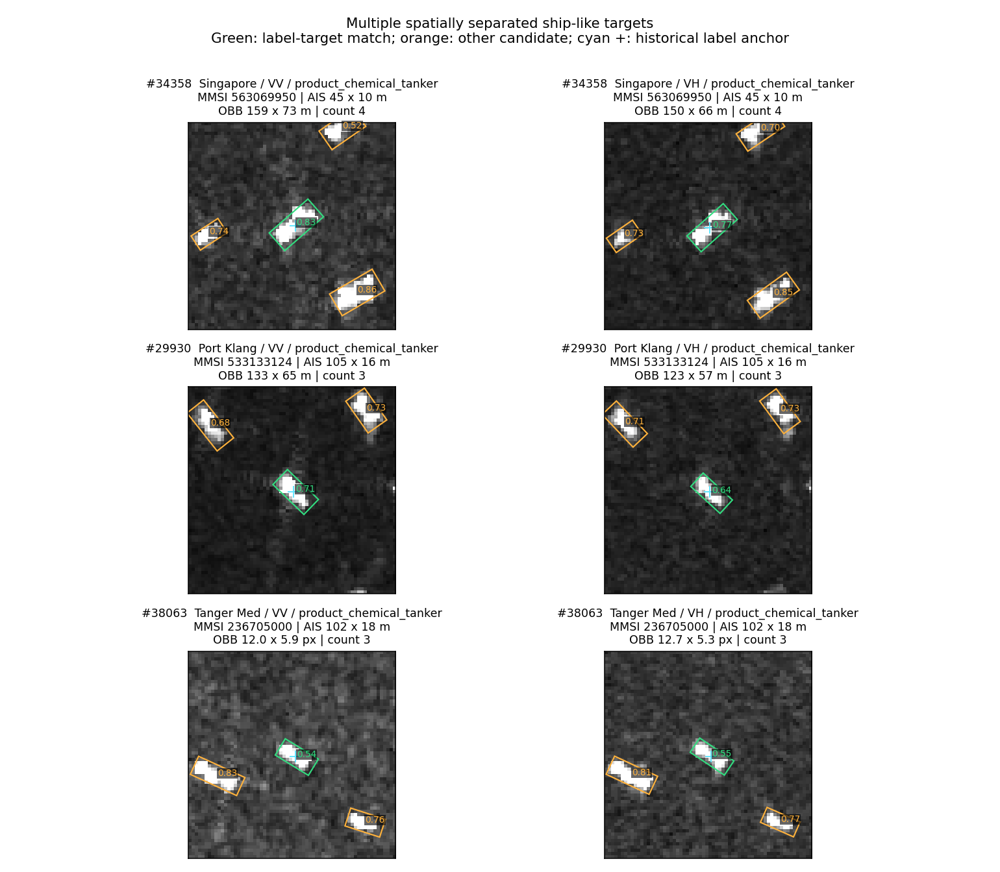
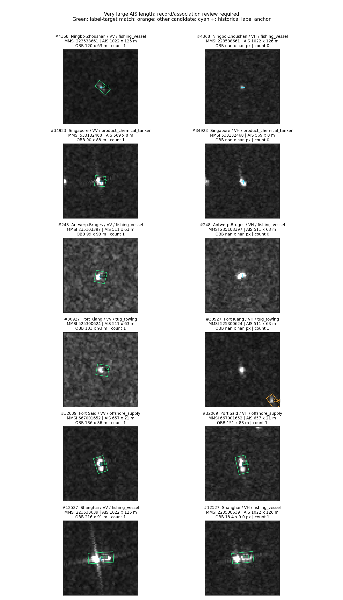
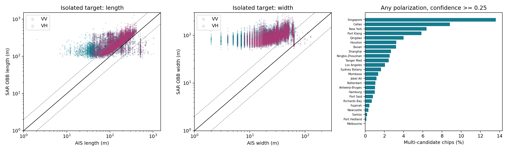
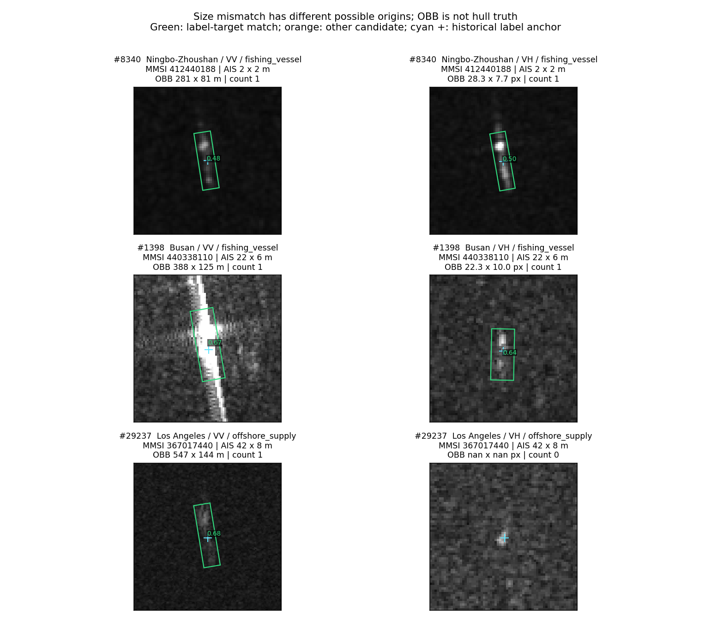

# 24港chip质量检查：多目标、AIS尺寸与检测框

日期：2026-10-17。**全量检测和候选复查已完成，原始图像、AIS、类别和训练划分均未改动。**

## 结论先说

确实发现需要处理的数据质量问题，但不能把所有“检测框与AIS不一致”都解释成配错船。

1. **一个分类样本里存在多个船状目标。** 38,091个VV/VH配对样本中，阈值0.25检出1,498个多目标候选（3.93%）；其中678个在两个极化中都检出多个目标。更换检测画布后，1,233个候选仍检出多目标。下面的真实chip能看到空间分离的多个目标。
2. **AIS尺寸参考本身有疑点。** 1,016个样本、290个不同MMSI涉及不同静态尺寸记录；另有511×63、1022×126、2×2米等需核实字段。这些值可追溯到上游原始TXT，不是本轮从框算出来的，也未发现由本地代码填成默认值。记录可追溯不等于物理尺寸可信。
3. **当前检测框不能直接当船体长宽真值。** 孤立、未截断、目标中心明确的VV样本中，框长/AIS长的中位数为1.408，框宽/AIS宽为3.645。图中有框包含强长条响应、弱拖长响应的案例。不能据此声称97%的AIS船宽错误。
4. **覆盖缺口仍须保留。** 只有21,199个样本至少一个极化同时具备目标匹配、AIS尺寸和可靠米制尺度。其余不能被归为尺寸正常。检测未通过阈值也不等于chip里没有船。

## 这轮实际做了什么

- 输入：`visual_reliable_baseline/artifacts/eight_class_adaptive_20260916/manifest.csv`，38,091个样本、24港、841个产品、18,766个非空MMSI；198行MMSI缺失。此前实验用的2,713个样本只是子集，**本轮不是仅查该子集**。
- 两极化全部PNG均实际读取，检测76,182幅影像。SAR OBB检测器为`v5_server_toolkit_20260912/models/550k.pt`，初检537.84秒。
- 原生像素不缩放，居中补零到512；最低保存置信度0.08，旋转NMS阈值0.30。保留所有候选，不只保留中心船。
- 主计数：置信度≥0.25、中心在chip内、长边≥4像素、短边≥1.5像素、长宽比≤25。另保留边界部分候选；本轮把这些候选纳入后，多目标样本数仍为1,498。
- AIS没有进入检测器。匹配已有目标时优先使用包含历史目标中心的框；多个框包含中心则记歧义。未包含时仅在中心距离≤`max(8, 0.15×chip短边)`内回退到最近框，并单独标记。
- 原manifest有12,435个样本缺chip内目标中心。使用原始裁片表恢复的偏移和源坐标补齐，没有把缺项当作漏检。这个中心是**历史目标标注中心，不是独立验证过的AIS投影位置**。
- 框几何使用检测器官方四角，消除宽高交换后角度错配风险；按对应极化的原始GDAL仿射线性部分把两条边转成米。未将AABB当船长，也未给缺失尺度默认填10米。

**重要独立性限制：** `550k.pt`曾用于旧V5匹配选框和裁片。本轮是同源检测器重检，不是独立人工真值验证。1024复查检验画布敏感性，同样不是第二个独立检测模型。参见`ais_metadata/PROVENANCE_FOLLOWUP.md`。

## 多目标统计

计数单位首先是配对样本：一个样本的任一极化有≥2个有效候选就进入候选清单。不是独立船舶数，也不是全部经人工确认的多船率。

|置信度阈值|VV多目标影像|VH多目标影像|任一极化多目标样本|双极化均多目标样本|双极化均零候选样本|
|---|---:|---:|---:|---:|---:|
|0.08|2,026|2,189|2,809|1,406|757|
|0.25|1,078|1,098|1,498|678|4,429|
|0.50|417|385|568|234|9,288|

阈值0.25下，各港候选比例包括：Singapore 716/5,259（13.61%）、Callao 42/476（8.82%）、New York 30/470（6.38%）、Port Klang 201/3,425（5.87%）。港间差异同时受样本组成、裁片、可见性和检测表现影响，不能直接解释为某港真实船舶密度更高。

图中绿色为匹配历史中心的目标，橙色为其他候选，青色十字为历史标注中心。第一行四个、第二和第三行各三个明显分离的船状响应。缺少可靠尺度时保留像素，不混填米。

**目视复核也发现计数局限：** #13525中心明亮响应未获得合格目标框；#9304的VH额外框靠近主目标延长方向，可能是响应分裂；#11717两条平行强响应仅凭chip不能确定是两条实船还是成像歧义。因此当前1,498是可复核候选数。额外目标的MMSI和类别没有被标定，不可宣称已经证明邻船与中心船异类。

## AIS参考和尺度覆盖

|证据范围|样本数|
|---|---:|
|AIS长宽有可追溯、正值且长≥宽的参考|37,090|
|其中：精确产品/MMSI/时间记录|16,596|
|其中：精确UID对象元数据|33|
|其中：同产品同MMSI静态一致参考|19,006|
|其中：跨观测同MMSI静态一致参考|1,455|
|没有可采用的尺寸参考|1,001|
|VV原生米制尺度有效|25,957|
|VH原生米制尺度有效|16,914|
|双极化尺度均有效|16,879|

尺度来自已关联的真实源GeoTIFF头和原始裁片尺寸，不是卫星产品名推测。完整关联、冲突、原始TXT行号、源仿射和缺失原因见`ais_metadata/ais_metadata_sidecar.csv`、`ais_metadata/README.md`。

本地导出只有总长/总宽，没有保留下来的A/B/C/D，未伪造这些分量。精确记录链也不等于AIS地理位置和图中船只已经独立确认。

### 需要单独核查的AIS字段

|字段现象|样本数|不同MMSI数|
|---|---:|---:|
|静态尺寸记录冲突|1,016|290|
|511×63米|192|99|
|1022×126米|22|12|
|1022×6米|12|1|
|2×2米|3|3|

整体有329行AIS总长>500米，4行≤5米；251行的长或宽具有511/1022/63/126这一边界值形态。上述集合有交集，不能相加当坏样本总数。

回读126个TXT中的245条选定异常记录，全部与原文件第15、16列一致，来源标记为BLM。导出代码直接保存服务端返回字节，本地解析直接读取长宽。**能定位到上游字段，尚不能定位为上游编码、设备配置、身份关联还是其他原因。**

ITU-R M.1371-5的尺寸分量规定中，511和63有“该值或更大”的上限编码含义；1022和126也恰好是对应两分量上限之和。这提供核查理由，但在没有原始分量和无线报文的情况下，**不能据总长/宽反推它们一定是哨兵值**。[ITU原始标准](https://www.itu.int/dms_pubrec/itu-r/rec/m/R-REC-M.1371-5-201402-I%21%21PDF-E.pdf)。采用此版本说明2024—2025数据时期的编码背景，不声称它是当前最新版。

## 尺寸到底能不能对上

本轮比较的是**SAR检测框地面投影长短边**与**AIS申报的物理总长宽**。它们不是天然相同的测量量。

宽松筛查阈值预先在分析脚本固定：长度比<0.5或>2且绝对差>30米；宽度比<0.5或>2且绝对差>20米。这是复核触发器，不是物理正确性的判决标准。

|统计口径|VV|VH|
|---|---:|---:|
|目标匹配且尺寸/尺度均可比较|20,611|15,103|
|单目标、中心包含唯一框、框不触边|19,800|14,348|
|上述严格子集的框长/AIS长中位数|1.408|1.342|
|上述严格子集的框宽/AIS宽中位数|3.645|3.360|
|上述严格子集触发船长差异筛查|3,726|1,687|
|上述严格子集船长落在AIS±25%内|3,609|4,034|

两极化合并去重后，21,199个样本至少有一个极化可比，其中4,558个触发长度筛查。这一宽口径包含多目标、近中心回退和边界案例；不能直接称为4,558个错配。

更严格地仅保留精确AIS记录，并排除静态冲突、边界值形态和极端总长，VV还有14,357例：框长/AIS长中位数仍1.389，框宽/AIS宽仍3.572，1,500例触发长度筛查。说明总体偏大现象不能全部归于那批明显可疑AIS参考；仍需独立测量/标注校准检测框。

在VV单目标子集中，AIS船长30—60米组的长度比中位数为3.424，200—500米组为1.258。小尺寸组差异更明显，但组间采集和类别组成不同，尚不能把它认定为某一种成像因素的因果证据。

Copernicus官方规格明确区分IW GRD HR约20×22米空间分辨率和10×10米像素间距。已有样本的实际换算仍使用源仿射；这个规格只说明“一个像素多少米”不能直接代表可测船宽精度。观测扩展、图像处理和框定义的各自贡献尚未分离。[官方产品规格](https://sentiwiki.copernicus.eu/web/s1-products)。

例如#1398的VV存在强长条响应，#29237的VV框覆盖弱延伸响应而VH未匹配到目标；这种情况不能直接拿框长指认AIS错误。也存在船长较接近的样本，例如#17484，AIS177米，VV框194米、VH框200米，但船宽仍偏大。正例见`size_agreement_examples.png`。

## 复查与验证

- 24港均匀覆盖的96对pilot：512与1024画布共192幅影像，190幅有效目标数一致；共同单目标171幅，长边相对差中位1.08%、95分位5.79%。
- 扩围复查6,160对：全部多目标/长度差异候选5,728对、按港抽取仅宽度差异336对、未触发这三类筛查的随机对照96对。**不是对全部宽度差异做1024全量复查。**
- 12,320幅复查影像中，11,317幅目标数一致；共同匹配目标的长度变化中位2.20%、95分位8.48%。
- 1,498个原多目标候选中1,233个保留；4,558个原长度差异候选中4,323个保留。这些仍是同源模型的稳定候选，不是人工确认数。
- 4项针对性代码测试通过：各向异性地面尺度和旋转边长、AIS不能影响选船、缺尺度不填补、多框歧义不进入严格尺寸子集。
- 元数据8项关联/冲突测试、38,091行对齐、45条跨15港原始记录回读通过；异常值另有上述245条回读。

## 文件和后续使用

- `multi_ship_candidates.csv`：1,498对候选，含原图路径和分极化目标数。
- `per_chip_quality.csv` / `per_view_quality.csv`：全量逐样本/逐极化结果、是否可比、目标匹配类型、单位和尺寸差异。
- `detected_objects.csv` / `full/canvas512/detections.jsonl`：所有保存的旋转框、置信度、四角、触边和可见比例。
- `size_mismatch_candidates.csv`：长度或宽度触发筛查的联合候选；**不要整体视作错标签名单**。
- `ais_attribute_review.csv`：静态冲突、极端值或边界值形态的参考字段及来源。
- `by_port.csv` / `by_class_name.csv`：分港/分类覆盖和候选比例。部分港没有可核实尺度，例如本次Qingdao米制可比数为0，不能据此说尺寸正常。
- `canvas_recheck_per_chip.csv`：哪些候选在1024复查保留。
- `visual_review_notes.csv`：目视案例事实与尚未确认的解释。图是有目的选例，不用于估计检测精确率。

建议保留原数据，先以这些标记构建“明确孤立目标 / 稳定多目标候选 / 尺寸参考可疑 / 尺度缺失 / 检测未匹配”等可重叠分组，再检查同一固定分类协议下的错误是否集中。这轮只完成质量检查，**没有证明这些问题导致多少分类掉点，也没有训练或更换主模型**。

复现顺序：`ais_metadata/build_sidecar.py` → `ais_metadata/finalize_interface.py` → `detect_chips.py --canvas 512 --batch 32` → `analyze_quality.py` → `detect_chips.py --canvas 1024 --batch 16 --rows-file recheck_rows.csv` → `compare_recheck.py` → `supplement_quality.py`。脚本在当前ClearSAR环境运行；检测脚本可从自身JSONL接续。
