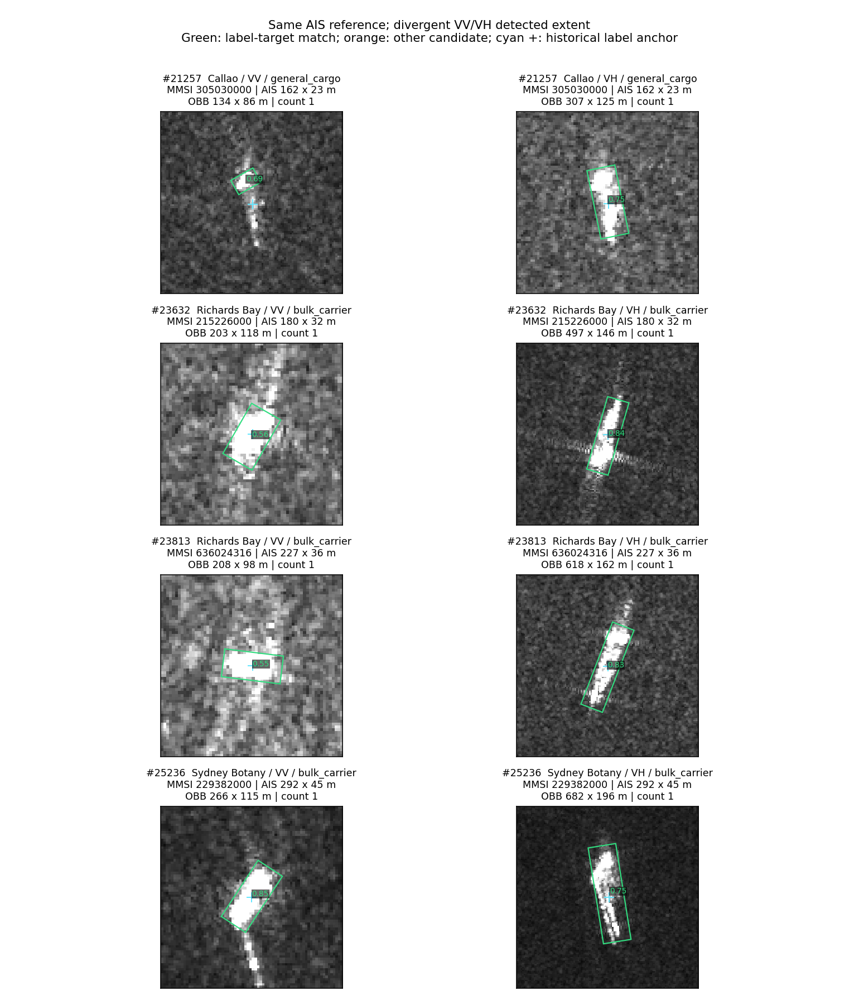

# AIS冲突幅度与船长差异的原因边界

2026-10-17。复用全量检测和AIS原始字段缓存，没有新训练、检测或标签修改。

## 回答一：290个MMSI的差距有多大

逐MMSI取已观察到的有效尺寸集合，长度差为最大长度减最小长度，宽度同理。290个MMSI每个只计一次，不能把1,016条重复样本当1,016条船。

|船长最大差值|MMSI数|
|---|---:|
|不超过2米|69|
|超过2米、不超过10米|137|
|超过10米、不超过50米|73|
|超过50米|11|

长度差中位6米、P90为15米、最大512米；宽度差中位0米、P90为2米、最大90米。24个MMSI的长或宽最大/最小比至少为2。若用长度差≤5米且宽度差≤2米描述轻微差异，则106个满足。

因此，多数不是成倍跳变，但不能说都无关紧要：247/290属于渔船，长度最大/最小比中位1.193548，即相对较短记录约19.35%。这里的几米可能已占短船尺寸较大比例。描述阈值不是判断哪条记录正确的标准。

已回读原始TXT验证的例子：

- MMSI205569000：291×45与292×45米。
- MMSI412352189：22×6与28×6米。
- MMSI312866000：27×5与76×12米。
- MMSI244632000：132×16与644×80米。
- MMSI412418993：42×8与379×98米。

同MMSI两组字段真实存在已经核实；仍未证明它们一定属于同一条物理船，或是哪一条字段错误。记录更新、上游属性来源、身份关联等原因尚未分开。完整逐MMSI表与10条原始行证据在`../conflict_magnitude/`。

## 回答二：4558个长度差异是AIS错还是配错

**现有证据还不能逐例二选一，而且还有图像/检测框测量口径这一类解释。** 已确认AIS记录层面有不一致；尚未获得全量独立AIS—SAR几何匹配真值，不能报告“多少百分比是错配”。

4558个候选来自21199个至少一极化可比的样本，筛查条件为框长/AIS长<0.5或>2，同时绝对差>30米。交叉统计如下，各行不是互斥原因分解：

|与长度差异候选同时出现的现象|样本数|
|---|---:|
|框长大于AIS两倍，且差>30米|4295（94.23%）|
|框长小于AIS一半，且差>30米|263|
|同MMSI静态尺寸记录冲突|304|
|AIS总长>500米或≤5米|179|
|AIS长宽出现511/1022/63/126边界值形态|131|
|上述三种AIS参考疑点的去重并集|485（10.64%）|
|任一极化存在多目标候选|328（7.20%）|
|既有AIS参考疑点又有多目标候选|49|
|这两类标记都没有|3794（83.24%）|
|触发长度筛查的框触边|38|
|触发长度筛查的框不是唯一包含历史中心的匹配|13|

485不代表已经确认485个AIS尺寸错，328不代表已经确认328个配错。无疑点标记也不等于正确：一致填写的AIS字段也可能不准确，单目标chip也可能关联到不正确的身份。

4295个框偏大的候选中，2542个AIS船长≤60米。这与小尺寸目标上检测框/响应范围偏大的表现相符，但也兼容AIS偏小或错配，不能把这个统计自动命名为分辨率导致的因果结果。

## 关于配错，我们目前知道什么

- 4558个候选中，762个在已有VV裁片元数据中记为`nearest_uncertain`，579个已有位置不确定性字段>500米。这些历史字段提供优先复核依据，不是本轮独立量出的误差；部分记录缺少该字段。
- 在可比样本中，`nearest_uncertain`组762/1287触发长度筛查，`bracket_interpolation`组809/2640触发。两组类别、船长和来源组成不同，不能把差异直接归为匹配算法的因果作用。
- 本轮的检测目标选择依赖历史目标中心，因此不能拿它独立证明历史SAR—AIS身份关联正确。重跑同源检测器也无法补上这个证据缺口。
- 要确认某个错配，应回到SAR观测时刻的AIS轨迹位置及原始场景，比较周边候选目标，并处理已有时间、位置不确定性。单看chip尺寸不足以完成身份归因。

## 图像和检测结果也有不可忽略的差异

14515个样本两极化均可核对尺寸，其中70个VV与VH框长相差超过两倍且超过30米，57个同时属于4558长度差异候选。

例如#23813的AIS船长均为227米，VV框长207.7米、VH框长618.4米，源像素间距均为10米。但两极化的历史目标中心相距216.7米，窗口/关联不完全相同。因此，这个例子说明仅靠一组AIS数字不能解释全部核对结果；**不能把它当作已经严格控制同目标同窗口、从而证明纯极化效应的实验**。图像响应、检测框、裁片和两极化关联仍需进一步拆开。

## 本轮确定与未确定的部分

- 确定：AIS参考存在从1米到数百米的记录矛盾；大多数冲突不是极端跳变。真实原始字段回读通过。
- 确定：检测框尺寸和AIS物理尺寸并不直接等价，存在明显偏大和两极化不一致的输出；这种输出不宜当无误差的船体测量。
- 未确定：4558个候选中AIS字段错误、SAR—AIS配错、检测/成像/裁片差异各占多少，是否叠加。当前没有独立逐例原因标签。
- 未做：自动改AIS、删除候选、根据尺寸重新配船或重训分类器。本轮也不把多船率当错配率。

复现：现有ClearSAR环境运行`../analyze_discrepancy_causes.py`。`length_candidates_with_evidence.csv`为4558例交叉表，`overlap.csv`是AIS疑点与多目标的2×2表；`by_*`表只报告关联。极化案例图用上层`analyze_quality.gallery`读取本轮原始chip和检测缓存生成。
