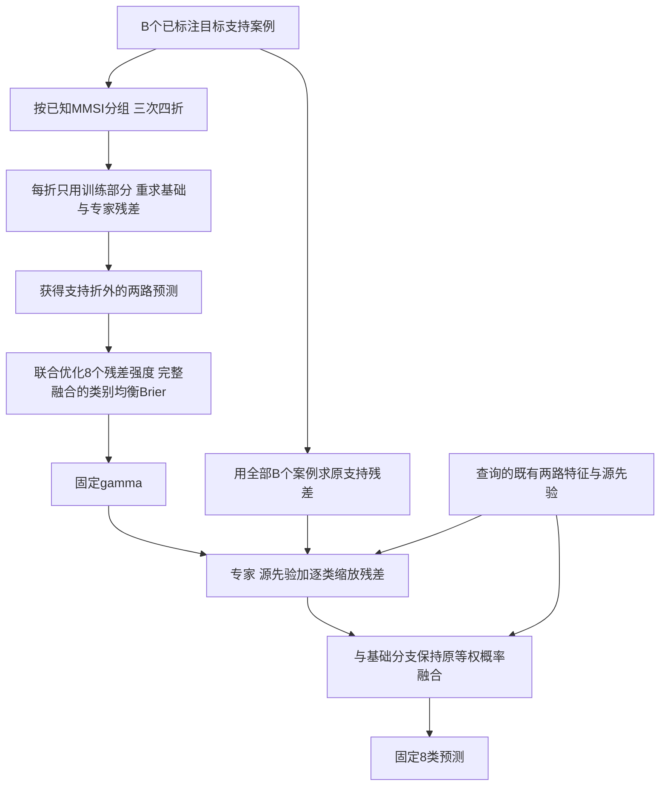

# 竞争感知的逐类残差调控：方法、收益与边界

日期：2026-10-12。本轮已完成模块实现、源端选择与留船评价、25个目标任务的375个配对评价单元，以及效用迁移诊断。未替换论文主模型，未改侧线工作，未启动下一轮训练。

## 结论先说

**我们已经把“根据实际作用分配修正强度”做成了一个轻量候选模块，找到了局部完整收益，也定位了它扩大使用时的两类瓶颈。**

- OpenSARShip 2.0、16个支持标签：完整模型 OA/BA 为37.2442%/27.5774%，相对原模型提高0.2965/0.5311个百分点，类别宏 Brier 同时降低0.002084。相对同协议的一维统一缩放，OA/BA提高0.8663/0.6712个百分点。这是值得保留的逐类适配正信号。
- 更广任务上的主要进展是概率风险，而非总体分类突破：23港三个预算的宏 Brier 均改善，BA分别下降0.7123、0.5910、1.3226个百分点。统一缩放也能得到其中大部分风险收益，不能全部记到逐类新设计名下。
- 不同失败需要不同解释：OSS2大预算可以较好预测哪些更新降低概率风险，却没有兑现为更高BA；F_0921 B64连支持端估计的效用都没有可靠迁移。不能把两者都概括为“没学到”，也不能都归因于最后融合。

这是研发候选的范围化结论，不是每个数据集挑最优方法组成的部署策略。历史原修正器和计数锚定的正结果仍保留，不因本轮负结果被抹掉。

## 1. 文献借鉴与实际改造

详见 [五篇近邻论文的方法精读](E:/临时会话/classwise_utility_adaptation_20261012/LITERATURE_ZH.md)，包含正文公式、标签使用与作者实现。

| 近邻方法 | 借鉴的核心 | 本项目具体调整 |
|---|---|---|
| ProKeR，CVPR 2025 | 保留源预测，以支持案例形成核残差 | 复用现有SAR先验与核，不把核残差重新命名为创新；新增的是残差输出效用控制 |
| Learning to Reweight Examples，ICML 2018 | 更新是否有用，应由验证任务判断，而非只看数量或损失大小 | 不增加干净目标验证集；在既有B个标签内按船交叉拟合，学习八个输出修正强度，不复现其在线样本重加权 |
| SUR，ECCV 2020 | 用少量任务相关参数适配已有表示 | 保留原双路与核，只优化8个残差幅度；与1个共享幅度直接比较 |
| CLAP，CVPR 2024；SS-Text+，MICCAI 2025 | 少样本、不平衡或缺类时，需要合理保留源知识 | 不把类别计数当作真实可靠性，保留计数锚定等已有强对照，评价更新对完整融合的作用 |

**候选贡献表述：** 针对跨港少标注识别中“支持数量不等于修正可靠性、单类修正会改变其他类决策”的问题，利用船级分组交叉拟合获得可用的支持外预测，在实际双路融合风险下共同分配类别残差强度，并通过真实类别与更新列的效用矩阵解释收益和误伤。新增价值需要由相对共享强度的收益及其适用范围支撑，而非普通CV、八个参数或模块名称本身。

该表述是可发展的研究贡献，不宣称绝对首创。当前实现中的竞争来自联合softmax风险，8×8矩阵用于事后解释，不是已实现的显式矩阵选择器。

## 2. 从已观察问题到模块

前轮23港B128缓存干预显示：仅施加低支持类限制，BA下降0.943个百分点；仅放宽高支持类更新，OA提高2.149个百分点，但BA仍下降0.188。这说明：少案例的有用修正可能被挡住，多案例的有效修正也可能误伤其他类别。数量规则不能直接代表任务效用。

本轮改变的是专家输出中“目标支持残差”的幅度，而非源先验、基础分支或特征：

\[
z_E(x;\gamma)=p_{src}(x)+\gamma\odot r_S(x),\quad
\gamma\in[0,2]^8.
\]

\[
P(x;\gamma)=\tfrac12\{\operatorname{softmax}(z_B(x))+
\operatorname{softmax}(z_E(x;\gamma))\}.
\]

\(\gamma_c=0\)表示该列只保留源先验，1表示原专家，2表示将该列支持残差加倍。每个支持任务得到一个八维向量，不是逐图动态注意力。某一列不变也不保证其概率或召回率不变，因为类别共同竞争。

目标为类别均衡的完整融合Brier加 \(\tau\|\gamma-1\|^2/8\)。正则回缩到原适配器，不是回缩到纯源模型。联合计算所有支持可见真实类别的风险，使优化考虑“帮助这一类时是否伤到其他类”；并没有保证每类不受损的硬约束。

支持内部三次四折都按已知MMSI分组；未知身份按行独立处理。每折同时重求基础与专家残差，岭强度保持训练样本数/8。最终仍用全部B个案例求残差。查询标签不进入gamma拟合或tau选择。

## 3. 替换对照与冻结规则

- **raw：** 原双路完整模型。
- **global：** 只学习一个共享幅度；同样的支持交叉拟合、完整融合风险、取值范围与源端选择机会。它是检验逐类自由度新增价值的主要参照。
- **self：** 每类只在真实标签属于本类的支持折外样本上优化自己的幅度，最后合并。该子问题仍计算8维Brier，但没有评价其他真实类别的后果。
- **joint：** 八列共同优化所有可见真实类别的完整风险。
- 同时保留原修正器initial、计数锚定count、既有源端选择的简单衰减simple。

在源FIT的81个任务单元，以跨预算平均宏Brier，从0.003/0.01/0.03选择每种策略唯一tau：global/joint=0.03，self=0.003。源HELD的27个单元不选tau。三个geometry context重复使用同一批留船样本，不是三个独立目标港。

源HELD B128，joint相对raw OA/BA为+0.2127/+0.5673个百分点，global为−0.0266/+0.0274；B16 joint为+2.6582/+4.0684，但已有固定衰减更好；B64 joint为−0.4785/−0.2104。源FIT的BA也并非全面改善，joint三预算分别−1.3032/−0.9696/−0.4303。没有把源端结果包装为稳健全胜；根据已声明的局部可用性原则冻结规则并扩展覆盖。

随后23个合格目标港、F_0921、OSS2各用B=16/64/128与五组历史支持，共375单元。所有新目标预测冻结后才评估查询标签。没有根据目标结果改tau、选择逐预算策略或拼接目标最优方法。

**self与joint是策略替换，不是严格单因素消融：** 两者tau独立源选，缺类时可动列与有效正则尺度也不同。其差值不能全部归因于“是否考虑竞争”。

## 4. 完整模型结果

下表OA/BA单位为%，差值为百分点；宏Brier差负数为改善。23港先对支持抽样取均值，再对港口等权；每港BA只平均该查询集实际存在的类别。

| 数据范围 | B | joint OA | joint BA | ΔOA | ΔBA | Δ宏Brier |
|---|---:|---:|---:|---:|---:|---:|
| 23港 | 16 | 63.9760 | 48.3791 | −0.9542 | −0.7123 | −0.003903 |
| 23港 | 64 | 64.8390 | 55.2642 | +0.1621 | −0.5910 | −0.020667 |
| 23港 | 128 | 63.5047 | 56.3115 | −0.3323 | −1.3226 | −0.023992 |
| F_0921 | 16 | 30.0705 | 22.0076 | −0.5956 | +0.3491 | −0.000402 |
| F_0921 | 64 | 34.5711 | 26.3270 | −0.4870 | −1.4039 | +0.002295 |
| F_0921 | 128 | 37.5947 | 29.8589 | +0.6549 | −0.7031 | −0.001424 |
| OSS2 | 16 | 37.2442 | 27.5774 | +0.2965 | +0.5311 | −0.002084 |
| OSS2 | 64 | 41.9419 | 34.1845 | −0.4942 | −0.4874 | −0.009990 |
| OSS2 | 128 | 41.9767 | 36.4999 | −0.6163 | −0.7698 | −0.016430 |

完整方法及逐港、逐类、五组抽样结果见 [TABLES_ZH.md](E:/临时会话/classwise_utility_adaptation_20261012/TABLES_ZH.md) 与同目录CSV。

### OSS2 B16的增量是否超过简单替代

| joint相对参照 | ΔOA | ΔBA | 五组支持中BA正收益次数 |
|---|---:|---:|---:|
| 原模型raw | +0.2965 | +0.5311 | 3/5 |
| 共享强度global | +0.8663 | +0.6712 | 4/5 |
| 各类各自优化self | +2.0756 | +2.0365 | 5/5 |
| 计数锚定count | +0.7151 | +0.4794 | 2/5 |
| 原修正器initial | +0.3605 | +0.9948 | 4/5 |
| 简单衰减simple | +3.5000 | +1.7197 | 5/5 |

正信号成立于均值和部分重复，但并非每次抽样都胜。尤其相对count，均值优势不等于多数抽样优势。五组支持不是五个神经训练种子，也不是独立新数据确认。

该范围中渔船召回提高9.2857个百分点，对八类BA贡献+1.1607个百分点；散货船与普通货船也获益，但成品/化学品船和原油船分别贡献−0.8590/−0.4596个百分点。**净收益来自救回与误伤的差，不是所有类别一起提升。** 这些是完整联合版本的类别结果，不能仅由平均gamma大小认定某个参数独自导致了全部变化。

### 广覆盖新增价值在哪里不足

23港B64/B128，joint相对global的BA仍为−0.4876/−0.5404个百分点；其额外宏Brier改善只有0.001179/0.001288，而global相对raw已改善0.019488/0.022703。因此当前广覆盖风险收益主要支持“需要调控残差强度”，尚不充分支持“必须增加逐类自由度”。F_0921 B64/B128的既有count方案仍更有利，保留原结论。

## 5. 为什么有的地方有效，有的地方没有

### 5.1 检查到什么，而不是猜根因

代码审阅没有发现核心求解、梯度或源FIT/HELD先验混用错误。独立8列、缺类有限差分最大误差1.73e−10。源分数回放通过；目标每单元最多32查询重求原专家与缓存相符。唯一具体错误是统计字段把全部组数命名为known_group_n，已更正为group_n，不改变预测。

这支持继续检查目标与效用迁移，不等于穷尽所有可能实现问题。

### 5.2 建立“真实类别×被改变输出列”的效用矩阵

固定其他gamma为1，每次仅将一列改为学到的值，分别计算支持折外与查询集的宏Brier变化。正值表示降低风险。保留每个真实类别，支持缺席类记为缺失而非零效用；另报告共同可见类别范围。

矩阵用于回答：**某列更新在支持端预计帮助谁、伤害谁，到了查询集是否仍然如此？** 所有查询分析都是预测冻结后的诊断，不参与训练。softmax下这些单列作用非线性耦合，不能把它们相加当作联合收益的因果百分比。

| 范围 | B | 支持估计与查询效用Spearman | 有益/有害排序AUC | 符号一致率 | 一律猜有益准确率 |
|---|---:|---:|---:|---:|---:|
| F_0921 | 64 | −0.294 | 0.501 | 35.0% | 32.5% |
| OSS2 | 16 | 0.149 | 0.586 | 42.5% | 47.5% |
| OSS2 | 128 | 0.796 | 0.857 | 80.0% | 75.0% |
| 23港 | 64 | 0.481 | 0.607 | 68.6% | 68.8% |
| 23港 | 128 | 0.633 | 0.656 | 75.8% | 75.9% |

各外部数据集40个列更新事件、23港920个事件；它们共享查询/支持/港口，不作独立样本显著性检验。完整与共同类别结果见utility_alignment_summary.csv。

**发现A：确实有可迁移的概率风险信息。** OSS2 B128的效用排序有较强关联，说明“学生/适配器完全没有可用信息”不符合本轮证据。但其BA仍下降0.7698个百分点，当前所学效用与最终分类目标不是同一回事。

**发现B：支持端估计也可能过于乐观。** 支持折外预测对残差读出是折外，但gamma正是用这些折外标签拟合的，所以gamma的OOF风险下降属于拟合改善，不是它的独立泛化成绩。23港B128中911/920个更新被估计为有益，实际218个是误报有益；符号一致率甚至不优于一律猜有益。不能用75.8%这个数字宣称已学会可靠避害。

**发现C：F_0921 B64主要是效用迁移不足。** 全类别风险效用相关为−0.294，共同类别仍为−0.167；不是简单由支持缺类解释。其宏Brier和BA同时退化，不适合只归咎于argmax或概率融合。当前尚不能在表示差异、少样本估计和支持代表性中认定唯一根因。

**发现D：OSS2 B16有净分类收益，但尚未获得可靠的逐列收益预测器。** 其列效用关联弱，当前可解释的是实际修正、类别救回/误伤和替换对照，不应将完整正收益扩大为“每一列都提前判断正确”。

风险下降可能包含置信度、类别区分与决策变化；尚未分解出纯校准贡献。这里不声称分离了物理因果因素。

## 6. 当前选择与下一步

**保留候选，不全面替换主方案。** OSS2小预算的完整净收益及源HELD B128信号值得记入论文候选证据；广覆盖概率风险收益也是有用中间结果。当前不足之处应指导针对性改进，而非一票否决或用新模块掩盖。

下一步最有价值的是先检验两个可区分的问题，尚未启动：

1. 在源端留船任务中独立检验效用估计器，区分“拟合gamma所用OOF风险下降”与“未参与gamma拟合的案例真正受益”。优先利用已有缓存与源任务，不新增目标标签。
2. 对已冻结预测分析概率风险改善与决策救回/误伤的关系，确认可用支持证据是否能预测净分类收益。只有看到值得利用且能预测的收益空间，才将目标改为与决策边界更贴近的适配损失。

目标不是再换一个损失名称，而是确定应改“估计是否可信”还是“估计的效用是否对准识别”。两者可以因任务而不同。不得把本轮目标查询结果用于事后预算最优拼接后再称验证完成。

## 7. 成本、完成状态与材料

- 源阶段108单元；目标375单元，预算16/64/128、五组历史支持、25任务。无骨干或源头重训，无新神经训练种子。
- 缓存条件下源预测冻结约9.03秒，目标约142.49秒；不包含既有特征提取、评估、诊断、报告，不能作为端到端推理时延。新增主要成本为每支持任务的重复折内小型求解与8维优化；查询端为残差列缩放。
- 核心5项测试通过；独立代码审阅完成。目标复算是每单元最多32查询，不是本轮对全部查询重新提特征。
- 目标沿用历史支持/查询行级排除，未新增严格船级外部测试；内层按船分组不改变这一边界。未知身份没有冒充已知船。
- 源HELD使用原留船队列，不是三个独立港；历史开发数据不是新独立确认集。
- 所有本轮必需进程已退出，审阅代理已结束。元数据字段更名不需要重跑实验。

材料：PROTOCOL_ZH.md、LITERATURE_ZH.md、TEST_AUDIT_ZH.md、TABLES_ZH.md、target_metrics.csv、target_classes.csv、utility_matrix.csv、utility_alignment_summary.csv。实现：core.py、run_source.py、run_targets.py；诊断：analyze.py。

