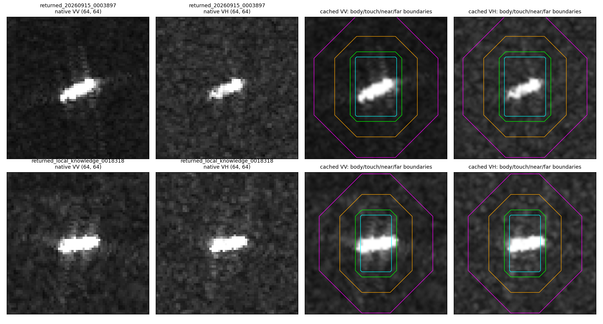
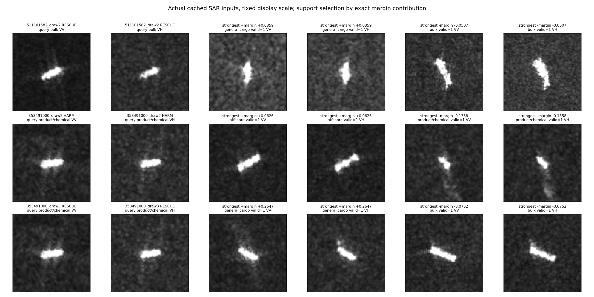

# 本轮改判的原图、区域与支持案例诊断

2026-10-16。回应“有没有真正从数据图像上找原因”。

后续追溯已完成：见`geometry_trace/FINDINGS_ZH.md`。发现并修复旧检测适配器排序宽高却不调整OBB角度的真实错误；同权重四图重检触发该错误。历史原始OBB未保留，不能一律交换旧框。本页保留追溯前的观察；新查询区域冻结诊断没有带来净分类增益，尚未一致重训。

## 先纠正上一轮的解释层次

上一轮证实了字段恢复、任务覆盖、支持组合和决策变化，但没有逐张检查这批改判原图与真正参与求解的支持图。
“解除了门槛，所以局部证据能参与”是计算路径解释，不是船体/海面物理机制的解释。
本次补看全部两个跨采集改判查询，使用seed0对应三个事件，并查看它们的全部32支持；没有新训练、修改框或挑选参数。

## 1. 图像确实提供了一个具体问题

两张原始VV/VH裁片都是64×64。当前显示中，船的主要可见结构是短小高亮块/亮条，未见能直接确认船型的清晰甲板细节；VV/VH背景颗粒和方向性延伸响应不同。
这里说的是实际uint8输入可见性，不证明原始辐射数据同样缺少信息，也不把任何延伸纹自动认作尾迹。

化学品/成品油船353491000的高亮结构偏横向，但当前区域读出用的VV框为x=[25,39)、y=[19,45)，是偏纵向的14×26框。
框上、下包含较多非高亮区，左右部分连续高亮响应进入贴框邻域。因此**模型里的“框外”不是物理意义上的纯海面/纯背景，框内也不是纯船体分割。**

已回查原server2裁片清单：两张图、两种极化的四组框，均与原left/top/right/bottom减去crop_left/top一致；64×64尺寸也一致。
所以这不是当前绘图时x/y翻转造成的。原框为何与当前亮结构形状不贴合，尚未追到原始检测几何，不能在这里断言是尺寸互换、旋转漏处理或标注错误。

| 查询 | 原VV中显示值>=200的像素落在框外 | 原VH对应数量 |
|---|---:|---:|
| 化学品船353491000 | 13/91，14.3% | 8/81，9.9% |
| 散货船511101582 | 0/74 | 0/53 |

这是固定阈值的可见亮响应统计，不是物理船体真值。实际56格区域投影至128缓存后的对应比例为VV13.4%、VH8.1%，强度重采样与区域离散化口径不同，分开保留。
它足以指出“环带贡献=海面背景贡献”的解释不成立，尚不足以证明把框改紧一定提高分类。

前两列为原64×64裁片；后两列为实际128缓存与区域边界。青色为船体框并集，绿色/橙色/紫色为膨胀2/8/16后的边界。

## 2. 同一张图为何有时救回、有时误伤

同一化学品船353491000、同一原始查询图：

| 支持抽样 | 旧预测→新预测 | 32个支持中可用于新几何核的数量 | 同类支持总数/可用数 | 真类对竞争类概率差 |
|---|---|---:|---:|---:|
| draw2 | 化学品船→海工供应船，误伤 | 12 | 5/2 | +0.006097→−0.005897 |
| draw3 | 普通货船→化学品船，救回 | 6 | 5/1 | −0.004000→+0.007226 |

图像没有变化；同类支持总数也同为5，但可用支持身份和其余类别关系变了。更多有效支持并不保证该例更正确。
全部支持图显示：同类船之间亮结构大小、方向、周围响应差别较大，不同类别也可呈现相近的短亮条/亮块。对此只能说“表观混淆在这些实例中可见”，不能凭肉眼判定模型具体使用了哪种物理因子。

代数路径进一步表明，救回不是简单的“找到了更像的同类案例”：draw3推动真类对普通货船分差的最大正贡献来自一张普通货船支持（+0.2647）；draw2最大负贡献来自一张同类化学品船支持（−0.1358）。
这是带符号的支持残差与联合求解产生的**分差贡献**，不是相似度本身，也不等于删掉该支持后的因果效果。完整32支持均参与原分类求解；几何无效支持只是不参与新增局部核，并非从分类器里删除。

散货船511101582也只有一个很小的旧概率劣势：真类对普通货船−0.003332，校正后+0.009599，最终被救回。该例同类支持4个均有效。

每行依次为查询VV/VH、最大正分差贡献支持VV/VH、最大负分差贡献支持VV/VH。显示固定0–255，不对每图单独增强对比度；代表支持按已记录的代数贡献选择，不能用来估计普遍发生率。
完整支持图另存为各MMSI_draw编号的all_supports.png，全部逐项贡献见all_support_contributions.csv。

## 3. 环带究竟在哪里起作用

将有界新增核按三个环带、四个方向槽作精确代数拆分，保持旧支持系数的直接分差项为：

| 案例 | 贴框0–2 | 邻域2–8 | 远域8–16 | 重新求解系数项 |
|---|---:|---:|---:|---:|
| 化学品船draw2误伤 | −0.038222 | −0.033397 | −0.042177 | −0.041754 |
| 化学品船draw3救回 | +0.040831 | +0.028850 | +0.033468 | +0.019990 |
| 散货船draw2救回 | +0.040278 | +0.031716 | +0.035305 | +0.020383 |

三个区域在每个案例中同向推动分差，不能把收益独归于某个“关键尾迹区域”。区域项包含与船体局部特征的共同映射、支持中心化和整体有界缩放，不能当作独立区域遮挡效果。
显示中远环多为颗粒状背景，贴框环又可能含目标关联亮响应；这说明物理命名和实际区域含义尚未完全对齐。

## 4. 已找到与仍没找到的原因

已直接看到：粗区域不等于物理船体/背景分离；这些查询结构细节有限；实际支持外观跨度较大。
已计算验证：查询不变时，支持组合、带符号关系和重新求解会使分差变化反向；本轮跨采集改判发生在很小的概率差附近；旧预测重放与分差和式通过。
尚未证明：究竟哪个船体散射点、海面纹理或观测几何物理因素导致上述效果；是否某类背景普遍可迁移；修正框后性能是否增加。

所以当前更准确的说法是：**已经找到一处真实的区域语义混合，并定位到支持关系如何推动救回/误伤，但还没有把有用图像线索分离成明确的物理原因。**
后续优先核对原检测几何与实际区域，再比较原区域与目标关联区域的固定模型诊断，区分目标亮响应补偿和真正的邻域证据；不直接交换宽高、不修改旧结果，也不立即堆新网络。

## 复现记录

- `../inspect_visual_cases.py`：3个实际案例、全部支持、两个原查询的区域与显示统计；无训练。
- `../check_visual_regions.py`：4组原裁片框与像素尺寸核对。
- `case_accounting.csv`：完整概率重放，直接核项+系数项=专家分差变化。
- `region_slot_contributions.csv`：逐支持、逐区域/方向槽的可加核贡献。
- `region_source_check.json`：原框来源与高亮越界统计。
