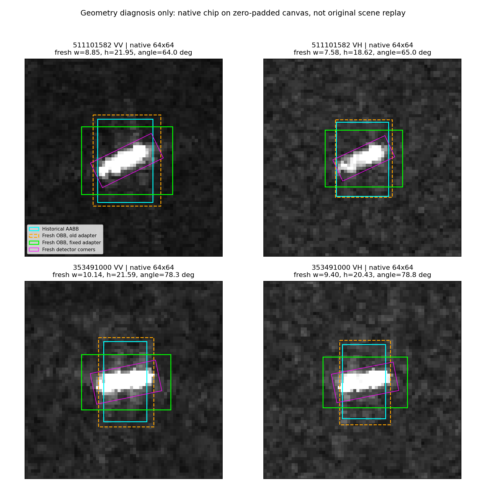

# 原始框追溯、OBB修复与冻结分类器诊断

日期：2026-10-16。承接上一轮两张真实查询图的区域混合问题。

## 结论

**找到并修复了一处真实的上游检测几何错误，不再只是凭图像外观猜测。**
旧检测适配代码将旋转框的宽、高按大小重新排序，却保留了原角度。Ultralytics的xywhr角度绑定原width轴，不保证width总是长边；当width<height时，这个排序改变了矩形方向。

原始四份JSON都使用了该流程输出的轴对齐框；本轮用同一历史权重对四张原裁片重新检测，四张均产生width<height，旧代码确实会处理错这些新的真实检测输出。修正框与可见亮结构方向更加一致。

**但本轮没有证明修框已经带来分类收益。** 冻结训练结果和支持区域、只替换两张查询的局部读出时，纠正适配器没有新增救回，两个模型版本的跨采集对照各多1次误判。这个结果保留，不把几何正确性等同于涨点。

## 1. 追到的完整路径

```text
YOLO输出原始 (cx, cy, width, height, angle)
    ↓ 旧代码把width/height排成长/短边，未调整angle [已证实错误]
按angle投影为轴对齐外接框，并乘1.25留边
    ↓ 保存时cxcywh_angle中的angle置0，原始OBB未保留
JSON → floor/ceil边界 → manifest原框
    ↓ 按中心裁64/128方形上下文，保留原框字段
原图64×64 → 模型128缓存 → 112输入 → stem56×56
    ↓ 原框定义主体、贴框、近环、远环
局部槽读出 → 查询/支持关系 → 支持残差求解 → 完整概率融合
```

根脚本`sea_ship_redetect_preview.py`旧第299–310行和归档toolkit第300–311行包含相同排序问题。当前根脚本已修复：长短边仅用于尺寸筛选，存储几何仍保留原width、height、angle配对。算法版本随修复更新，避免新运行将旧缓存当成同一算法完成。
新增`redetect_obb_cxcywh_angle_deg`保存原始旋转几何，避免再次只留下归零角的外接框。历史toolkit、JSON、manifest、PNG、模型及预测缓存均未改写；归档toolkit仍是旧代码，不应直接当作修复版重新部署。

独立检查crop/export和context代码，没有找到另一处已证实的显式旋转/转置错误。64×64图片与14×26目标框并不矛盾：前者是方形上下文，后者是其中的目标区域。详见上级`crop_code_review.md`。

## 2. 原记录与实际图像验证

- 两个查询：散货船511101582（全局行24846）；化学品/成品油船353491000（35475）。各VV/VH，共4图。
- 原JSON通过obj_uid及source_object_index定位，浮点pts向外取整后，4/4与原crop manifest边界一致。
- 原JSON仅保存轴对齐结果，且angle=0；没有找到这4次历史检测未排序的原始OBB。不能根据现有外接框反推出每条历史记录该不该交换宽高。
- 重检使用归档`v5_server_toolkit_20260912/models/550k.pt`，原64像素不缩放，放入1024零填充画布；只按距中心16像素内最高置信度选目标，不用船型标签或分类结果选框。
- 新的4个原始OBB均width<height。其角点与修复适配器外接范围一致；旧适配器在同一个OBB上给出错误方向。
- **零填充画布不是原大图上下文。** 新框尺寸与历史框有差别，因此这不是历史检测的数值精确重放，也不足以确定整个数据集受影响比例。

| 查询/极化 | 原框外亮像素 | 新检测+旧适配器 | 同一新检测+修复适配器 |
|---|---:|---:|---:|
| 散货VV | 0/74 | 0/74 | 0/74 |
| 散货VH | 0/53 | 0/53 | 0/53 |
| 化学品VV | 13/91 | 1/91 | 0/91 |
| 化学品VH | 8/81 | 0/81 | 0/81 |

亮像素沿用固定显示值>=200，仅是输入可见亮响应，不是船体分割真值。**原框到新修复框的变化同时包含重新检测与几何修复，不能把13→0全部归因于修复。** 同一新检测的旧/新适配器才是隔离宽高错误的对照。



青：历史框；橙虚线：新检测经过旧适配器；绿：同一新检测经过修复适配器；紫：新检测的原始旋转角点。

## 3. 冻结完整分类器的小对照

不训练、不选倍率、不改支持、不改基础B、不改船轴/雷达轴。只修改新增局部关系分支的查询区域，重新读取同一个冻结stem中的局部槽。

三种输入：历史框；新检测+旧适配器；同一新检测+修复适配器。框均按原floor/ceil规则离散，再使用原VV/VH并集、0–2/2–8/8–16环带和原角槽规则。

范围：原有strict和optional两种模型，各3个训练种子；同场景/跨采集分别覆盖这两个查询的全部5个支持抽样。每个模型×场景×方案是30次预测，但只有2个查询，不是30个独立样本。总360条预测，无新增训练。

| 版本/任务 | 历史框判对次数 | 新检测+旧适配器 | 同一新检测+修复适配器 |
|---|---:|---:|---:|
| strict 跨采集 | 6/30 | 6/30 | 5/30 |
| optional 跨采集 | 8/30 | 6/30 | 5/30 |
| strict 同场景 | 15/30 | 15/30 | 15/30 |
| optional 同场景 | 13/30 | 12/30 | 12/30 |

适配器单独对照的两次误伤：strict种子1/化学品船draw3，真类对普通货船分差0.003611→−0.000659；optional种子0/散货船draw2，真类对普通货船0.003185→−0.001000。两者都在很小的决策边界附近。

这两张图是上一轮按改判选出的事后诊断案例，**不能报告成新方法OA/BA，也不能据此估计修复的总体利弊。** 它回答的只是“区域改变是否传入了当前完整决策、是否立即救回这批样本”。答案是传入了，但没有自动涨点。

旧支持和模型仍沿用旧区域，只有查询改变，的确存在表示定义不一致；尚未证明这是两次退化的唯一原因。其他可能包括旧区域混合信息本来有用、读出权重适应旧划分，以及微小分差变化。不能凭本对照就认定纠正几何无价值，或认定一致重训必然涨点。

## 4. 下一步应改什么

1. 保留代码修复，不把历史轴对齐框一律交换宽高。原角度已丢失，须从保留的原始OBB或重新检测的真实角点产生新区域sidecar。
2. 在一个固定、现有合法源训练/支持/查询池上，使用一致的修复区域重提局部读出，再重训受影响的区域读出头；保持原SAR像素、骨干、划分、支持抽样和预算，比较完整融合结果。若要隔离适配器错误，旧/新两路都基于同一批重新检测输出。
3. 同时报原框覆盖、区域信息分布、逐船救回/误伤和计算成本，区分“区域定义更正确”和“分类更好”。不因新增一点几何信息就增加注意力或门控模块。

原始大图缺失导致重检上下文改变，必须单列；不能将其伪装成历史检测的精确恢复。修复AABB也不等于得到纯船体/纯海面，且stem卷积会跨区域边界读像素。因此今后暂称“目标框区域/邻域”，不强行赋予纯物理语义。

## 5. 检查及文件

- `test_redetect_obb_geometry.py`：旧代码在2个合法width<height案例失败；修复后几何与Ultralytics角点一致，尺寸筛选保留，原始OBB元数据保存。
- 联合旧检测、发布相关测试共29项通过。使用既有yolo环境，未安装依赖。
- 历史特征提取保留原32样本批次，4组token重放最大差0；6个模型的旧完整概率重放最大差1.39e−16。
- `trace.json/csv`保存原始来源与新检测值；`query_box_tokens.npz`只存两张查询的区域重读；`query_box_predictions.csv`保存360条完整概率；`adapter_only_paired.csv`保存匹配对照；`readout_checks.json`记录边界。
- 运行脚本：上两级`trace_detection_geometry.py`、`extract_box_probe.py`、`probe_box_readout.py`。提取与完整分类器分进程运行，避免旧模块同名导入冲突。

本轮完成：真实错误定位、可达性验证、局部代码修复、真实像素验证、冻结分类对照。尚未完成：全队列原始OBB恢复、一致区域重训、修复后的主表收益验证。
