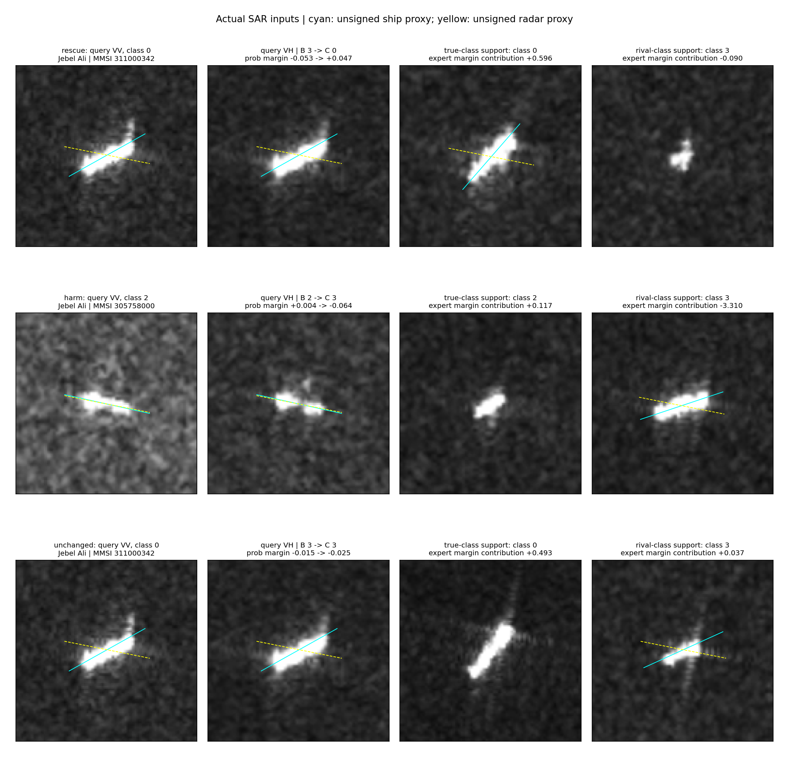

# 查询—支持案例与决策路径

固定seed0，跨采集、可启用查询；救回/误伤/不变各按港口、原始行、折、抽样排序取第一个。这是事后解释实例，不是发生率估计。

图像是模型实际拉伸uint8 VV/VH输入，不是原始辐射定标数据。青线/黄线分别为无向船轴与雷达轴代理，不命名船首/尾迹。

完整32支持均参与求解，图中只展示真实类中贡献最大的支持与竞争类中贡献最小的支持；不存在该类时会明确标注替代。按支持贡献选图不能证明其外观对应同一物理机制。

## rescue：311000342

Jebel Ali，真实类0，固定竞争类3。最终预测B=3，C=0。真实类对竞争类概率差-0.053044→+0.046935。
专家分差变化+1.033833，分解为保持旧支持系数的直接核效应+4.259137，以及重求解系数效应-3.225304。这是精确代数路径，不是物理因果分解。

## harm：305758000

Jebel Ali，真实类2，固定竞争类3。最终预测B=2，C=3。真实类对竞争类概率差+0.003840→-0.063729。
专家分差变化-0.671726，分解为保持旧支持系数的直接核效应-6.715960，以及重求解系数效应+6.044233。这是精确代数路径，不是物理因果分解。

## unchanged：311000342

Jebel Ali，真实类0，固定竞争类3。最终预测B=3，C=3。真实类对竞争类概率差-0.014974→-0.024773。
专家分差变化-0.169972，分解为保持旧支持系数的直接核效应-0.134121，以及重求解系数效应-0.035850。这是精确代数路径，不是物理因果分解。

## 解释边界

正确类关系改善、完整分类获益和船体/海面物理机制是不同层级。分区贡献可定位计算依赖，但不自动区分框外目标关联响应和环境纹理；需要结合实际图像观察，不把角度依赖直接命名为物理机制。所有支持、分区贡献及精确和式核对保存在CSV。
