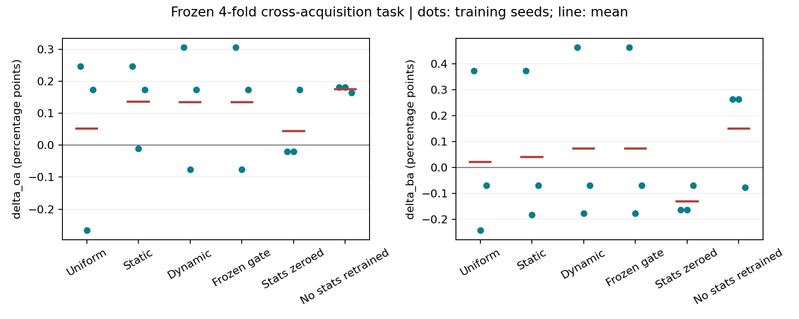
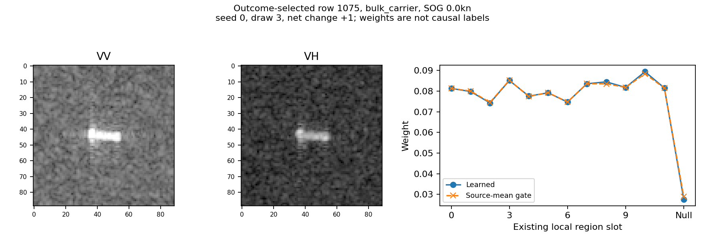
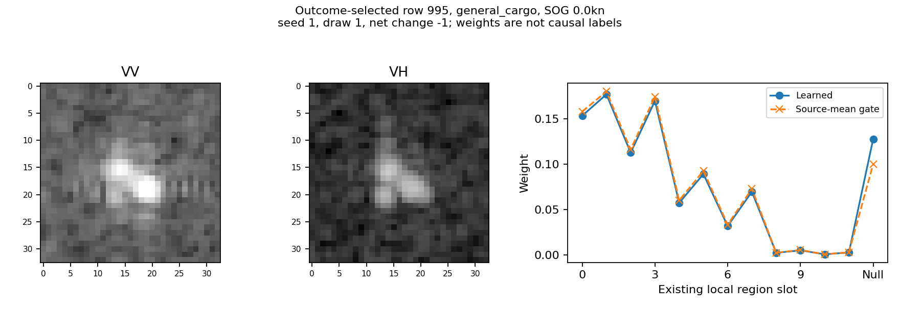

# 局部证据读出：本轮完成报告

日期：2026-10-17。状态：主实验36次训练、补充对照12次训练全部结束。

后续针对“设计还是数据问题”的只读诊断见[ROOT_CAUSE_ZH.md](ROOT_CAUSE_ZH.md)：单图门控未以支持集为条件、源端支持组合固定、辅助梯度偏强及源留出曲线等问题；没有新增训练，亦未证明唯一根因。

## 1. 先说结论

**局部关系读出有小幅正信号，但“逐样本动态选择区域”没有贡献出可辨认的分类增益。新增定标SAR统计也没有被证明是OA/BA增益的必要来源。**

- 原完整模型跨采集OA/BA为45.0028%/43.7593%。动态版为45.1377%/43.8318%，提升0.1349/0.0725个百分点。
- 把动态门控替换为源训练集平均门控后，全部最终类别预测不变，概率差异也很小。因此不能把上述提升写成“模型知道每张船图该看哪个区域”。
- 从训练开始就不用新增SAR统计的静态读出，OA/BA为45.1782%/43.9093%，提升0.1754/0.1501个百分点。OA三个训练种子均正，BA两个正、一个负。这是可保留的低成本候选，不是大幅突破。
- 含SAR统计的动态版在类别宏平均Brier上更好；无新增统计版这一指标略有退化。分类正确率和连续风险确实给出不同侧面，不用一个指标抹掉另一个。
- 本轮仍是OSS1四个既有留采集折、199张查询、B16、五次支持抽样、三个读出训练种子。不是OSS1全量留采集，也没有扩到其他数据集。

**决定：保留训练后的局部关系读出及全部结果；不把动态门控或额外SAR统计包装成已确立的核心机制，不自动替换原主模型。**

## 2. 为什么做这一轮

上一轮真实图像与统计表明，VV/VH的局部响应随条件变化不一致；但直接用固定亮度空间相似度补支持核没有得到整体分类收益。源端进一步诊断也未找到“亮一点/清楚一点就该用”的稳定规则。

因此本轮测试的是：让源端分类与检索任务学习如何表示框内及邻域响应，再检验额外的区域权重学习是否有用。不是把海况回归准确等同于分类有效，也不是先给亮响应命名为尾迹再设计模块。

源端旁线结果见[source_diagnostic/FINDINGS.md](source_diagnostic/FINDINGS.md)：旧固定描述的跨采集源选择任务宏Brier收益为-0.000297942；按独立查询再类宏平均则为+0.000044820，两者权重不同。真实标签事后选择的正收益上界0.001124678不可部署，也不是新可学习读出的能力上限。该诊断未训练另一个选择器。

## 3. 实际模块与接入位置

```text
SAR VV/VH裁片 + 产品观测几何
  -> 各折已有源限定R18浅层特征（骨干冻结）
  -> 已有船轴/雷达轴组织的12个局部位置（3尺度 x 4方向）
  -> 框内128维、每位置64维、位置16维
  -> 可选：同位置分VV/VH的10维定标响应描述
  -> 共享非线性内容映射，每位置16维
  -> 覆盖掩码 + 区域权重 + 零证据槽
  -> 保留12个位置的192维拼接读出
  -> 支持中心化与有界变换
  -> 同时补充支持-支持SS核、查询-支持QS核
  -> 重新求解带源先验的支持系数
  -> 与原基础分支按0.5/0.5全量融合
  -> 八分类概率与最终类别
```

原stem本来输入VV、VH及二者均值，并不是此次才第一次看到极化信息。不使用新增统计，也不等于模型没有VV/VH信息。

框内和局部内容分别映射到32维，位置和定标描述分别映射到8维；拼接框内、局部、逐元素乘积及位置/描述，共112维，映射到32维再输出16维单位向量。每位置乘以权重平方根后拼接。对同一个支持任务，查询与支持使用共享变换，增量形式为：

\[
K'_{SS}=K_{SS}+H_SH_S^\top,\qquad
K'_{QS}=K_{QS}+H_QH_S^\top.
\]

这样改变的是案例关系以及支持解，不是单独给查询类别分数加一个手工偏置。区域信息不足时保留原预测；没有恢复5%交接。

三个主训练臂：

| 名称 | 内容映射 | 区域选择 |
| --- | --- | --- |
| uniform | 学习 | 固定偏好，仅覆盖改变有效权重 |
| static | 学习 | 所有样本共用的可学习偏好，另有覆盖掩码 |
| dynamic | 学习 | 在静态偏好上加当前图像决定的修正 |

三者都具有零证据槽，允许减弱整条局部增量。static不是常量特征：它的内容映射仍随图像变化，只是不额外学习逐样本的区域选择。

新增10维描述是每极化局部/框内响应比、局部变异、较亮响应占比、框内均值，以及局部与框内的VV/VH比。来自已经定标的sigma0，不再次平方；标准化仅拟合源TRAIN。它们是观测描述，不是真实可靠性标签。框内/框外区域也不是纯船体/纯海面分割。

## 4. 配对训练与评价口径

- 冻结原查询、支持抽样、骨干、源先验与完整读出。每折源端拟合/选择任务分别为27/7、27/7、26/8、30/5；保留原采集和MMSI隔离。
- 共同层相同初始化，三个种子，200步，每步两个相同索引的源任务。AdamW，学习率0.001，权重衰减0.0001，梯度裁剪5。
- 损失为完整分类的类别宏Brier加0.05倍局部检索CE。检索温度0.2，各类支持取logmeanexp，避免支持多的类仅凭数量占优。支持缺类不参加该辅助项，但保留完整分类评价。
- 固定局部核强度1，固定第200步。不按目标挑倍率/种子/检查点；源选择曲线仅记录。
- 主表先对每任务的OA/已出现类别BA求值，再等权平均四折、五次支持抽样、三个训练种子；不是全199张拼在一起的微平均。
- Brier为八类概率平方误差之和；宏Brier再对当前任务实际出现的查询类别等权平均。风险收益=旧风险-新风险，正数较好。概率沿用同一固定转换，没有另行证明置信度已校准。
- 支持MAP@R只在支持中有同类的查询上定义；不把缺类查询的检索分数填零。

## 5. 完整模型主结果

跨采集；OA/BA为百分数，变化量为百分点。宏Brier收益不是百分点。

| 方案 | OA | BA | ΔOA | ΔBA | 宏Brier收益 |
| --- | ---: | ---: | ---: | ---: | ---: |
| 原完整模型 | 45.0028 | 43.7593 | 0 | 0 | 0 |
| uniform | 45.0542 | 43.7792 | +0.0514 | +0.0199 | +0.0003690 |
| static | 45.1397 | 43.7991 | +0.1369 | +0.0398 | +0.0003483 |
| dynamic | 45.1377 | 43.8318 | +0.1349 | +0.0725 | +0.0004269 |
| dynamic冻结为源均值门控 | 45.1377 | 43.8318 | +0.1349 | +0.0725 | +0.0004270 |
| dynamic仅预测时将新增统计置零 | 45.0474 | 43.6269 | +0.0446 | -0.1324 | +0.0000494 |
| static从训练开始不用新增统计 | 45.1782 | 43.9093 | +0.1754 | +0.1501 | -0.0000179 |

最后一行是看到主结果后增加的针对性重训对照，12次匹配训练，单独保存，并非预注册主臂。没有依据目标结果继续调参，也没有据此宣布新最优主模型。

同采集平均ΔOA/ΔBA：uniform +0.2504/+0.1827；static +0.1671/+0.1052；dynamic +0.1671/+0.1052；无新增统计重训+0.1492/+0.0621。**同采集也提升不构成否决理由**，但这些结果不能证明作用只发生在跨采集。

### 5.1 种子与支持组合

| 方案/训练种子 | 跨采集ΔOA | 跨采集ΔBA |
| --- | ---: | ---: |
| dynamic / 0 | +0.3060 | +0.4641 |
| dynamic / 1 | -0.0756 | -0.1771 |
| dynamic / 2 | +0.1744 | -0.0693 |
| dynamic / 均值±种子标准差 | +0.1349±0.1938 | +0.0725±0.3433 |
| 无新增统计重训 / 0 | +0.1810 | +0.2638 |
| 无新增统计重训 / 1 | +0.1810 | +0.2638 |
| 无新增统计重训 / 2 | +0.1643 | -0.0774 |
| 无新增统计重训 / 均值±种子标准差 | +0.1754±0.0096 | +0.1501±0.1969 |

无新增统计重训的五个支持抽样平均ΔBA为0、+0.1889、+0.4545、+0.1068、0；dynamic为0、-0.1273、+0.3030、+0.1870、0。支持组合会改变是否越过分类边界，不能把这些重复查询计成五个独立数据集。

四个采集簇上的探索性bootstrap，dynamic ΔBA区间为[-0.3777,+0.3892]，无新增统计重训为[-0.5661,+0.7544]。只有四簇，区间不支持强统计结论；也不据此抹掉可以保留的局部正信号。

### 5.2 收益在哪些采集上

| 留出折 | dynamic ΔOA/ΔBA | 无新增统计重训 ΔOA/ΔBA |
| --- | ---: | ---: |
| pilot | +0.2381 / +0.2841 | +0.2381 / +0.3636 |
| S1A_010685_00FED5 | +0.1754 / +0.4762 | +0.3509 / +0.9524 |
| S1A_011246_011040 | -0.5405 / -0.5983 | -0.7207 / -0.8761 |
| S1A_011421_0115FD | +0.6667 / +0.1282 | +0.8333 / +0.1603 |

三折平均正、一折负。dynamic跨采集共10次救回、5次误伤事件，涉及5张被救回查询、4张被误伤查询；无新增统计重训为10次救回、4次误伤，涉及5张和2张查询。事件重复跨种子/支持抽样，不等于对应数量的独立船只。

无新增统计重训的类别翻转主要发生在散货船和杂货船：散货5次救回/1次误伤，杂货5次救回/3次误伤。其他类别没有top-1变化不等于没有概率变化，也不要求所有类别获益才认可已有信号。

## 6. 门控为什么没贡献出额外收益

**先排除了“没有接上或根本没训练”的解释。** 门控参数从零发生更新，区域门控权重范数0.239至0.568，零证据门控0.250至0.614。查询权重相对源均值门控的RMS差为0.000607至0.002394。

但在12个区域都可用的查询上，跨样本门控logit方差大部分是各区域共同升降，公共分量占比中位数96.11%。共同加一个数不改变12个区域之间的softmax相对比例；它仍可能改变区域总质量相对零证据槽的比例，但不等于“这张切到区域A、那张切到区域B”。

冻结门控替换后：

- 所有保存的同/跨采集top-1预测与dynamic完全一致。
- 类别概率最大绝对变化约0.000102；宏Brier差异约1e-7量级。
- 再保持每张样本中心化后特征能量、只替换为固定门控的方向，OA/BA仍相同，风险收益也近似相同。

这说明**当前训练出来的区域动态性不是本轮净分类收益的必要因素**。证据不支持“所有动态选择都没用”，也不说明共同内容映射没有随图像变化。为什么当前数据与目标没有促成更强的相对切换，还未被进一步区分，不预设只要更复杂门控就会成功。

## 7. 为什么必须补重训对照

仅在预测时把新增统计置零，dynamic BA从43.8318降到43.6269，只能说明已训练模型对这些输入有依赖。置零改变了该模型熟悉的输入组合，不能据此证明添加统计优于从一开始不使用。

匹配重训后，无新增统计的OA/BA反而更高。因此额外定标统计目前没有可确认的top-1价值。含统计dynamic的宏Brier在三个种子上均改善，而无新增统计版平均略差；普通样本平均Brier在无新增统计版仍小幅改善0.000125。**不能笼统写“无统计风险更差”而不说明按什么加权。**

更低复杂度的候选是静态区域偏好配合内容映射，省去运行时新增统计提取。当前匹配原型保留了同尺寸质量投影但输入固定零，以保证对照一致；未以删层后的参数量或端到端实测速率冒充已验证成本优势。

## 8. 图像与决策证据

动态版支持MAP@R从0.22530到0.22740；NLL平均下降0.001960，普通Brier下降0.000790。关系和连续分数略有改善，但不能将全部top-1变化解释成检索名次提升。



两例均按结果事后选取，不用于代表总体或挑选训练策略；显示定标图像的dB变换，VV/VH采用相同显示范围。

### 救回案例：row1075，散货船



图中VV和VH都存在横向主体响应，VV周围显示响应更亮；只记录可见差异，不据此外推环境或尾迹。seed0/draw3中，真实类概率从0.216692升至0.221785，原杂货预测变为散货。支持集有6个同类案例，AP@R保持0.238889不变。

真实类相对原错误类的专家分数差增加0.111439，其中查询-支持核改变贡献+0.116678，支持系数重解贡献-0.005239。两项精确相加。这说明即使名次未变，关系强度与支持解仍可推动越界；不是动态门控救回，因为替换门控后仍然救回。

### 误伤案例：row995，杂货船



图像尺寸更小，VV/VH呈现若干相邻亮响应。不能仅凭此判定船体散焦或背景污染。seed1/draw1中真实类概率从0.203771降至0.200824，原正确杂货变为其他类；3个同类支持，AP@R两边均为0。

真实类相对新错误类的专家分数差改变-0.025916，其中核改变-0.028047，支持重解+0.002131。这一读出确实会把关系推错；不是所有可见局部结构都值得使用。两例记录AIS SOG均0，仅用于事后描述，没有进入预测。

完整16个支持案例的分解在`changed_support_edges.csv`。这是固定计算图中的精确分数归因，不是区域/物理因素的因果效应，也不是去掉一个支持后的因果贡献。

## 9. 已验证内容、成本与剩余边界

- 5个针对性测试通过：共享初始化与PSD、缺失区域回退、固定门控替换、支持数量/缺类检索处理、均匀辐射描述。
- 40个历史OA/BA回放最大误差7.11e-15；120个dynamic任务重新求解，保存概率最大误差9.71e-17，支持核与重解分解恒等式通过。
- 区域坐标与旧缓存一致；采样按conv1中心映射，不重跑骨干/检测器，不改历史结果。
- 主36次拟合累计约69.60秒，补12次拟合约24.52秒。仅缓存小读出训练，不包括已有骨干训练、检测、原图读取或定标统计提取。
- 三个主臂训练参数为10960/10973/11039。缓存求解均值约0.32至0.44毫秒，不是端到端新增开销。
- 未证明这套局部布局优于所有合理的多层读出，未单独证明辅助检索损失优于不加该损失，也未证明训练后的映射优于匹配随机映射。当前能归因到的是“此训练读出整体接入后”的小净效应，不能拆成每一设计都有独立原创收益。
- 读出训练种子不等于骨干种子；既有开发语料不等于未使用确认集；没有B32/B64及其他数据集的本模块新结果。

## 10. 保留与暂缓

**保留：** 共享、保留位置的局部内容读出；与原支持核同步重解的接入方式；无新增统计静态版作为较简洁候选；含统计版的连续风险正信号与全部负结果。

**暂缓：** 把逐样本门控作为创新核心；再叠加更复杂注意力；把新增统计依赖写成必要收益；按目标表现逐折挑方案；直接扩出一张全数据集主表。

下一步若继续，应先冻结这个简洁候选，明确选OA/BA还是宏风险为主要目标，再沿已有不同支持预算/采集扩大范围；不能把本轮目标排名当作已验证的自适应选择规则。无需要求每个港口、类别、抽样都赢，但需要在所声明范围内有值得成本的可重复净收益。

## 11. 文件与参考

协议：`PROTOCOL_ZH.md`；补重训依据：`RETRAINED_CONTROL.json`。

主要代码：`local_evidence.py`、`extract_quality.py`、`train_reliability.py`、`train_no_quality.py`、`diagnose.py`。

主结果：`metrics.csv`、`predictions.csv`；补重训：`trained_no_quality_metrics.csv`、`trained_no_quality_predictions.csv`。汇总与逐折/类别/支持/种子结果分别见`summary.csv`、`fold_summary.csv`、`class_summary.csv`、`support_draw_summary.csv`、`seed_summary.csv`。均保留原始记录。

本轮直接阅读CVF官方论文的相关方法部分：QAN（CVPR2017）借鉴任务监督学习质量权重，PFE（ICCV2019）借鉴将相似与可靠性区分的思路；没有实现PFE的高斯概率嵌入。详细阅读范围、原文地址及任务差异在协议中。不是穷尽文献综述，也不主张质量加权首创。
