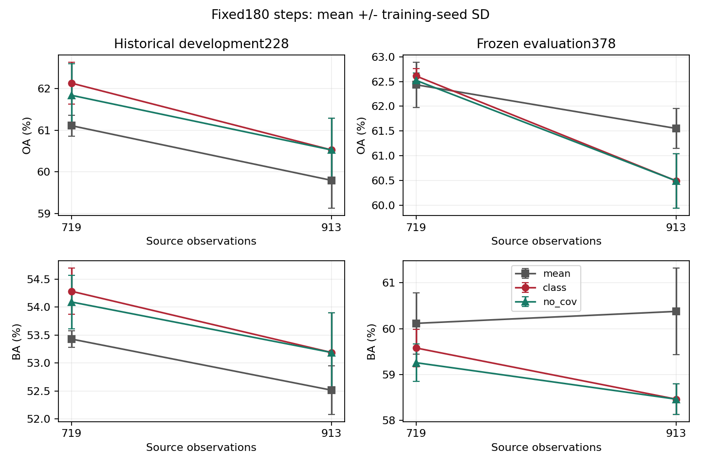
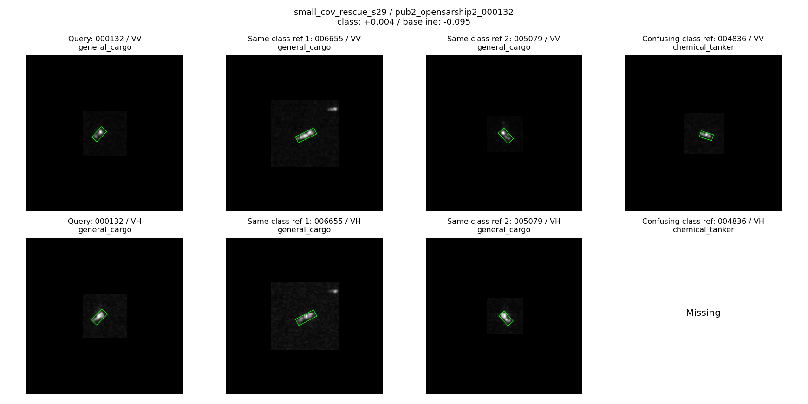
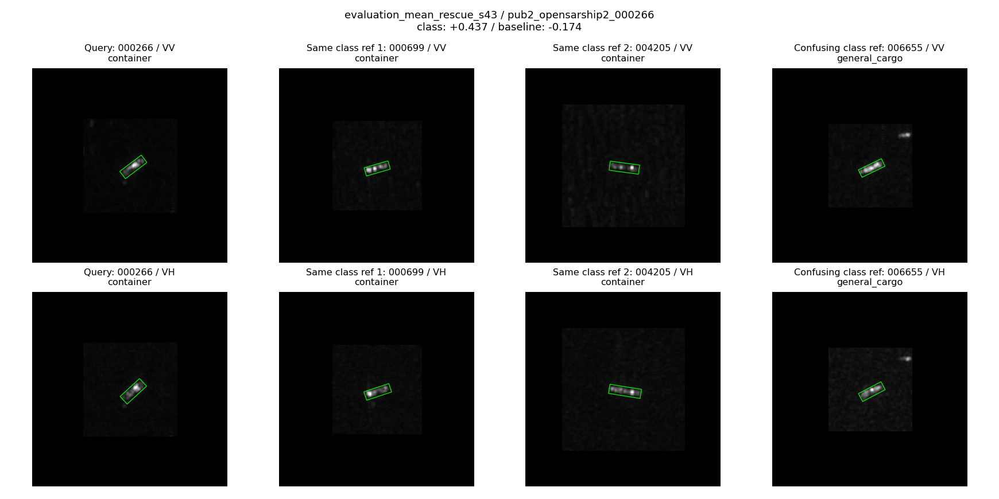
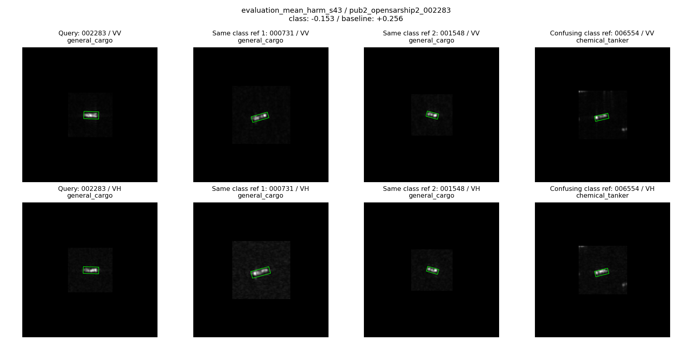
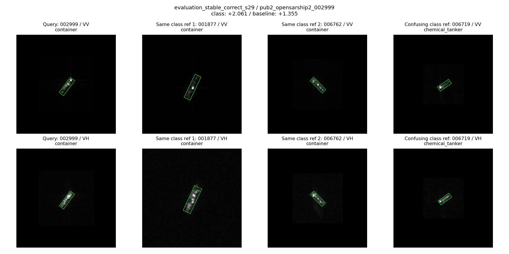
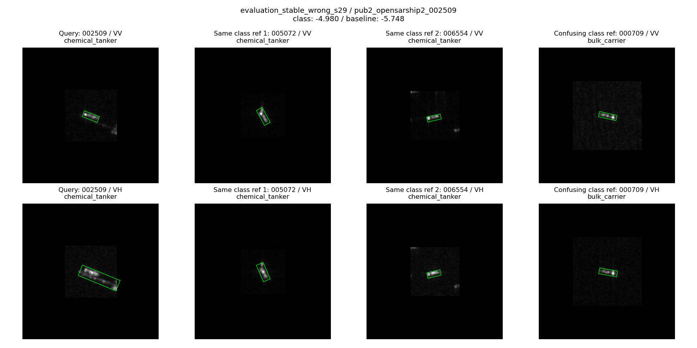

# M1扩充源数据与协方差配套训练消融

日期：2026-11-01。18组训练及分析已完成；未修改正式模型，未同步Git。

## 结论

扩大源覆盖没有在本轮固定180步训练下增强新版M1的总体分类优势。不能据此说更多数据无价值，也不能继续把“样本少”当成新版M1尚未兑现机制收益的既定原因。

可保留两项有限正信号：

1. 在开发集228张上，新版相对均值对照仍有平均OA/BA收益。
2. 小源集、seed29的评价样本000132出现了协方差配套训练带来的真实救回；扩大源集后，协方差仍改善NLL，但未产生额外救回或误伤。

当前不能把新版升级为“更广覆盖下优于均值”的正式替代，更不能把整套模块的收益全部归功于协方差。

## 数据与训练

OSS2既有四类检测队列：散货船、普通货船、化学品/成品油轮、集装箱船。

| 范围 | 观测 | 船只MMSI | 过境轨道组 |
|---|---:|---:|---:|
| 原源集 | 719 | 683 | 13 |
| 新增历史selection队列 | 194 | 193 | 5，其中4个新过境 |
| 扩充源集 | 913 | 876 | 17 |
| 开发集 | 228 | 223 | 4 |
| 固定评价集 | 378 | 369 | 5 |

新增194张明确改作训练，未在本轮用于选模型。原文件不变。训练/开发/评价间无ID、MMSI、平台-轨道组交集。评价378张有历史研究暴露，不是新盲测。此处不是全量OSS2、多折、八分类或跨数据集结果。

每个源规模训练mean、class、no_cov三组，各17/29/43三个种子。每组固定180步，最终步评价，不按评价结果挑选checkpoint；同源规模/种子的三个方法使用完全一致的批次顺序、固定32个源参考。

- mean：均值上下文反馈，gain=0.1。
- class：类别竞争协方差M1，gain=0.3。
- no_cov：保持class其余结构和gain，训练开始就把反馈及辅助分类中的协方差输入置零。仍保留局部类别响应权重、偏置、均值及辅助目标；不是删除整个类别分支。参数分配相同，但不声称有效容量相同。
- M1位于layer2[3]的conv2之后、conv3之前，VV/VH各自模块参数；训练M1、相邻conv3及分类头，其余冻结。
- 保留公共实验载体的M2和固定M3参考消息。该载体没有自建正式版layer2[2] M2，不是全部M1-M3联合重训。
- 均值与class的gain沿用前轮候选；class对mean是候选方案比较，class对no_cov才是协方差贡献的直接配套训练对照。

每组优化步数相同，但保留每轮末尾短batch：719组累计4314例，913组4228例，后者每轮有1例短batch。因此本轮检验的是固定训练流程下扩充数据的结果，不是完全隔离优化噪声的纯数据量定律。源类别/船只权重和困难样本权重也随合法源池重新计算。

## 分类结果

固定评价378张，三训练种子均值±样本标准差；OA/BA单位%。

| 源数据 | 方法 | OA | BA | NLL，越低越好 |
|---|---|---:|---:|---:|
| 719 | 均值对照 | 62.434±0.458 | 60.117±0.666 | 1.14605 |
| 719 | 新版M1 | 62.610±0.153 | 59.580±0.407 | 1.14130 |
| 719 | 训练时去协方差 | 62.522±0.153 | 59.260±0.407 | 1.14179 |
| 913 | 均值对照 | 61.552±0.404 | 60.377±0.941 | 1.11725 |
| 913 | 新版M1 | 60.494±0.551 | 58.465±0.330 | 1.09772 |
| 913 | 训练时去协方差 | 60.494±0.551 | 58.465±0.330 | 1.09935 |

开发228张：新版相对均值在719条件下OA+1.023、BA+0.853个百分点；913条件下OA+0.731、BA+0.673个百分点。评价378张则分别为OA+0.176/BA-0.536，以及OA-1.058/BA-1.912。这说明开发收益没有同等迁移到较广的固定评价队列，不是模块完全没有作用。

## 哪部分确实来自协方差

719评价集：class相对no_cov在seed17/43均无救回和误伤，seed29有1次救回、0次误伤，均值OA+0.088、BA+0.321个百分点。开发集seed17/29各有1次救回，seed43无变化。

913条件：开发和评价、三个种子中，class相对no_cov均0救回/0误伤。评价NLL三种子均改善，平均下降0.001632；开发下降0.002848。这是概率评分层面的正信号，不等于分类精度提升，更不等于已经证明概率校准或物理因果解释。

这里对比的是分别配套训练后的系统，不是同一权重推理时关闭分支；不能把训练收益自动解释为推理时协方差对该样本不可替代。

## 类别层面发生了什么

三种子正确数变化相加，比较class与mean。下面是重复评价事件，不能当作独立船只数。

| 源集 | 散货 | 普通货 | 化学品/成品油轮 | 集装箱 | 总净事件 |
|---|---:|---:|---:|---:|---:|
| 719 | +1 | -3 | +3 | +1 | +2 |
| 913 | -1 | -5 | +3 | -9 | -12 |

评价中四类分别132/26/83/137张。719的OA小升而BA下降，是具体类别得失及类别数量共同形成的结果：普通货船少数类损失对BA权重更高。913中化学品/成品油轮仍有局部收益，但普通货和集装箱损失超过收益。不要求每类都赢；这里的问题是所声明完整任务的净分类收益没有保住。

新增194张在旧载体初始OA为60.31%，原719为92.07%。原719已参与载体训练，不能据此认定新增数据更差或标签有误；只能说明新增观测不是同等已拟合程度的简单重复。

## 原始chip与参考案例回看

图册分别显示VV/VH、原像素尺度160画布裁剪/补零和实际合法源参考，不将船只缩放为同尺寸。展示的两个同类、一个混淆类参考按固定池化特征余弦选取，不是M1注意力最大位置或其直接归因。Missing表示本队列该极化无可用输入，不断言原数据没有该极化。

已实际查看以下5组查询与参考图；另有4组开发案例自动生成，不能将“已生成”混作“均已人工检查”。

### 1. 协方差相关的有限救回：000132

719源、seed29、普通货船。均值错判油轮，真实类别分差-0.09452；no_cov仍错，分差-0.02796；class判对，+0.00393。

图像可见：VV框内只有小范围亮响应，VH更清楚地呈现细长结构。同类参考006655有更长的响应和框外亮斑，005079表现不同；混淆类004836也有紧凑细长响应。不存在肉眼即可确认的独有类别形态。配套消融支持该次训练加入协方差使样本跨过边界，但优势极小、未跨种子复现，不能声称已定位具体物理机制。

### 2. 整套M1的救回，不是协方差专属：000266

913源、seed43、集装箱船。mean错判普通货，分差-0.17379；class正确+0.43652；no_cov也正确+0.43257。

VV/VH均有倾斜的局部亮响应，参考集装箱船也有亮点排列，普通货参考同样细长。图像支持类别外观重叠这一事实；消融直接说明本例无需协方差输入也能救回。不能用本例为协方差机制背书。

### 3. 被误伤：002283

913源、seed43、普通货船。mean正确+0.25574；class错判油轮-0.15293；no_cov亦错-0.09573。

目标VV中呈横向亮带，VH内部亮度分布不均；同类与油轮参考也有细长亮响应。不能凭外观认定“油轮特征污染”，但已知误伤并不依赖协方差存在。失败不应全部归咎于协方差算子。

### 4. 持续正确：002999

913源、seed29、集装箱船。mean/class/no_cov均正确，分差1.35491/2.06128/2.05960。VV有多个不均匀亮点，VH仍有长条结构，同类参考尺寸和亮点布局也有差异。本例是分差增强但无top1变化，而且主要增强同样存在于no_cov中。

### 5. 持续错误：002509

913源、seed29、化学品/成品油轮，三方案均错判散货船；mean/class/no_cov分差-5.74784/-4.97950/-4.98060。

图像中VV检测框紧凑，VH框明显更长，覆盖了延伸亮响应；同类参考则多为较紧凑细长结构。检测覆盖和极化外观存在实际差异，值得作为失败条件记录，但本轮未改变检测框，不能确认其导致错判。分差改善仍远未跨过分类边界，且几乎不依赖协方差。这提供了“连续指标改善而OA不变”的真实例子。

## 实现、证据边界与决定

缓存1519例中947复用、572新增；输入/中间特征复放误差0，固定M3消息最大误差1.49e-8。零初始化一致；no_cov相关权重梯度为0；正常分支和相邻conv3有梯度；所有checkpoint重载误差0，训练批次顺序配对一致。没有发现足以解释本轮结果的接入失效。这不等于排除了所有优化问题。

训练时宿主内存换页严重：保留一次未完成日志，改为精确float32 GPU缓存后续跑，预测一致性误差0。18组完整结果之外确有一次中断计算；不把耗时作为严格算力对照。分析入口的历史同名模块导入冲突已修复，不影响训练结果。

建议保留新版及全部正负结果为研究候选，不替换正式模型，也不继续盲目扩数据或扫参数。当前已缩小问题：不是“协方差完全没有信息”，而是它的额外分类效用很弱，整套新版的开发优势在固定评价集上未保住。

下一次若继续，最有辨别力的最小动作是针对719/913保持同一固定batch大小与优化次数，单独检验训练组织影响；或者先复用已有分差/概率结果分析类别边界变化。只有这些分析指向可修正原因，才继续改损失或模块。本轮不追加训练，不把任何一个猜测写成已确认根因。

## 文件

- `PROTOCOL.md`、`DATA_NOTES_ZH.md`：预定协议与数据审计。
- `summary.csv`、`averages.csv`：每组与三种子汇总。
- `pairs.csv`、`pair_averages.csv`：救回/误伤及配对差值。
- `classes.csv`、`passes.csv`、`events.csv`：类别、过境、样本证据。
- `cases.json`、`index.html`：完整案例路径、分差和图册。
- `experiment.py`、`analyze.py`及各run的receipt/checkpoint：复现实验。
