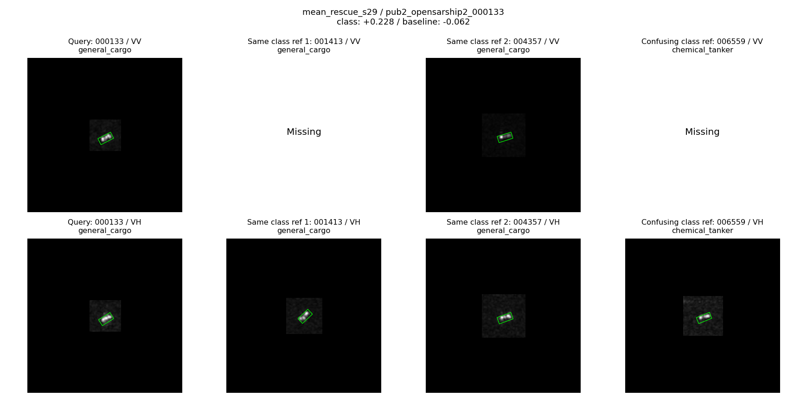
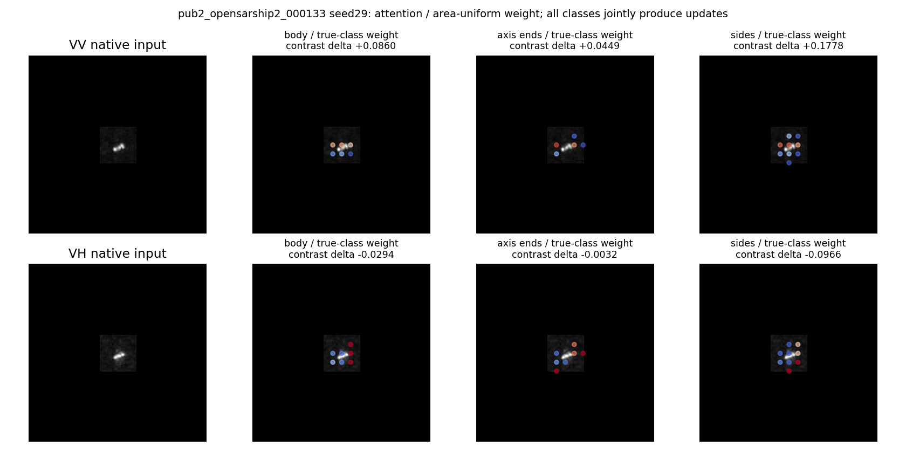
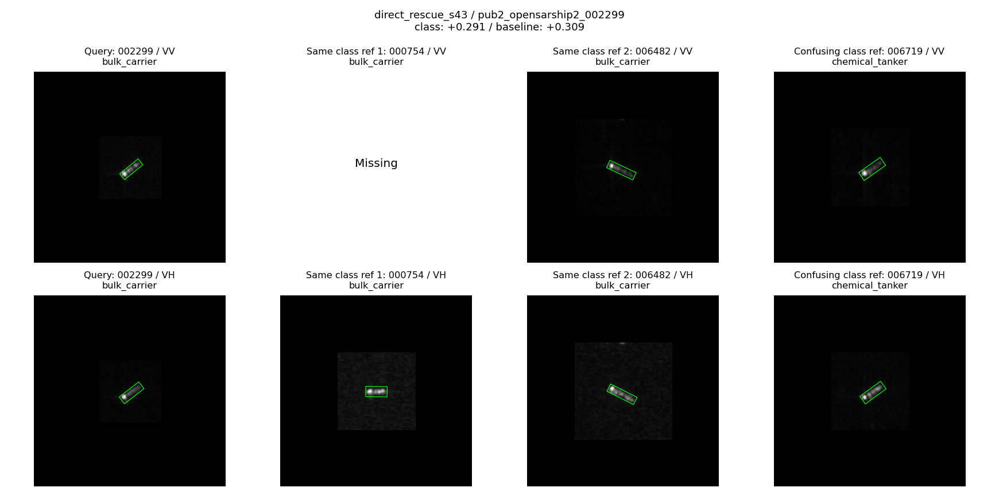
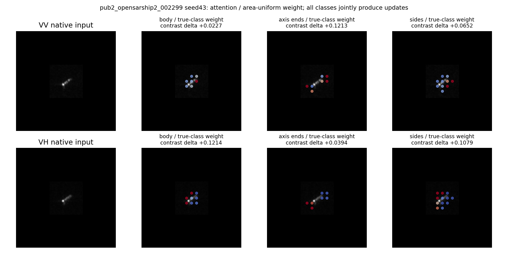

# M1类别响应指导M2区域池化：首轮配对验证

2026-11-06。9组训练、同权重诊断、原图回看和接口验证均已完成。正式模型未变，未推送Git。

## 核心结论

本轮支持一个具体、有限的结论：**复用冻结M1的空间响应来指导M2区域内取证，在本OSS2评价队列上，比配套训练的区域均值和普通内容注意池化更好。** 正确的空间对应也具有实际分类作用，不再只是注意力图看起来不同。

但是，相对训练前冻结模型，完整流程OA基本持平、BA仅微升。因此保留“响应引导区域池化”为有机制证据的候选，不自动替换正式模型，也不把相对退化对照的优势写成大幅完整模型提升。

## 本轮真正改了什么

冻结上一轮719源、seed17训练出的M1及载体。M1位于layer2[3]的conv2之后；它的128通道输入生成4张候选类别响应图。M2读取该block的conv3、残差加和及ReLU之后的512通道特征，两者共享20×20网格和步长。

只增加浅层M2读出的补充量，不改深层M2、内部区域回写、M3参考路径、输入裁片或参考库。VV/VH各自处理。公共载体没有自建正式版的layer2[2] M2，本轮不是全部M1-M3联合优化或新卷积实验。

对极化p、几何区域r、候选类别k，先由M1原响应a构造相对响应：

```math
d_k(u)=a_k(u)-\frac{1}{K-1}\sum_{j\ne k}a_j(u),\qquad
s_k(u)=2\tanh\frac{d_k(u)-\overline d_k}{\sqrt{\operatorname{Var}_{valid}(d_k)+0.01}}.
```

在区域面积掩膜m内部计算权重和摘要：

```math
\alpha_{r,k}(u)=\frac{m_r(u)e^{s_k(u)}}{\sum_v m_r(v)e^{s_k(v)}},\qquad
t_{r,k}=\sum_u\alpha_{r,k}(u)V(\operatorname{LN}F(u)).
```

同时保留均匀区域摘要t_r,mean，拼接该摘要和4个加权摘要，由160→512线性层形成有界增量：

```math
\delta_r=0.1\operatorname{RMS}(\overline F_r)
\tanh W_p[t_{r,mean},t_{r,1},\ldots,t_{r,4}].
```

原浅层区域均值加上delta，仍在原框内/轴端/侧向的特征槽位中，与既有深层区域项相加，再送入分类头。输出W零初始化，初始完全保留旧模型。空区域和缺极化无更新。实际前向同时使用四类，不输入查询真值，也不先选定一个类别再取证。

**这不是把邻域亮度当作类别，更不是按船轴朝向分类。** M1图只是已训练的类别相关候选提示，未被证明是可靠的像素类别标注。区域特征有卷积感受野，画在框外的网格中心不意味着该特征只含纯背景。

## 配对协议

source719，开发228，固定评价378；四类：散货、普通货、化学品/成品油轮、集装箱。固定32个源参考，保持既有同船/过境隔离。新增selection194本轮没有用于训练。评价378已有历史开发暴露，不是新盲测。

三方案：
- mean：4份重复区域均值，保留同结构投影和补充容量。
- content：从当前局部特征学习4张不预指定类别的注意图。
- class：使用冻结M1相对类别响应图，不重新训练M1。

每组3个新增读出训练种子17/29/43、180步、固定batch24，总1620步；相同源样本流，每组4320例，跨排列边界补足batch，避免上一轮短batch差异。只训练新增读出与分类头；同一上游seed17，不是三套独立骨干/M1训练。固定末步，不按评价结果挑checkpoint。

共同可训练参数225292；content另有4096个评分参数，合计229388。mean重复token不等于相同有效容量；class复用了已有监督训练的reader，content新评分器从随机参数开始。因此胜出首先支持“复用已有响应有用”，不是证明类别语义优于所有可能的注意机制。

## 结果

评价378张，均值±训练种子标准差，OA/BA单位%。

| 方案 | OA | BA | NLL |
|---|---:|---:|---:|
| 训练前冻结模型 | 62.434 | 59.718 | 1.14782 |
| 均值补充mean | 61.464±0.305 | 58.233±0.710 | 1.14277 |
| 普通内容注意content | 61.464±0.666 | 58.050±0.674 | 1.14460 |
| M1响应引导class | **62.346±0.153** | **59.781±0.220** | **1.14005** |

class对mean：OA+0.882、BA+1.548个百分点，三个种子均为正。
class对content：OA+0.882、BA+1.731个百分点；OA两正一平，BA三正。
class对原冻结模型：OA-0.088、BA+0.063个百分点；不能称为已获得明确完整系统准确率增益。

开发228张：三种方案平均OA/BA均为62.281/55.731；class与mean每个种子的预测完全相同，class和content有少量互有得失。类别引导的优势主要在本轮固定评价集出现，不能推广为处处更好。

## 正确空间对应有没有实际作用

对每个class训练结果保持权重不变，改取证方式：

| 推理方式 | 评价OA | 评价BA |
|---|---:|---:|
| 正确M1响应 | 62.346 | 59.781 |
| 区域内均匀权重 | 61.464 | 57.753 |
| 区域内反向置换权重 | 60.758 | 57.297 |
| 关闭整个新增读出 | 62.169 | 58.796 |

正确响应相对均匀：各种子救回3/4/3、误伤0/0/0；平均OA+0.882、BA+2.028。相对位置置换：救回5/6/7、误伤均0，平均OA+1.587、BA+2.484。置换只在区域非空位置进行，保持每组权重直方图及总量，但改变权重与图像的对应。

这说明正确的空间加权在这个评价队列中有实际分类作用。它不是类别名称/语义已被完全识别的证明；训练后置换也存在分布改变，所以必须与配套训练的mean/content一起解释。

开发集上正确响应相对均匀平均OA-0.146、BA-0.094，并未同样获益；正确对应不是普适规则。

## 收益来自哪里

class对mean跨三个种子共有10次救回、0次误伤，涉及7艘不同船、7条观测、3个过境。class对content共有17次救回、7次误伤；救回涉及11艘船、4个过境。重复种子事件不当作独立船只。

对mean的10次救回中，9次在训练前冻结模型中已经正确，只有seed29的000319原本错误。因此本轮主要是**减少普通读出适配造成的错误取证/退化**，不是发现10个原模型无法分类的新目标。000319和对content的seed17样本002299属于相对原冻结模型的新救回，原始记录保存在event_provenance.csv；它们不是全体净增益。

三种子合计的分类正确数变化：

| 对照 | 散货 | 普通货 | 化学品/成品油轮 | 集装箱 |
|---|---:|---:|---:|---:|
| class - mean | +1 | +3 | +4 | +2 |
| class - content | +2 | +4 | +2 | +2 |
| class - 自身关闭新增读出 | +2 | +3 | +2 | -5 |

不要求所有类都赢，但需保留最后一行：新增路径仍会误伤集装箱类，不能用对mean全正掩盖它。

同权重分解还指出具体的协调问题：class模型关闭新增路径后BA为58.796，比原冻结模型59.718低0.922；打开新增路径恢复0.984，最终净+0.063。关闭时其余图像特征保持原样，因此这里确有分类头更新与新增路径的效应抵消。它是本轮模型级事实，不证明所有退化都源于分类头，也不保证冻结头必能涨点。

## 原始chip与区域证据

本轮已查看7组查询与实际合法参考的VV/VH原图：002628、002527、000133、002299、002394、000258、002281；另在设计前查看源000586的VV/VH。均为原生160裁剪/补零，无船体统一缩放。参考按固定池化余弦选择，不是M1注意最大参考；Missing是该输入队列不可用极化。

### 普通货船000133，seed29：取证方式确实改变了边界

mean错判油轮，真实类分差-0.06155；content也错-0.13751；class正确+0.22820。将class同权重改成均匀或置换后分别-0.06187、-0.13565，均错。关闭新增路径仍正确+0.04877，说明本例“正确取证优于错误取证”，不能称新增路径从无到有救回。

原图为小范围斜向亮结构，VV/VH分布不同；同类和油轮参考也有相似的细长亮响应。加权不只是沿最亮像素集中：特征网格中不同位置被提升/降低。精确线性分解显示VV框内/轴端/侧向对普通货-油轮分差分别贡献约+0.0860/+0.0449/+0.1778，VH相应-0.0294/-0.0032/-0.0966，净约+0.1794。不能把每个极化/区域都描述为有益。




图中点为真实20×20特征网格中心，红色权重高于面积均匀基线、蓝色低于，显示范围0到2。按真实类别展示仅用于事后解释；前向计算用全部4类。图题分差贡献由全部候选摘要形成，不是单张显示的类别图独立贡献。

### 散货船002299，seed43：新增读出直接救回，但非独有能力

自身关闭分支时错判油轮，分差-0.18660；打开后+0.29122。正确类别得分增加0.18247，油轮得分降低0.29536，合计改善0.47783。VV/VH的六个区域项本例均正。

原图VV可见一端较强响应及较弱延伸，VH更集中；同类与混淆类也存在端部亮响应。普通mean/content也判对，同权重均匀仍判对+0.17385，置换则错-0.09249。因此它支持新增读出/正确对应有用，不支持只有M1类别语义才能识别。




### 保留负例与未翻转例

- 002394散货，seed17：自身关闭分支正确+0.14140，打开错判油轮-0.54723；mean/content也错。原图横向多亮点与同类参考相似，但有相似外形不意味着模型必能取对证据。该分支降低真实类得分0.44710、提高油轮0.24153，错误方向明确，具体图像物理原因未证实。
- 002527油轮，seed17：content正确+0.14230，class错为普通货-0.25357；class自身off更差-0.53814。不能把“输给content”误称为“新增分支直接破坏该样本”，它实际上改善了分差但不足以跨界。
- 000258油轮持续正确：class分差2.68860，content更强3.23191；原图及参考都可见细长、局部集中响应。不是所有增强都优于通用注意力。
- 002281散货持续错误：class分差-4.60206，比自身off的-4.21946更差；原图与普通货参考均有横向细长亮结构。类别重叠是真实可见现象，但不足以认定特定散射机理。
- 002628散货：class优于content的救回属于“避免content造成的错误”，mean及自身off本来正确。

所有图及每个模型分差在index.html。区域贡献总和与实际新增类别分数差误差小于5e-7，是可追溯的计算分解；它不等同于物理因果解释。

## 实现确认与下一步

恢复了M1、相邻conv3及head完整局部补丁，再冻结缓存。历史分数复放最大误差3.24e-5；三个新算子零初始化均为0误差，空区域/无效权重、加权求和、head区域切片均通过检查；正常新增路径有梯度，所有checkpoint重载误差0。将新增量实际加到原网络M2输出后，与缓存训练实现最大分数误差9.30e-6。不存在只改图或绕过原区域路径的问题。

**保留这个候选接口，而不是宣告完整模型已经提升。** 当前最值得继续的最小修正，是保护原分类头、只学习新增区域读出，再做同样三个方法的配对比较：已有诊断指出头部更新抵消了相当部分读出收益。该项本轮尚未执行，不预设必然有效。没有新增更多位置、频域或骨干解冻实验。

入口：study.py --prepare生成冻结缓存，study.py运行9组训练，analyze.py生成图册，diagnose.py记录事件来源及原网络接入等价。协议、所有中间结果、负例均保留。
