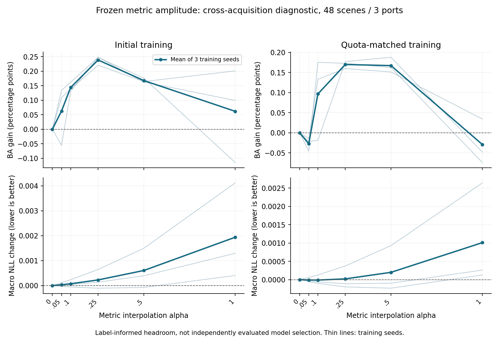

# 冻结类别参照度量的倍率收益空间诊断

后续更新（2026-10-14）：[支持内选择验证](../metric_support_selection_20261014/FINDINGS_ZH.md)已完成。该轮不使用查询标签选择，得到更小净收益，但未证明任务选择优于同频率随机分配；本报告oracle结果及范围保持不变。

2026-10-14。计算与数据层面分析已完成；未新增神经网络、源分类头或度量训练，未替换主模型和论文结果。

## 结论

**用留出标签挑倍率有诊断价值：在现有候选矩阵和六个倍率内，缩小修正能恢复小幅跨采集识别收益。但这不是无需查询标签就能获得的部署成绩。**

两个训练版本在倍率0.1、0.25、0.5处的平均BA均高于固定类别参照，说明不只有一个孤立的正值。全局BA最优倍率均为0.25，BA分别增加0.239和0.170个百分点，OA均下降约0.026个百分点。配额对齐版0.5倍率的BA增加0.167、OA增加0.032个百分点，5组支持抽样中4组BA上涨，是值得保留的低成本候选。

不过，0.25倍率的净BA增益高度集中于一个稀有类查询在一组支持组合下被救回。三个训练种子都涨点，不等于三份独立船只证据。认可这个真实救回，同时不能把当前结果讲成广泛稳定提升。

## 1. 实验到底改了什么

沿用已完成的类别参照任务训练矩阵，分别保留初版随机支持训练和配额对齐训练，不选训练种子，不重新训练。

\[
M_\alpha=(1-\alpha)I+\alpha M_{\mathrm{learned}},\qquad
\alpha\in\{0,0.05,0.1,0.25,0.5,1\}.
\]

\[
K_\alpha=0.75K_{\mathrm{visual}}+0.25R M_\alpha R^\top.
\]

- 0代表固定类别参照，不是没有类别参照的原视觉核；1复现上一轮完整学习矩阵。
- 在矩阵层面插值，不插值矩阵因子、最终概率或已解出的支持系数。
- 每个倍率重新计算支持-支持核和查询-支持核，重新求解带权残差ridge。
- 冻结源先验、2752维视觉几何、类别中心、核混合权重0.25、ridge参数8及基础/专家概率各50%的融合。
- 这里只调整类别参照关系的学习改动幅度，不改变双分支融合比例，不增加新的视觉证据。

范围：现有Jebel Ali、Port Klang、Singapore三个港口，共48景；每个支持任务64个案例、5组支持抽样、3个训练种子；同采集与跨采集分开。不是23港全量验证，也没有新增F_0921或OpenSARShip外部实验。这些数据有历史研发暴露，不称为新独立确认集。

指标先在港内等权汇总景和支持抽样，再等权汇总三个港口及三个训练种子。BA对查询中实际出现的类别取宏平均，不排除支持中缺失的类别。

全局oracle只选一个共用倍率；逐港oracle每港只选一个倍率，均先汇总种子和抽样后选择。BA最大与宏NLL最小分别选择，精确并列取较小倍率。没有逐样本、逐景、逐抽样或逐种子挑最优。

## 2. 完整分类流程的跨采集结果

下表OA/BA均为相对固定类别参照的百分点变化，NLL为原量纲差值，越低越好。固定参照OA=35.67317%，BA=35.25950%；原视觉核OA=35.46443%，BA=35.33419%。

| 训练版本 | 倍率 | OA变化 | BA变化 | 宏NLL变化 |
|---|---:|---:|---:|---:|
| 初版 | 0.05 | -0.020 | +0.062 | +0.000034 |
| 初版 | 0.10 | -0.017 | +0.144 | +0.000073 |
| 初版 | 0.25 | -0.025 | +0.239 | +0.000227 |
| 初版 | 0.50 | -0.054 | +0.168 | +0.000605 |
| 初版 | 1.00 | -0.172 | +0.062 | +0.001938 |
| 配额对齐 | 0.05 | -0.030 | -0.027 | -0.000010 |
| 配额对齐 | 0.10 | -0.020 | +0.097 | -0.000012 |
| 配额对齐 | 0.25 | -0.026 | +0.170 | +0.000021 |
| 配额对齐 | 0.50 | +0.032 | +0.167 | +0.000199 |
| 配额对齐 | 1.00 | -0.090 | -0.029 | +0.001010 |

0.25倍率的绝对BA分别为35.49802%和35.42943%，相对原视觉核分别增加0.164和0.095个百分点。不能把“相对固定类别参照”和“相对原视觉核”的增益混用。

曲线细线表示训练种子，不表示独立数据集。图中所有倍率的比较均来自同一批查询标签。

## 3. 知道每个港口最佳倍率，会怎样

BA逐港oracle在两个版本均选择Jebel Ali=0、Port Klang=1、Singapore=0.25。相对固定参照的整体BA增益分别为0.351和0.276个百分点，OA分别变化+0.002和-0.028个百分点。

这说明三个港口对修正幅度的需求不同，但**不证明现有可观测信息能预测哪个倍率更好**。由于候选包含0，BA oracle不低于固定参照是选择规则自带的性质，真正有用的是正收益大小、来源及能否在不使用查询标签的条件下兑现。这里也不是连续倍率或所有模型的理论上限。

按全局宏NLL选，初版选择0，配额对齐版选择0.1，和BA最优倍率不同。训练的概率风险目标与最终top-1宏准确率并不完全一致，不能默认继续降低NLL就一定提高BA。

## 4. 数据层面：收益来自哪里

0.25倍率时，初版逐港BA变化为Jebel Ali -0.081、Port Klang +0.152、Singapore +0.645个百分点；配额对齐版分别为-0.132、+0.108、+0.534。

最突出的单项是Singapore第47个任务的一个渔船查询：manifest行18270、MMSI 457649000。在跨采集支持抽样draw=1时，两个版本的三个种子均将其由错改对。该查询任务只有1个渔船样本，支持中渔船数为0。它对等港口总体BA的贡献在两个版本均为+0.158730个百分点，约为各自净BA增益的67%和93%。这是净贡献比例，不是全部救回样本的比例。

这个救回是真实有效的分类变化，不能因它属于稀有类就删除；BA本来就在重视类别平衡。但同一个查询跨种子重复救回，不构成多艘独立渔船的可迁移证据。支持中没有渔船，也说明该事件不能简单解释为“找到一个同类支持案例”；它发生于已有源先验、其他类别支持残差和改变后的关系共同作用的流程中。尚未分离哪一项是这次救回的充分原因。

另有Port Klang offshore等类别的正贡献，不是所有救回都来自该渔船。0.25倍率下，初版救回37个不同查询行、36艘不同船，伤害45个查询行、45艘船；配额对齐版救回36行、33艘，伤害39行、39艘。这些是跨所有种子/支持组合的事件并集，同一行可能在不同条件下既救回又受损，不能直接相减当作某次部署OA。

| 版本/倍率 | 平均BA变化 | 支持抽样BA标准差 | BA上涨抽样数 | 去掉最好的一组后平均BA变化 |
|---|---:|---:|---:|---:|
| 初版 / 0.25 | +0.239 | 0.513 | 3/5 | +0.018 |
| 配额对齐 / 0.25 | +0.170 | 0.450 | 3/5 | -0.013 |
| 初版 / 0.50 | +0.168 | 0.389 | 3/5 | +0.004 |
| 配额对齐 / 0.50 | +0.167 | 0.295 | 4/5 | +0.065 |

“去掉最好的一组”只是集中程度诊断，不是删除数据后的正式新成绩。各支持抽样复用了查询，不能当作完全独立样本做显著性宣称。

0.25倍率的训练种子BA标准差只有0.016和0.009个百分点，远小于支持抽样波动。因此，主要需要面对的是支持组合敏感性，不能只增加训练种子来宣称稳定。

## 5. 能解释到什么程度

已确认：在固定已学矩阵方向的情况下，减少偏离固定参照的幅度，可以使这一批跨采集任务的分类权衡更好。原先“完整学习矩阵未稳定涨点”不能推出“学到的方向完全没用”。

尚未确认：具体哪些关系变化具有普遍可迁移性；能否仅用源验证或支持内验证选出有效倍率；为什么该稀有查询被救回能够推广到其他船。矩阵只重排已使用的参照证据，没有创造新的物理信息或证明因果因素。

同采集任务并未同步受益：0.25倍率初版/对齐版BA分别下降0.075/0.044个百分点，0.5倍率下降0.261/0.177。这界定当前证据主要来自跨采集支持转移，不能把倍率候选作为所有任务通用升级。

## 6. 当前决定与下一步

保留固定类别参照主候选。把缩小学习度量改动记为低成本、有局部收益空间的研究候选，不因某港口掉点否决，也不将本轮oracle写成正式模型提升。

若继续，优先冻结少量候选倍率，在源验证或支持内分组验证中选择，查询标签只用于最后计分；对照固定0/0.25/0.5，不训练复杂门控，不继续细扫倍率。重点看是否能兑现现有小幅净收益及支持组合敏感性。这个后续实验本轮尚未启动。

## 7. 复现与检查

入口run.py；数据来源分析explain.py；预先固定范围见PROTOCOL.json。主计算14880次小型专家求解、0次新增模型训练，预测与缓存写入约28.6秒，不含后续汇总，也不是端到端模型成本。

alpha0与alpha1分别精确复现对应历史端点；6个中间倍率实例与独立sklearn KernelRidge解最大误差8.88e-16。17280条完整流程BA由类别事件重构，最大误差1.42e-14，训练种子与支持抽样均值汇总一致。独立代理仅审阅协议，不是独立数值复现实验。图已渲染检查。

主要数据：curve.csv、oracle_summary.csv、oracle_port_choices.csv、draw_sensitivity.csv、scene_class_contributions.csv、changed_cases_alpha025.csv。原负结果及所有倍率均保留。
