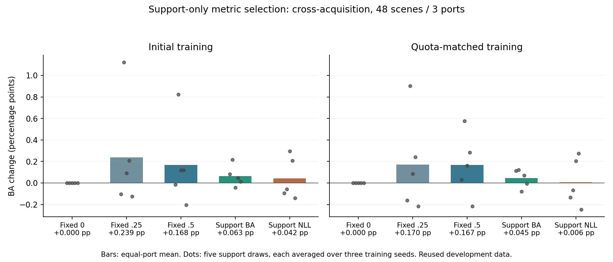

# 支持内选择修正倍率：结果与收口判断

2026-10-14。支持内选择、完整预测评价和针对性来源分析均已完成。未新增骨干、源分类头或度量训练，未替换主模型或论文主表。

## 结论先说

**不看查询标签选倍率，获得了很小的平均OA/BA净收益；但尚未证明“按任务选择倍率”比同样少用修正更有效。** 本轮不是全盘失败，也没有证据支持继续为选择器开发复杂模块。

建议保留此结果作为低成本配套候选和机制边界，收住可学习度量/倍率选择支线。论文核心继续放在已有类别参照关系及其支持残差适配效用，不把本轮选择器升级为独立创新模块。

## 1. 做了什么，标签在哪里用

沿用三港48景、每任务64个支持案例、5组支持抽样、两个已有训练版本和各3个训练种子。跨采集和同采集分别评价。不是完整23港或新增外部数据验证。

1. 倍率固定为0、0.25、0.5，矩阵路径仍是M(a)=(1-a)I+aM_learned。0代表固定类别参照，不是原视觉核。
2. 跨采集支持集合含13至30次采集，整批分成4折；同采集支持只有一个批次，按类别分层分成4折。原支持每条来自不同船，因此不存在折间同船复用。
3. 每折使用训练部分重新适配基础分支和专家分支，类别平衡权重也只从折内训练标签计算。对留出支持得到完整0.5概率融合的OOF预测。
4. 主规则选择支持OOF BA最高的倍率，精确并列取较小值；副规则独立选择宏NLL最低的倍率，不按查询结果在两条规则间择优。
5. 全部选择写入choices.csv和SELECTION_FROZEN.json后，才打开旧查询概率缓存。最后使用全部64个支持完成适配的预测，不使用折内模型投票。

选择阶段用支持标签和支持采集标识，不需要查询标签。源先验、参照和学习矩阵不变，支持适配不改变这些源端参数。采集分组依赖支持元数据，不能声称整个选择过程只需要无元数据的SAR像素。

本设计在上一轮oracle探索后确定，数据也已经多轮研发使用。因此“本轮选择没有读取查询标签”不等于“整个方法研发未见这些查询结果”。原任务支持类别配额也沿用既有设定，不将它称为完全盲采样新基准。

## 2. 完整分类结果

以下为跨采集支持任务，先平均港内场景和支持抽样，再等权平均3港与3训练种子。OA/BA变化为百分点，相对固定类别参照。

| 训练版本 | 策略 | OA | BA | OA变化 | BA变化 | BA上涨支持抽样 |
|---|---|---:|---:|---:|---:|---:|
| 共用基线 | 固定倍率0 | 35.6732% | 35.2595% | 0 | 0 | -- |
| 初版 | 固定0.25 | 35.6478% | 35.4980% | -0.0254 | +0.2385 | 3/5 |
| 初版 | 固定0.5 | 35.6197% | 35.4271% | -0.0535 | +0.1677 | 3/5 |
| 初版 | 支持BA选择 | 35.6889% | 35.3226% | +0.0157 | +0.0631 | 4/5 |
| 初版 | 支持NLL选择 | 35.6413% | 35.3013% | -0.0319 | +0.0418 | 2/5 |
| 配额对齐 | 固定0.25 | 35.6470% | 35.4294% | -0.0262 | +0.1699 | 3/5 |
| 配额对齐 | 固定0.5 | 35.7048% | 35.4267% | +0.0316 | +0.1672 | 4/5 |
| 配额对齐 | 支持BA选择 | 35.6911% | 35.3041% | +0.0180 | +0.0446 | 3/5 |
| 配额对齐 | 支持NLL选择 | 35.6683% | 35.2653% | -0.0049 | +0.0058 | 2/5 |

原视觉核BA为35.3342%；支持BA选择两版相对它仍为-0.0116/-0.0301个百分点。不能将“改善固定类别参照”写成“已超过所有基线”。固定0.25/0.5的表现来自同批已探索数据，亦非新的独立确认结果。

支持BA选择的跨采集BA训练种子增益：初版+0.0645/+0.0478/+0.0770，对齐版+0.0277/+0.0699/+0.0360，均为正。支持抽样标准差分别0.0978和0.0854个百分点；相同查询跨种子复用，不把它们当作独立船只样本或据此宣称显著性。

逐港BA变化：初版Jebel Ali +0.0456、Port Klang +0.0610、Singapore +0.0827；对齐版+0.0156/+0.0972/+0.0209。同采集任务BA变化则为-0.0252/+0.0096，保留不同任务条件下的差异。

宏NLL并非同步改善：支持BA选择初版/对齐版变化+0.000089/+0.000214。支持NLL选择对齐版宏NLL降低0.000158，但BA仅增加0.0058；不把更细的概率指标自动视为更好的识别倍率选择目标。

## 3. 为什么只兑现了一小部分

### 支持验证对小改动的分辨率有限

跨采集每版有240个支持任务乘3训练种子，共720个选择单元，其中60.56%的三个候选OOF BA完全相同。BA规则初版77.78%、对齐版78.33%的时候选择0；实际只在约22%的单元启用非零改动。

这说明多数支持集无法通过top-1 BA区分这些细小关系改动。它不是优化没有梯度或基础分支忘记重训：本轮没有重新学习度量，两路支持系数均按折重算，并已独立核对。

### 支持缺类，使某些查询收益不可见

上一轮贡献+0.158730总体BA百分点的Singapore渔船查询（任务47、draw1、行18270、MMSI 457649000），其64支持中没有渔船。本轮两个版本、三个种子、两种规则都选0，没有保住这一救回。支持验证目标本来就不包含渔船，不能直接评价该类会不会受益。

这定位了一个具体信息缺口，但不证明加入渔船标签必然改善选择，也不说明全部选择误差都由缺类造成。

### 更换成NLL没有自动解决问题

NLL对连续概率有分辨率，选择非零倍率的次数更多，但最终BA收益更低。问题不只是“BA太粗”；支持概率风险变化与查询分类收益也没有充分一致。

### 代理任务与最终任务不完全相同

跨采集折内训练47至49例，同采集48例，而最终适配64例。保持ridge=8时，相对数据项的正则作用和类别覆盖都会变化。跨采集平均每个支持任务有0.667个OOF样本的类别在相应训练折缺失。未追加预算或正则扫描，不能把这个合理差异直接断言为唯一根因。

按现有OOF结果分解，支持BA选择的平均CV BA增量为0.3802/0.3479，其中折内有同类训练支持的样本贡献0.3686/0.3305，折内缺类样本贡献0.0116/0.0174。说明CV自身的正信号主要不是由折内缺类样本制造，但兑现到查询后明显缩小。

## 4. 是选对任务，还是只是减少修正次数

在主结果产生后，补一个不训练、不重新预测的来源诊断：在同一版本、港口、训练种子和同/异采集条件内，保持选择器实际使用0/0.25/0.5的频率，将这些倍率随机分给原任务。直接从各固定倍率已有指标计算其准确期望，不做随机置乱扫描，不平均概率后再分类。

| 支持BA规则 | 实际BA增益 | 同频率随机分配预期增益 | 实际选择的额外优势 |
|---|---:|---:|---:|
| 初版 | +0.0631 | +0.0567 | +0.0064 |
| 配额对齐 | +0.0446 | +0.0564 | -0.0118 |

它保留每港的修正频率，专门检验港内按支持任务挑选有没有额外价值，不检验港口级频率是否有价值。当前没有一致优势，因此不能将净涨点全部归因于“识别出了值得修正的任务”。这不是证明选择完全无用，而是现有证据不足以支撑这个较强机制主张。

NLL规则相对同频率预期的BA额外优势为-0.0694/-0.1072，也不支持把它升级为更好的选择器。

## 5. 净收益的实际样本来源

支持BA选择所有查询BA净收益都来自支持集合已有对应类别的查询；对支持缺类查询，没有新增救回或损害。

初版34次救回暴露、26次损害暴露，涉及17艘救回船和12艘受损船；对齐版44/40次，涉及19/18艘。暴露数含重复种子/支持组合，独特船集合可能重叠，不能直接相减作为部署准确率。

一个Port Klang offshore查询（任务23、draw1、行30771、MMSI 533000522）被两版各3个种子救回，支持中该类有1例。该事件对总体BA贡献+0.041667个百分点，占两版净增益约66%和94%。另有油轮、集装箱等正贡献及相抵的损害，原始事件均保留。不能因其稀有就删除，也不能把它在三种子重复发生当作三艘船上的证据。

## 6. 成本、验证与决定

480个支持任务，34560次专家折内求解和1920次基础折内求解；没有新增神经或源端拟合。支持选择阶段约18.9秒，含数据装载和OOF缓存写入。对单个冻结模型，每任务候选选择计时中位数约5.08ms，包含共用基础/视觉核准备与该模型候选求解，未包含图像编码、源训练、最终查询预测及I/O，不作为端到端成本。

6个实际验证折的双分支完整概率与独立sklearn加权KRR最大差1.11e-16；6个完整64支持缓存复现最大差2.22e-16。14400条系统BA由类别事件重构，最大差1.42e-14；5760条CV覆盖贡献分解最大差1.78e-14；种子/抽样平均汇总一致。图已渲染检查。代码与协议的独立静态审阅不等于独立数值复现实验。

**收口决定：记录真实的小正信号，不宣布算法无效；但不继续为这点收益增加复杂选择模块。固定类别参照仍是主候选，缩小度量改动及支持CV留作配套研究记录。** 本轮没有证据证明选择器优于简单固定小倍率，也没有在这48景超过原视觉核BA，暂不升级主模型。

后续若有新的、更直接的支持代表性信息或未用验证条件，可以重新评估；当前不追加细网格、更多种子或新门控。已有固定类别参照在外部数据的局部收益不受本轮选择支线的弱结果否定。

文件：run.py、analyze.py、DESIGN_ZH.md、PROTOCOL.json、choices.csv、summary.csv、selection_quality.csv、matched_frequency_control.csv、support_coverage_contributions.csv、changed_cases.csv及OOF缓存。全部主结果和对照保留。
