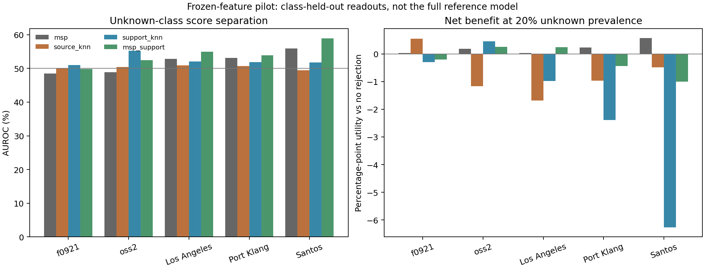

# 未知类与目标缺类：先验证收益空间

日期：2026-10-13。独立侧线；未修改主模型、稿件或主线程实验。

## 结论先说

**存在有条件的收益空间，但尚不足以开发通用未知类模块。** 将渔船留作未知类时，目标支持距离在 OpenSARShip 2.0 和 Port Klang 上比最大分类置信度更有区分力，在假定未知占比20%的评价中，五次支持抽样均有净收益。这个信号值得保留，不要求其他所有留类任务也赢。

同时，收益不是免费的：未知比例降低后，误拒原本认对的已知船型可能抵消收益。跨全部留类任务的区分度仍弱，不能把局部正信号写成通用开放集能力。

最明确的数据层问题是：**“不像64个支持案例”同时混入了“真正的新类别”和“已知类别没有被抽进支持集”两种情况。** 当前证据证明两者发生混淆，但尚未通过覆盖干预证明缺少支持是全部退化的根因。

## 做了什么

- 5个固定目标任务：Los Angeles、Port Klang、Santos、F_0921、OpenSARShip 2.0。
- 每个任务轮流留出8类中的一类，重新拟合7类PCA、标准化及分类读出；该类不进入本轮源拟合或目标支持。
- 每个留类任务使用64个已知类支持案例，5次抽样，共200个任务/留类/抽样组合。相同查询重复使用，不是200个独立数据集。
- 本轮源拟合使用3739艘不同船舶；源、目标支持、目标查询之间按船舶身份隔离。查询每类最多128艘，每船一张。
- 冻结现有R50和R18特征，使用紧凑双路岭适配读出。不含主模型全部分频、稳定坐标等组件；没有新增神经网络训练。
- 比较分类置信度MSP、源案例距离、目标支持距离、固定等权置信度/支持距离组合。所有方法共用分类预测。
- 拒识阈值由64个已知支持逐例留一预测确定，主工作点为95%经验分位。目标查询标签不用于模型拟合或阈值选择，但用于诊断任务的分层选样和评价。

**边界：这是冻结特征留类诊断，不是完整模型正式开放集结果。** 历史编码器是否接触过留出类别没有重置。64个支持从已知标签库选取，不等于在含未知类的池中标注64次就能取得64个已知案例。

## 一、哪里确实有收益

下表仅为“渔船作为未知类”，目标支持距离的五次抽样平均。已知类指标按类别宏平均。

| 目标 | 未知查询船数 | MSP AUROC | 支持距离AUROC | 未知检出率 | 已知误拒率 | U(20%) | 五次U为正 |
| --- | ---: | ---: | ---: | ---: | ---: | ---: | ---: |
| OSS2 | 128 | 28.55% | 72.56% | 25.00% | 7.59% | +3.20 | 5/5 |
| Port Klang | 38 | 35.36% | 76.08% | 25.26% | 6.28% | +2.90 | 5/5 |
| Los Angeles | 9 | 28.58% | 76.23% | 28.89% | 9.20% | +3.46 | 5/5 |
| Santos | 7 | 24.43% | 93.88% | 91.43% | 9.82% | +14.68 | 5/5 |
| F_0921 | 128 | 42.45% | 31.08% | 0.63% | 6.77% | -1.47 | 0/5 |

LA和Santos的未知船数很少，五次抽样重复评价同一批船，不能用它们替代更多独立船舶的确认。OSS2和Port Klang是更值得保留的线索。该类别是本轮结果中发现的候选范围，需要后续冻结范围验证，不能当成预先指定的胜利。

这里的 U(pi) = pi × 未知检出率 - (1-pi) × 被误拒的原本正确已知类比例，单位为百分点。它是按指定未知占比重加权后，相对不拒识的净正确决策收益，**不是已知类BA提升，也不是实际部署未知比例**。未知占比改成5%，上述OSS2和Port Klang收益分别为-0.89、-1.30。开发前必须明确使用场景及错接未知、误拒已知的代价。

## 二、为什么还不能直接开发通用模块

全部8个留类任务、5次支持抽样的平均结果如下，阈值均只从支持校准。U以假定20%未知计算。

| 目标 | MSP AUROC | 支持距离AUROC | MSP U | 支持距离U |
| --- | ---: | ---: | ---: | ---: |
| F_0921 | 48.46% | 51.02% | +0.03 | -0.30 |
| OSS2 | 48.89% | 55.24% | +0.18 | +0.46 |
| Los Angeles | 52.80% | 52.09% | +0.03 | -0.98 |
| Port Klang | 53.14% | 51.86% | +0.23 | -2.40 |
| Santos | 55.93% | 51.76% | +0.57 | -6.27 |

F_0921源案例距离有小幅正信号：U=+0.55，相对MSP增加0.51，五次抽样的留类平均差均为正。OSS2目标支持距离相对MSP增加0.27，五次中四次为正。都不足以说明已实现强未知检出。

即使使用查询标签事后确定允许5%已知误拒的阈值，各方法的跨留类平均未知检出率仍主要在4%-8%。这个不可部署的oracle诊断说明，**现有分数排序本身也有问题，不能只归咎于阈值未调好**。它是当前分数族的工作点诊断，不是所有未来方法的收益上限。

## 三、数据层面发现了什么

同一个支持距离判据下，按“已知类别是否在当前支持中出现”分层：

| 目标 | 已知但零支持：误拒率 | 已知且有支持：误拒率 | 真未知检出率 |
| --- | ---: | ---: | ---: |
| F_0921 | 14.17% | 5.36% | 6.41% |
| OSS2 | 9.67% | 7.48% | 10.90% |
| Los Angeles | 13.33% | 8.24% | 10.43% |
| Port Klang | 23.75% | 10.26% | 9.75% |
| Santos | 58.06% | 14.90% | 20.87% |

表格为各分层内类别/任务/抽样单元的平均，不是按船数加权的总体率。不同分层类别组成不同，因此这是定位证据，不是覆盖不足的因果效应估计。

Santos的零支持已知类别不仅被拒得多，其中原本正确预测被拒的比例达到43.55%。这解释了净收益的损失来源。已有支持的类别也存在较高误拒，说明不能把全部问题归于零支持；类别难度、支持代表性和跨港几何关系仍待区分。

## 四、“目标没有某个已知类”是另一个问题

使用8类参照模型、目标支持排除某类，查询只含另外7类。比较原预测与两种屏蔽规则，以下为BA变化百分点：

| 目标 | 真正缺席类已知时，只屏蔽它 | 屏蔽64支持里所有未出现类 |
| --- | ---: | ---: |
| F_0921 | +0.88 | +0.44 |
| OSS2 | +0.44 | +0.37 |
| Los Angeles | +1.14 | +1.15 |
| Port Klang | +0.63 | -0.05 |
| Santos | +0.52 | -5.30 |

第一列需要知道真实缺席类别，只是这一具体操作的oracle参照，不是所有缺类适配方法的总体上限。第二列可由支持标签实现，但会把“存在却未抽到”的类一起删除。

结论：目标缺类确实留有约0.4-1.1点的局部修正空间；**支持中没见过，不等于目标港不存在**。目标缺类与真正未知类必须分别建模、分别评价。

## 下一步开发门槛

本轮停止在收益验证，不增加门控网络或重训骨干。优先做一个能区分解释的数据对照：

1. 固定查询、模型、64标签预算和拒识分数，在支持池允许的类别上对比随机支持与保证已知类覆盖的支持抽样；同时报告类内不同船覆盖，不能重复同一船凑数。
2. 检查补齐类别覆盖后，已知误拒是否下降，渔船未知检出是否保留。如果成立，再发展“支持覆盖感知拒识”；否则转向类内代表性或表示重叠，而不是把距离换个网络包装。
3. 按实际使用范围固定未知占比或业务代价，保留多个工作点。局部可重复、有成本价值的收益即可成立，不要求每港每类都赢。

以上是建议的下一轮，**尚未运行**。正式完整模型接入、历史骨干类别暴露的严格控制、更多未知船和标注预算变化也未完成。

## 产物与实现核查

- `PROTOCOL_ZH.md`：预测前固定方案。
- `study.py`、`analyze.py`、`diagnose.py`：拟合、评价、独立核算。
- `metrics.csv`：1600行，包含两个预设校准分位、四种分数。
- `partial_metrics.csv`、`class_coverage_diagnostics.csv`：缺类与覆盖诊断。
- `tasks/*/unknown_*.npz`：预测、分数、校准分数、阈值和支持索引。
- `VERIFIED.json`：200个组合身份/类别检查、4800项独立指标核算、40次独立primal岭求解对照通过。检查用于排除实现不一致，不替代研究结论验证。
- `SEPARATION_AND_UTILITY.png/.pdf`：已查看PNG，无文字截断。

本轮没有证明未知检测不可行，也没有把“支持距离有效”推广为“因果因素已被分离”。目前最有价值的收获，是找到局部可利用关系，并识别出开发模块之前必须解决的支持覆盖混淆。
