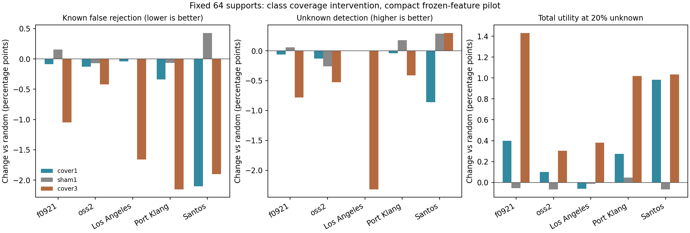

# 固定64标签预算：补齐已知类覆盖有没有用

日期：2026-10-13。已完成。独立侧线，不修改主模型或论文。

## 结论

**有用，但首先支持的是“支持集需要覆盖保障”，还不是“通用未知类门控已经可开发”。**

保持64艘支持、同一批查询、冻结源模型及适配配方，只补入原本未抽到的已知类，在F_0921、OSS2、Port Klang和Santos上得到平均总效用改善。前三个中的F_0921、Port Klang及Santos，五次支持抽样的全留类平均改善均为正；OSS2为4/5。同样替换数量但不补类别的对照没有解释掉这些平均收益。

原有渔船未知类信号基本保留：OSS2检出率25.00%变成24.38%，Port Klang保持25.26%。但支持距离在全部未知类别平均上仍弱，多个任务即使改善后仍不如不拒识；这两个事实必须同时保留。

更具体地说：

- F_0921主要受益于原本没有目标支持的类别更容易认对，而不是未知检出明显变强。
- Santos既改善支持邻域，也改变支持留一校准阈值，从而减少把已知类别当未知的错误。
- 保证三艘不总比保证一艘好。对于OSS2渔船未知，三艘方案损失更多未知检出，不能按总体均值自动推广。

## 设计和实际覆盖

固定上一轮5目标、8留类、5抽样，共200个组合；每组4个抽样臂，共800个评价单元。没有新增源分类头、PCA或骨干训练。所有目标支持残差及留一阈值仍按原配方求解，改变支持时重新计算这些支持依赖量，并非冻结旧残差系数。

| 抽样臂 | 操作 |
| --- | --- |
| random | 原64个支持，不改 |
| cover1，主对照 | 缺哪个已知类，就从当前最多的类别让出一例补入；每个已知类至少一艘，其余原样保留 |
| sham1，替换对照 | 与cover1相同位置、相同替换数量，但换入原类别的另一艘船，不增加类别覆盖 |
| cover3，预设敏感性 | 同样64艘，每已知类尽量至少三艘，匹配原拒识分数的3近邻需求；不调近邻数 |

全部已知类在候选支持池中至少有一艘，cover1均实际做到全覆盖。LA第7类、Santos渔船各仅有两艘候选支持，因此cover3在这些类最多取两艘，不宣称满足三艘。

| 目标 | 原随机支持有缺类的组合/40 | cover1每组平均替换艘数 | cover3每组平均替换艘数 |
| --- | ---: | ---: | ---: |
| F_0921 | 21 | 0.650 | 3.875 |
| OSS2 | 18 | 0.450 | 3.175 |
| Los Angeles | 2 | 0.050 | 1.125 |
| Port Klang | 9 | 0.275 | 3.000 |
| Santos | 22 | 0.700 | 3.750 |

总共72/200个原组合存在缺类。原本已经覆盖全部已知类的128个组合，cover1不变，输出也不变。查询按船隔离，未从查询借船补支持。

## 一、主对照的系统结果

以下均为目标支持距离拒识，按全部8留类、5抽样平均；变化单位为百分点，原阈值规则不变，均为已知支持LOO的95%经验分位。

| 目标 | 已知BA变化：拒识前 | 已知误拒率变化 | 未知检出率变化 | 总效用变化V(20%) | 五抽样总效用改善 | cover1相对sham总效用 |
| --- | ---: | ---: | ---: | ---: | ---: | ---: |
| F_0921 | +0.657 | -0.086 | -0.065 | +0.399 | 5/5 | +0.454 |
| OSS2 | +0.165 | -0.127 | -0.132 | +0.101 | 4/5 | +0.167 |
| Los Angeles | -0.080 | -0.038 | 0.000 | -0.060 | 0/5，另有3次不变 | -0.047 |
| Port Klang | +0.197 | -0.337 | -0.039 | +0.275 | 5/5 | +0.227 |
| Santos | +0.232 | -2.100 | -0.858 | +0.983 | 5/5 | +1.049 |

五抽样全留类平均V差值的标准差，按表中顺序为0.246、0.268、0.100、0.339、0.374。不是五个独立测试数据集，也没有做总体显著性声明。

这里V(pi)=(1-pi)×拒识后已知BA+pi×未知检出率，是按指定未知比例重加权的总正确决策量。**V的跨臂差同时计算分类变化、误拒变化和未知检出变化，不是原八类OA/BA。** pi=20%是沿用的诊断设定，不是已知部署比例。

旧U(pi)则是相对各臂自身“不拒识”分类器的增量。在本实验中，支持改变了分类器预测，因此不能只比较各臂U就当成完整系统收益。两种量均保留在CSV中。

在未知占比5%的设定下，cover1相对random的V变化为F+0.485、OSS2+0.145、LA-0.071、Klang+0.334、Santos+1.328。说明支持修复的整体价值并非只在20%未知比例存在；但不代表拒识操作本身在5%比例下值得启用。

## 二、原来未覆盖的已知类别，确实发生了什么

下表只追踪原随机支持为零的已知类别，并在完全相同的查询船上比较。不把“补齐后这一组消失了”误当成误拒下降。

| 目标 | 原未覆盖类误拒率：random -> cover1 | 这些类的识别率，不拒识：random -> cover1 |
| --- | --- | --- |
| F_0921 | 14.17% -> 13.39% | 7.81% -> 22.61% |
| OSS2 | 9.67% -> 8.56% | 1.85% -> 18.77% |
| Los Angeles | 13.33% -> 13.33% | 0.00% -> 3.33% |
| Port Klang | 23.75% -> 17.72% | 22.46% -> 37.95% |
| Santos | 58.06% -> 45.89% | 60.91% -> 67.17% |

这些是原缺类单元的类别平均，不是整个港口BA。补入少数类会让出其他类支持，所以必须结合上一节全任务结果，不能只展示受补类改善。

案例组成也很明确：F的缺类主要为渔船和第7类，OSS2为拖船及第7类；Santos以渔船、原油轮、第7类为主。Santos被跟踪的渔船只有7艘查询船，其缺支持时误拒率85.71%，补齐后66.67%。这支持局部机制，但不能把反复评价同7艘当作大样本证明。

同数量同类别替换sham1后，Santos原未覆盖类误拒从58.06%变为59.08%，Port Klang从23.75%变为23.22%，未复现cover1的改善。这增强了“补入原缺类别有实际作用”的解释；对照仍只有规定的五次抽样，不排除不同具体支持船的影响。

## 三、为何有效：分开邻域、阈值和分类读出

对support_knn采用固定顺序的路径交叉：

原距离/原阈值/原分类 -> 新距离/原阈值/原分类 -> 新距离/新阈值/原分类 -> 新距离/新阈值/新分类。

这是计算路径诊断，不是唯一物理因果分解。

### F_0921：主要是分类证据补齐

cover1的总效用增加0.399点。只改变支持距离和阈值、保持原分类决定时，增加仅约0.001点；进一步更新支持残差分类才增加约0.397点。

因此本轮F的正结果不能写成“未知检测机制变强”。更准确的说法是：**原来这个已知类几乎没有目标域监督，补入该类案例后，目标支持校正可以更有效地识别它。**

### Santos：邻域修复和校准共同减少误拒

- 原已知误拒19.212%，只换支持距离、固定旧阈值后18.364%。
- 再用新支持LOO校准阈值，降至17.111%。
- 同一路径的V变化分别为+0.572、再+0.440；更新分类决定后变化-0.028，总计+0.983。

这说明收益不只是阈值变宽：固定阈值时已有正作用；但也不能全部说成表征更好，校准变化贡献明显。换支持没有改变冻结的SAR表征。

补入一艘已知类后，它不再只能依赖其他船型的支持邻居；同时支持LOO分数分布发生变化。两条路径均有计算证据，尚不等于已知全部散射或港口物理原因。

## 四、原有未知检出信号是否保住

预先指定上一轮发现的渔船未知范围：

| 目标 | 未知检出：random -> cover1 | 已知误拒：random -> cover1 | U(20%)：random -> cover1 | V变化 |
| --- | --- | --- | --- | ---: |
| OSS2 | 25.00% -> 24.38% | 7.59% -> 7.50% | +3.20 -> +3.15 | +0.611 |
| Port Klang | 25.26% -> 25.26% | 6.28% -> 6.23% | +2.90 -> +2.94 | +0.084 |

因此可以说**基本保住局部信号**，不能说未知检出完全无损，也不能说覆盖修复显著提高未知识别。OSS2 AUROC72.56%变为71.17%，Klang76.08%变为76.05%。LA这一留类原本无缺类，cover1完全不改；Santos的渔船未知检出也不变，但仅7艘。

## 五、为什么不直接升级复杂模块

### 比旧拒识更好，不等于比不拒识更好

cover1后，对全部留类平均，支持距离拒识自身的U(20%)仍为：F -0.425、OSS2 +0.427、LA -0.979、Klang -2.278、Santos -5.470。

也就是说，Santos的覆盖修复确实有效，但目前通用拒识仍伤害了太多原本正确的已知预测。不能把“减少部分损失”包装为已获得可部署的通用开放集方案。已有渔船未知范围的正收益单独保留。

### 三例保底不是全面升级

cover3的全留类平均V收益为F+1.431、OSS2+0.302、LA+0.380、Klang+1.019、Santos+1.033；但OSS2渔船未知检出降到20.47%，比random少4.53点，该范围V为-0.018。LA渔船检出也下降8.89点。

因此只把cover3作为预设敏感性，不按每个目标港的测试结果在cover1/cover3之间挑选最优并宣称可部署。

## 实际建议

1. **保留cover1为轻量的支持覆盖保障候选。** 当前函数已经实现，可复用；它是有实验依据的支持组织策略，不需要先造复杂注意力或门控。
2. **把“已知类覆盖是否足够”与“样本是否未知”分开。** 前者已证明有局部、可重复价值；后者仍需独立识别证据，不应用一个距离混着承担。
3. 若后续接完整模型，先固定cover1，在主模型原64支持任务上做同样配对接入，而非同时修改表示、核和拒识机制。本轮尚未接入主模型。
4. 在已标注候选库中，cover1使用的支持仍只有64艘；但在完全无标签池中实现覆盖可能需要额外查找/标注。这个成本尚未验证，不能宣称“任意无标签池只标64艘就能覆盖七类”。

**本轮开发门槛判断：支持覆盖保障值得保留、可进入完整模型的受控接入；通用未知类门控尚未达到开发收益门槛。** 不否定开放集路线，也不继续无边界增加模块。

## 产物和实现检查

- `PROTOCOL_ZH.md`：结果前固定方案，含cover3和sham1。
- `SUPPORT_PLAN.json`、`pool_capacity.csv`：选样、各类容量、每次替换记录。
- `run.py`、`analyze_coverage.py`：实现和分析。
- `metrics.csv`：3200条，四臂乘四种拒识分数；主解释预先指定支持距离。
- `paired.csv`、`coverage_vs_sham.csv`、`class_effects.csv`、`path_decomposition.csv`：全量配对和路径结果。
- `draws_all.csv`等：五次支持抽样波动。
- `replay.csv`：200个原组合回放，分类决定与四分数95%阈值拒识决定零翻转。
- `ANALYSIS_COMPLETE.json`：12800项独立按类/决策转移指标核算通过；未改支持的臂输出一致。

加载已保存float32模型并改变批次时，数值并非逐位相同：最大概率差2.21e-7、分数差2.83e-6、阈值差9.72e-7。最初过严的浮点一致性检查中止后，保留原行批次表示、在同一次执行内重放所有random并与各干预配对；最终全部实际分类/拒识决定与旧记录一致。未依据测试标签调整模型、阈值或抽样规则。

最终预测运行约29秒、CPU单线程，不含之后指标汇总耗时。使用冻结特征和原紧凑读出，历史编码器暴露边界沿用上一轮，不是主论文完整模型的新主表。
