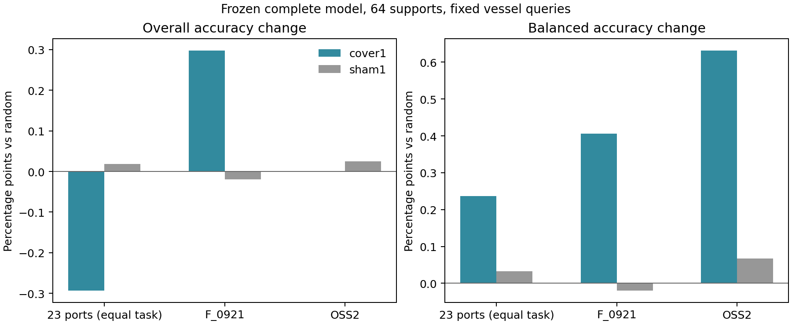

# 支持覆盖保障接入完整模型：收益及代价

方案与运行目录沿用2026-10-13；报告收口日期2026-10-14。独立侧线，主模型、稿件、其他实验未修改。

## 结论

**已经接入真实完整模型，存在类别均衡收益，但不是OA/BA同时普遍提高。**

- 23港平均BA增加0.236个百分点，五次支持抽样的港口均值均为正；同时OA下降0.293点，五次均为负。这个取舍不能解释成偶然随机波动。
- F_0921平均OA/BA增加0.298/0.407点，但主要受一次较大收益推动，完整模型上的重复性比上轮紧凑实验弱。
- OSS2平均BA增加0.632点、OA持平；五次抽样只有一次原本缺类，因此只有该次发生改变。不是五次都重复提点。
- 同替换数量但不补类别的sham没有复现主要BA收益；说明类别覆盖确实有作用，不只是碰巧换了几艘船。

建议保留为**偏重类别均衡的轻量支持选择候选**，不直接替换主方案默认采样，也不扩写为通用未知类门控。认可能解释的局部价值，同时保留常见类别的代价。

## 一、这次确实是完整模型

参考版本为`paper_reference_20261013 / dual_refit_late`：原C4/基础分频核、原基础先验、双路专家重拟合先验、专家保留与PCA补充核，以及适用港口的稳定/漂移/入射角处理均保留。目标支持仍使用类平衡残差岭强度8，最后两头概率各0.5。

没有新增源拟合或神经训练；仅对新支持按原配方重算残差系数。25任务乘5抽样乘3个分支的原预测回放共375项，基础/专家/融合的argmax均与存档一致。

本轮是真实八类闭集任务。完整参考训练过八类，不能隐藏一个输出便声称实现未知类检测；因此**本轮没有新增完整模型未知检出结果**，上轮留类诊断单列保留。

## 二、实际比较范围

23个港口任务，加F_0921、OSS2，共25任务。每任务固定查询船、64个支持、5次抽样，对比：

1. random：随机64艘。
2. cover1：仅对候选支持池存在、但64支持没抽到的类补入一艘，从当前最多案例类别让出一艘；其余原样保留。
3. sham1：同位置、同数量替换，但换入原类别另一艘，不增加类别覆盖。

总计375个任务/抽样/采样臂单元，三个分类读出得到1125条指标。每个支持集64艘不同船，支持与查询身份隔离。之前五个目标的查询船与上轮相同；其他港按同一固定程序新增覆盖。

查询每类最多128艘、每船一观测；Mombasa因支持池较小预先提升到64艘，留下49艘查询。**本报告的绝对OA/BA不等于原自然行频率的论文主表**，但三臂比较使用完全相同查询，可以解释本轮策略差值。

部分港口查询只有3个类别；模型输出空间仍为8类，BA按该任务实际出现的类宏平均。Houston、Mombasa、Port Said、Richards Bay、Sydney Botany各有一个查询类别在候选支持池中不存在，cover1无法补齐，未借用查询船。

| 范围 | 需要补类的抽样数 | 总抽样数 | 实际替换支持总数 |
| --- | ---: | ---: | ---: |
| 23港 | 28 | 115 | 39 |
| F_0921 | 3 | 5 | 3 |
| OSS2 | 1 | 5 | 1 |

全覆盖时策略不动作，未变化单元输出完全一致。所有sham均有可用同类替换船。

## 三、完整融合主结果

下表为百分比，变化为百分点；23港按任务等权，外部各自五抽样平均。

| 范围 | random OA | cover1 OA | OA变化 | random BA | cover1 BA | BA变化 |
| --- | ---: | ---: | ---: | ---: | ---: | ---: |
| 23港 | 61.970 | 61.677 | -0.293 | 55.662 | 55.899 | +0.236 |
| F_0921 | 29.712 | 30.010 | +0.298 | 29.314 | 29.721 | +0.407 |
| OSS2 | 38.512 | 38.512 | 0.000 | 34.204 | 34.836 | +0.632 |

对应cover1相对sham的OA/BA变化：23港-0.311/+0.204；F+0.318/+0.426；OSS2-0.025/+0.565。少数类BA收益不是同数量随意换案例就能复现。

### 不把平均值当重复性

| 范围 | 五次BA变化 | BA变化均值±标准差 |
| --- | --- | --- |
| 23港 | +0.089、+0.215、+0.261、+0.099、+0.516 | +0.236 ± 0.173 |
| F_0921 | +0.315、0、+2.214、0、-0.496 | +0.407 ± 1.051 |
| OSS2 | 0、0、0、0、+3.159 | +0.632 ± 1.413 |

F去掉最好一次后，其余四次平均BA变化约-0.045点；因此不能把F写成完整模型稳定五次获益。OSS2四次不变是因为原支持已经覆盖候选池各类，而不是策略运行却无效。

23港中13个港有实际替换，8港平均BA为正、5港为负；另外10港完全不动作。具体逐港结果见`task_summary.csv`，包括所有负例。

## 四、为什么BA提高、OA反而下降

对每个查询追踪random和cover1的正确性转移，再按完整任务分母汇总。下面每列严格加总为对应整体差值，没有只看受益类别。

| 查询类别所属组 | 23港OA贡献 | 23港BA贡献 | F OA贡献 | F BA贡献 | OSS2 OA贡献 | OSS2 BA贡献 |
| --- | ---: | ---: | ---: | ---: | ---: | ---: |
| 原零支持、现在补入 | +0.110 | +0.360 | +0.755 | +0.856 | +0.202 | +0.741 |
| 让出支持的类别 | -0.323 | -0.079 | +0.199 | +0.195 | +0.050 | +0.039 |
| 其他已有支持类别 | -0.083 | -0.056 | -0.655 | -0.645 | -0.252 | -0.148 |
| 仍无支持的类别 | +0.003 | +0.012 | 0 | 0 | 0 | 0 |
| 合计 | -0.293 | +0.236 | +0.298 | +0.407 | 0.000 | +0.632 |

这条链已有直接证据：**补齐缺失类 -> 一部分原弱类别被救回 -> 全局支持残差也改变其他类别分数 -> 常见类别出现额外错误 -> 宏平均BA与按样本平均OA出现取舍。**

23港累计查询/抽样事件中，散货船救回38次、伤害99次；渔船救回27次、伤害1次；海工供应船救回32次、伤害7次。这些是重复抽样事件数，不是相同数量的独立船。

不能简单说“因为拿走一艘散货船所以伤害它”。更换支持同时改变核关系、标签残差目标和类平衡权重，联合求解会影响其他类别；F和OSS2的让出类别甚至净受益。当前定位到了真实类别贡献与耦合路径，尚未唯一分离每一种数学变化的因果份额。

### 具体案例范围

- F原缺海工供应船的三次抽样中，该类111艘查询船的平均召回从1.20%升至12.61%；但其他已有支持类损失抵消了不少收益。
- OSS2缺海工供应船的那一次，27艘该类查询船从0艘认对变为8艘，召回0%到29.63%。与此同时其他类别新增错误，导致总OA保持不变。
- Port Klang补渔船的那一次，38艘渔船召回44.74%到86.84%，说明某些支持缺口确实很有价值。
- 也有补齐无明显直接收益：Richards Bay拖船五次被补，但该类六艘查询的召回仍为0。**有标签覆盖不等于这一艘案例已经代表该类的跨域变化。** 不将此解释成实现错误或否认其他范围收益。

## 五、是不是融合把收益掩盖了

| 范围 | 基础头BA变化 | 专家头BA变化 | 完整融合BA变化 |
| --- | ---: | ---: | ---: |
| 23港 | +0.133 | +0.195 | +0.236 |
| F_0921 | +0.467 | +0.528 | +0.407 |
| OSS2 | +0.133 | +0.419 | +0.632 |

23港两个单头自身就同时出现OA下降、BA提高，因此不能把问题一概归咎于最终融合。F融合兑现的BA增量低于两个单头，但OSS2相反，现有证据不支持为此全面更换融合模块。

## 六、如何使用本轮结论

**可以保留：** cover1作为已标注案例库中的类别均衡支持组织策略，有局部实际收益、低额外计算成本，并且能解释何时动作、动作后救回了谁。

**暂不采用：** 把它当成默认全面升级，或者凭这轮闭集结果增加未知类门控。23港OA损失具有一致性，F和OSS2的额外重复收益也还有限。

对于论文，可以表述为：

> 少样本支持适配的困难不仅来自视觉表示不足，也来自目标支持的类别覆盖。固定标签预算下的最小覆盖修复可恢复部分稀有船型的判别证据，但其收益通过全局残差求解传播，可能与常见类别准确率产生取舍。完整模型的配对支持替换与逐类救回/伤害分解揭示了该作用范围。

不能把这个常识性覆盖规则本身包装成已证明的顶刊核心原创模块。本轮价值主要在完整模型验证和可解释边界，也为后续是否需要更针对性的支持组织提供依据；没有启动新的门控、权重搜索或神经训练。

## 七、成本与边界

- 在已标注候选库里，各臂只使用64个支持标签；实现类别保障需要知道候选库类别，不能隐去查找/额外标注成本。
- 64支持下系数求解与查询预测的CPU中位耗时，random约0.703毫秒、cover1约0.692毫秒、sham约0.661毫秒。差异不解释为加速，均不含骨干提特征、核构建或标注成本。
- 本轮预测脚本含选样/特征读出/回放约22.9秒，CPU单线程，缓存特征已存在；不是端到端运行时间。
- 现有源几何/编码器暴露沿用冻结主模型，并未按新查询重新去除全部源船舶。新支持与查询身份隔离，不等于所有训练层级均未见目标船。
- 本轮与上一轮紧凑7类留类实验的源拟合、类别空间、随机支持都不同，因此不能把两个实验间的收益差单独归因于某个完整模块。

## 产物与检查

- `PROTOCOL_ZH.md`、`SUPPORT_PLAN.json`、`QUERY_PLAN.json`：预测前固定规则、支持与查询索引。
- `inventory.csv`：每港船舶/类别容量及无法补齐的类别数。
- `run_full.py`、`analyze_full.py`：完整接入与分析，复用上轮已验证的repair采样函数。
- `tasks/*/predictions.npz`：三采样臂、三读出、五次支持的原概率。
- `metrics.csv`、`task_summary.csv`、`summary.csv`、`draws.csv`：完整指标与波动。
- `classes.csv`、`role_contributions.csv`、`events.csv`：类别贡献和具体救回/伤害记录。
- `coverage_vs_sham.csv`：同数量替换对照。
- `replay.csv`：375项原分类决定回放零翻转。
- `ANALYSIS_COMPLETE.json`：3375项救回-伤害及类别贡献加总核算通过，支持身份不与查询重叠，未修改支持的输出一致。

主模型默认策略保持原状。本侧线已完成本轮受控接入，没有进一步实验正在运行。
