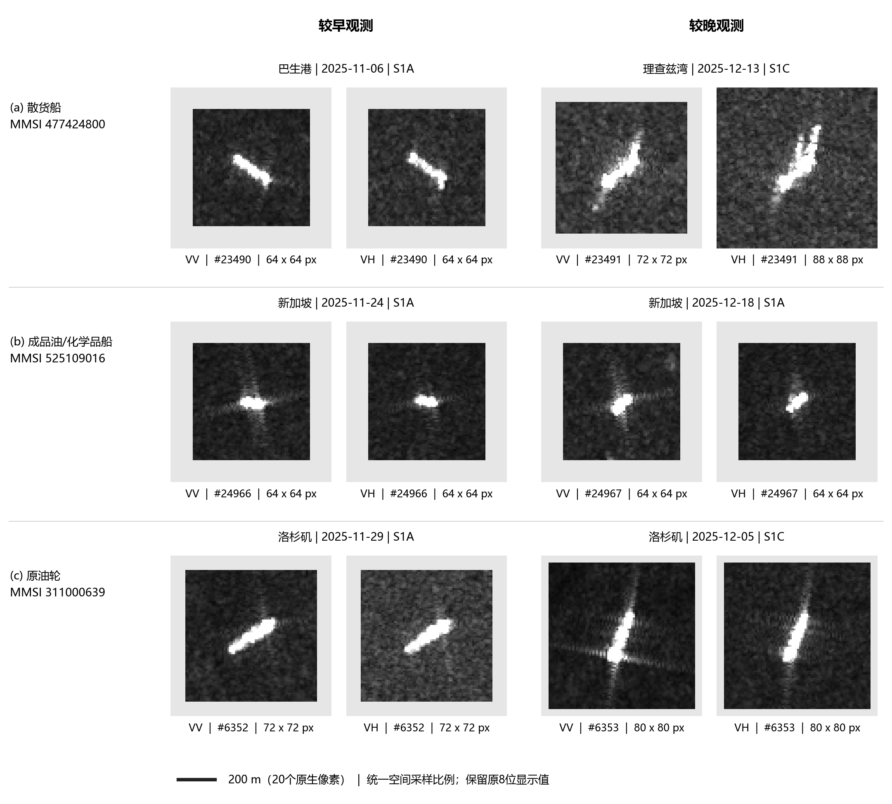

# 成像条件与场景变化下的SAR船舶分类

# 1. Introduction

合成孔径雷达（SAR）为海上监测提供了重要的图像来源。船型分类在目标检测的基础上，进一步识别已定位船只的类别。OpenSARShip、FUSAR-Ship等公开资源推动了学习式分类方法的研究与评价[R1][R2]。然而，实际应用要求分类器识别训练数据所覆盖条件之外的船只观测。本文关注已定位船舶图像切片（chip）上的这一问题：船型是需要识别的属性，而船舶所处的观测条件与场景可能发生变化。

同一艘船的重复观测直观体现了这一困难。图1展示了不同成像批次下、关联到相同船舶身份的VV/VH图像。散货船在巴生港和理查兹湾的观测呈现出不同的方向及强响应空间排列；成品油/化学品船在同一港口、同一Sentinel-1A平台的两次观测中也存在外观变化，说明这种变化并不局限于跨港口或跨平台；原油轮在洛杉矶的两次观测同样表现出目标响应及周围结构的差异。尽管船舶身份与类别保持一致，其可见图像证据并非固定不变。这些自然观测为分析跨场景识别中的类内变化提供了直观起点。

**图1.** 24港数据中三艘船的配对观测：（a）不同港口、不同Sentinel-1平台的散货船；（b）相同港口、相同平台的成品油/化学品船；（c）相同港口、不同平台的原油轮。每行的船舶身份由相同MMSI关联，类别标签保持一致。较早、较晚观测分别展示VV和VH。保留所有原始像素，各面板按10 m/像素的共同空间采样比例显示，灰度范围固定为0–255；采样间隔不等于传感器分辨率。浅灰色表示原chip之外的留白，不属于图像。拼图未施加旋转、对比度增强、去噪或船长归一化。输入是已有8位显示产品，不是定标后向散射的定量比较。案例用于说明现象，不代表随机样本，也未单独隔离港口、几何或平台效应。

相应的学习问题不只是如何缩小特征分布差异，还包括如何利用判别作用随条件而变化的图像证据。局部响应可能支持正确类别，也可能抬高竞争类别的分数，或者对最终决策影响很小。它的用途未必能仅由强度或空间位置决定。已有双极化船型分类方法通过共享特征提取、跨分支交互或高阶融合利用VV/VH的互补信息[R4][R5][R6]。在这些研究的基础上，本文进一步关注局部证据的来源与组织方式，以及这些证据在观测变化下如何影响类别竞争。

为研究这一问题，我们结合重复船舶观测与固定分类器上的受控扰动。自然配对在记录的船舶身份保持一致时，展示图像层面的变化；受控扰动则在其他输入与模型参数固定的条件下，改变指定极化、区域和空间尺度分量。第3节的诊断实验表明，相近的局部操作在不同区域和极化中具有不同作用。同一操作在联合极化与单极化读出下，甚至可能产生方向相反的平均类别分差效应。判断改善有时来自竞争类别证据比正确类别证据下降得更多，而相近操作也可能破坏原有正确判断。这些结果刻画的是指定计算系统对受控输入变化的响应，并不等于识别了SAR采集过程中的独立物理原因。

由此，我们将研究问题聚焦为：**如何在保留局部响应的极化、区域与尺度身份的同时，学习它们在当前判别关系中的用途？** 目标不是统一抑制变化较大的响应，也不是预先把外围区域视为有害信息，而是在保留潜在线索的前提下，区分有效类别证据与误导性的类别竞争。受控扰动可以用于分析模型依赖，但固定模型敏感性与重新学习后的信息价值是不同的问题[R8][R9]。因此，本文将问题的实证刻画与分类方法的有效性验证分开：第2节梳理相关研究，第3节给出支持方法设计的观测与扰动证据，后续再通过匹配的训练与评价检验设计是否改善识别。

# 2. Related Work

## 2.1 SAR船型分类与观测、场景变化

公开数据集为SAR船型识别提供了不同的观测基础。OpenSARShip面向Sentinel-1船舶解译建立开放数据资源[R1]；FUSAR-Ship则将高分三号SAR影像与AIS信息匹配，覆盖多种海岸与海域场景，支持船舶检测和识别[R2]。不同数据源的传感器、图像产品、类别体系与样本组织存在差别，因此，数据集内分类表现与跨观测应用中的可靠性需要分别评价。针对数据分布差异，Zhao和Lang研究了结合双分支网络与注意力的深度子域适应方法，用于SAR船型分类[R3]。这些研究为跨域识别提供了数据和方法基础。

本文从另一互补角度考察观测变化：局部图像证据如何参与船型判别。同船多次观测在记录身份一致的条件下呈现类内外观变化，而对指定输入分量的控制分析进一步考察分类器对这些变化的响应。这一分析着眼于类别竞争及证据利用，与特征分布适配相互补充。

## 2.2 双极化融合与多尺度表征

已有分类方法从极化互补、分层特征和融合协调等方面利用SAR船舶信息。Xie等提出的HOG-SiamShipCLSNet将HOG描述与浅层、深层卷积表征结合[R4]。其VV和VH分支共享骨干参数，在两个深度分别进行单极化及跨极化分组双线性池化，再与融合后的HOG特征拼接，测试时汇总多个输出。该方法联合使用双极化、显式结构描述和不同层次的学习表征，为共享特征提取与分层融合提供了直接先例。

DPIG-Net采用VV主导的三分支组织[R5]：VV幅度作为主输入，VH幅度与跨极化乘积幅度作为辅助输入；交叉注意力利用VV特征引导辅助分支，经拼接后由膨胀残差稠密结构融合，并通过VV全局残差保留主分支信息。其设计同时考虑极化交互、上下文聚合，以及融合过程中对主分支信息的保留。

CPINet进一步结合多尺度深层特征融合、混合阶统计注意力与因子化双线性编码[R6]。MO-SE使用一路极化的一阶、二阶统计生成权重，调制另一路特征；FBC既聚合跨极化关系，也处理单极化表征，并通过自适应损失权重协调四个分类输出。其伪孪生特征提取与共享FC嵌入层的组织方式，也体现了极化专属处理与共享表征之间的结构选择。

上述方法分别在不同类别配置及数据划分下验证了融合设计：HOG-SiamShipCLSNet使用OpenSARShip 2.0四类任务，DPIG-Net报告三类和六类实验，CPINet报告三类和五类实验[R4][R5][R6]。其结果为相应设定中的极化融合提供了依据，跨方法比较则需要统一类别体系、预处理和评价协议。

在已有融合研究的基础上，本文进一步分析这些信息在观测变化下的具体判别用途：某一极化、区域和尺度的响应何时支持正确类别，何时加强混淆。区域用于区分船体及邻域的空间来源，尺度用于刻画不同层次的图像或特征变化。保留这些身份，使局部响应的变化能够与具体类别竞争联系起来，并为后续证据组织方法提供可检验的设计依据。

## 2.3 受控扰动、解释与训练约束

通过输入修改分析模型依赖已有明确方法基础。Li等针对MSTAR上的SAR自动目标识别，利用Shapley值量化目标、阴影和杂波区域的贡献，分析区域间交互，并通过随机调整信杂比研究背景依赖[R7]。这项工作已将数据选择偏差、区域信息和模型行为联系起来，而非仅展示注意力图。但其地面目标结论不能直接证明船舶周边响应都属于无用背景，也不能确定某一次船型误判的物理原因。

Meaningful Perturbation通过优化紧凑掩码，以模糊、替换等显式操作压低或保留分类响应，并用正则化限制扰动伪影[R8]。这为研究固定模型的输入依赖提供了依据。ROAR则将重要性排序对应的特征从训练集和测试集中同时移除，再重新训练，以减少仅在测试时删除信息引入的分布变化对解释评估的干扰[R9]。二者回答的问题不同：固定模型对某次修改敏感，不等于删除该信息后重新训练必然变差，也不等于据此增加一个模块就能提高完整模型表现。

Yin等的Fourier Perspective使用范数受控的傅里叶基扰动考察不同频率位置的敏感性，并分析不同图像扰动之间的鲁棒性权衡[R10]。它提示应区分扰动强度与频率位置，而不能预设高频均为噪声。对于SAR灰度图像，空间尺度或傅里叶成分也不能直接命名为某种雷达散射、运动或环境机制。本文据此保留干预的极化、区域与尺度身份，同时检查正确类和实际竞争类的分数变化；救回可能来自混淆类别受到更强抑制，并不总是正确类响应增强。

解释信息也可以进入训练目标。Ross等的Right for the Right Reasons通过惩罚被标注为无关位置的输入梯度，将解释约束加入分类训练[R11]。这一工作建立了解释与可微学习之间的联系。对于局部证据作用随样本和联合读出变化的船型识别，值得进一步研究的是如何从配对扰动中提取可靠的判别约束：既利用能够减轻类别混淆的变化，也保护原本支持正确判断的证据。此类约束的价值应通过与普通增强及匹配训练对照的比较检验，而不能仅由扰动敏感性推定。

# 参考文献

[R1] Lanqing Huang, Bin Liu, Boying Li, Weiwei Guo, Wenhao Yu, Zenghui Zhang, and Wenxian Yu. "OpenSARShip: A Dataset Dedicated to Sentinel-1 Ship Interpretation." IEEE Journal of Selected Topics in Applied Earth Observations and Remote Sensing, 11(1), 195-208, 2018. DOI: 10.1109/JSTARS.2017.2755672. Primary URL: https://doi.org/10.1109/JSTARS.2017.2755672.

[R2] Xiyue Hou, Wei Ao, Qian Song, Jian Lai, Haipeng Wang, and Feng Xu. "FUSAR-Ship: building a high-resolution SAR-AIS matchup dataset of Gaofen-3 for ship detection and recognition." Science China Information Sciences, 63, article 140303, 2020. DOI: 10.1007/s11432-019-2772-5. Primary URL: https://link.springer.com/article/10.1007/s11432-019-2772-5.

[R3] Shuangmei Zhao and Haitao Lang. "Improving Deep Subdomain Adaptation by Dual-Branch Network Embedding Attention Module for SAR Ship Classification." IEEE Journal of Selected Topics in Applied Earth Observations and Remote Sensing, 15, 8038-8048, 2022. DOI: 10.1109/JSTARS.2022.3206753. Primary URL: https://ieeexplore.ieee.org/document/9893336.

[R4] Hongtu Xie, Jinfeng He, Zheng Lu, and Jun Hu. "Two-Level Feature-Fusion Ship Recognition Strategy Combining HOG Features with Dual-Polarized Data in SAR Images." Remote Sensing, 15(18), article 4393, 2023. DOI: 10.3390/rs15184393. Primary URL: https://www.mdpi.com/2072-4292/15/18/4393.

[R5] Zikang Shao, Tianwen Zhang, and Xiao Ke. "A Dual-Polarization Information-Guided Network for SAR Ship Classification." Remote Sensing, 15(8), article 2138, 2023. DOI: 10.3390/rs15082138. Primary URL: https://www.mdpi.com/2072-4292/15/8/2138.

[R6] Jinglu He, Ruiting Sun, Yingying Kong, Wenlong Chang, Chenglu Sun, Gaige Chen, Yinghua Li, Zhe Meng, and Fuping Wang. "CPINet: Towards A Novel Cross-Polarimetric Interaction Network for Dual-Polarized SAR Ship Classification." Remote Sensing, 16(18), article 3479, 2024. DOI: 10.3390/rs16183479. Primary URL: https://www.mdpi.com/2072-4292/16/18/3479.

[R7] Weijie Li, Wei Yang, Li Liu, Wenpeng Zhang, and Yongxiang Liu. "Discovering and Explaining the Noncausality of Deep Learning in SAR ATR." IEEE Geoscience and Remote Sensing Letters, 20, 1-5, 2023. DOI: 10.1109/LGRS.2023.3266493. Primary URL: https://arxiv.org/abs/2304.00668.

[R8] Ruth C. Fong and Andrea Vedaldi. "Interpretable Explanations of Black Boxes by Meaningful Perturbation." Proceedings of the IEEE International Conference on Computer Vision (ICCV), 3449-3457, 2017. DOI: 10.1109/ICCV.2017.371. Primary URL: https://arxiv.org/abs/1704.03296.

[R9] Sara Hooker, Dumitru Erhan, Pieter-Jan Kindermans, and Been Kim. "A Benchmark for Interpretability Methods in Deep Neural Networks." Advances in Neural Information Processing Systems, 32, 2019. Primary URL: https://proceedings.neurips.cc/paper/2019/hash/fe4b8556000d0f0cae99daa5c5c5a410-Abstract.html.

[R10] Dong Yin, Raphael Gontijo Lopes, Jonathon Shlens, Ekin D. Cubuk, and Justin Gilmer. "A Fourier Perspective on Model Robustness in Computer Vision." Advances in Neural Information Processing Systems, 32, 2019. Primary URL: https://proceedings.neurips.cc/paper/2019/file/b05b57f6add810d3b7490866d74c0053-Paper.pdf.

[R11] Andrew Slavin Ross, Michael C. Hughes, and Finale Doshi-Velez. "Right for the Right Reasons: Training Differentiable Models by Constraining their Explanations." Proceedings of the Twenty-Sixth International Joint Conference on Artificial Intelligence (IJCAI-17), 2017. Primary URL: https://www.ijcai.org/proceedings/2017/0371.pdf.