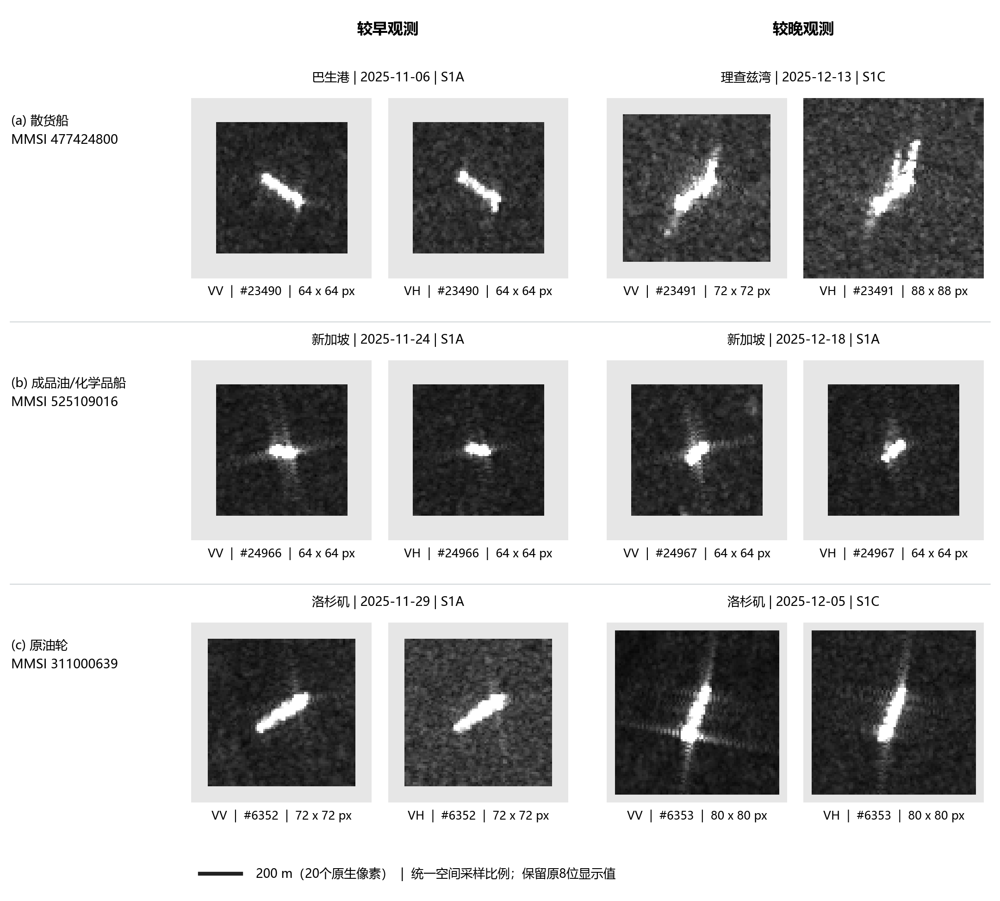
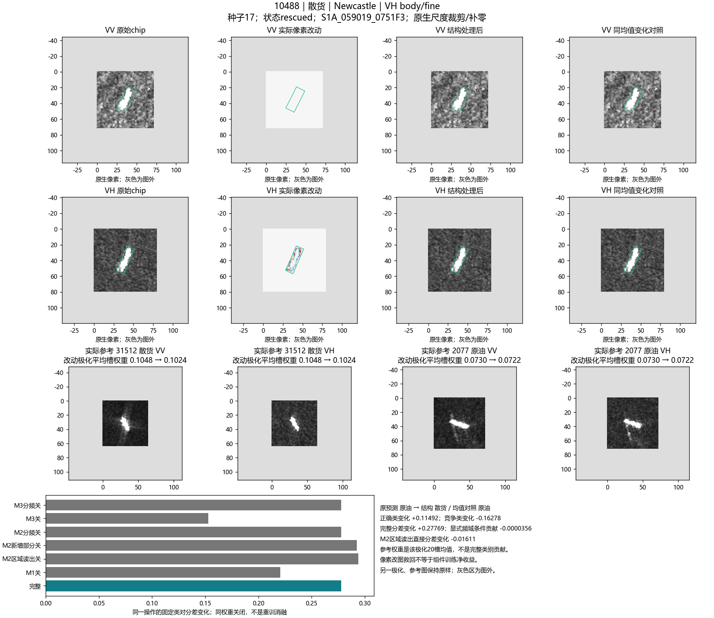
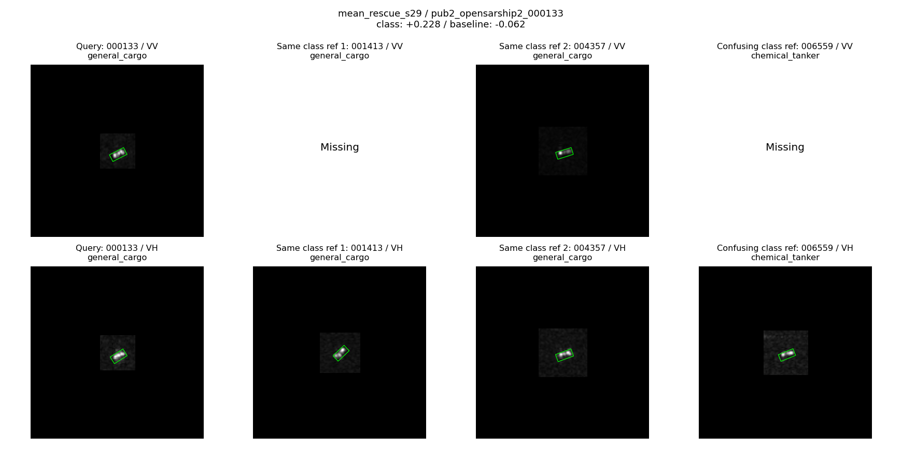
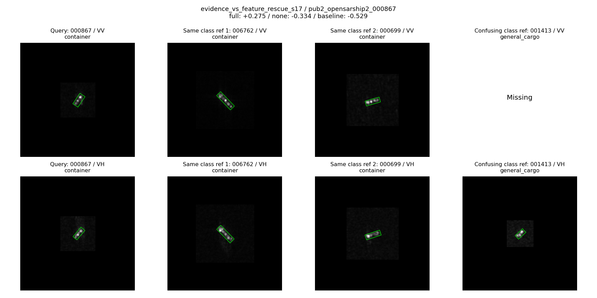

**英文题目：** Intervention-Informed Polarization and Region Evidence Learning for SAR Ship Classification Across Acquisition Conditions

# 摘要

中低分辨率合成孔径雷达（SAR）船舶图像中的局部响应同时受到目标属性与观测条件的影响。同一船只在不同观测中可能呈现不同的响应排列，框外信息也可能补充或干扰类别判断。因此，将局部变化统一视为噪声，或将不同极化和区域的响应直接合并，均可能损失有用判别信息。本文结合重复船舶观测、区域输入对照和固定分类器上的受控干预，分析局部证据如何改变正确类别与竞争类别之间的优势。实验发现，同一尺度操作的效应可随极化、区域和读出方式改变方向，部分纠错来自削弱竞争类别而非单纯增强正确类别。依据这些发现，构建共享ResNet-50骨干、极化专属处理的类别证据网络：类别响应反馈模块在特征形成阶段保留均值上下文与相对类别响应；响应引导区域池化模块在目标几何区域内组织多层证据；参考类别证据回写模块将查询与源参考之间的比较转化为可继续被骨干处理的类别证据场。三个模块均不使用显式频域输入，图像尺度干预用于机制诊断，源端训练约束另在历史载体上验证。在OpenSARShip 2.0四分类的378条评价观测上，响应引导读出相对配套训练的均值读出，三次读出训练平均提高OA 0.882、BA 1.548个百分点；相对固定上游模型整体保持接近持平。单独开展的参考模块开发对照中，类别证据回写优于普通参考特征回写，但扩围结果显示其收益具有队列依赖。研究支持以极化、区域和类别竞争为单位组织局部证据，同时表明输入敏感性、模块路径作用与完整系统增益应分别验证。

**关键词：** SAR船舶分类；观测条件变化；双极化；区域池化；参考证据；受控干预

# Abstract

Local responses in medium- and low-resolution synthetic aperture radar (SAR) ship images vary with both target properties and acquisition conditions. Consequently, neither suppressing all variable responses nor indiscriminately merging polarization and regional information is necessarily beneficial. We investigate this issue using repeated vessel observations, matched regional-input controls, and controlled interventions on fixed classifiers. The interventions reveal that changes in classification margins depend on polarization, region, and readout, and that corrections may arise from suppressing competing-class evidence rather than solely increasing the correct-class score. These observations motivate a polarization-specific evidence network with a shared ResNet-50 backbone. Class-response feedback modulates intermediate features; response-guided regional pooling preserves target-relative region identities; and reference-conditioned class-evidence writeback transforms query–reference comparisons into spatial evidence for subsequent processing. No explicit frequency descriptor is used by these three modules. On a four-class OpenSARShip 2.0 evaluation cohort of 378 observations, response-guided pooling improves overall and balanced accuracy by 0.882 and 1.548 percentage points over a jointly trained mean-readout control, averaged over three readout-training seeds, while remaining approximately unchanged relative to the fixed upstream model. Separate reference-module experiments support class-evidence writeback on the development cohort but show mixed results under expanded coverage. The findings motivate structured evidence utilization while distinguishing controlled model dependence from physical causal identification and system-level generalization gains.

# 1 引言

SAR船舶分类位于目标检测之后，旨在为已定位的船舶赋予类别。与检测任务判断“是否存在船只”不同，细分类需要在船体外形、局部响应和周围结构有限的条件下区分外观相近的类别。OpenSARShip等公开数据资源推动了Sentinel-1船舶解译研究[1]。然而，训练数据与应用数据可能来自不同过境、不同水域及不同观测条件，同一类别甚至同一艘船在这些条件下的可见证据也会改变。本文研究已定位目标的闭集船型分类，重点关注跨观测条件的证据利用，而非重新训练检测器。

图1给出了三艘船的重复观测。船舶身份保持一致时，方向、强响应排列及VV/VH差异仍可发生变化。其中，化学品/成品油轮的两次观测来自同一港口和同一卫星平台，说明问题不能简单归结为“换港口”。在更大范围的历史诊断中，原油轮的一次正确、一次错误比例高于部分其他类别，而普通货船、拖船更多表现为持续混淆。这提示跨观测错误并非都能由统一的角度补偿或背景抑制解决。

{width=95%}

现有双极化方法通过共享特征提取、多尺度融合或极化交互提升船舶表征[4–6]。本文进一步关注这些表征中的证据如何被利用：同样的局部响应，位于框内与框外、来自VV与VH、支持不同竞争类别时，是否具有相同价值？如果框外响应中包含可用线索，直接剔除会造成信息损失；如果不加区分地汇总，误导性响应又可能与有效证据混合。局部高响应不自动等于正确类别证据，低响应也不自动等于噪声。

为此，我们将自然观测与受控输入干预结合。前者用于确认实际分类不稳定，后者在固定图像、模型和参考条件下，仅改变一个极化、区域和尺度分量，观察类别竞争如何变化。这里的干预识别的是计算系统对指定输入操作的依赖，而非直接恢复海况、航速或电磁散射的物理因果规律。解释研究已强调，固定模型对输入修改的敏感性与重新训练后的信息价值不是同一问题[8,9]。因此，本文分别检验现象、机制线索和方法收益，而不以一张热图代替完整论证。

本文的研究贡献围绕以下三个方面组织。第一，通过同船观测、配套输入控制及极化—区域—尺度干预，刻画局部证据对类别竞争的条件性作用，为避免统一去背景或统一去尺度成分提供实验依据。第二，提出相互衔接但职责不同的证据处理框架：M1调节局部特征形成，M2保持区域身份并由类别响应指导区域读出，M3形成参考条件化的类别证据并回写骨干。第三，采用同权重路径替换与配套训练对照区分模块作用和内部算子价值，同时报告重复收益、误伤及扩围边界。本文不将可插拔、残差连接或注意力本身作为独立首创主张。

# 2 相关研究

## 2.1 SAR船舶分类与观测变化

OpenSARShip面向Sentinel-1船舶解译建立开放数据资源[1]；FUSAR-Ship则基于高分三号SAR与AIS匹配支持检测和识别[2]。不同数据集在传感器、分辨率、类别体系与样本组织上存在差异，不能将原文随机划分的分类结果直接与船只身份和过境隔离的结果比较。针对分布差异，已有研究将双分支注意与深度子域适应用于SAR船型分类[3]。本文从局部判别证据的组织切入，与分布适配相互补充，实验中进一步明确船只身份和过境组的隔离单位。

## 2.2 双极化与分层证据融合

HOG-SiamShipCLSNet采用共享骨干提取VV/VH特征，并在不同深度结合组双线性池化及HOG描述[4]。DPIG-Net使用VV引导VH与极化乘积幅度分支，通过交叉注意及残差融合组织极化信息[5]。CPINet结合多尺度融合、混合阶统计注意与因子化双线性编码[6]。这些研究表明共享或专属处理、跨极化交互和高阶统计均已有方法基础。

SCRC-Net通过结构约束融合模块，从特征预测采样网格的长宽、共同旋转角和局部伸缩，改变卷积采样以适应船体结构[14]。本文不以动态形状采样或可旋转卷积作为创新，而使用已定位目标的几何区域，保留框内、轴端和侧向证据的身份，再由类别响应指导区域内读出。两者都利用结构与上下文，但实际操作及被检验的问题不同。

本文的区别不在于首次使用双极化或多尺度，而在于将受控干预中观察到的作用差异具体落实为证据接口：VV/VH保留专属参数，几何区域不在读出前混为一体，候选类别响应指导区域内部取证。与直接学习一般内容注意相比，这一接口复用已有分类监督形成的响应；其价值通过配套训练的均值及内容注意对照检验，而非仅以结构差异判定。

## 2.3 局部参考比较与类别证据

DeepEMD将密集图像表示间的局部匹配用于少样本分类，并通过交叉参考机制为结构元素赋权[12]。这类工作说明，参考信息不必仅以全局原型参与决策，但局部对应的复杂程度是否必要取决于局部描述中实际保留的信息。

本文区分“选择哪些参考证据”与“是否需要精细搬运参考局部值”。M3保留参考权重、区域身份和类别组织，将比较结果转化为类别证据场；采用传输边际聚合取消精细值对应。与普通参考特征回写相比，主要被检验的差异是回写消息已包含查询相对于各类参考的判别关系，而不是把参考外观直接交给下游重新解释。传输、类别条件度量及残差回写均存在通用方法基础，本文通过内部替换实验限定实际贡献所在。

## 2.4 受控扰动与解释约束

Li等在SAR自动目标识别中量化目标、阴影与杂波的贡献及交互，并通过背景重标度研究非目标区域依赖[7]。Meaningful Perturbation通过显式输入操作研究固定模型的重要区域[8]；ROAR在训练和测试数据中一致移除信息后重新训练，强调区分模型敏感性与信息价值[9]。Fourier Perspective通过范数受控的频率扰动分析鲁棒性，说明高频或低频的作用不能一概而论[10]。Right for the Right Reasons则将解释约束纳入可微训练[11]。

本文沿用受控输入分析的基本思想，但将诊断单位细化为极化、目标相对区域及空间尺度，并同时记录正确类和竞争类变化。进一步利用源端干预响应筛选判别优势保护对象，而不要求所有图像对同一掩膜或同一尺度操作保持不变。空间尺度操作仍发生于图像，不能将其等同于精确频带删除或物理因素分离。

# 3 问题发现与受控干预证据

## 3.1 从自然不稳定到可检验问题

历史条件诊断覆盖自建24港来源语料中的4744次观测、2973个船舶身份、18港和八个输出类别。为避免只挑预测翻转案例，每艘具有重复观测的船取日期跨度最大的一对，得到910艘船的1820次观测，配对队列实际出现七类。表1展示其中三类的三种子平均状态比例。

**表1 同船重复观测的不同失效形态。每一行的百分比先按训练种子统计再平均，不是单次整数事件比例。**

| 船型 | 船对数 | 两次均正确（%） | 一次正确一次错误（%） | 两次均错误（%） |
|---|---:|---:|---:|---:|
| 集装箱船 | 126 | 35.98 | 34.92 | 29.10 |
| 原油轮 | 100 | 27.67 | 54.67 | 17.67 |
| 普通货船 | 62 | 4.84 | 27.42 | 67.74 |

原油轮较多表现为观测相关的不稳定，普通货船则更多持续混淆。跨港与同港的粗比较还受到类别组成影响：未经类别等权，跨港“两次均错误”比例为38.80%，低于同港43.92%；按七类等权后分别为50.94%和46.06%，方向反转。因此，任务需同时关注观测条件与类别组成，不能把跨港分组差异直接解释成港口的独立效应。

为检验外围信息是否值得保留，使用同一源划分及配套训练的Ridge读出，比较整图输入和卷积前严格框内掩膜输入。整图输入、全局池化的OA/BA为35.139%/38.795%，严格框内输入对应32.610%/37.231%。原油轮召回分别为53.580%和42.222%。整图输入在4744条观测中救回690条、误伤570条，净增加120条正确判断。该对照说明限定任务中框外可见信息具有可利用性；它不证明框外都是环境信息，也不证明几何区域池化必然优于其他结构。

## 3.2 干预定义与类别竞争

记双极化输入为 $x=(x^{VV},x^{VH})$，固定诊断器为 $T$，真实类别为 $y$。以原图最强错误类作为固定竞争类别 $c^\star=\arg\max_{c\ne y}T_c(x)$，定义分差及操作效应：

$$m_{y,c^\star}(x)=T_y(x)-T_{c^\star}(x),\qquad
\Delta m_a=m_{y,c^\star}(x_a^I)-m_{y,c^\star}(x). \tag{1}$$

其中 $a=(p,r,b)$ 指定极化 $p$、区域 $r$ 和尺度 $b$。图像尺度分量取

$$D_f(I)=I-G_1(I),\qquad D_m(I)=G_1(I)-G_2(I), \tag{2}$$

$G_\sigma$ 为标准差为 $\sigma$ 个原生像素的高斯平滑。限定区域内用平滑边缘掩膜削弱分量，其他极化、检测框、参考库及模型参数保持不变。结构操作间使用共同 $L_2$ 剂量，并增加具有相同区域净灰度变化的均值控制。后者用于检验改善是否仅由平均亮度变化解释，不同时匹配全部像素分布和扰动范数。历史轮次采用不同操作集合和剂量，效应大小仅在对应轮次内比较。

式（1）可分解为 $\Delta T_y-\Delta T_{c^\star}$。因此，正确类分数下降并不必然意味着决策退化：如果错误竞争类下降更多，分差仍可改善。为排除竞争类切换造成的虚假改善，选样时进一步检查各自最强错误类定义的分差 $m_{\max}(x)=T_y(x)-\max_{c\ne y}T_c(x)$。

## 3.3 极化与区域决定操作效应

在24港来源的新增104艘船、209次观测、31个过境和6港队列中，VH框内细尺度削弱平均损害正确类别优势，而VH侧向中尺度削弱平均改善优势；同一侧向中尺度操作在VV中则为负。表2中的区间为探索性船级区间，数值是诊断器分差而非准确率百分点。

**表2 极化与区域干预的船均分差变化。**

| 操作 | 平均 $\Delta m$ | 船级95%区间 | 相对同均值控制的剩余效应 |
|---|---:|---|---:|
| VH框内细尺度削弱 | −0.003910 | [−0.005232, −0.002528] | −0.002997 |
| VH侧向中尺度削弱 | +0.002023 | [+0.000882, +0.003169] | +0.001417 |
| VV侧向中尺度削弱 | −0.001454 | [−0.002477, −0.000476] | −0.001147 |

同一操作也并非各类均受益。VH侧向中尺度在集装箱9船上平均为+0.008422，在散货7船上为−0.008180。对这些现象的合理设计响应不是永久抑制VH外围或永久增强VV船体，而是保留可区分的极化和区域证据，让监督决定如何利用。

## 3.4 判别作用依赖联合读出

OpenSARShip 1.0的扩围诊断提供了更直接的读出对照。在新增集装箱子集的175艘船、203次观测上，同一VH框内细尺度削弱在VV/VH联合读出中平均产生+0.001596的分差变化，在单VH读出中为−0.000700；两读出效应差为+0.002296，探索性船级95%区间为[+0.002039,+0.002583]。20个过境的读出效应差同向，但这不是20次独立训练。

这种差异不能转化为统一预处理规则。对全部1165条相应扩围观测执行该VH操作仅救回3条、误伤8条，OA下降0.429个百分点。由此得到的设计依据是：局部响应的价值依赖联合判别关系，需要学习其用途；不是“已找到可统一删除的噪声”。

历史完整模型中的散货船10488提供了直观实例（图2）。仅削弱VH框内细尺度后，散货分数增加0.11492、错误原油轮分数下降0.16278，分差提高0.27769，均值控制仍错误。相反，化学品船26628的干预同时降低正确类并抬高海工竞争类，造成误伤。这些正负对照说明，证据分析需要追踪具体类别竞争，而非只看总响应强度。

{width=95%}

## 3.5 因果线索的范围及设计转化

上述对照在固定计算系统内建立了“指定输入操作—类别响应变化”的干预联系：保持其他计算条件不变，仅改变限定输入，输出差异可归于该操作及其在网络中的传播。自然观测同时包含多种因素，其因果归属不同于这种模型内干预。本文不把显示图像的亮度直接解释为RCS，不把尺度分量直接对应某种物理散射机制，也不声称已分离纯因果特征。

证据转化为三个具体设计要求。首先，M1保留均值上下文，同时显式表示相对候选类别的局部响应，避免仅按强度选择。其次，M2保留极化和目标相对区域身份，并利用M1响应决定区域内部如何汇总。最后，M3比较的是查询相对于各类参考的判别证据，将比较结果回写而非仅复制参考外观。这里从机制线索到算子设计是一组可验证假设，其有效性由第6节的训练和替换对照检验。

# 4 方法

## 4.1 任务与整体结构

给定由固定检测流程定位的目标chip、OBB和可用极化标记，模型预测 $K$ 个已知船型之一。当前实例取 $K=4$。源参考库为 $\mathcal R=\{(x_j,y_j)\}_{j=1}^{B}$，本研究取 $B=32$，每类8个参考；它是带源标签的参考记忆，不是目标标注预算。查询真值不参与预测路由。参考选择排除与查询相同船舶身份或相同过境的观测，并按极化可用性屏蔽非法关系。

输入按目标中心在原生像素网格裁剪或补零至 $160\times160$，不通过统一缩放使船体变成相同大小。有效范围掩膜排除补零。该操作保留已有chip的像素尺度，不意味着不同数据源已经具有相同物理分辨率。VV与VH分别前向计算，共享ResNet-50[13]卷积参数，但M1、M2和M3中的极化处理参数分开。缺失极化以可用性标记处理，不由另一极化伪造。

> **图3占位：当前模型整体结构。** 展示双极化共享骨干、layer2末block中的M1、layer3末block中的M2回写、layer3之后的M3，以及浅层／深层区域摘要和全局摘要。流程图由作者绘制。

**表3 当前模型的实际作用位置。block索引从0开始。**

| 部分 | 位置 | 输入与输出 | 每极化作用次数 |
|---|---|---|---:|
| M1类别响应反馈 | layer2[3]，conv2及激活之后、conv3之前 | $128\times20\times20$，保持形状 | 1 |
| M2浅层区域读出 | layer2最终输出 | $512\times20\times20\to3\times512$ | 1 |
| M2区域池化回写 | layer3[5]，conv1及激活之后、conv2之前 | $256\times10\times10$，保持形状 | 1 |
| M3类别证据回写 | layer3之后、layer4之前 | 向 $1024\times10\times10$ 特征加残差 | 1 |
| M2深层区域读出 | M3更新后的layer3输出 | $1024\to512$ 通道投影的三区域摘要 | 1 |
| 全局读出 | layer4输出 | 有效范围平均池化至2048维 | 1 |

当前配置不在layer2[2]额外插入M2，也不替换stem的原生最大池化。M2的“池化”包括区域向量读出和区域上下文回写，不等同于改变骨干下采样。该配置由实际工作版本确定，而非把不同历史候选的有利部分拼接成未经验证的新网络。

## 4.2 M1 类别响应反馈

设某一极化的输入特征为 $F(u)\in\mathbb R^{128}$，有效位置权重归一化为 $\omega(u)$。分别通过 $1\times1$ 卷积得到32维值特征 $v(u)=V F(u)$ 和 $K$ 个候选类别响应 $a_k(u)=A_kF(u)$。记 $\bar v=\sum_u\omega(u)v(u)$、$\bar a_k=\sum_u\omega(u)a_k(u)$。为表达某类相对于其余类的局部偏离，定义

$$\begin{aligned}
d_k(u)&=\frac{K}{K-1}\left[(a_k(u)-\bar a_k)-\frac1K\sum_j(a_j(u)-\bar a_j)\right],\\
s_k(u)&=\frac{d_k(u)}{\sqrt{\sum_v\omega(v)d_k(v)^2+0.01}}.
\end{aligned}\tag{3}$$

以相对响应和局部值的共同变化形成类别相关摘要：

$$\begin{aligned}
c_k&=\sum_u\omega(u)\,[v(u)-\bar v]s_k(u),\\
h(u)&=\frac1K\sum_k\tanh(s_k(u))\tanh(L_kc_k+b_k).
\end{aligned}\tag{4}$$

$c_k$是低维值特征与标准化类别响应之间的交叉统计，不是完整通道协方差矩阵。均值支路和关系支路分别变换，得到有界门控并反馈至原特征：

$$\begin{aligned}
g(u)&=\tanh\{W_0\tanh(L_0\bar v+b_0)+W_1h(u)\},\\
F'(u)&=F(u)+\gamma\,o(u)\,F(u)\odot g(u).
\end{aligned}\tag{5}$$

其中 $o(u)$ 为有效面积占比，当前 $\gamma=0.3$。输出映射零初始化，初始化时保留原路径；训练时类别辅助读出为候选响应提供源标签约束。M1的作用是调整当前图像内部的特征处理，不读取其他查询标签或邻船真实类别。类别响应也不是像素级类别标注，其语义强度需要实验检验。

与只对均值生成门控不同，式（4）保留响应偏离及其与局部内容的共同变化；但结构上多一项统计不等于已经证明该项不可替代。当前实验将M1的整体反馈、关系支路和其指导M2读出的作用分开评价。

## 4.3 M2 响应引导的区域证据池化

### 4.3.1 区域身份与内部回写

利用OBB长轴建立目标相对坐标，构造框内、轴端和侧向三个区域。框内为长宽 $L,W$ 的软矩形；轴端为长轴扩展至 $1.5L$ 的矩形减去框内；侧向为宽度扩展至 $2W$ 的矩形减去框内。两个轴端不命名为船首和船尾。区域与有效输入范围相交，并以特征网格实际面积占比表示 $m_r(u)$。当前不额外输入绝对港口、经纬度、雷达观测角度或AIS航向。

对于特征 $F$，区域均值为

$$t_r(F)=\frac{\sum_u m_r(u)F(u)}{\sum_u m_r(u)},\qquad r\in\{\mathrm{body,end,side}\}. \tag{6}$$

空区域返回零并屏蔽更新。layer3[5]中的内部M2以区域专属两层映射 $\phi_r$ 变换摘要，只回写至相应区域：

$$F^{+}(u)=F(u)+\sum_r\widetilde m_r(u)\phi_r(t_r(F)),\qquad
\widetilde m_r(u)=\frac{m_r(u)}{\max(1,\sum_jm_j(u))}. \tag{7}$$

该处理不改变空间尺寸，使随后 $3\times3$ 卷积获得区域上下文。区域池化读出则只执行式（6）及相应摘要计算，不回写特征图。因此，多层区域摘要不要求在每个stage之前都插入一个完整回写块。

### 4.3.2 由M1响应指导浅层取证

M1读取layer2[3]中的128通道特征，其响应与该block末端512通道特征 $F_2$ 位于同一 $20\times20$ 网格。在有效范围内标准化相对类别响应，得到有界评分 $q_k(u)=2\tanh(s_k(u))$。在每个区域内分别归一化：

$$\begin{aligned}
\alpha_{r,k}(u)&=\frac{m_r(u)\exp q_k(u)}{\sum_v m_r(v)\exp q_k(v)},\\
t_{r,k}&=\sum_u\alpha_{r,k}(u)V_p\operatorname{LN}(F_2(u)).
\end{aligned}\tag{8}$$

同时保留均匀摘要 $t_{r,0}=\sum_u\frac{m_r(u)}{\sum_vm_r(v)}V_p\operatorname{LN}(F_2(u))$。这里 $V_p$ 将512维变为32维，四类时五个摘要拼接为160维。补充量为

$$\delta_{p,r}=0.1\operatorname{stopgrad}\{\operatorname{RMS}(t_r(F_2))\}
\tanh\!\left(W_p[t_{r,0};t_{r,1};\ldots;t_{r,K}]\right). \tag{9}$$

$W_p$将160维映射回512维，零初始化。所有候选类别同时参与，既不输入查询真值，也不按当前预测的单一类别硬路由。输出仍位于原有区域槽位，保留均值信息，并用有界残差限制新增路径的幅度。式（8）回答“在这一几何区域内哪些位置更有助于类别区分”，式（6）回答“该区域总体包含什么”。

> **图4占位：M1与M2的接口及池化回写。** 区分128维响应生成、512维特征取证、三区域摘要，以及只发生在layer3内部的空间回写。不要把浅层读出画成新增卷积或下采样。

区域掩膜定义的是特征中心覆盖，不是感受野的严格分割。框外网格仍可能包含船体信息；反之，框内特征也可能包含外围信息。因此，区域结果可定位计算证据来源，但不能直接宣布某一向量是纯船体或纯海面环境。

## 4.4 M3 参考条件化类别证据聚合与回写

### 4.4.1 比较描述与值描述分离

M3使用源参考库补充单图判别。首先对固定锚点路径中的layer1和layer2特征分别读出区域局部描述，通道数为256和512。每极化各自投影至32维并拼接，再分别生成32维比较键 $k$ 与值 $v$。键经归一化用于比较，值用于构造判别消息。局部槽位保留框内8、侧向8、轴端4的组织，空槽和不可用极化不参与参考比较。

当前M3的比较输入来自固定锚点表征，区别于被M1更新后的实时特征流。这样可以在保持已有参考关系的条件下优化后续读出，但本研究不据此宣称全网共同学习了新的实时参考关系。

对某区域的合法源参考，按参考标签形成类均值 $\mu_c$ 和其他类均值 $\mu_{\neg c}$，由共享小网络生成有界正通道度量：

$$\begin{aligned}
w_c&=1+0.5\tanh\psi([\mu_c;\mu_{\neg c};\mu_c-\mu_{\neg c}]),\\
S^{j}_{ab}&=\cos(\sqrt{w_{y_j}}\odot k_{q,a},\sqrt{w_{y_j}}\odot k_{j,b}).
\end{aligned}\tag{10}$$

这里 $a,b$ 是查询和参考的局部槽位，$j$是参考船，$y_j$是已知源标签。当前实现还将查询槽位对候选类的最佳相似度相对于其他类的优势加入真实匹配成本，再使用带未匹配槽的Sinkhorn归一化得到有效传输 $T^j$。该比较设计保留在实现中，其独立分类贡献仍需区别于整个回写路径。

### 4.4.2 保留参考选择而取消精细值耦合

记 $T^j$ 的有效行、列边际为 $\rho^j_a$、$\kappa^j_b$，有效总质量为 $M^j$。选用的聚合版在值传递阶段使用

$$\widetilde T^j_{ab}=\frac{\rho^j_a\kappa^j_b}{M^j},\qquad
\bar v^j_a=\frac{\sum_b\widetilde T^j_{ab}v_{j,b}}{\rho^j_a}. \tag{11}$$

当分母非零时，$\bar v^j_a$实际为按列边际汇总的区域参考值，不再保留查询槽位到参考槽位的一一精细搬运。参考可靠性仍由原传输与相似度给出：对每个查询槽位，先在参考之间对传输加权相似度进行温度0.1的softmax，再在各候选类别内部归一化，得到 $\beta^c_{j,a}$。类参考表示为

$$P_{c,a}=\sum_{j:y_j=c}\beta^c_{j,a}\bar v^j_a. \tag{12}$$

因此，聚合版不等于无参考选择的均值，也没有移除Sinkhorn计算。采用它的依据是精细对应未在当前配套对照中形成额外分类优势，而不是先验认定所有匹配都没有价值。

### 4.4.3 类别证据场及空间回写

查询值与各类参考表示的距离形成候选类别证据，并在可用类别中中心化：

$$\begin{aligned}
e_{c,a}&=-\frac{\sum_d w_{c,d}(v_{q,a,d}-P_{c,a,d})^2}{0.1},\\
\widetilde e_{c,a}&=e_{c,a}-\frac{1}{|\mathcal C_a|}\sum_{j\in\mathcal C_a}e_{j,a}.
\end{aligned}\tag{13}$$

不可用类别屏蔽，而不是以缺失值表示强负证据。用局部槽位的空间占比 $\eta_a(u)$将证据重新落回layer3网格：

$$E_c(u)=\sum_a\eta_a(u)\widetilde e_{c,a},\qquad
F_3^{+}(u)=F_3(u)+0.1W_p^{\mathrm{out}}E(u). \tag{14}$$

$W_p^{\mathrm{out}}$是从 $K$ 个类别证据通道到1024个骨干通道的 $1\times1$ 卷积。后续layer4继续加工 $F_3^{+}$，而深层M2也从该特征读取区域摘要。M3回写的是“当前局部值更支持哪些候选类别”的关系，而不是原样复制参考船的外观。该设计与M1的单图特征调节、M2的几何区域汇总具有不同职责。

> **图5占位：M3横向流程。** 两个输入端为查询和源参考；顺序展示多层局部键／值、合法关系与参考权重、保留边际的类内聚合、查询—类别参考距离、中心化类别证据场、空间回写。明确聚合版取消精细值对应但保留比较计算。

在当前M1/M2实验中，式（14）的M3残差由已训练固定锚点路径预计算，主干前向为 $F_3^{+}=F_3^{\mathrm{live}}+\Delta F_3^{\mathrm{anchor}}$。这与让M3随新M1特征实时重算不同。本文结果沿用前者，不把缓存读出实验描述为三个模块共同端到端更新。

## 4.5 多层融合与最终分类

对极化 $p$ 和区域 $r$，最终区域描述为

$$z_{p,r}=t_r(F_{2,p})+P_p^{\mathrm{deep}}t_r(F_{3,p}^{+})+\delta_{p,r}. \tag{15}$$

深层线性投影将1024维映射为512维，使相同区域的浅层、深层和引导补充项可以相加；不同区域之间保持拼接。layer4得到有效范围全局平均描述 $g_p\in\mathbb R^{2048}$，每极化表示为

$$\begin{aligned}
h_p&=[g_p;z_{p,\mathrm{body}};z_{p,\mathrm{end}};z_{p,\mathrm{side}}]\in\mathbb R^{3584},\\
\ell&=W_h[a_{VV}h_{VV};a_{VH}h_{VH};a_{VV};a_{VH}]+b_h.
\end{aligned}\tag{16}$$

$a_p\in\{0,1\}$ 为极化可用性，分类输入共7170维。式（15）的同区域相加与式（16）的跨区域、跨极化拼接不可混淆。最终softmax输出 $K$ 类概率。

## 4.6 分阶段优化及干预指导约束

当前模型采用分阶段优化，而非从头同时训练所有参数。M3阶段固定已有骨干及M1/M2，使用完整分类交叉熵训练参考模块和分类头；M1阶段训练新反馈、相邻conv3与分类头，并以0.02权重加入类别响应辅助交叉熵；最后固定已选上游，仅更新M1引导M2的浅层补充读出与分类头。所有阶段只使用源标签。

源样本权重按类别内独立船数和同船观测次数修正，并对固定上游分差小于1的源难例乘2。最后阶段在同一源样本流上训练180步，batch为24；输出映射、值投影、分类头的学习率分别为 $10^{-3},3\times10^{-4},10^{-5}$，AdamW权重衰减0.01，梯度裁剪阈值5。BN统计不更新。三次重复改变新增读出的初始化与样本顺序，保留同一上游。

干预指导是训练期的另一条约束路径。对源样本，以式（1）固定竞争类，要求某结构操作同时降低交叉熵、提高原竞争类分差，并优于匹配均值控制；三个初筛阈值均为0.01。通过初筛后，还需正确类概率和 $m_{\max}$ 均提高，才设置有效标记 $u_i=1$。当前流程直接复用干预图的教师分数，不重算或恢复显式频率描述，也不为这一复核额外前向。

有效标记不意味着仅训练这些样本。所有原图都接受交叉熵；教师原本正确的样本额外接受分布保持约束；$u_i=1$的样本接受原图教师判别优势下界保护。记 $b_{i,c}=T_y(x_i)-T_c(x_i)$，学生分数为 $z_i$，则

$$\mathcal L_{\mathrm{floor}}=
\frac{\sum_i w_i u_i\frac{1}{K-1}\sum_{c\ne y_i}
\left[b_{i,c}-(z_{i,y_i}-z_{i,c})\right]_+^2}{\sum_i w_i}, \tag{17}$$

$$\mathcal L_{\mathrm{adapt}}=\mathcal L_{\mathrm{CE}}+
0.1\mathcal L_{\mathrm{KL,correct}}+\lambda\mathcal L_{\mathrm{floor}}. \tag{18}$$

教师量均停止梯度。该实现保护原图教师分差，并不要求学生模仿干预图全部隐特征，也不把干预后更高分差直接作为下界。预测时输入仍为原始SAR图像，不执行依赖真值的干预选择。第6节将该约束的历史载体验证与新版模块结果分别报告。

# 5 实验设置

## 5.1 数据与隔离单位

问题分析使用自建24港来源语料及OpenSARShip 1.0，模块工作版使用OpenSARShip 2.0四分类子集。不同实验队列承担不同问题，不合并为同一个最终测试集。24港和OSS1的输入干预结果用于支持机制线索；新版数值对照以OSS2为主。本文不将FUSAR-Ship或F_0921的历史模型结果放入新版性能主表。

**表4 当前OSS2工作版的数据组成。括号内为独立船数；过境按产品元数据中的平台与绝对轨道分组。**

| 集合 | 散货船 | 普通货船 | 化学品/成品油轮 | 集装箱船 | 总观测/船数/过境 |
|---|---:|---:|---:|---:|---|
| 源训练 | 221（216） | 73（71） | 141（137） | 284（259） | 719 / 683 / 13 |
| 开发 | 87（84） | 23（22） | 29（29） | 89（88） | 228 / 223 / 4 |
| 扩围评价 | 132（128） | 26（26） | 83（81） | 137（134） | 378 / 369 / 5 |

这三个集合在观测ID、船舶身份和过境组上隔离。固定32个参考来自源训练，每类8个；训练参考模块时按源类别和独立船抽取参考，再排除非法查询—参考连接。开发集用于结构和超参数研发，扩围评价队列也有历史开发暴露，因此这些结果为已有数据上的受控验证，不作全新盲测声明。

## 5.2 评价与对照原则

OA为总体正确率，BA为评价集合实际纳入类别的召回率平均；新版四分类评价均覆盖四类。同时报告NLL、逐样本纠错与误伤以及极化／区域路径变化。重复训练报告均值与样本标准差；同一图像在三个种子中的三次纠错只计为三次事件，不计为三艘独立船。本文不以有限种子结果自动宣称统计显著。

对照分为两类。配套训练对照保持数据、训练步数和可更新部位尽可能一致，回答不同算子训练后是否更有效；同权重替换只改变某个读出或回写关系，回答当前决策依赖什么。后者可能改变特征分布，需要与前者共同解释。不同研发阶段的模块差值不相加，也不拼成一个虚构的逐模块消融阶梯。

# 6 结果与分析

## 6.1 新版响应引导池化的分类结果

保持上游、参考库和样本流一致，比较区域均值补充、从局部内容新学习注意的补充、以及复用M1类别响应的补充。均值对照重复四份均值摘要以匹配接口，内容注意另有4096个评分参数；其有效表达能力和初始化来源仍有差别，比较首先检验已有类别响应是否值得复用。

**表5 OSS2扩围评价378条上的新版结果。均值和标准差来自新增读出的三个训练种子；固定上游没有三次独立训练标准差。**

| 读出方式 | OA（%） | BA（%） | NLL |
|---|---:|---:|---:|
| 增加补充读出前的固定上游 | 62.434 | 59.718 | 1.14782 |
| 区域均值补充 | 61.464 ± 0.305 | 58.233 ± 0.710 | 1.14277 |
| 普通内容注意补充 | 61.464 ± 0.666 | 58.050 ± 0.674 | 1.14460 |
| M1响应引导M2补充 | **62.346 ± 0.153** | **59.781 ± 0.220** | **1.14005** |

响应引导相对均值补充的OA/BA分别提高0.882/1.548个百分点，三个种子均为正；相对内容注意提高0.882/1.731个百分点。相对固定上游则为−0.088/+0.063个百分点。因此，这一结果主要支持已有类别响应指导区域取证优于本轮配套简单补充，而非完整模型获得大幅新增识别能力。开发228条中，三个方案的平均OA/BA均为62.281%/55.731%，也说明收益具有队列边界。

## 6.2 正确空间对应是否参与判断

在响应引导模型权重固定时，将区域内部权重改成均匀值，或反向置换非空位置的权重。均匀替换保持归一化总量但改变权重分布；位置置换同时保持总量与直方图，仅改变权重与局部特征的对应。

**表6 同权重取证方式替换，OSS2扩围评价378条。**

| 取证方式 | OA（%） | BA（%） |
|---|---:|---:|
| 正确响应位置 | 62.346 | 59.781 |
| 区域内均匀权重 | 61.464 | 57.753 |
| 区域内位置置换 | 60.758 | 57.297 |
| 关闭新增读出 | 62.169 | 58.796 |

正确响应相对位置置换平均提高OA 1.587、BA 2.484个百分点，表明该评价队列中的正确权重—特征对应实际参与分类。响应引导相对配套均值模型共有10次纠错、0次误伤，涉及7条观测、7艘船和3个过境；其中9次在增加读出前已正确，所以主要作用是减少不合适读出适配造成的损失。

图6的普通货船000133在seed29下，均值模型真实类分差为−0.06155，响应引导为+0.22820；把同一模型的权重改为均匀或置换后分别为−0.06187和−0.13565。该模型关闭新增读出时仍正确，故此例支持“正确取证优于错误取证”，不是原先不可分类目标的新救回。线性分解中，VV框内、轴端、侧向对普通货船相对油轮的优势贡献分别约+0.0860、+0.0449、+0.1778，VH三项则为负。可解释性来自实际分差和路径贡献，而不是把所有高权重位置都解释为有效物理结构。

{width=95%}

新增读出也存在误伤，例如002394在seed17下由自身关闭读出时的+0.14140降为−0.54723。进一步冻结分类头后，响应引导方案OA/BA为60.229%/57.641%，低于允许分类头小学习率更新的结果。由于冻结也改变了全局梯度裁剪集合，这一比较支持保留当前联合头策略，不能把退化完全归因于某一种特征—头失配机制。

## 6.3 M3中哪一部分产生实际收益

在固定前端的独立M3实验中，三组配对训练使用相同源数据、查询／参考episode和120步预算，仅更新相应参考模块及分类头。表7采用固定末轮，避免按某一评价结果选择不同训练长度。

**表7 M3开发队列228条上的配套训练比较。标准差来自三个M3训练种子，固定骨干和已有M1/M2。**

| 方案 | OA（%） | BA（%） |
|---|---:|---:|
| 无M3，更新分类头 | 58.626 ± 0.253 | 50.017 ± 0.162 |
| 普通参考特征回写 | 58.772 ± 0.439 | 50.119 ± 0.281 |
| 类别证据回写，精细对应 | 60.234 ± 1.410 | 51.830 ± 0.852 |
| 类别证据回写，保留边际聚合 | **61.257 ± 2.251** | **53.511 ± 2.442** |

聚合证据回写相对无M3提高OA/BA 2.632/3.495个百分点，相对普通参考特征回写提高2.485/3.392个百分点。普通参考特征回写仍保留类别、区域和极化组织，因此这一比较不只是“有类别信息”对“完全无组织信息”。图7的集装箱船000867在三个种子中均被类别证据回写判对，而普通参考回写、无M3和其自身关闭回写均错。seed17的真实类分差由无M3的−0.334、参考特征回写的−0.286变为+0.275，构成直接路径案例。

{width=95%}

精细匹配并未表现出额外分类必要性。对精细模型固定权重改为保留边际聚合后，三个种子、228条查询的预测全部不变；配套训练的聚合版平均也优于精细版。保留原开发选轮规则时，聚合相对无M3仍提高OA/BA 2.193/2.632个百分点，但小于固定末轮差值。因此，当前可保留的主要证据是参考类别关系及其回写，而不是精细局部耦合独有优势。

## 6.4 M3扩围与作用边界

冻结候选后，将类别证据回写与普通参考特征回写扩大到其他已有观测。表8中的125条来自另一扩围集合中满足源端过境隔离的子集；378条为前述评价集合；503条为两者合并，不能将它们当作三个互不相关测试集。

**表8 M3类别证据回写相对普通参考特征回写的扩围差值。单位为百分点，三种子平均。**

| 队列 | 观测/独立船/过境 | $\Delta$OA | $\Delta$BA |
|---|---|---:|---:|
| 严格跨过境扩围子集 | 125 / 125 / 4 | +0.533 | +0.589 |
| 扩围评价 | 378 / 369 / 5 | −0.970 | −0.622 |
| 严格合并 | 503 / 494 / 9 | −0.596 | −0.523 |

收益没有覆盖所有队列。在378条中主要净损失来自化学品/成品油轮，平均少判对4条。样本000295在三个种子中均由自身关闭回写时正确变为错误普通货船；其中17/29主要由VV路径推错，43主要由VH路径推错。这既说明回写错误可定位到具体极化路径，也说明统一删除一种极化不是已有证据支持的修复。

表5和表7–8不是同一联合训练实验。表5固定既有M3残差并更新M1引导读出，表7–8固定其当时前端并训练M3。它们分别检验接口和参考回写，不能相加为新版完整系统累计提升，也不能构造“逐个加模块必然涨点”的曲线。

## 6.5 干预发现、频域取舍与训练作用

历史八分类完整模型的2276次有效结构操作中，相比只改变图像，进一步重算显式频率描述没有造成预测翻转，最大类别分数差为0.00012112。该结果表明，在所检验载体内，图像尺度敏感性并未兑现为显式描述分支的必要性。因此当前三个模块不保留显式频域分支，训练期图像尺度操作仍用于诊断和选择。

历史训练扩围包含3075条目标观测、1950艘船、18港和85个过境。未适配模型OA/BA为46.5691%/37.1043%，匹配普通选样适配为47.3930%/39.3206%，干预选样适配为47.3388%/39.4030%。干预选样相对普通选样的主要额外信号是NLL降低0.020376、Brier降低0.002503，而非明确的总体准确率优势。这些数字属于历史训练载体；当前选定的新M1/M2/M3组合没有用同一新流程重新完成干预适配，不能将历史增益归于新版完整系统。

# 7 讨论

## 7.1 从因果线索到模块，而非从模块反推原因

本文最直接的因果证据来自固定模型上的输入操作。它说明限定响应变化如何沿计算路径改变类别竞争，为保留极化与区域身份提供了依据；但不会自动指定唯一正确的网络算子。M1的候选类别提示、M2的区域内加权、M3的类别证据回写分别是实现这一设计原则的方式，需要各自对照支持。现有结果更有力地支持M1响应指导区域读出和任务内类别证据回写，而不是所有内部统计或传输细节均有独立收益。

三个模块共享“类别证据”这一目标，但处理对象不同。M1处理当前图像的特征形成；M2处理同一图像内部、不同几何来源的汇总；M3引入外部源参考，形成查询条件化的类间证据。通过不同信息输入、不同网络位置和配套替换，可检验它们是否真正承担不同作用，而非仅给相似注意层更换名称。

## 7.2 可解释性的层次

本文解释链由原始chip、实际操作区域、类别分差、模块路径及配套训练结果组成。线性分类头允许把区域补充对固定类对的贡献精确分解；M3路径开关可以检验某次预测是否依赖参考证据；训练后的替换对照用于检验这种设计是否优于合理替代。它们均比单独显示注意力更接近判别过程，但仍不等同于识别出尾迹、吃水或海况等独立物理机制。

存在局部净收益即可支持针对所述任务的研究价值，不要求每港、每类和每个种子均获胜。同时，明确的队列退化不能被成功案例抵消。本文保留误伤与扩围边界，目的在于限定模块的实际用途，并避免将“已有信息被更合理利用”夸大为“已恢复普适不变表征”。

## 7.3 适用范围

当前任务为已定位船只的闭集分类，不包含虚警拒识、未知类检测、整景邻船类别传播或港口功能区先验。OBB用于组织区域，不提供可靠船首／船尾标注，也不保证全网旋转不变。已有框外证据可以来自目标延伸、周围海面或其他目标，当前模型未逐一分离这些来源。

参考库规模、源类别覆盖及类内观测多样性仍影响性能。本研究固定32个源参考，不能据此推断更少或更多参考时的最优配置。当前分阶段训练和固定锚点也限定了结论：它检验的是保护已有表征下的证据组织，不是全骨干联合优化的性能上限。已有数据被反复用于研发，进一步独立观测确认及同协议强基线比较是扩大外推范围的必要条件。

# 8 结论

本文围绕跨观测条件SAR船型分类，建立了从自然失效、受控输入干预到模块设计的证据链。实验显示，局部响应对类别判断的作用依赖极化、区域、尺度和读出，改善可能来自削弱错误竞争，也可能伴随其他类别的损失。基于这一认识，当前网络将类别响应反馈、区域身份保持的池化与参考类别证据回写分开组织，在共享骨干上保留极化专属处理。配套实验支持响应引导相对简单区域补充的收益，以及特定任务中类别证据回写的作用；精细匹配、显式频域分支和全范围稳定增益则未获得同样支持。研究的核心结论是，应通过可追溯的局部证据组织与实际类别竞争检验改进，而非把所有观测变化消除，或把输入敏感性直接等同于新模块收益。

# 参考文献

[1] L. Huang, B. Liu, B. Li, W. Guo, W. Yu, Z. Zhang, and W. Yu. OpenSARShip: A Dataset Dedicated to Sentinel-1 Ship Interpretation. *IEEE JSTARS*, 11(1):195–208, 2018. doi:10.1109/JSTARS.2017.2755672.

[2] X. Hou, W. Ao, Q. Song, J. Lai, H. Wang, and F. Xu. FUSAR-Ship: Building a High-Resolution SAR-AIS Matchup Dataset of Gaofen-3 for Ship Detection and Recognition. *Science China Information Sciences*, 63:140303, 2020. doi:10.1007/s11432-019-2772-5.

[3] S. Zhao and H. Lang. Improving Deep Subdomain Adaptation by Dual-Branch Network Embedding Attention Module for SAR Ship Classification. *IEEE JSTARS*, 15:8038–8048, 2022. doi:10.1109/JSTARS.2022.3206753.

[4] H. Xie, J. He, Z. Lu, and J. Hu. Two-Level Feature-Fusion Ship Recognition Strategy Combining HOG Features with Dual-Polarized Data in SAR Images. *Remote Sensing*, 15(18):4393, 2023. doi:10.3390/rs15184393.

[5] Z. Shao, T. Zhang, and X. Ke. A Dual-Polarization Information-Guided Network for SAR Ship Classification. *Remote Sensing*, 15(8):2138, 2023. doi:10.3390/rs15082138.

[6] J. He et al. CPINet: Towards A Novel Cross-Polarimetric Interaction Network for Dual-Polarized SAR Ship Classification. *Remote Sensing*, 16(18):3479, 2024. doi:10.3390/rs16183479.

[7] W. Li, W. Yang, L. Liu, W. Zhang, and Y. Liu. Discovering and Explaining the Noncausality of Deep Learning in SAR ATR. *IEEE GRSL*, 20:1–5, 2023. doi:10.1109/LGRS.2023.3266493.

[8] R. C. Fong and A. Vedaldi. Interpretable Explanations of Black Boxes by Meaningful Perturbation. *ICCV*, 3449–3457, 2017. doi:10.1109/ICCV.2017.371.

[9] S. Hooker, D. Erhan, P.-J. Kindermans, and B. Kim. A Benchmark for Interpretability Methods in Deep Neural Networks. *NeurIPS*, 32, 2019.

[10] D. Yin, R. G. Lopes, J. Shlens, E. D. Cubuk, and J. Gilmer. A Fourier Perspective on Model Robustness in Computer Vision. *NeurIPS*, 32, 2019.

[11] A. S. Ross, M. C. Hughes, and F. Doshi-Velez. Right for the Right Reasons: Training Differentiable Models by Constraining Their Explanations. *IJCAI*, 2017.

[12] C. Zhang, Y. Cai, G. Lin, and C. Shen. DeepEMD: Few-Shot Image Classification With Differentiable Earth Mover's Distance and Structured Classifiers. *CVPR*, 12203–12213, 2020.

[13] K. He, X. Zhang, S. Ren, and J. Sun. Deep Residual Learning for Image Recognition. *CVPR*, 770–778, 2016.

[14] Y. Qi, L. Wang, C. Zhao, P. T. Mathiopoulos, T. Ohtsuki, and F. Adachi. SCRC-Net: A Structure-Constrained and Representation-Consistent Network for SAR Ship Classification. *Pattern Recognition*, 180:114294, 2026. doi:10.1016/j.patcog.2026.114294.
