# 摘要

SAR 船舶图像受船体结构、极化方式、观测几何及海面环境等多种因素共同影响，使不同船型可能呈现相似的局部散射特征，同一船型也可能表现出明显差异。现有方法侧重整体特征融合与局部增强，对不同来源响应的类别判别作用仍缺乏针对性组织。受因果层级分析思想启发，本文从观测关联、输入干预和替代证据比较出发，分析局部响应与船舶分类决策之间的关系。基于上述分析，提出一种极化与区域证据学习网络，采用共享 ResNet-50 骨干，通过类别响应反馈模块（CRFB）、响应引导区域池化模块（RGRP）和参考类别证据回写模块（RCEW），分别实现类别相关特征调节、结构化区域取证和跨样本类别证据引入。同时，设计受控干预引导的训练策略，利用干预响应筛选训练样本，并通过教师原图判别优势保护约束辅助优化。在 OpenSARShip 2.0 四分类和自建24港八分类任务上，模型的平均总体准确率（OA）分别达到64.727%和52.076%，平衡准确率（BA）分别达到59.396%和48.970%。实验结果表明，结合极化、空间区域与类别竞争关系组织局部判别证据，有助于改善跨场景 SAR 船舶分类。

**关键词：** SAR船舶分类；跨场景泛化；双极化；区域池化；参考证据；受控干预

# 1 引言

合成孔径雷达（Synthetic Aperture Radar，SAR）船舶分类为海上交通监测、港口管理和海洋活动分析提供重要信息。然而，SAR 船舶图像受船体结构、极化方式、观测几何及海面环境等多种因素共同影响，使不同船型可能呈现相似的局部散射特征，同一船型也可能表现出明显差异。当训练与应用数据来自不同采集时相或港口水域时，模型不仅需要应对图像表征的变化，还需要从相似的局部响应中提取能够区分船型的信息[1,2]。

本文研究包含不同采集时相、观测条件及港口水域的跨场景SAR船舶分类，评价模型在上述因素共同变化时的识别能力。场景由采集产品所属过境、成像条件和地理水域共同描述，涵盖同港不同采集和不同港口／水域中的观测变化。实验通过产品元数据确定过境组，并同时隔离船舶身份，以考察未见船舶与未见场景下的识别能力。

Sentinel-1船舶影像同时受目标结构、成像几何、极化、海面环境与运动状态影响[1]。不同数据集的辐射定标、灰度转换、重采样与裁片方式还会改变输入数值分布、目标尺度和邻域覆盖。因此，跨场景表征差异既涉及实际观测变化，也涉及数据处理方式。数据集预处理见表3，因素对照详见独立补充材料。

图1展示三艘船在不同场景中的方向、强响应排列与VV/VH差异。其中化学品/成品油轮的两次观测来自同港、同平台，表明同港采集之间也存在显著变化。同船诊断进一步显示，原油轮较多出现一次正确、一次错误，普通货船则更多持续混淆。这些差异提示应结合类别与实际局部响应研究失效机制。

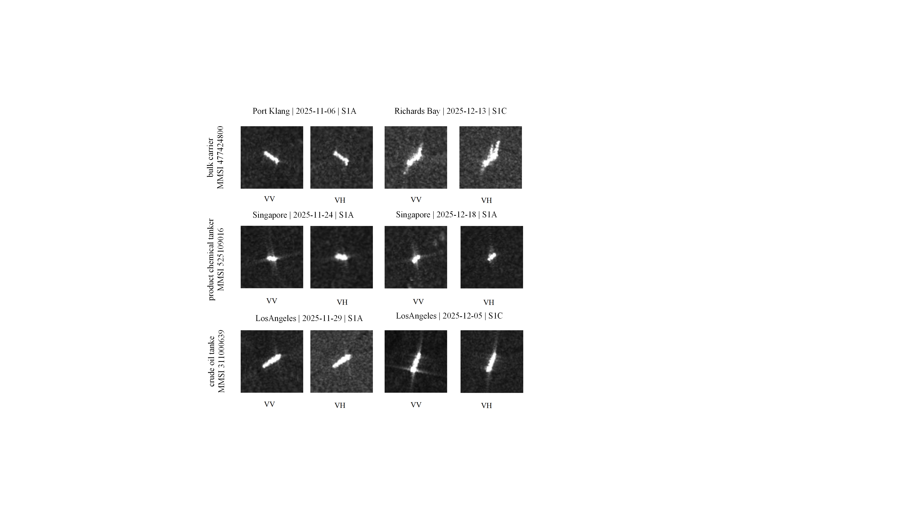{width=95%}

现有研究主要通过特征提取、双极化融合和局部增强改善船舶表示。例如，极化引导和跨极化交互方法利用不同极化的信息互补性，多尺度特征与统计注意机制进一步增强目标的判别表达。这些方法提升了信息利用能力，但整体特征的融合或局部响应的增强，并不直接说明这些信息如何影响具体类别的判断[2,3,4]。 对于包含船体及邻近区域的 SAR 图像，外围响应可能提供补充线索，也可能引入混淆；局部高响应可能支持正确类别，也可能强化竞争类别。因此，仅依赖整体表征或统一的局部增强策略，仍难以充分反映不同来源信息的判别作用。

因果层级分析为理解这一问题提供了一个视角：观测关联描述变量如何共同变化，干预分析考察主动改变某项条件后的结果，反事实分析则进一步追问给定事实下另一种条件可能产生的结果。这些问题所需的信息并不相同，观测中的相关性不能直接替代对操作效应的检验[5]。 近期多模态图像融合研究借鉴这一思想，通过受控扰动检验模态间依赖，并学习在干预下保持稳定的特征[6]。 对 SAR 船舶分类而言，这一视角启发我们从"哪些响应与船型相关"进一步追问"改变这些响应后，模型对不同船型的判断如何变化"。由此，本文关注的核心问题是：**如何辨别不同极化与空间区域中局部响应的类别判别作用，并将这些差异转化为有效的证据组织方式？**

围绕这一问题，本文从观测关联、输入干预和替代证据比较展开分析。首先，利用同船重复观测考察类别身份不变时，局部响应与分类结果在不同场景中的变化。随后，固定诊断模型、目标定位及参考条件，对指定极化、目标相对区域和空间尺度施加受控操作，追踪正确类别与竞争类别的分差变化，并设置匹配均值对照，检验平均强度变化能否解释所观察到的效应。进一步，在同一查询和固定模型下替换参考聚合方式或撤除局部回写路径，分析不同证据配置对决策的影响。这里的替代证据比较借鉴反事实提问方式，分析对象限定为分类系统内部的信息依赖，而非真实成像过程的反事实重建。

上述分析表明，局部响应的判别作用具有条件性。相同类型的局部削弱操作，在不同极化、区域或船型中可能产生相反的作用；分类改善既可能来自正确类别分数提高，也可能来自竞争类别受到更强抑制。因此，场景相关的响应变化不宜被统一视为需要消除的干扰，局部响应也不宜仅按强弱进行增强或抑制。更合适的处理方式，是在保留整体上下文的基础上，结合响应的极化来源、目标相对位置及类别比较关系组织判别信息。

基于上述分析，本文提出一种极化与区域证据学习网络，面向检测定位后、固定类别集合下的 SAR 船舶分类。网络采用共享 ResNet-50 骨干[7]，并为不同极化设置专属证据处理参数。类别响应反馈模块（Class-Response Feedback Block，CRFB）通过相对类别响应与局部内容的交叉统计形成位置相关反馈，在保留均值上下文的同时调节中间特征。响应引导区域池化模块（Response-Guided Regional Pooling，RGRP）依据定向边界框（Oriented Bounding Box，OBB）组织框内、轴端和侧向区域，通过区域上下文回写与类别响应引导读出汇总局部信息。参考类别证据回写模块（Reference-Class Evidence Writeback，RCEW）进一步比较查询与不同类别源参考之间的局部关系，将比较结果转化为空间类别证据并回写至中间特征，使参考信息参与后续特征提取。三个模块分别处理单图类别响应、目标相对区域及跨样本类别关系，共同构成差异化的证据组织框架。

此外，本文将干预分析用于训练阶段的判别保护分配。所有源样本均参与原图分类学习，通过干预筛选的样本额外接受教师原图类别分差的下界约束，从而将输入操作揭示的判别信息引入优化过程，而不要求预测阶段执行相同干预。最终模型通过全骨干微调联合优化特征表征与证据模块，并在 OpenSARShip 2.0 四分类和自建24港八分类任务上，采用船舶身份与采集过境隔离的协议进行评价，结合整体性能、机制替换及逐类、逐场景分析考察方法的有效性与适用范围。

本文的主要贡献如下：

1. **受因果层级启发的局部判别证据分析。** 结合同船重复观测、极化—区域—尺度受控干预及替代证据比较，分析局部响应对正确类别与竞争类别的不同作用，为差异化证据组织提供实验依据。

2. **极化与区域证据学习网络。** 通过 CRFB、RGRP 和 RCEW，将类别响应反馈、结构化区域取证与源参考类别证据回写相结合，使不同来源的局部信息能够参与中间特征更新与最终分类。

3. **受控干预引导的判别保护策略。** 利用源样本的干预响应选择额外保护对象，以教师原图的类别分差约束学生学习，并结合全骨干微调，在不增加在线干预步骤的条件下优化分类模型。

# 2 相关研究

## 2.1 SAR船舶分类与跨场景学习

SAR船舶分类需要从目标散射响应和空间结构中提取具有类别区分能力的表示。OpenSARShip面向Sentinel-1船舶解译建立开放数据资源[1]；FUSAR-Ship基于高分三号SAR与AIS匹配支持检测和识别[8]。不同资源在传感器、分辨率、类别体系和样本组织上存在差异，促使研究从固定分布下的识别拓展至分布适应。针对这一问题，已有研究将双分支注意与深度子域适应用于SAR船型分类[9]。

双极化信息利用是 SAR 船舶分类的重要研究方向。DPIG-Net [4] 通过极化交叉注意与残差密集学习，引导不同极化信息的特征提取和融合。CPINet [2] 进一步结合多尺度表示、混合阶统计注意和因子化双线性编码，利用一个极化的特征统计引导另一极化的表示学习。这些方法通过自适应交互增强双极化信息的互补表达，为船舶分类提供了比单极化输入更丰富的特征来源。

针对不同数据来源之间的分布差异，相关研究从域适应角度改善船舶识别。Liu 等提出多尺度对齐域适应网络，通过尺度感知特征提取、多层双线性融合及对抗学习处理不同分辨率 SAR 图像之间的偏移，并采用类别对比约束改善类间区分 [10]。Shi 等则研究从有标签光学图像到无标签 SAR 图像的迁移，通过渐进式特征对齐缓解跨模态差异 [11]。这些研究分别从尺度变化和模态差异出发，提高目标域上的识别能力。

HOG-SiamShipCLSNet采用共享骨干提取VV/VH特征，并在不同深度结合组双线性池化及HOG描述[3]。DPIG-Net使用VV引导VH与极化乘积幅度分支，通过交叉注意及残差融合组织极化信息[4]。CPINet结合多尺度融合、混合阶统计注意与因子化双线性编码[2]。这些研究表明共享或专属处理、跨极化交互和高阶统计均已有方法基础。

DBDN构造极化特征引导和纹理特征引导的两种伪RGB图像，进行双分支提取与融合分类[12]。本文采用逐极化前向与共享卷积，并以极化专属类别响应连接中间特征处理和区域取证。

与上述研究侧重极化交互或域间对齐不同，本文关注不同来源的局部响应如何参与具体类别判别。在仅使用源端标注数据的设置下，本文保留极化与目标相对区域的组织关系，并通过局部类别响应和源参考比较辅助分类。该研究侧重判别证据的利用方式，以补充特征融合与分布适应的研究视角。

## 2.2 类别响应与结构化区域表示

类别响应、特征统计与上下文建模为局部信息利用提供了不同途径。类别激活映射（Class Activation Mapping，CAM）利用分类权重与卷积特征生成类别相关的空间响应，用于定位判别区域 [13]。全局二阶池化（Global Second-Order Pooling，GSoP）将通道或位置之间的二阶统计引入网络中间层，增强特征间依赖建模 [14]；GCNet 则通过全局上下文汇总、变换与反馈，为局部特征补充长程信息 [15]。因此，类别相关定位、高阶统计和中间层上下文反馈均已有相应的方法基础。

面向 SAR 船舶的结构特点，SCRC-Net [16] 通过旋转矩形采样使感受区域适应船舶几何轮廓，并结合特征解耦和多尺度协同改善表示的一致性。该类研究表明，局部特征的采样与组织可以结合船舶形态，而不局限于固定图像网格上的处理。

PGMNet从SAR图像生成目标掩膜，以掩膜引导视觉特征对齐，并融合船舶尺寸描述的文本表征[17]。本文RGRP保留船体与不同方向外围的区域身份，RCEW引入带类别的源参考，使目标几何与跨样本判别关系分别承担区域定位和类别比较的作用。

类别响应与统计反馈方面，CAM将线性分类权重投射到末层卷积图，生成类别相关空间响应[13]；SENet以全局均值生成通道权重[18]，SRM联合均值和标准差完成重标定[19]，GSoP将通道或位置二阶统计嵌入中间层反馈[14]。本文CRFB保留均值支路，通过相对候选类别响应与局部值的交叉统计产生位置相关反馈，并将响应继续传递给RGRP，用于区域内部取证。

区域上下文方面，A2-Nets将注意汇总的全局描述按位置重新分配[20]；GCNet通过瓶颈变换将全局上下文反馈至特征图[15]；R-FCN以位置敏感得分图与RoI网格编码类别及相对位置[21]。RGRP以OBB框内、轴端和侧向限定证据来源，分别进行区域回写与多层读出，并复用CRFB响应指导浅层取证。

SAA从原图及随机裁剪中选择查询—支持最匹配的特征，联合估计空间和通道注意后进行原型分类[22]。本文在目标几何区域内复用候选类别响应，检验类别相关评分相对一般内容注意的取证效用。

本文进一步将类别响应与目标相对区域联系起来。CRFB 计算中心化局部内容与相对类别响应的交叉统计，形成位置相关的特征反馈；RGRP 则在 OBB 定义的框内、轴端及侧向区域中组织上下文，并复用类别响应进行区域内部读取。两者分别作用于特征更新和区域汇总，使类别信息能够在不同空间处理环节中被利用。其侧重点不是单独增加空间权重，而是建立类别响应、局部内容与几何区域之间的联系。

## 2.3 局部参考匹配与类别证据学习

参考样本能够为查询分类提供显式的类别比较依据。Prototypical Networks 通过支持样本构建类别原型，并依据查询与原型之间的距离进行分类 [23]。DN4 则保留局部描述子，将查询图像与同类参考描述池进行近邻比较，形成图像到类别的度量 [24]。两者分别从整体类别表示和局部特征匹配角度利用参考信息。

CAN通过类参考与查询的相关性生成交叉注意，比较加权表示[25]；BiEnFRN联合支持—查询双向重构、自重构与快照集成，提高细粒度少样本分类的区分能力[26]。

进一步地，DeepEMD 将查询与支持图像之间的局部匹配建模为可微分运输问题，通过地球移动距离比较密集特征表示 [27]。特征图重构网络（Feature Map Reconstruction Network，FRN）利用某一类别的支持特征重构查询特征，并以重构误差衡量类别匹配程度 [28]。这些方法表明，参考信息的利用不仅可以通过全局原型实现，也可以建立在局部对应及特征重构之上。

本文借鉴局部比较与类别度量的思路，但研究对象是固定类别集合与源参考库下的跨场景分类。RCEW 在极化和几何区域内建立查询—参考关系，利用传输边际聚合参考内容，再将查询相对于各参考类别的距离转化为空间类别证据，回写至主干中间特征。由此，参考比较结果不仅用于类别评分，还能够参与后续卷积与区域读出，将跨样本关系与查询表征学习相连接。

## 2.4 因果层级启发与受控干预学习

Pearl 的因果层级区分关联、干预和反事实三类问题，强调观察变量之间的关系、主动改变变量以及在给定事实下推断替代结果，需要不同的信息与建模条件 [5]。这一视角启发视觉研究从特征与预测的相关性出发，进一步检验输入变化及信息移除对模型决策的作用。

在模型解释方面，Meaningful Perturbation 通过受约束的输入修改识别影响分类决策的图像区域 [29]。移除并重训（Remove and Retrain，ROAR）进一步在训练集与测试集中一致移除特征，并重新训练模型，以区分信息移除的影响和扰动引入的分布偏移 [30]。在训练约束方面，*Right for the Right Reasons* 将输入梯度惩罚纳入优化过程，引导模型减少对非期望特征的依赖 [31]。这些工作分别从预测依赖分析、解释评估和训练干预三个方面研究特征的实际作用。

近期，Wang 等在多模态图像融合中提出受干预稳定性驱动的特征学习方法 [6]。该方法通过互补遮挡、同位置随机遮挡和模态丢弃，分别检验跨模态补偿、局部信息充分性及模态贡献，并利用自适应门控优先整合在不同干预下保持作用的特征。其重点在于通过主动扰动学习可靠的跨模态依赖，而非仅依据观测中的共现关系进行融合。

本文同样借鉴因果层级的分析思路，但关注局部响应对类别竞争的条件性作用，而非以干预稳定性作为主要学习目标。通过极化、目标相对区域及空间尺度的受控操作，本文考察正确类别与竞争类别的分差变化，并将干预响应用于额外判别保护对象的选择。学生仍在原图上学习，保护目标来自教师原图的类别分差，而不是要求其复现干预后的输出。替代证据比较则用于检验固定分类系统中的信息依赖，分析范围限定于模型输入及证据处理路径。

Li等在SAR自动目标识别中量化目标、阴影与杂波的贡献及交互，并通过背景重标度研究非目标区域依赖[32]。Meaningful Perturbation通过显式输入操作研究固定模型的重要区域[29]；ROAR在训练和测试数据中一致移除信息后重新训练，强调区分模型敏感性与信息价值[30]。Fourier Perspective通过范数受控的频率扰动分析鲁棒性，说明高频或低频的作用不能一概而论[33]。Right for the Right Reasons则将解释约束纳入可微训练[31]。

在训练端，RSC依据真实类梯度抑制主导隐藏特征，鼓励网络利用其他证据[34]；输入梯度正则直接约束分类损失对输入的局部敏感性[35]。本文比较有限幅度的区域尺度操作与匹配均值控制，对通过判别改善筛选的源样本施加教师分差下界保护。

PASTA依据合成与真实图像的幅度谱差异，对较高空间频率施加相对更强的乘性扰动，以扩大训练分布覆盖[36]。FGFL根据少样本任务产生DCT频率掩膜，转换回图像后结合三元组与对比目标学习表示[37]。本文的尺度操作同样发生于图像，但以极化、区域和类别竞争的操作效应确定保护对象；预测路径仅使用空间特征。

Contrastive-ACE利用特征对标签的平均干预效应稳定性组织跨域学习[38]。本文从可追溯的输入操作出发，以正确类—竞争类分差刻画响应变化，并将其用于样本级判别保护。

# 3 问题发现与受控干预证据

为了系统分析跨场景条件下的判别证据，本文构建了一个受观测、干预与替代证据比较启发的分层分析框架。如图2所示，自然观测用于揭示局部响应的场景依赖性，受控干预用于检验局部证据对类别竞争的影响，而替代证据比较进一步分析不同证据配置如何改变分类决策。基于此，本文进一步提出证据引导的学习框架。

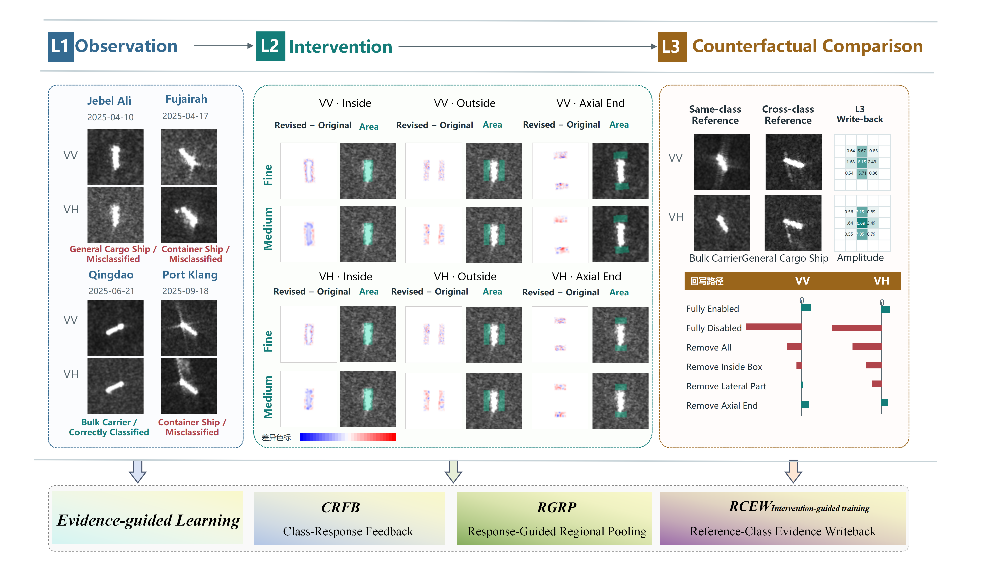{width=100%}

## 3.1 从自然不稳定到可检验问题

同船重复观测揭示了两种不同的失效形式：原油轮更容易在不同观测间发生正确与错误预测的切换，普通货船则更多表现为持续混淆。不同场景的类别组成还会改变汇总统计，因而需要将同类船舶的响应变化与类别比例差异分开考察。诊断队列、配对方式及完整统计见独立补充材料。

在相同源划分和配套训练的Ridge读出下，整图输入与卷积前框内掩膜输入的OA/BA分别为35.139%/38.795%和32.610%/37.231%；原油轮召回分别为53.580%和42.222%。整图输入在4744条观测中纠正690条、误判新增570条，净增加120条正确判断。这表明外围可见响应包含可利用的补充信息，也具有误导风险，需要区分其对具体类别竞争的作用。

## 3.2 干预定义与类别竞争

记双极化输入为 $x=(x^{VV},x^{VH})$，固定诊断器为 $T$，真实类别为 $y$。以原图最强错误类作为固定竞争类别 $c^\star=\arg\max_{c\ne y}T_c(x)$，定义分差及操作效应：

$$\begin{aligned}
m_{y,c^\star}(x)&=T_y(x)-T_{c^\star}(x),\\
\Delta m_a&=m_{y,c^\star}(x_a^I)-m_{y,c^\star}(x).
\end{aligned}\tag{1}$$

其中 $a=(p,r,b)$ 指定极化、目标相对区域和空间尺度。通过高斯尺度分解，在指定区域内有限幅度地削弱细尺度或中尺度分量；另一极化、检测框、参考库和模型参数保持不变。采用共同扰动剂量及匹配区域净灰度变化的均值对照，区分结构变化与平均亮度变化的作用。尺度分解、平滑掩膜和剂量匹配的实现见独立补充材料。

式（1）可分解为 $\Delta T_y-\Delta T_{c^\star}$。因此，正确类分数下降并不必然意味着决策退化：如果错误竞争类下降更多，分差仍可改善。为排除竞争类切换造成的虚假改善，选样时进一步检查各自最强错误类定义的分差 $m_{\max}(x)=T_y(x)-\max_{c\ne y}T_c(x)$。

## 3.3 极化与区域决定操作效应

在自建24港语料的104艘船、209次观测、31个过境和6港干预队列中，VH框内细尺度削弱平均损害正确类别优势，VH侧向中尺度削弱平均改善优势，同一侧向中尺度操作在VV中则为负。表1以诊断器分差报告效应及船级95%区间。

**表1 极化与区域干预的船均分差变化。**

| 操作 | 平均 $\Delta m$ | 船级95%区间 | 相对同均值控制的剩余效应 |
|---|---:|---|---:|
| VH框内细尺度削弱 | −0.003910 | [−0.005232, −0.002528] | −0.002997 |
| VH侧向中尺度削弱 | +0.002023 | [+0.000882, +0.003169] | +0.001417 |
| VV侧向中尺度削弱 | −0.001454 | [−0.002477, −0.000476] | −0.001147 |

类别进一步调节操作效应：VH侧向中尺度削弱在9艘集装箱船上的平均分差变化为+0.008422，在7艘散货船上为−0.008180。相反的作用方向支持保留极化和区域身份，并依据类别响应学习取证方式。

## 3.4 类别竞争的案例分析

图3的散货船10488展示了类别竞争的变化。仅削弱VH框内细尺度后，散货分数增加0.11492，错误原油轮分数下降0.16278，分差提高0.27769；均值控制仍误判。对照案例化学品船26628则同时降低正确类并抬高海工竞争类，产生误伤。局部证据的效用因此需落实到正确类与竞争类的相对变化。

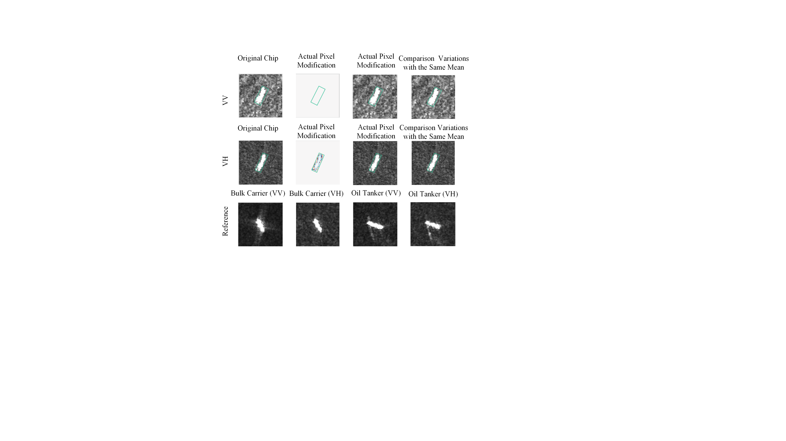{width=95%}

## 3.5 判别机制与设计依据

自然观测和受控干预共同表明，局部证据的判别作用具有条件性：不同极化、区域和尺度中的响应可能改变不同的类别竞争关系。固定模型上的输入操作建立了“局部响应变化—类别竞争变化”的可追溯联系，其效应对应分类系统对指定操作的依赖。基于这些证据，本文从三个层次组织模型设计。

首先，仅依据激活强度不足以确定局部证据的判别方向，因而保留整体均值上下文，并建立局部内容与相对类别响应的联系，对应CRFB。其次，同一操作在框内和侧向可能产生不同作用，因而保留极化及目标相对区域身份，在区域内部开展类别引导取证，对应RGRP。最后，纠错既可能来自增强正确类，也可能来自削弱混淆类，因而将查询与各类源参考的比较显式转换为相对类别证据，对应RCEW。

上述分析为模块提供设计依据，配套训练与替换实验进一步检验其分类效用。训练端则利用源样本的实际干预响应确定判别保护对象，使证据分析参与优化过程，而不将一种固定的图像削弱操作应用于所有查询。

# 4 方法

## 4.1 任务与整体结构

本文研究检测后、固定类别集合下的跨场景船舶分类。整体网络依次组织单图类别响应、目标相对区域和源参考类别关系，使局部证据在特征形成、区域汇总和跨样本比较三个环节参与判别。

给定固定检测流程定位的目标chip、OBB与极化可用性标记，模型预测 $K$ 个已知船型之一。网络在源场景的标注样本上学习，在船舶身份和采集过境均隔离的目标场景中评价。公开集分类实验取 $K=4$，自建数据采用八类标签。源参考库为 $\mathcal R=\{(x_j,y_j)\}_{j=1}^{B}$；公开集取 $B=32$，每类8个参考，自建数据取 $B=16$，每类2个参考。查询标签不参与预测；参考选择排除与查询同船或同过境的观测，并按极化可用性屏蔽无效关系。

输入按目标中心在原生像素网格裁剪或补零至 $160\times160$，保留已有chip的像素尺度，有效范围掩膜排除补零。VV与VH分别前向并共享ResNet-50[36]卷积权重；CRFB、RGRP及RCEW的投影与回写使用极化专属参数，生成通道度量的小网络共享。各极化依据检测框有效性确定是否进入分类：某一极化未通过目标定位或置信度要求时，仅屏蔽该分支，仍使用另一有效极化。这对应检测后分类中部分极化定位失败的情况，原始影像本身可同时具备VV和VH。

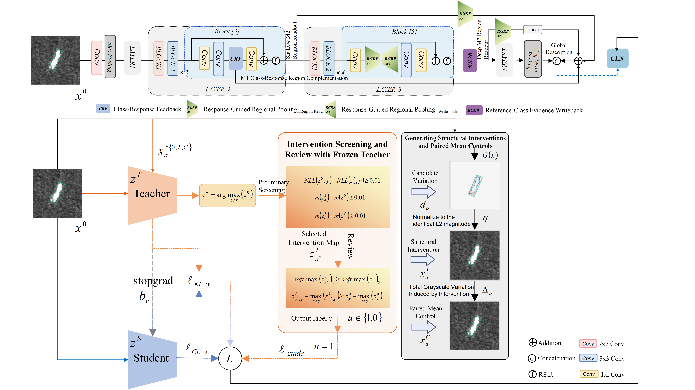{width=100%}

CRFB位于layer2末块的conv2激活之后；RGRP在layer3末块的conv1激活后执行区域池化回写，并从layer2输出和RCEW更新后的layer3输出读取区域摘要；RCEW位于layer3与layer4之间。各极化分别执行上述处理，全局描述来自layer4。区域池化保持特征图空间尺寸，与骨干下采样各司其职。

## 4.2 类别响应反馈模块（CRFB）

局部高响应可能同时支持多个易混淆类别，仅依据响应强弱进行重标定，难以描述它对类别竞争的不同作用。CRFB以当前类相对其他类的响应为条件，计算其与局部内容变化的关联，并将这种关联反馈至中间特征；均值支路同时保留整体上下文。

设某一极化的输入特征为 $X_1(u)$，$u$表示空间位置，$\omega(u)$为有效面积归一化权重。两个 $1\times1$ 卷积分别产生值特征 $V_1(u)$ 和候选类别响应 $A(u)$。令 $d_k(u)=A_k(u)-\operatorname{mean}_{j\ne k}A_j(u)$，在有效位置上将其中心化、标准化得到 $s_k(u)$；$\bar V_1$为加权内容均值。标准化常数与各层维度见独立补充材料。

以相对响应和局部值的共同变化形成类别相关摘要：

$$\begin{aligned}
C_k&=\sum_u\omega(u)\,[V_1(u)-\bar V_1]s_k(u),\\
R_1(u)&=\frac1K\sum_k\tanh(s_k(u))\tanh(L_k(C_k)).
\end{aligned}\tag{2}$$

$C_k$描述低维内容与标准化类别响应之间的交叉统计，$L_k$为含偏置的仿射映射。令均值变换 $U_0=W_0\tanh(L_0(\bar V_1))$，与关系支路共同生成有界门控并反馈至原特征：

$$\begin{gathered}
G_{\mathrm{CRFB}}(u)=o(u)\tanh\{U_0+W_1R_1(u)\},\\
X'_1(u)=X_1(u)+0.3X_1(u)\odot G_{\mathrm{CRFB}}(u).
\end{gathered}\tag{3}$$

输出映射零初始化，使训练从原特征路径开始。类别辅助读出利用源标签约束候选响应。$X'_1$经过该block的conv3、归一化与残差相加形成layer2输出 $F_2$；类别响应保留给后续区域读出使用。

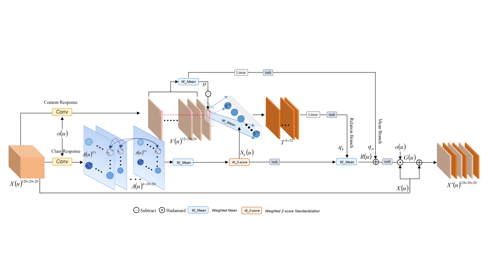{width=100%}

式（2）中的交叉统计同时包含内容偏离和类别响应偏离，反馈因而不只依赖某个位置的激活大小。相比CAM的类别激活定位[13]与GSoP的特征统计重标定[14]，这里将候选类别相对响应与中心化局部内容关联起来，形成位置相关的中间层更新。CRFB输出的类别响应还继续用于RGRP，在特征反馈与区域取证之间共享判别依据。

## 4.3 响应引导区域池化（RGRP）

统一的全局汇总会压缩船体与不同方向外围的空间差别，而预先划定区域也不能保证区域内各位置具有相同的判别价值。RGRP结合目标几何与CRFB类别响应，分别处理“从哪个区域读取”及“区域内如何加权”两个问题。该模块包含骨干内部的区域池化回写，以及面向分类的多层区域读出。

### 4.3.1 区域身份与内部回写

以OBB长轴建立目标相对坐标，构造框内、轴端与侧向三个区域。框内为长宽 $L,W$ 的软矩形；轴端为长轴扩展至 $1.5L$ 的矩形减去框内；侧向为宽度扩展至 $2W$ 的矩形减去框内。区域与有效输入范围相交，以特征网格实际面积占比表示 $m_r(u)$。两轴端对称处理，无需船首、船尾标注。

对于特征 $F$，区域均值为

$$\pi_r(u)=\frac{m_r(u)}{\sum_v m_r(v)},\qquad \operatorname{Pool}_r(F)=\sum_u\pi_r(u)F(u).\tag{4}$$

令 $t_r=\operatorname{Pool}_r(X_3)$。空区域返回零并屏蔽更新。layer3[5]中的内部RGRP以区域专属两层映射 $\phi_r$ 变换摘要，只回写至相应区域：

$$\begin{gathered}
X'_3(u)=X_3(u)+\sum_r\widetilde m_r(u)\phi_r(t_r),\\
\widetilde m_r(u)=m_r(u)/\max\{1,\sum_jm_j(u)\}.
\end{gathered}\tag{5}$$

其中 $X_3$ 为conv1激活后的256通道特征。区域专属变换保留框内、轴端与侧向的身份，不将三者合成同一个上下文再广播到全图。回写保持空间尺寸，使随后 $3\times3$ 卷积同时读取局部内容与对应区域的摘要。另两处区域读出仅汇总特征，用于最终分类。

### 4.3.2 由CRFB响应指导浅层取证

CRFB读取layer2[3]中的128通道特征，其响应与该block末端512通道特征 $F_2$ 位于同一 $20\times20$ 网格。在有效范围内标准化相对类别响应，得到有界评分 $q_k(u)=2\tanh(s_k(u))$。在每个区域内分别归一化：

$$\begin{aligned}
\alpha_{r,k}(u)&=\frac{m_r(u)\exp q_k(u)}{\sum_v m_r(v)\exp q_k(v)},\\
t_{r,k}&=\sum_u\alpha_{r,k}(u)V_2(u).
\end{aligned}\tag{6}$$

其中 $V_2$为浅层特征的低维值投影。同时保留均匀摘要 $t_{r,0}$，将其与各候选类别的加权摘要拼接，经线性映射、有界变换及原区域RMS尺度调节，形成补充量 $\delta^{(2)}_{p,r}$。该补充量回到原区域描述空间，并采用零初始化输出映射。所有候选类别同时参与，不输入查询真值，也不按当前预测的单一类别硬路由。式（6）回答“在这一几何区域内哪些位置更有助于类别区分”，式（4）回答“该区域总体包含什么”。

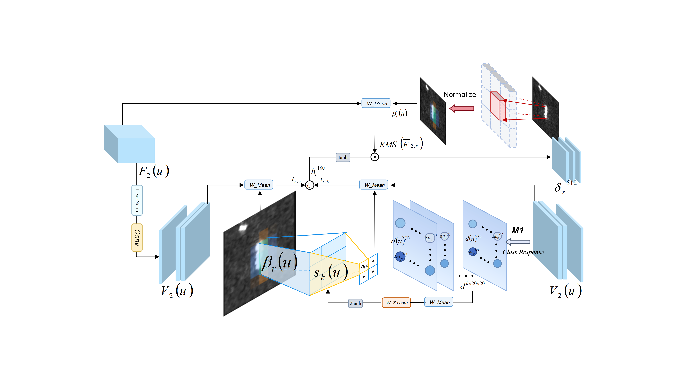{width=100%}

区域权重依据特征中心的覆盖面积计算；由于卷积感受野交叠，区域描述保留的是计算位置与目标几何的关系。

## 4.4 参考类别证据回写（RCEW）

CRFB和RGRP主要组织当前图像内部的证据；当查询中某些局部响应同时接近多个船型时，还需要比较它与不同类别参考之间的关系。RCEW利用固定源参考库构造这种比较，将“局部内容更接近哪类参考、相对其他类优势多大”转化为类别证据场，再反馈至骨干。参考信息因此参与后续特征计算，而不只提供末端相似度分数。

### 4.4.1 比较描述与值描述分离

RCEW使用源参考库补充单图判别。首先对当前共享骨干的layer1和layer2特征分别读出区域局部描述，通道数为256和512。每极化各自投影至32维并拼接，再分别生成32维比较键 $k$ 与值 $v$。键经归一化用于比较，值用于构造判别消息。局部槽位保留框内8、侧向8、轴端4的组织，空槽和不可用极化不参与参考比较。

查询与源参考由同一版本的骨干编码。联合微调时重新计算参考特征，使其随骨干更新而保持一致；预测时权重固定，源参考描述可预先计算并复用。

对某区域的合法源参考，按参考标签形成类均值 $\mu_c$ 和其他类均值 $\mu_{\neg c}$，记 $a_c=[\mu_c;\mu_{\neg c};\mu_c-\mu_{\neg c}]$，由共享小网络生成有界正通道度量：

$$\begin{gathered}
w_c=1+0.5\tanh\psi(a_c),\\
S_{sij}=\cos(\sqrt{w_{y_s}}\odot k_i^q,\sqrt{w_{y_s}}\odot k_{sj}^{\mathrm{ref}}).
\end{gathered}\tag{7}$$

这里 $i,j$ 分别为查询与参考槽位，$s$为源参考船，$y_s$为其标签；为简洁省略极化和区域索引。正通道度量同时用于键比较和后续值距离，使比较与回写采用一致的类别条件。

空间分支先计算查询槽位对类别 $c$ 的最佳相似度 $B_{ic}=\max_{s:y_s=c,j}S_{sij}$，只在合法参考和非空槽位上取最大值。再以 $b_{ic}=B_{ic}-\operatorname{mean}_{c'\ne c}B_{ic'}$ 表示相对其他可用类的优势，形成比较logit $L_{sij}=S_{sij}+b_{i,y_s}$。只有一个可用类别时令 $b_{ic}=0$。带未匹配槽的Sinkhorn归一化产生有效传输 $T_s$，非法位置在归一化前屏蔽。通道与空间分支因此是耦合的比较步骤，而不是两个结果直接相加的独立分支。

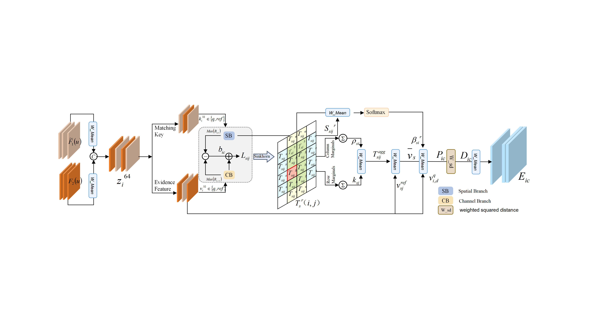{width=100%}

### 4.4.2 类别条件的参考聚合

记 $T_s$ 的有效行、列边际为 $\rho_{si}=\sum_jT_{sij}$、$\kappa_{sj}=\sum_iT_{sij}$，有效总质量为 $M_s=\sum_i\rho_{si}$。选用的聚合版在值传递阶段使用

$$T^{\mathrm{agg}}_{sij}=\frac{\rho_{si}\kappa_{sj}}{M_s},\qquad \bar v_s=\frac{\sum_j\kappa_{sj}v^{\mathrm{ref}}_{sj}}{M_s}.\tag{8}$$

上述等式适用于分母非零的位置，其余位置屏蔽。$\bar v_s$实际是按列边际汇总的区域参考值，不再保留查询槽位到参考槽位的一一精细搬运。参考权重仍依赖原传输与相似度：先计算 $g_{si}=\sum_jT_{sij}S_{sij}/\rho_{si}$，再在合法参考间令 $\beta_{si}=\operatorname{softmax}_s(g_{si}/0.1)$。类参考表示为

$$P_{ic}=\frac{\sum_{s:y_s=c}\beta_{si}\bar v_s}
{\sum_{s:y_s=c}\beta_{si}}. \tag{9}$$

边际聚合保留查询相关的参考选择及类内组织，将局部值对应压缩为区域参考摘要。这样，比较路径负责确定值得参考的响应及参考样本，值路径则以类别为单位汇总可传递的内容；二者通过传输边际和参考权重相联系。

### 4.4.3 类别证据场及空间回写

查询值与各类参考表示的距离形成候选类别证据，取 $e_{ic}=-D_{ic}/0.1$，并在可用类别中中心化：

$$\begin{gathered}
D_{ic}=\sum_d w_{c,d}(v^q_{i,d}-P_{ic,d})^2,\\
\widetilde e_{ic}=e_{ic}-\frac{1}{|\mathcal C_i|}\sum_{c'\in\mathcal C_i}e_{ic'}.
\end{gathered}\tag{10}$$

屏蔽不可用类别后，以局部槽位的空间占比 $\eta_i(u)$将证据落回layer3网格：

$$\begin{gathered}
E_c(u)=\sum_i\eta_i(u)\widetilde e_{ic},\\
F_3^{+}(u)=F_3(u)+0.1W_p^{\mathrm{out}}E(u).
\end{gathered}\tag{11}$$

$W_p^{\mathrm{out}}$为 $K$ 个类别证据通道到1024个骨干通道的 $1\times1$ 卷积。距离越小，候选类别的原始证据越高；类别中心化进一步突出相对优势，使回写消息表达类间比较，而不是无类别区分的参考内容。layer4继续加工 $F_3^{+}$，深层RGRP从该特征读取区域摘要。RCEW由此将跨样本的类间关系引入特征流，补充CRFB的单图调节和RGRP的区域汇总。

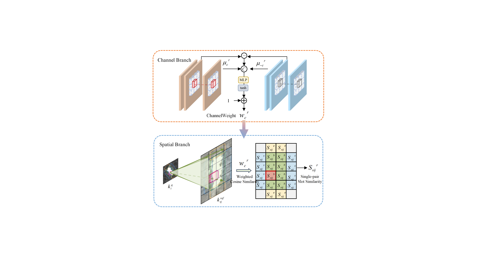{width=80%}

参考证据在layer3与layer4之间更新查询特征，后续卷积与区域读出共同利用这一更新。查询标签不参与参考选择、类别比较或回写。

## 4.5 多层融合与最终分类

多层融合在相同几何区域内整合不同深度的表示，并在不同区域之间保留独立描述。layer2提供较细的空间网格，RCEW更新后的layer3包含区域上下文及参考类别证据，layer4则形成全局表示。

对极化 $p$ 和区域 $r$，令 $t^{(2)}_{p,r}=\operatorname{Pool}_r(F_{2,p})$、$t^{(3)}_{p,r}=\operatorname{Pool}_r(F_{3,p}^{+})$，最终区域描述为

$$R_{p,r}=t^{(2)}_{p,r}+D_pt^{(3)}_{p,r}+\delta^{(2)}_{p,r}.\tag{12}$$

深层线性投影 $D_p$ 将1024维映射为512维，使相同区域的浅层、深层和引导补充项可以相加；不同区域之间保持拼接。layer4得到有效范围全局平均描述 $g_p\in\mathbb R^{2048}$，每极化表示为 $h_p=[g_p;R_{p,\mathrm{body}};R_{p,\mathrm{end}};R_{p,\mathrm{side}}]\in\mathbb R^{3584}$。将可用极化描述及标记拼接为 $h=[a_{VV}h_{VV};a_{VH}h_{VH};a_{VV};a_{VH}]$，得到分类分数：

$$z=W_{\mathrm{head}}h+b_{\mathrm{head}}.\tag{13}$$

$a_p\in\{0,1\}$ 为极化可用性，分类输入共7170维。最终softmax输出 $K$ 类概率。

## 4.6 干预指导与联合优化

完整模型对共享骨干与证据模块进行联合微调，并使用源域干预指导训练得到的检查点初始化。干预响应用于选择需要额外判别保护的原图，而非作为预测阶段的额外输入。初始化训练及各方法的优化配置见独立补充材料。

在干预指导训练中，对源样本，以式（1）固定竞争类，要求结构操作同时降低交叉熵、提高竞争类分差，并优于匹配均值控制。随后复核正确类概率与 $m_{\max}$ 均提高，将通过样本标记为 $u_n=1$。筛选直接使用干预图的教师预测。

所有原图均接受交叉熵监督；教师原本正确的样本额外接受分布保持约束；$u_n=1$的样本进一步接受原图教师判别优势下界保护。以 $n$ 表示训练样本，$w_n$为类别／船舶平衡权重，$z_n^0=T(x_n^0)$、$z_n^S$分别为原图教师与学生分数，$b_{nc}=\operatorname{stopgrad}(z^0_{n,y_n}-z^0_{nc})$，则

$$\begin{aligned}
\ell_{\mathrm{guide},n}
&=\frac{1}{K-1}\sum_{c\ne y_n}[b_{nc}-(z^S_{n,y_n}-z^S_{nc})]_+^2,\\
\mathcal L_{\mathrm{guide},w}
&=\frac{\sum_n w_nu_n\ell_{\mathrm{guide},n}}{\sum_n w_n}.
\end{aligned}\tag{14}$$

$$\mathcal L_{\mathrm{adapt}}=\mathcal L_{\mathrm{CE},w}+0.1\mathcal L_{\mathrm{KL,correct},w}+\lambda\mathcal L_{\mathrm{guide},w}.\tag{15}$$

教师量均停止梯度。该约束以教师原图分差为下界，而非以干预图的更高分差作为学生必须达到的目标。未通过筛选的样本仍参与分类监督，教师原本判对时也参与KL保持，仅不施加式（14）的额外保护。预测时输入原始SAR图像，不执行依赖真实类别的干预筛选。联合微调在原图上优化类别／船舶平衡交叉熵和类别响应辅助监督，参考特征与骨干同步更新；干预筛选及其判别保护已用于源域初始化训练，不在预测时执行。

# 5 实验设置

## 5.1 数据集介绍

本文使用OpenSARShip 2.0（OSS2）和自建24港数据集开展跨场景分类实验，分别考察公开四分类与自建八分类任务。表2汇总实际整理的数据规模；公开数据数量按本研究解析清单统计。每条观测对应一个船舶目标，VV/VH为其两种极化视图。

**表2 数据集组成。**

| 数据集 | 观测规模 | 类别与采集 |
|---|---|---|
| OSS2 | 6,780条GRDH记录 | 本文分类取4类；训练集719、验证集228、测试集378条 |
| 自建24港 | 38,091条观测；18,766个非空MMSI | 8类、24港、841个IW-GRDH产品 |

**公开数据集。** OSS2沿用原生船舶裁片及元数据，本文使用IW-GRDH产品。细粒度标签仅保留与任务类别一致的记录，笼统Cargo和Tanker标签不直接映射为普通货船或原油轮。OSS2分类比较采用散货船、普通货船、化学品／成品油轮和集装箱船四类图像，以保证各类参考与输入覆盖。

公开集各极化分别执行固定OBB定位，检测置信度达到0.25且几何有效时进入对应分支。在OSS2训练集、验证集和测试集中，分别有48、22和30条观测仅一个极化满足条件；这些观测的另一极化原始文件仍存在。模型通过式（13）的可用性标记处理该情况，符合检测后分类中某一极化定位不成功、另一极化仍可用于识别的输入条件。

**自建24港数据集。** 数据来源为Sentinel-1A和Sentinel-1C的IW-GRDH双极化产品，依据AIS关联的船舶身份与类型组织八类目标，保存VV/VH图像、源产品号、港口、裁片位置及目标几何信息。采集时间为2025年1月1日至2026年2月24日；38,091条观测中，32,184条来自Sentinel-1A，5,907条来自Sentinel-1C。841个产品按平台与绝对轨道合并为720个过境组，避免将同次过境的不同产品切片视为独立观测条件。本文使用地理处理后的8位动态裁片，不将其视为原始复数SAR。模型输入遵循第4.1节的原生像素裁剪／补零规则；可恢复的10 m像素间距不等同于传感器空间分辨率。

表3对照源产品、像素表示与预处理。公开集提供的32位原始幅度和定标裁片是不同文件分支，本文分类输入采用8位灰度裁片；自建数据同样采用8位图像。标称像素间距用于描述采样格网，不等同于传感器空间分辨率。

**表3 各数据集的Sentinel-1产品、像素表示与预处理对照。**

| 对照项 | OpenSARShip 2.0 | 自建24港SAR–AIS |
|---|---|---|
| 源产品 | Sentinel-1 IW-GRDH | Sentinel-1A／1C IW-GRDH |
| 极化 | VV/VH | VV/VH |
| 源产品标称像素间距 | 约10 × 10 m | 约10 × 10 m |
| 像素表示 | 提供原始幅度、定标与灰度裁片 | 地理处理后的8位灰度PNG动态裁片 |
| 辐射定标 | 提供定标裁片，具体参数未详述 | 使用灰度显示值；已追溯服务器分支未应用定标LUT |
| 几何处理 | 沿用数据集裁片；论文未明确重投影设置 | UTM地理编码、10 m输出格网；重采样方式随处理批次不同 |
| 灰度转换 | 提供灰度图，映射参数未详述 | 按极化作百分位拉伸；已追溯服务器分支采用整景2%／98%阈值 |
| 本文分类输入 | 8位灰度裁片 | 8位灰度裁片 |

图9展示24港的地理位置与港区观测分布，各港覆盖3至8类。表4给出八类总体组成；完整逐港统计及诊断队列见独立补充材料。

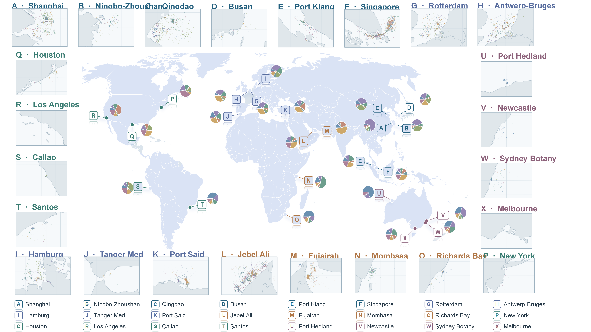{width=100%}

**表4 自建数据集类别分布。**

| 船型 | 观测数 | 占比（%） |
|---|---:|---:|
| 散货船 | 11,128 | 29.21 |
| 渔船 | 8,599 | 22.57 |
| 普通货船 | 5,929 | 15.57 |
| 化学品／成品油轮 | 5,827 | 15.30 |
| 集装箱船 | 2,208 | 5.80 |
| 原油轮 | 1,757 | 4.61 |
| 拖轮／拖带船 | 1,478 | 3.88 |
| 海工补给船 | 1,165 | 3.06 |
| 合计 | 38,091 | 100.00 |

## 5.2 跨场景划分与源参考

根据产品元数据，将同次过境的相邻切片合并后划分训练集、验证集和测试集，并隔离船舶身份。本文的跨场景评价包含不同时相、观测条件及港口水域的共同变化，不要求训练与测试来自完全不同港口。目标标签不参与训练、模型选择或参考构建。表5给出OSS2类别组成。

**表5 OSS2四分类划分。括号内为独立船数。**

| 集合 | 散货船 | 普通货船 | 化学品/成品油轮 | 集装箱船 | 总观测/船数/过境 |
|---|---:|---:|---:|---:|---|
| 训练集 | 221（216） | 73（71） | 141（137） | 284（259） | 719 / 683 / 13 |
| 验证集 | 87（84） | 23（22） | 29（29） | 89（88） | 228 / 223 / 4 |
| 测试集 | 132（128） | 26（26） | 83（81） | 137（134） | 378 / 369 / 5 |

自建24港采用20,653条训练观测、160条验证观测及3,075条测试观测，测试集包含1,950艘船、18港和85个过境组。过境组按平台、绝对轨道号及datatake确定。固定源参考库在OSS2中每类8艘、合计32艘，在24港中每类2艘、合计16艘；参考来自训练集，并排除测试船舶与测试过境。诊断队列与正式分类划分分别使用，详细清单及初始化训练子集见独立补充材料。

## 5.3 实现与比较设置

本文完整模型采用全骨干微调，位置与结构固定为第4节配置。共享ResNet-50骨干与证据模块联合优化，BN运行统计保持固定；查询与参考均由当前骨干编码。采用AdamW，学习率 $10^{-4}$、权重衰减0.01、有效batch 24、梯度裁剪5，两轮预热后余弦衰减。监督目标为类别／船舶平衡交叉熵与权重0.02的类别响应辅助损失。最多训练30轮，最少12轮后使用8轮早停耐心值；按验证集BA、OA、NLL依次选取检查点。初始化及干预指导训练配置见独立补充材料。

在OSS2验证集选择优化范围与学习率后，将相同配方用于自建24港，不迁移OSS2训练权重。所有结果采用种子17、29和43，报告均值与样本标准差。

比较包括普通双极化ResNet-50基础模型（Baseline）、匹配位置SE[15]和CPINet[4]独立复现版。Baseline与SE采用ImageNet初始化及受限骨干更新，均不包含本文提出的三个证据模块；CPINet从随机初始化训练。各方法使用相同训练、验证、测试划分和原始极化可用性，并在验证集选择超参数；具体初始化、预处理和预算见独立补充材料。这些比较评价系统识别性能，组件增量另由配套训练和固定权重替换分析。表中“—”表示相应实验尚未完成。

## 5.4 评价指标

采用总体准确率（OA）、平衡准确率（BA）、宏平均F1及负对数似然（NLL）。BA对测试集合实际纳入的类别召回率等权平均，宏F1对相同类别的F1等权平均。逐类混淆矩阵按真实类别归一化，再在三个种子间取均值，不进行预测集成。配对区间以船舶身份为簇重采样，保留同船观测的关联。路径干预固定模型权重、查询图像和参考成员，只改变指定证据路径。

# 6 结果与分析

## 6.1 逐类识别与混淆关系

表6首先给出两个数据集的逐类识别结果，本文模型均为全骨干微调后的完整模型。OSS2中的散货船和化学品／成品油轮相对Baseline分别提高16.16和10.04个百分点；普通货船的平均召回不变。自建24港中七类取得平均召回增益，其中原油轮、集装箱船和普通货船分别提高21.88、15.60和14.62个百分点。

**表6 全骨干微调完整模型的逐类召回。单元格为三种子平均召回率（%）及相对Baseline的增量（百分点）。**

| 船型 | OSS2 | 自建24港 |
|---|---:|---:|
| 散货船 | 66.16（+16.16） | 62.30（+10.03） |
| 普通货船 | 39.74（0.00） | 48.17（+14.62） |
| 化学品／成品油轮 | 61.85（+10.04） | 42.80（+2.57） |
| 集装箱船 | 69.83（+2.68） | 57.16（+15.60） |
| 渔船 | 不适用 | 64.71（+1.31） |
| 原油轮 | 不适用 | 66.93（+21.88） |
| 拖轮／拖带船 | 不适用 | 13.77（−2.42） |
| 海工补给船 | 不适用 | 35.93（+6.79） |

图10显示，OSS2散货船误判为集装箱船的比例下降14.39个百分点，化学品／成品油轮误判为散货船与集装箱船分别下降6.02和5.62个百分点。普通货船误判为油轮的比例下降11.54个百分点，但误判为集装箱船相应增加，表明总体召回不变仍可能伴随竞争类别转移。

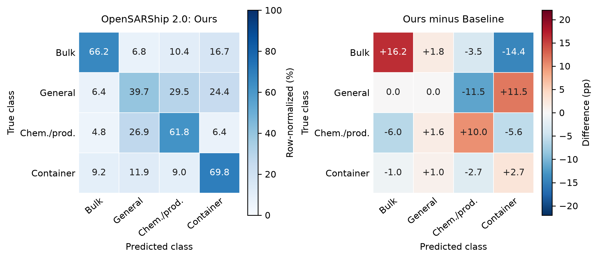{width=100%}

在自建24港中，原油轮误判为散货船、化学品／成品油轮分别下降11.85和6.25个百分点，集装箱船误判为散货船下降8.68个百分点（图11）。收益覆盖多个类别对，并非仅由样本最多的散货船贡献。拖轮／拖带船召回降低2.42个百分点，仍是主要混淆类别之一。

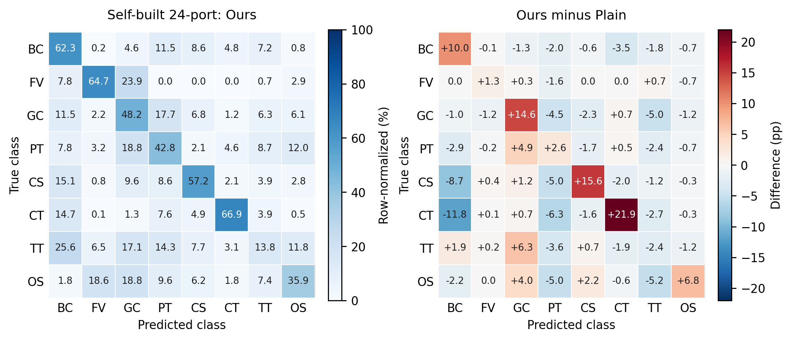{width=100%}

## 6.2 整体性能比较

表7汇总相同测试集合与输入可用性下的系统性能。完整模型在OSS2取得64.727%的OA和59.396%的BA，相对基础模型分别提高8.819和7.220个百分点，宏F1提高7.520个百分点。

**表7 两个数据集上的分类性能，三种子均值与标准差。训练配置见第5.3节及独立补充材料。**

| 数据集 | 方法 | OA（%） | BA（%） | 宏F1（%） |
|---|---|---:|---:|---:|
| OSS2 | Baseline | 55.908 ± 1.332 | 52.176 ± 1.506 | 50.173 ± 1.359 |
| OSS2 | SE | 54.233 ± 0.954 | 53.497 ± 1.802 | 49.862 ± 1.323 |
| OSS2 | CPINet [2] | 56.261 ± 1.986 | 56.988 ± 0.960 | 52.413 ± 1.482 |
| OSS2 | SCRC-Net [16] | — | — | — |
| OSS2 | 同源参考类原型 | — | — | — |
| OSS2 | 本文 | **64.727 ± 2.702** | **59.396 ± 3.831** | **57.693 ± 3.187** |
| 自建24港 | Baseline | 42.927 ± 0.620 | 40.172 ± 1.041 | 38.385 ± 0.784 |
| 自建24港 | SE | 42.309 ± 0.523 | 41.218 ± 0.668 | 38.742 ± 0.693 |
| 自建24港 | CPINet [2] | — | — | — |
| 自建24港 | SCRC-Net [16] | — | — | — |
| 自建24港 | 同源参考类原型 | — | — | — |
| 自建24港 | 本文 | **52.076 ± 0.244** | **48.970 ± 0.808** | **46.520 ± 0.637** |

自建24港的OA、BA和宏F1分别达到52.076%、48.970%和46.520%，相对Baseline提高9.149、8.798和8.135个百分点。更细的八类划分与更广的水域覆盖下，模型仍取得整体增益。不同方法的优化预算并不完全相同，故系统收益不直接分配给某一模块；配套组件删除、区域取证替换及极化参数对照汇总于独立补充材料。

## 6.3 跨数据集泛化

跨数据集评价采用OpenSARShip 2.0与自建24港共同覆盖的散货船、普通货船、化学品／成品油轮和集装箱船四类，分别执行OSS2训练至24港测试及反向迁移。源训练、验证和参考库均不使用目标数据；划分时排除源端与目标测试之间重复的船舶身份及采集过境。查询标签只用于最终评价，每类选取8张源参考，共32张。

表8采用与当前完整模型一致的全骨干微调方案，各方法使用相同的源训练、验证及目标测试队列，超参数和检查点仅由源验证集确定。24港与OSS2目标测试队列分别包含2,412和378条共同四类观测；分类输出均为四类，不将24港八分类结果直接折算为四分类。正文数值对应当前模型配置，已完成的受限骨干跨数据集对照单独列于补充材料。

**表8 双向跨数据集分类性能。单元格为三个训练种子的均值与标准差；箭头表示训练数据集至测试数据集，“—”为待补结果。**

| 迁移方向 | 方法 | OA（%） | BA（%） | 宏F1（%） |
|---|---|---:|---:|---:|
| OSS2 → 自建24港 | Baseline | — | — | — |
| OSS2 → 自建24港 | SE | — | — | — |
| OSS2 → 自建24港 | CPINet [2] | — | — | — |
| OSS2 → 自建24港 | SCRC-Net [16] | — | — | — |
| OSS2 → 自建24港 | 本文 | — | — | — |
| 自建24港 → OSS2 | Baseline | — | — | — |
| 自建24港 → OSS2 | SE | — | — | — |
| 自建24港 → OSS2 | CPINet [2] | — | — | — |
| 自建24港 → OSS2 | SCRC-Net [16] | — | — | — |
| 自建24港 → OSS2 | 本文 | — | — | — |

## 6.4 完整模型的组件贡献

表9比较在相同全骨干微调协议下移除CRFB、RGRP或RCEW后的识别结果。各配置保持划分、训练预算与参考权限一致，保留组件及其后续网络重新优化；删除RGRP同时移除其区域读出与响应引导接口。独立补充材料中的受限骨干消融作为机制证据保留，本表对应当前完整模型的配套实验。

**表9 全骨干微调协议下的组件删除对照。单元格为三种子平均OA／BA（%）。**

| 配置 | OSS2 | 自建24港 |
|---|---:|---:|
| 无CRFB | — | — |
| 无RGRP | — | — |
| 无RCEW | — | — |
| 完整模型 | 64.727／59.396 | 52.076／48.970 |

## 6.5 核心设计的替换比较

表10围绕类别反馈、区域身份和参考类别消息设置替换对照。比较保持输入覆盖及模块接入位置不变，仅替换指定计算；相应可训练路径按同一优化协议重新训练，区别于后文固定权重的证据路径撤除。

**表10 当前完整模型的核心算子替换。单元格为三种子平均OA／BA（%）。**

| 组件 | 替换方式 | OSS2 | 自建24港 |
|---|---|---:|---:|
| CRFB | 无反馈，保留响应读出 | — | — |
| CRFB | 仅均值反馈 | — | — |
| CRFB | 仅类别关系反馈 | — | — |
| CRFB | 普通内容注意反馈 | — | — |
| RGRP | 仅框内池化 | — | — |
| RGRP | 同范围内外合并池化 | — | — |
| RGRP | 仅合并最终区域读出 | — | — |
| RGRP | 分区域读出，无内部回写 | — | — |
| RCEW | 普通参考特征回写 | — | — |
| RCEW | 精细对应的类别证据回写 | — | — |
| RCEW | 单位度量、无竞争偏置 | — | — |
| RCEW | 学习度量、无竞争偏置 | — | — |
| RCEW | 单位度量、保留竞争偏置 | — | — |
| 本文 | 完整配置 | 64.727／59.396 | 52.076／48.970 |

## 6.6 参考类别证据如何改变决策

在最终OSS2完整模型上固定权重、原图及32个源参考，比较实际回写、关闭回写与简单类别均值替代（表11）。实际回写相对简单均值平均提高OA 0.617、BA 0.732个百分点，表明查询相关的参考选择与类别证据组织在这组权重下具有增量。与完全关闭回写相比，OA小幅提高、BA小幅降低，说明参考补充对各类别并非等量作用。

**表11 最终完整模型的同权重参考路径比较，三种子平均。**

| 参考路径 | OA（%） | BA（%） |
|---|---:|---:|
| 关闭RCEW回写 | 64.374 | 59.702 |
| 简单类别均值 | 64.109 | 58.664 |
| RCEW类别证据回写 | 64.727 | 59.396 |

案例002422（seed29）进一步说明，参考证据不仅改变响应幅度，还能改变类别竞争。该查询在关闭RCEW时的真实类分差为−0.0416，实际回写后为+0.0928；改用简单类别均值后为−0.0769，撤除框内回写后为−0.0545。该例将预测纠正定位到当前查询的框内参考证据，而不是仅由热图亮度推断模块效用。

三个种子合计产生23次纠错与19次新增误判。23次纠错中21次也可由简单类别均值实现，说明当前收益主要来自参考证据补充，其中少数边界样本进一步受益于条件化组织。独立补充材料提供参考消息形式、通道度量和类别偏置的配套替换，以区分整体参考价值与内部设计增量。

## 6.7 极化处理与部署输入

表12对照极化参数组织与输入方式。参数共享实验保持骨干、模块位置和优化流程一致；单极化及早期融合使用相同测试观测范围，并分别训练对应模型。

**表12 当前完整模型的极化处理对照。单元格为三种子平均OA／BA（%）。**

| 输入 | 参数组织 | OSS2 | 自建24港 |
|---|---|---:|---:|
| VV | 单极化配套训练 | — | — |
| VH | 单极化配套训练 | — | — |
| VV＋VH | 共享骨干、共享模块 | — | — |
| VV＋VH | 共享骨干、专属模块 | 64.727／59.396 | 52.076／48.970 |
| VV/VH堆叠 | 早期融合 | — | — |

对一侧未获得有效目标框的观测，在核实两极化图像对应关系后，使用另一侧框恢复缺失视图。保持完整模型权重不变，OSS2仅恢复查询后OA／BA由64.727%／59.396%变为65.344%／59.430%，同时恢复查询与参考后为65.785%／59.776%。自建24港恢复83条测试观测后为52.249%／49.481%，同时恢复参考后为52.379%／49.691%。

上述结果单独评价输入可用性，不混入表7的主比较。它说明部分分类损失来自可利用极化未进入网络，而非模型无法从该极化提取证据；跨极化恢复需要可靠的图像对应与框坐标转换。参数共享方式及目标框扰动对照见独立补充材料。

## 6.8 源参考库规模

表13固定完整模型权重与查询集合，按每类独立船数改变源参考预算，每个预算进行五次配对抽样。不同预算保持源候选池与测试集不变，避免将样本组成变化误作参考数量收益；抽样标准差与训练种子标准差分别报告。

**表13 源参考库规模敏感性。OA、BA为五次参考抽样的均值与标准差。**

| 数据集 | 每类／总参考数 | OA（%） | BA（%） | NLL | 延迟（ms） |
|---|---|---:|---:|---:|---:|
| OSS2 | 1／4 | — | — | — | — |
| OSS2 | 2／8 | — | — | — | — |
| OSS2 | 4／16 | — | — | — | — |
| OSS2 | 8／32 | — | — | — | — |
| OSS2 | 16／64 | — | — | — | — |
| 自建24港 | 1／8 | — | — | — | — |
| 自建24港 | 2／16 | — | — | — | — |
| 自建24港 | 4／32 | — | — | — | — |
| 自建24港 | 8／64 | — | — | — | — |
| 自建24港 | 16／128 | — | — | — | — |

## 6.9 干预指导的训练贡献

表14比较干预有效性选样、类内等配额随机选样与无分差保护。各组使用相同原图、初始化训练预算及后续全骨干微调配置，只改变保护对象及额外分差约束。无保护组仍保留原图分类监督与教师正确样本的分布保持，随机组与干预组按类别匹配保护数量。

**表14 干预指导对最终完整模型的影响。单元格为三种子平均OA／BA（%）。**

| 策略 | 保护对象 | OSS2 | 自建24港 |
|---|---|---:|---:|
| 无分差保护 | 无 | — | — |
| 类内随机选样 | 等配额源样本 | — | — |
| 干预有效性选样 | 通过筛选的源样本 | 64.727／59.396 | 52.076／48.970 |

## 6.10 场景表现与定位鲁棒性

表15按过境与港口汇总当前模型相对Baseline的表现，分组BA只对该组实际存在的类别取平均。表16固定查询图像、标签及模型权重，分别扰动OBB中心、长宽与角度，并重新生成所有依赖该框的查询区域，考察完整模型的几何输入敏感性。

**表15 当前模型的场景级性能增量。增量单位为百分点。**

| 分组 | 场景数 | 平均ΔOA | 平均ΔBA | OA正／平／负 |
|---|---:|---:|---:|---|
| OSS2／过境 | 5 | — | — | — |
| 24港／过境 | 85 | — | — | — |
| 24港／港口 | 18 | — | — | — |

**表16 当前完整模型的目标框扰动。单元格为OA／BA（%）；正负方向分别评价。**

| 变量 | 幅度 | OSS2 | 自建24港 |
|---|---|---:|---:|
| 原始OBB | 0 | 64.727／59.396 | 52.076／48.970 |
| 沿船轴中心 | ±5%、10%、20%框长 | — | — |
| 横船轴中心 | ±5%、10%、20%框宽 | — | — |
| 长度 | ±10%、20% | — | — |
| 宽度 | ±10%、20% | — | — |
| 等比长宽 | ±10%、20% | — | — |
| 方向角 | ±5°、10°、20° | — | — |
| 缺框 | 回退处理 | — | — |

## 6.11 计算成本

在双极化 $160\times160$ 输入下，OSS2完整模型实际执行参数为25.053 M，卷积与矩阵乘运算量为8.673 G，32个参考的FP32描述缓存为3.755 MiB。自建八分类配置对应25.233 M、8.640 G和1.878 MiB，使用16个源参考。运算量按一次乘加两次操作统计，不含归一化和传输迭代中的逐元素开销。

**表17 当前模型及基线的计算成本。运算量为卷积及矩阵乘统计，延迟为单张稳态前向。**

| 配置 | 参数（M） | 运算量（G） | 延迟（ms） | 显存（MiB） |
|---|---:|---:|---:|---:|
| OSS2 Baseline | 23.524 | 8.342 | — | — |
| OSS2 SE | 23.690 | 8.343 | — | — |
| OSS2 CPINet | — | — | — | — |
| OSS2 SCRC-Net | — | — | — | — |
| OSS2类原型 | — | — | — | — |
| OSS2本文 | 25.053 | 8.673 | — | — |
| 24港本文 | 25.233 | 8.640 | — | — |

相对相同输入的Baseline，OSS2完整模型执行参数增加6.50%，卷积／矩阵乘运算量增加3.96%。源参考由固定模型离线编码，在线阶段复用其描述，避免逐查询重复执行参考图像骨干。独立补充材料给出计数范围及固定权重推理加速实现的计时结果。

# 7 讨论

自然观测与输入干预共同表明，局部响应的判别作用与极化、区域和类别竞争有关。CRFB反馈类别相关内容，RGRP保留目标相对区域身份，RCEW引入带类别的参考证据，三者在不同处理环节承接这一发现。整体分类、逐类混淆与固定路径替换分别评价系统收益、收益分布及已训练决策对特定证据的依赖。

受控输入操作识别的是固定模型对指定证据变化的响应，不将其直接等同于真实散射过程的独立物理因果效应。参考证据与外围响应能够纠正部分错误，也可能引入混淆，因此模块价值应结合净收益和具体适用条件评价。联合训练后，自建24港的NLL为1.4139、Brier分数为0.6462；逐类分析仍显示拖轮等类别较难识别，改善其源样本覆盖和竞争类别证据是后续重点。

# 8 结论

本文针对跨场景SAR船舶分类中局部判别证据利用不足的问题，结合同船观测与受控输入干预，分析不同极化、区域和尺度响应对类别竞争的影响。基于这些证据，提出由CRFB、RGRP和RCEW组成的极化与区域证据学习网络，并利用干预响应辅助训练样本选择和原图判别保护。共享骨干与证据模块联合微调后，OSS2和自建24港任务的OA分别达到64.727%和52.076%，BA分别达到59.396%和48.970%。逐类混淆分析与参考路径比较表明，按证据来源、目标区域和类别关系组织局部响应，能够减少多个船型间的误判，为跨场景SAR船舶分类提供有效的证据利用方式。

# 参考文献

[1] L. Huang, B. Liu, B. Li, W. Guo, W. Yu, Z. Zhang, and W. Yu. OpenSARShip: A Dataset Dedicated to Sentinel-1 Ship Interpretation. *IEEE JSTARS*, 11(1):195–208, 2018. doi:10.1109/JSTARS.2017.2755672.

[2] J. He et al. CPINet: Towards A Novel Cross-Polarimetric Interaction Network for Dual-Polarized SAR Ship Classification. *Remote Sensing*, 16(18):3479, 2024. doi:10.3390/rs16183479.

[3] H. Xie, J. He, Z. Lu, and J. Hu. Two-Level Feature-Fusion Ship Recognition Strategy Combining HOG Features with Dual-Polarized Data in SAR Images. *Remote Sensing*, 15(18):4393, 2023. doi:10.3390/rs15184393.

[4] Z. Shao, T. Zhang, and X. Ke. A Dual-Polarization Information-Guided Network for SAR Ship Classification. *Remote Sensing*, 15(8):2138, 2023. doi:10.3390/rs15082138.

[5] J. Pearl, "The Seven Tools of Causal Inference, with Reflections on Machine Learning," *Communications of the ACM*, vol. 62, no. 3, pp. 54–60, 2019.

[6] X. Wang, Z. Guan, W. Qian, C. Wang, and R. Ma, "Multi-Modal Image Fusion via Intervention-Stable Feature Learning," in Proceedings of the IEEE/CVF Conference on Computer Vision and Pattern Recognition (CVPR), 2026, pp. 33827–33837.

[7] K. He, X. Zhang, S. Ren, and J. Sun. Deep Residual Learning for Image Recognition. *CVPR*, 770–778, 2016.

[8] X. Hou, W. Ao, Q. Song, J. Lai, H. Wang, and F. Xu. FUSAR-Ship: Building a High-Resolution SAR-AIS Matchup Dataset of Gaofen-3 for Ship Detection and Recognition. *Science China Information Sciences*, 63:140303, 2020. doi:10.1007/s11432-019-2772-5.

[9] S. Zhao and H. Lang. Improving Deep Subdomain Adaptation by Dual-Branch Network Embedding Attention Module for SAR Ship Classification. *IEEE JSTARS*, 15:8038–8048, 2022. doi:10.1109/JSTARS.2022.3206753.

[10] Z. Liu, K. Li, L. Wang, and Z. Zhang. Multi-Scale Alignment Domain Adaptation for Ship Classification in Multi-Resolution SAR Images. *IEEE Transactions on Automation Science and Engineering*, 22:4051–4062, 2025. doi:10.1109/TASE.2024.3407130.

[11] Y. Shi, L. Du, Y. Guo, Y. Du, and Y. Li. Unsupervised Domain Adaptation for Ship Classification via Progressive Feature Alignment: From Optical to SAR Images. *IEEE Transactions on Geoscience and Remote Sensing*, 62:1–17, 2024. doi:10.1109/TGRS.2024.3458937.

[12] N. Xie, T. Zhang, W. Guo, Z. Zhang, and W. Yu. Dual Branch Deep Network for Ship Classification of Dual-Polarized SAR Images. *IEEE Transactions on Geoscience and Remote Sensing*, 62:1–15, 2024. doi:10.1109/TGRS.2024.3372021.

[13] B. Zhou, A. Khosla, A. Lapedriza, A. Oliva, and A. Torralba, "Learning Deep Features for Discriminative Localization," in Proceedings of the IEEE Conference on Computer Vision and Pattern Recognition (CVPR), 2016, pp. 2921-2929, doi: 10.1109/CVPR.2016.319.

[14] Z. Gao, J. Xie, Q. Wang, and P. Li, "Global Second-Order Pooling Convolutional Networks," in Proceedings of the IEEE/CVF Conference on Computer Vision and Pattern Recognition (CVPR), 2019, pp. 3024-3033, doi: 10.1109/CVPR.2019.00314.

[15] Y. Cao, J. Xu, S. Lin, F. Wei, and H. Hu, "GCNet: Non-Local Networks Meet Squeeze-Excitation Networks and Beyond," in Proceedings of the IEEE/CVF International Conference on Computer Vision Workshops (ICCVW), 2019, pp. 1971-1980, doi: 10.1109/ICCVW.2019.00246.

[16] Y. Qi, L. Wang, C. Zhao, P. T. Mathiopoulos, T. Ohtsuki, and F. Adachi. SCRC-Net: A Structure-Constrained and Representation-Consistent Network for SAR Ship Classification. *Pattern Recognition*, 180:114294, 2026. doi:10.1016/j.patcog.2026.114294.

[17] L. Chen, J. Li, H. Zhong, H. Shi, Z. Yang, and W. Li. PGMNet: A Prototype-Guided Multimodal Network for Ship Recognition in SAR Images. *IEEE Transactions on Geoscience and Remote Sensing*, 63:5215517, 2025. doi:10.1109/TGRS.2025.3583282.

[18] J. Hu, L. Shen, and G. Sun, "Squeeze-and-Excitation Networks," in Proceedings of the IEEE/CVF Conference on Computer Vision and Pattern Recognition (CVPR), 2018, pp. 7132-7141, doi: 10.1109/CVPR.2018.00745.

[19] H. Lee, H.-E. Kim, and H. Nam, "SRM: A Style-Based Recalibration Module for Convolutional Neural Networks," in Proceedings of the IEEE/CVF International Conference on Computer Vision (ICCV), 2019, pp. 1854-1862, doi: 10.1109/ICCV.2019.00194.

[20] Y. Chen, Y. Kalantidis, J. Li, S. Yan, and J. Feng, "A^2-Nets: Double Attention Networks," in Advances in Neural Information Processing Systems, vol. 31, 2018, pp. 352-361.

[21] J. Dai, Y. Li, K. He, and J. Sun, "R-FCN: Object Detection via Region-based Fully Convolutional Networks," in Advances in Neural Information Processing Systems, vol. 29, 2016, pp. 379-387.

[22] X. Li, X. Wang, R. Zhu, Z. Ma, J. Cao, and J.-H. Xue. Selectively Augmented Attention Network for Few-Shot Image Classification. *IEEE Transactions on Circuits and Systems for Video Technology*, 35(2):1180–1192, 2025. doi:10.1109/TCSVT.2024.3480279.

[23] J. Snell, K. Swersky, and R. Zemel, "Prototypical Networks for Few-shot Learning," in Advances in Neural Information Processing Systems, vol. 30, 2017, pp. 4077-4087.

[24] W. Li, L. Wang, J. Xu, J. Huo, Y. Gao, and J. Luo, "Revisiting Local Descriptor Based Image-To-Class Measure for Few-Shot Learning," in Proceedings of the IEEE/CVF Conference on Computer Vision and Pattern Recognition (CVPR), 2019, pp. 7260-7268, doi: 10.1109/CVPR.2019.00743.

[25] R. Hou, H. Chang, B. Ma, S. Shan, and X. Chen, "Cross Attention Network for Few-shot Classification," in Advances in Neural Information Processing Systems, vol. 32, 2019, pp. 4003-4014.

[26] J. Wu, D. Chang, A. Sain, X. Li, Z. Ma, J. Cao, J. Guo, and Y.-Z. Song. Bi-Directional Ensemble Feature Reconstruction Network for Few-Shot Fine-Grained Classification. *IEEE Transactions on Pattern Analysis and Machine Intelligence*, 46(9):6082–6096, 2024. doi:10.1109/TPAMI.2024.3376686.

[27] C. Zhang, Y. Cai, G. Lin, and C. Shen. DeepEMD: Few-Shot Image Classification With Differentiable Earth Mover's Distance and Structured Classifiers. *CVPR*, 12203–12213, 2020.

[28] D. Wertheimer, L. Tang, and B. Hariharan, "Few-Shot Classification With Feature Map Reconstruction Networks," in Proceedings of the IEEE/CVF Conference on Computer Vision and Pattern Recognition (CVPR), 2021, pp. 8012-8021, doi: 10.1109/CVPR46437.2021.00792.

[29] R. C. Fong and A. Vedaldi. Interpretable Explanations of Black Boxes by Meaningful Perturbation. *ICCV*, 3449–3457, 2017. doi:10.1109/ICCV.2017.371.

[30] S. Hooker, D. Erhan, P.-J. Kindermans, and B. Kim. A Benchmark for Interpretability Methods in Deep Neural Networks. *NeurIPS*, 32, 2019.

[31] A. S. Ross, M. C. Hughes, and F. Doshi-Velez. Right for the Right Reasons: Training Differentiable Models by Constraining Their Explanations. *IJCAI*, 2017.

[32] W. Li, W. Yang, L. Liu, W. Zhang, and Y. Liu. Discovering and Explaining the Noncausality of Deep Learning in SAR ATR. *IEEE GRSL*, 20:1–5, 2023. doi:10.1109/LGRS.2023.3266493.

[33] D. Yin, R. G. Lopes, J. Shlens, E. D. Cubuk, and J. Gilmer. A Fourier Perspective on Model Robustness in Computer Vision. *NeurIPS*, 32, 2019.

[34] Z. Huang, H. Wang, E. P. Xing, and D. Huang, "Self-challenging Improves Cross-Domain Generalization," in Computer Vision - ECCV 2020, Lecture Notes in Computer Science, vol. 12347, 2020, pp. 124-140, doi: 10.1007/978-3-030-58536-5_8.

[35] A. S. Ross and F. Doshi-Velez, "Improving the Adversarial Robustness and Interpretability of Deep Neural Networks by Regularizing Their Input Gradients," in Proceedings of the AAAI Conference on Artificial Intelligence, vol. 32, no. 1, 2018, pp. 1660-1669, doi: 10.1609/aaai.v32i1.11504.

[36] P. Chattopadhyay, K. Sarangmath, V. Vijaykumar, and J. Hoffman. PASTA: Proportional Amplitude Spectrum Training Augmentation for Syn-to-Real Domain Generalization. *ICCV*, 19288–19300, 2023.

[37] H. Cheng, S. Yang, J. T. Zhou, L. Guo, and B. Wen. Frequency Guidance Matters in Few-Shot Learning. *ICCV*, 11814–11824, 2023.

[38] Y. Wang, F. Liu, Z. Chen, Y.-C. Wu, J. Hao, G. Chen, and P.-A. Heng. Contrastive-ACE: Domain Generalization Through Alignment of Causal Mechanisms. *IEEE Transactions on Image Processing*, 32:235–250, 2023. doi:10.1109/TIP.2022.3227457.
