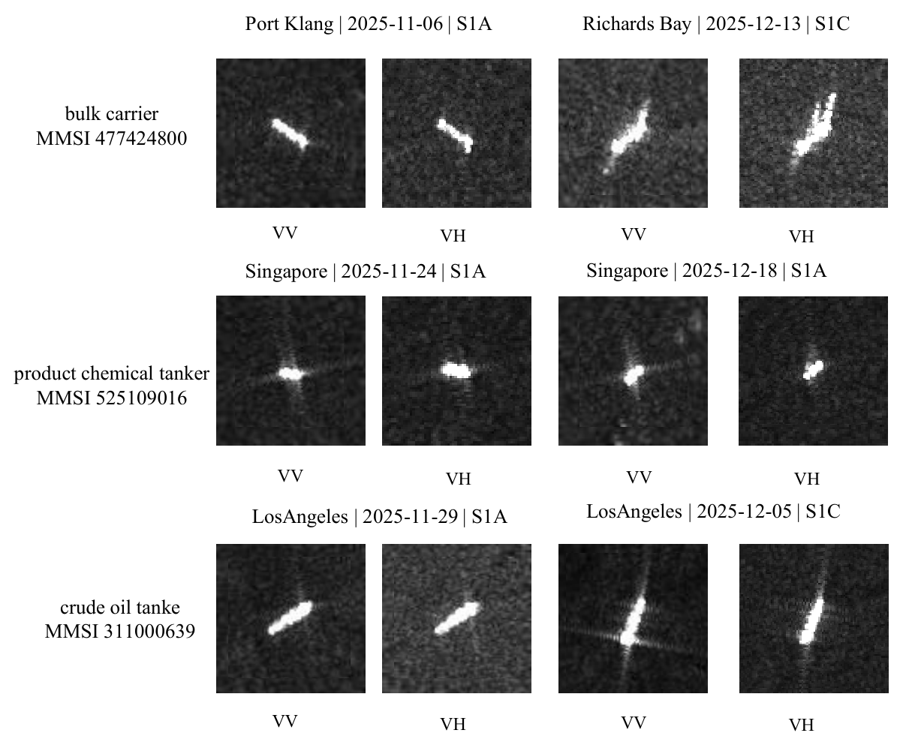
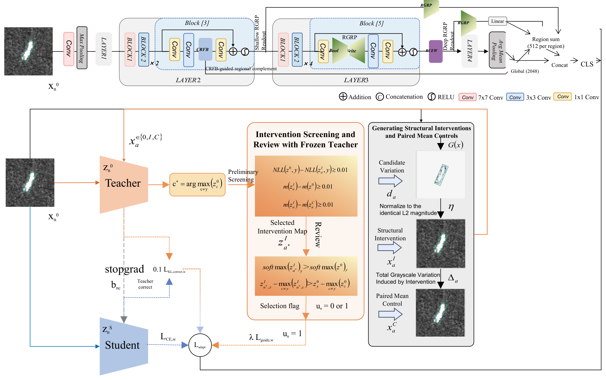
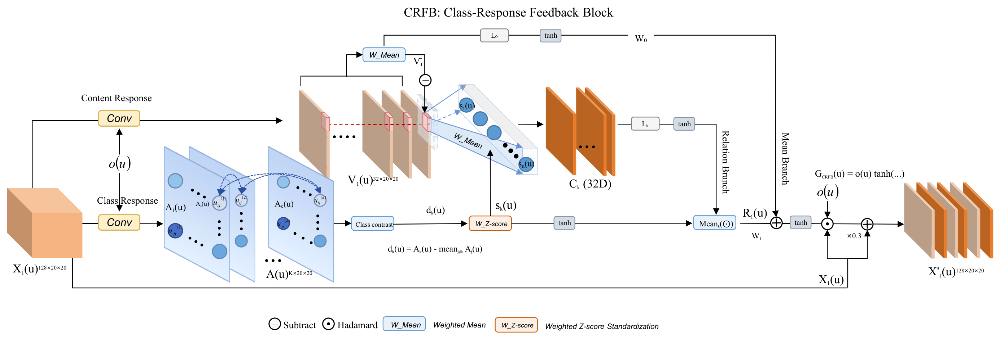
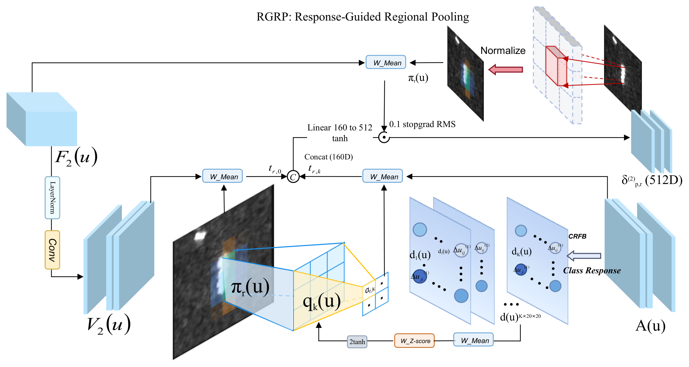
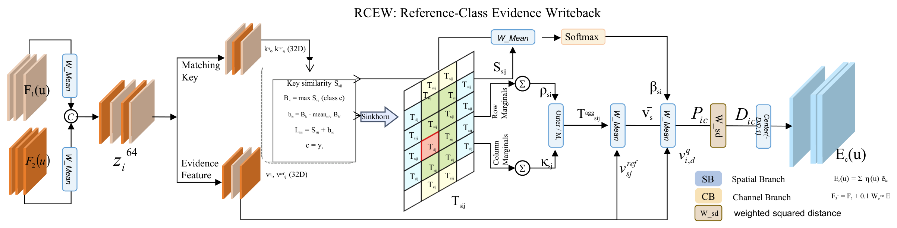
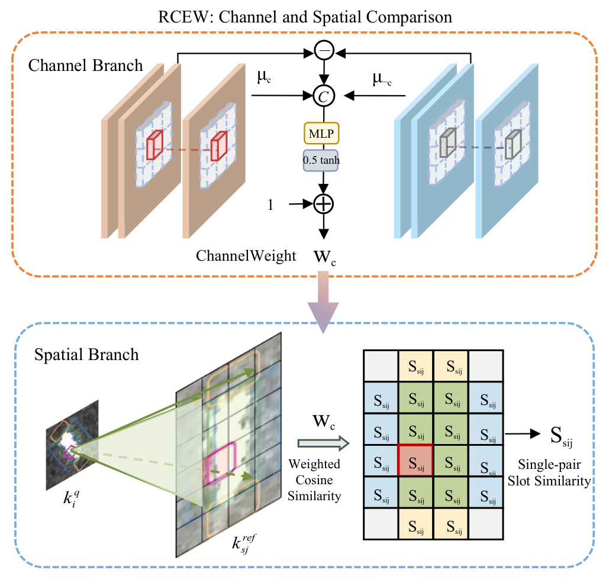

**英文题目：** Intervention-Informed Polarization and Region Evidence Learning for Cross-Scene SAR Ship Classification

# 摘要

跨场景SAR船舶分类面临采集场景变化引起的局部判别证据迁移。在中低分辨率图像中，同一船只的局部响应排列会随观测改变，邻域信息也可能补充或干扰船型判断。本文通过重复船舶观测、区域输入对照和受控图像干预，发现局部尺度响应的判别作用依赖极化、区域及联合读出方式，部分纠错来自削弱竞争类别。基于这些发现，提出共享ResNet-50骨干的极化与区域证据网络：类别响应反馈模块保留均值上下文并利用相对类别响应调节局部特征；响应引导区域池化模块在目标几何区域内组织多层判别证据；参考类别证据回写模块将查询与源参考的比较转化为中间层类别证据场。训练框架同时提供受控干预选样与判别优势保护约束。在OpenSARShip 2.0四分类的378条评价观测上，响应引导读出相对配套均值读出提高OA 0.882、BA 1.548个百分点；当前组合相对移除参考回写后配套训练的模型提高OA 0.353、BA 0.760个百分点，均为三次末阶段训练的平均结果。实验表明，保留极化与区域身份、以类别竞争组织局部响应，可以改善限定跨场景任务中的证据利用。

**关键词：** SAR船舶分类；跨场景泛化；双极化；区域池化；参考证据；受控干预

# 1 引言

SAR船舶分类位于目标检测之后，依据有限的船体外形、局部响应和周围结构区分外观相近的船型。OpenSARShip等资源推动了Sentinel-1船舶解译研究[1]。然而，训练与应用数据来自不同过境或水域时，同类乃至同一艘船的可见证据也会改变。本文研究已定位目标的跨场景闭集分类，以采集过境、地理水域及相关成像条件描述场景，涵盖同港不同采集和不同港口／水域之间的迁移。实验通过产品元数据确定过境组，并同时隔离船舶身份。

图1展示三艘船在不同场景中的方向、强响应排列与VV/VH差异。其中化学品/成品油轮的两次观测来自同港、同平台，表明同港采集之间也存在显著变化。同船诊断进一步显示，原油轮较多出现一次正确、一次错误，普通货船则更多持续混淆。这些差异提示应结合类别与实际局部响应研究失效机制。

{width=95%}

现有双极化方法通过共享特征提取、多尺度融合或极化交互提升船舶表征[2,3,4]。近年的研究进一步利用极化与纹理构造表示[5]、多尺度域对齐[6]以及目标区域引导的多模态融合[7]改善船型分类。本文进一步关注这些表征中的证据如何被利用：同样的局部响应，位于框内与框外、来自VV与VH、支持不同竞争类别时，是否具有相同价值？如果框外响应中包含可用线索，直接剔除会造成信息损失；如果不加区分地汇总，误导性响应又可能与有效证据混合。局部高响应不自动等于正确类别证据，低响应也不自动等于噪声。

为此，我们将自然观测与受控输入干预结合。前者揭示实际分类不稳定，后者固定模型和参考条件，仅改变一个极化、区域和尺度分量，追踪正确类别与竞争类别的分数变化。本文研究的是指定输入操作在分类系统中的判别效应。依据输入敏感性与训练后信息价值的区别[8,9]，进一步通过配套训练和算子替换检验这些线索能否转化为分类收益。

本文的贡献包括三个方面：（1）结合同船观测、区域输入控制与极化—区域—尺度干预，揭示局部响应对类别竞争的条件性作用，为保留差异化证据提供依据；（2）提出类别响应反馈模块（Class-Response Feedback Block，CRFB）、响应引导区域池化模块（Response-Guided Regional Pooling，RGRP）和参考类别证据回写模块（Reference-Class Evidence Writeback，RCEW），分别作用于局部特征形成、区域汇总和跨样本证据引入；（3）通过配套训练、空间对应替换和实际船舶案例，验证类别响应引导取证及参考类别证据回写的作用。

# 2 相关研究

## 2.1 SAR船舶分类与跨场景泛化

OpenSARShip面向Sentinel-1船舶解译建立开放数据资源[1]；FUSAR-Ship基于高分三号SAR与AIS匹配支持检测和识别[10]。不同资源在传感器、分辨率、类别体系和样本组织上存在差异。针对分布差异，已有研究将双分支注意与深度子域适应用于SAR船型分类[11]。本文以局部判别证据的组织补充分布适配研究，并以船舶身份及过境组隔离建立跨场景评价。

MSADAN结合尺度感知特征、多层双线性融合驱动的对抗对齐及类别对比约束，处理多分辨率SAR船型跨域分类[6]。Shi等在有标签光学源域到无标签SAR目标域的迁移中联合域级校准与类级对齐[12]。这些方法分别关注分辨率变化和跨模态适配；本文研究源SAR监督下，局部响应的极化、区域身份及源参考类别关系如何参与跨场景判断。

## 2.2 双极化、类别响应与分层证据

HOG-SiamShipCLSNet采用共享骨干提取VV/VH特征，并在不同深度结合组双线性池化及HOG描述[2]。DPIG-Net使用VV引导VH与极化乘积幅度分支，通过交叉注意及残差融合组织极化信息[3]。CPINet结合多尺度融合、混合阶统计注意与因子化双线性编码[4]。这些研究表明共享或专属处理、跨极化交互和高阶统计均已有方法基础。

DBDN构造极化特征引导和纹理特征引导的两种伪RGB图像，进行双分支提取与融合分类[5]。本文采用逐极化前向与共享卷积，并以极化专属类别响应连接中间特征处理和区域取证。

SCRC-Net的结构约束融合模块从特征预测采样网格的长宽、共同旋转角与局部伸缩，以适应细长船体结构[13]。本文利用检测OBB定义目标相对区域，保持框内、轴端与侧向的证据身份，再由类别响应指导区域内汇总。两者分别从采样几何和证据读出组织结构信息。

PGMNet从SAR图像生成目标掩膜，以掩膜引导视觉特征对齐，并融合船舶尺寸描述的文本表征[7]。本文RGRP保留船体与不同方向外围的区域身份，RCEW引入带类别的源参考，使目标几何与跨样本判别关系分别承担区域定位和类别比较的作用。

类别响应与统计反馈方面，CAM将线性分类权重投射到末层卷积图，生成类别相关空间响应[14]；SENet以全局均值生成通道权重[15]，SRM联合均值和标准差完成重标定[16]，GSoP将通道或位置二阶统计嵌入中间层反馈[17]。本文CRFB保留均值支路，通过相对候选类别响应与局部值的交叉统计产生位置相关反馈，并将响应继续传递给RGRP，用于区域内部取证。

区域上下文方面，A2-Nets将注意汇总的全局描述按位置重新分配[18]；GCNet通过瓶颈变换将全局上下文反馈至特征图[19]；R-FCN以位置敏感得分图与RoI网格编码类别及相对位置[20]。RGRP以OBB框内、轴端和侧向限定证据来源，分别进行区域回写与多层读出，并复用CRFB响应指导浅层取证。

SAA从原图及随机裁剪中选择查询—支持最匹配的特征，联合估计空间和通道注意后进行原型分类[21]。本文在目标几何区域内复用候选类别响应，检验类别相关评分相对一般内容注意的取证效用。

## 2.3 局部参考比较与类别证据

Prototypical Networks依据查询到类内支持均值原型的距离分类[22]；DN4将同类参考组成局部描述池，累加查询的近邻相似度[23]；CAN通过类参考与查询的相关性生成交叉注意，比较加权表示[24]。这些工作分别提供全局原型、局部到类度量与查询相关取证的依据。

DeepEMD通过交叉参考机制为密集表示中的结构元素赋权，并以局部匹配完成少样本分类[25]；FRN使用类内参考局部特征重构查询图，以岭回归重构误差形成类别分数[26]。两者为局部参考利用提供了不同途径。本文借鉴关系算子，在已知类别和固定源参考库的闭集任务中研究中间层证据回写。

BiEnFRN联合支持—查询双向重构、自重构与快照集成，提高细粒度少样本分类的区分能力[27]。与SAA的联合注意[21]和重构式分类相比，本文RCEW将查询相对于各参考类别的距离转化为类别证据场，回写至中间特征，由后续骨干继续处理。

RCEW保留参考权重、区域身份和类别组织，以传输边际聚合参考值，再形成查询相关的类间证据。回写消息显式包含类别比较结果，使后续网络直接处理参考提供的判别信息。其与普通参考特征回写、精细局部对应的差异通过内部替换实验检验。

## 2.4 受控扰动与解释约束

Li等在SAR自动目标识别中量化目标、阴影与杂波的贡献及交互，并通过背景重标度研究非目标区域依赖[28]。Meaningful Perturbation通过显式输入操作研究固定模型的重要区域[8]；ROAR在训练和测试数据中一致移除信息后重新训练，强调区分模型敏感性与信息价值[9]。Fourier Perspective通过范数受控的频率扰动分析鲁棒性，说明高频或低频的作用不能一概而论[29]。Right for the Right Reasons则将解释约束纳入可微训练[30]。

本文将受控输入分析细化为极化、目标相对区域和空间尺度，并同时记录正确类与竞争类变化。源端干预响应用于筛选判别优势保护对象，使训练约束与样本实际响应相联系。

在训练端，RSC依据真实类梯度抑制主导隐藏特征，鼓励网络利用其他证据[31]；输入梯度正则直接约束分类损失对输入的局部敏感性[32]。本文比较有限幅度的区域尺度操作与匹配均值控制，对通过判别改善筛选的源样本施加教师分差下界保护。

PASTA依据合成与真实图像的幅度谱差异，对较高空间频率施加相对更强的乘性扰动，以扩大训练分布覆盖[33]。FGFL根据少样本任务产生DCT频率掩膜，转换回图像后结合三元组与对比目标学习表示[34]。本文的尺度操作同样发生于图像，但以极化、区域和类别竞争的操作效应确定保护对象；预测路径仅使用空间特征。

Contrastive-ACE利用特征对标签的平均干预效应稳定性组织跨域学习[35]。本文从可追溯的输入操作出发，以正确类—竞争类分差刻画响应变化，并将其用于样本级判别保护。

# 3 问题发现与受控干预证据

## 3.1 从自然不稳定到可检验问题

同船诊断使用自建24港语料中的4744次观测、2973个船舶身份、18港及八个输出类别。对每艘具有重复观测的船选择日期跨度最大的一对，得到910艘船的1820次观测，覆盖七类。表1给出三种代表性船型的三种子平均状态比例。

**表1 同船重复观测的分类状态，三种子平均。**

| 船型 | 船对数 | 两次均正确（%） | 一次正确一次错误（%） | 两次均错误（%） |
|---|---:|---:|---:|---:|
| 集装箱船 | 126 | 35.98 | 34.92 | 29.10 |
| 原油轮 | 100 | 27.67 | 54.67 | 17.67 |
| 普通货船 | 62 | 4.84 | 27.42 | 67.74 |

原油轮较多表现为观测相关的不稳定，普通货船则更多持续混淆。跨港与同港的粗比较还受到类别组成影响：未经类别等权，跨港“两次均错误”比例为38.80%，低于同港43.92%；按七类等权后分别为50.94%和46.06%，方向反转。因此，任务需同时关注观测条件与类别组成，不能把跨港分组差异直接解释成港口的独立效应。

在相同源划分和配套训练的Ridge读出下，整图输入与卷积前框内掩膜输入的OA/BA分别为35.139%/38.795%和32.610%/37.231%；原油轮召回分别为53.580%和42.222%。整图输入在4744条观测中纠正690条、误判新增570条，净增加120条正确判断。这表明外围可见响应包含可利用的补充信息，也具有误导风险，需要区分其对具体类别竞争的作用。

## 3.2 干预定义与类别竞争

记双极化输入为 $x=(x^{VV},x^{VH})$，固定诊断器为 $T$，真实类别为 $y$。以原图最强错误类作为固定竞争类别 $c^\star=\arg\max_{c\ne y}T_c(x)$，定义分差及操作效应：

$$\begin{aligned}
m_{y,c^\star}(x)&=T_y(x)-T_{c^\star}(x),\\
\Delta m_a&=m_{y,c^\star}(x_a^I)-m_{y,c^\star}(x).
\end{aligned}\tag{1}$$

其中 $a=(p,r,b)$ 指定极化 $p$、区域 $r$ 和尺度 $b$。图像尺度分量取

$$D_f(I)=I-G_1(I),\qquad D_m(I)=G_1(I)-G_2(I).\tag{2}$$

$G_\sigma$ 为标准差为 $\sigma$ 个原生像素的高斯平滑。限定区域内通过平滑边缘掩膜削弱分量，保持另一极化、检测框、参考库和模型参数不变。结构操作使用共同 $L_2$ 剂量，并设置具有相同区域净灰度变化的均值控制，以区分局部结构变化和平均亮度变化的作用。

式（1）可分解为 $\Delta T_y-\Delta T_{c^\star}$。因此，正确类分数下降并不必然意味着决策退化：如果错误竞争类下降更多，分差仍可改善。为排除竞争类切换造成的虚假改善，选样时进一步检查各自最强错误类定义的分差 $m_{\max}(x)=T_y(x)-\max_{c\ne y}T_c(x)$。

## 3.3 极化与区域决定操作效应

在自建24港语料的104艘船、209次观测、31个过境和6港干预队列中，VH框内细尺度削弱平均损害正确类别优势，VH侧向中尺度削弱平均改善优势，同一侧向中尺度操作在VV中则为负。表2以诊断器分差报告效应及船级95%区间。

**表2 极化与区域干预的船均分差变化。**

| 操作 | 平均 $\Delta m$ | 船级95%区间 | 相对同均值控制的剩余效应 |
|---|---:|---|---:|
| VH框内细尺度削弱 | −0.003910 | [−0.005232, −0.002528] | −0.002997 |
| VH侧向中尺度削弱 | +0.002023 | [+0.000882, +0.003169] | +0.001417 |
| VV侧向中尺度削弱 | −0.001454 | [−0.002477, −0.000476] | −0.001147 |

类别进一步调节操作效应：VH侧向中尺度削弱在9艘集装箱船上的平均分差变化为+0.008422，在7艘散货船上为−0.008180。相反的作用方向支持保留极化和区域身份，并依据类别响应学习取证方式。

## 3.4 判别作用依赖联合读出

OpenSARShip 1.0的175艘集装箱船、203次观测提供了联合读出对照。同一VH框内细尺度削弱，在VV/VH联合读出中的平均分差变化为+0.001596，在单VH读出中为−0.000700；两者差为+0.002296，船级95%区间为[+0.002039,+0.002583]，覆盖的20个过境均同向。

在全部1165条扩围观测上统一执行该VH操作，产生3次纠错和8次误伤，OA下降0.429个百分点。因而，联合读出效应提示的是条件化利用局部响应，而非固定预处理。

图2的散货船10488展示了类别竞争的变化。仅削弱VH框内细尺度后，散货分数增加0.11492，错误原油轮分数下降0.16278，分差提高0.27769；均值控制仍误判。对照案例化学品船26628则同时降低正确类并抬高海工竞争类，产生误伤。局部证据的效用因此需落实到正确类与竞争类的相对变化。

{width=95%}

## 3.5 判别机制与设计依据

固定模型上的输入操作建立了“局部响应变化—类别竞争变化”的可追溯联系。该机制描述分类系统对指定操作的依赖；自然观测中的方向、海况和目标状态则共同影响输入。本文据此形成三项设计要求：保留均值信息与相对类别响应，区分极化和几何区域的证据来源，将源参考转换为可被后续网络处理的类间判别信息。三者分别落实为CRFB、RGRP和RCEW，并由配套训练及替换实验检验。

# 4 方法

## 4.1 任务与整体结构

给定固定检测流程定位的目标chip、OBB与极化可用性标记，模型预测 $K$ 个已知船型之一。网络在源场景的标注样本上学习，在船舶身份和采集过境均隔离的目标场景中评价。公开集分类实验取 $K=4$，自建数据诊断采用八类标签。源参考库为 $\mathcal R=\{(x_j,y_j)\}_{j=1}^{B}$，取 $B=32$，每类8个参考。查询标签不参与预测；参考选择排除与查询同船或同过境的观测，并按极化可用性屏蔽无效关系。

输入按目标中心在原生像素网格裁剪或补零至 $160\times160$，保留已有chip的像素尺度，有效范围掩膜排除补零。VV与VH分别前向并共享ResNet-50[36]卷积权重；CRFB、RGRP及RCEW的投影与回写使用极化专属参数，生成通道度量的小网络共享。各极化依据检测框有效性确定是否进入分类：某一极化未通过目标定位或置信度要求时，仅屏蔽该分支，仍使用另一有效极化。这对应检测后分类中部分极化定位失败的情况，原始影像本身可同时具备VV和VH。

{width=100%}

CRFB位于layer2末块的conv2激活之后；RGRP在layer3末块的conv1激活后执行区域池化回写，并从layer2输出和RCEW更新后的layer3输出读取区域摘要；RCEW位于layer3与layer4之间。各极化分别执行上述处理，全局描述来自layer4。区域池化保持特征图空间尺寸，与骨干下采样各司其职。

## 4.2 类别响应反馈模块（CRFB）

设某一极化的输入为 $X_1(u)\in\mathbb R^{128}$，$u$表示空间位置，有效面积占比为 $o(u)$，归一化权重为 $\omega(u)=o(u)/\sum_v o(v)$。屏蔽无效位置后，以两个 $1\times1$ 卷积得到32维值特征 $V_1(u)$ 和 $K$ 维候选类别响应 $A(u)$。记 $\bar V_1=\sum_u\omega(u)V_1(u)$，相对类别响应及其标准化量为

$$\begin{aligned}
d_k(u)&=A_k(u)-\frac{1}{K-1}\sum_{j\ne k}A_j(u),\\
\bar d_k&=\sum_u\omega(u)d_k(u),\\
s_k(u)&=\frac{d_k(u)-\bar d_k}
{\sqrt{\sum_v\omega(v)(d_k(v)-\bar d_k)^2+0.01}}.
\end{aligned}\tag{3}$$

以相对响应和局部值的共同变化形成类别相关摘要：

$$\begin{aligned}
C_k&=\sum_u\omega(u)\,[V_1(u)-\bar V_1]s_k(u),\\
R_1(u)&=\frac1K\sum_k\tanh(s_k(u))\tanh(L_k(C_k)).
\end{aligned}\tag{4}$$

$C_k$描述低维内容与标准化类别响应之间的交叉统计，$L_k$为含偏置的仿射映射。令均值变换 $U_0=W_0\tanh(L_0(\bar V_1))$，与关系支路共同生成有界门控并反馈至原特征：

$$\begin{gathered}
G_{\mathrm{CRFB}}(u)=o(u)\tanh\{U_0+W_1R_1(u)\},\\
X'_1(u)=X_1(u)+0.3X_1(u)\odot G_{\mathrm{CRFB}}(u).
\end{gathered}\tag{5}$$

输出映射零初始化，使训练从原特征路径开始。类别辅助读出利用源标签约束候选响应。$X'_1$经过该block的conv3、归一化与残差相加形成layer2输出 $F_2$；类别响应保留给后续区域读出使用。

{width=100%}

均值支路保留整体上下文，式（4）进一步表示响应偏离与局部内容的共同变化，使门控随类别证据的空间分布而变化。

## 4.3 响应引导区域池化（RGRP）

### 4.3.1 区域身份与内部回写

以OBB长轴建立目标相对坐标，构造框内、轴端与侧向三个区域。框内为长宽 $L,W$ 的软矩形；轴端为长轴扩展至 $1.5L$ 的矩形减去框内；侧向为宽度扩展至 $2W$ 的矩形减去框内。区域与有效输入范围相交，以特征网格实际面积占比表示 $m_r(u)$。两轴端对称处理，无需船首、船尾标注。

对于特征 $F$，区域均值为

$$\pi_r(u)=\frac{m_r(u)}{\sum_v m_r(v)},\qquad \operatorname{Pool}_r(F)=\sum_u\pi_r(u)F(u).\tag{6}$$

令 $t_r=\operatorname{Pool}_r(X_3)$。空区域返回零并屏蔽更新。layer3[5]中的内部RGRP以区域专属两层映射 $\phi_r$ 变换摘要，只回写至相应区域：

$$\begin{gathered}
X'_3(u)=X_3(u)+\sum_r\widetilde m_r(u)\phi_r(t_r),\\
\widetilde m_r(u)=m_r(u)/\max\{1,\sum_jm_j(u)\}.
\end{gathered}\tag{7}$$

其中 $X_3$ 为conv1激活后的256通道特征。区域上下文回写保持空间尺寸，使随后 $3\times3$ 卷积同时读取局部内容与相应区域的摘要。另两处区域读出仅汇总特征，用于最终分类。

### 4.3.2 由CRFB响应指导浅层取证

CRFB读取layer2[3]中的128通道特征，其响应与该block末端512通道特征 $F_2$ 位于同一 $20\times20$ 网格。在有效范围内标准化相对类别响应，得到有界评分 $q_k(u)=2\tanh(s_k(u))$。在每个区域内分别归一化：

$$\begin{aligned}
\alpha_{r,k}(u)&=\frac{m_r(u)\exp q_k(u)}{\sum_v m_r(v)\exp q_k(v)},\\
t_{r,k}&=\sum_u\alpha_{r,k}(u)V_2(u).
\end{aligned}\tag{8}$$

其中 $V_2=W_V^{(2)}\operatorname{LN}(F_2)$ 为512维到32维的值投影。同时保留均匀摘要 $t_{r,0}=\sum_u\pi_r(u)V_2(u)$；四类时五个摘要拼接为160维。记 $t_r^{\mathrm{cat}}=[t_{r,0};\ldots;t_{r,K}]$，$\sigma_{p,r}=\operatorname{stopgrad}\{\operatorname{RMS}(\operatorname{Pool}_r(F_{2,p}))\}$，补充量为

$$\delta^{(2)}_{p,r}=0.1\sigma_{p,r}\tanh(W_p^{\mathrm{read}}t_r^{\mathrm{cat}}).\tag{9}$$

$W_p^{\mathrm{read}}$将160维映射回512维，零初始化，同一极化的三区域共享该映射。所有候选类别同时参与，既不输入查询真值，也不按当前预测的单一类别硬路由。输出仍位于原有区域槽位，保留均值信息，并用有界残差限制新增路径的幅度。式（8）回答“在这一几何区域内哪些位置更有助于类别区分”，式（6）回答“该区域总体包含什么”。

{width=100%}

区域权重依据特征中心的覆盖面积计算；由于卷积感受野交叠，区域描述保留的是计算位置与目标几何的关系。

## 4.4 参考类别证据回写（RCEW）

### 4.4.1 比较描述与值描述分离

RCEW使用源参考库补充单图判别。首先对固定锚点路径中的layer1和layer2特征分别读出区域局部描述，通道数为256和512。每极化各自投影至32维并拼接，再分别生成32维比较键 $k$ 与值 $v$。键经归一化用于比较，值用于构造判别消息。局部槽位保留框内8、侧向8、轴端4的组织，空槽和不可用极化不参与参考比较。

参考比较使用固定锚点路径的layer1和layer2表示，以在读出优化期间保持查询—参考表征一致。

对某区域的合法源参考，按参考标签形成类均值 $\mu_c$ 和其他类均值 $\mu_{\neg c}$，记 $a_c=[\mu_c;\mu_{\neg c};\mu_c-\mu_{\neg c}]$，由共享小网络生成有界正通道度量：

$$\begin{gathered}
w_c=1+0.5\tanh\psi(a_c),\\
S_{sij}=\cos(\sqrt{w_{y_s}}\odot k_i^q,\sqrt{w_{y_s}}\odot k_{sj}^{\mathrm{ref}}).
\end{gathered}\tag{10}$$

这里 $i,j$ 分别是查询与参考的局部槽位，$s$是参考船，$y_s$是已知源标签；为简洁省略极化和区域索引。通道分支以32维类均值、其他类均值及其差拼接为96维，经96→16→32的小网络生成 $w_c\in(0.5,1.5)^{32}$。它既用于键的加权余弦比较，也用于后续值距离，并非独立的分类头。

空间分支先计算查询槽位对类别 $c$ 的最佳相似度 $B_{ic}=\max_{s:y_s=c,j}S_{sij}$，只在合法参考和非空槽位上取最大值。再以 $b_{ic}=B_{ic}-\operatorname{mean}_{c'\ne c}B_{ic'}$ 表示相对其他可用类的优势，形成比较logit $L_{sij}=S_{sij}+b_{i,y_s}$。只有一个可用类别时令 $b_{ic}=0$。带未匹配槽的Sinkhorn归一化产生有效传输 $T_s$，非法位置在归一化前屏蔽。通道与空间分支因此是耦合的比较步骤，而不是两个结果直接相加的独立分支。

{width=100%}

### 4.4.2 类别条件的参考聚合

记 $T_s$ 的有效行、列边际为 $\rho_{si}=\sum_jT_{sij}$、$\kappa_{sj}=\sum_iT_{sij}$，有效总质量为 $M_s=\sum_i\rho_{si}$。选用的聚合版在值传递阶段使用

$$T^{\mathrm{agg}}_{sij}=\frac{\rho_{si}\kappa_{sj}}{M_s},\qquad \bar v_s=\frac{\sum_j\kappa_{sj}v^{\mathrm{ref}}_{sj}}{M_s}.\tag{11}$$

上述等式适用于分母非零的位置，其余位置屏蔽。$\bar v_s$实际是按列边际汇总的区域参考值，不再保留查询槽位到参考槽位的一一精细搬运。参考权重仍依赖原传输与相似度：先计算 $g_{si}=\sum_jT_{sij}S_{sij}/\rho_{si}$，再在合法参考间令 $\beta_{si}=\operatorname{softmax}_s(g_{si}/0.1)$。类参考表示为

$$P_{ic}=\frac{\sum_{s:y_s=c}\beta_{si}\bar v_s}
{\sum_{s:y_s=c}\beta_{si}}. \tag{12}$$

边际聚合保留查询相关的参考选择及类内组织，将局部值对应压缩为区域参考摘要。

### 4.4.3 类别证据场及空间回写

查询值与各类参考表示的距离形成候选类别证据，取 $e_{ic}=-D_{ic}/0.1$，并在可用类别中中心化：

$$\begin{gathered}
D_{ic}=\sum_d w_{c,d}(v^q_{i,d}-P_{ic,d})^2,\\
\widetilde e_{ic}=e_{ic}-\frac{1}{|\mathcal C_i|}\sum_{c'\in\mathcal C_i}e_{ic'}.
\end{gathered}\tag{13}$$

屏蔽不可用类别后，以局部槽位的空间占比 $\eta_i(u)$将证据落回layer3网格：

$$\begin{gathered}
E_c(u)=\sum_i\eta_i(u)\widetilde e_{ic},\\
F_3^{+}(u)=F_3(u)+0.1W_p^{\mathrm{out}}E(u).
\end{gathered}\tag{14}$$

$W_p^{\mathrm{out}}$为 $K$ 个类别证据通道到1024个骨干通道的 $1\times1$ 卷积。layer4继续加工 $F_3^{+}$，深层RGRP从该特征读取区域摘要。RCEW将参考提供的类间关系引入特征流，补充CRFB的单图调节和RGRP的区域汇总。

{width=80%}

最后的区域读出优化固定参考路径，式（14）实现为 $F_3^{+}=F_3^{\mathrm{live}}+\Delta F_3^{\mathrm{anchor}}$，其中锚点残差由已训练的RCEW产生。

## 4.5 多层融合与最终分类

对极化 $p$ 和区域 $r$，令 $t^{(2)}_{p,r}=\operatorname{Pool}_r(F_{2,p})$、$t^{(3)}_{p,r}=\operatorname{Pool}_r(F_{3,p}^{+})$，最终区域描述为

$$R_{p,r}=t^{(2)}_{p,r}+D_pt^{(3)}_{p,r}+\delta^{(2)}_{p,r}.\tag{15}$$

深层线性投影 $D_p$ 将1024维映射为512维，使相同区域的浅层、深层和引导补充项可以相加；不同区域之间保持拼接。layer4得到有效范围全局平均描述 $g_p\in\mathbb R^{2048}$，每极化表示为 $h_p=[g_p;R_{p,\mathrm{body}};R_{p,\mathrm{end}};R_{p,\mathrm{side}}]\in\mathbb R^{3584}$。将可用极化描述及标记拼接为 $h=[a_{VV}h_{VV};a_{VH}h_{VH};a_{VV};a_{VH}]$，得到分类分数：

$$z=W_{\mathrm{head}}h+b_{\mathrm{head}}.\tag{16}$$

$a_p\in\{0,1\}$ 为极化可用性，分类输入共7170维。最终softmax输出 $K$ 类概率。

## 4.6 分阶段优化及干预指导约束

网络采用分阶段优化。首先固定骨干与CRFB/RGRP，通过分类交叉熵训练参考模块及分类头；随后更新CRFB、相邻conv3与分类头，并以0.02权重加入类别响应辅助交叉熵；最后固定上游，训练响应引导区域补充及分类头。所有阶段仅使用源标签。

源样本权重按类别内独立船数和同船观测次数修正，并对固定上游分差小于1的源难例乘2。最后阶段在同一源样本流上训练180步，batch为24；输出映射、值投影、分类头的学习率分别为 $10^{-3},3\times10^{-4},10^{-5}$，AdamW权重衰减0.01，梯度裁剪阈值5。BN统计不更新。三次重复改变新增读出的初始化与样本顺序，保留同一上游。

训练框架还包含干预指导约束。对源样本，以式（1）固定竞争类，要求结构操作同时降低交叉熵、提高竞争类分差，并优于匹配均值控制，三个初筛阈值均为0.01。随后复核正确类概率与 $m_{\max}$ 均提高，将通过样本标记为 $u_n=1$。筛选直接使用干预图的教师预测。

所有原图均接受交叉熵监督；教师原本正确的样本额外接受分布保持约束；$u_n=1$的样本进一步接受原图教师判别优势下界保护。以 $n$ 表示训练样本，$z_n^0=T(x_n^0)$、$z_n^S$分别为原图教师与学生分数，$b_{nc}=\operatorname{stopgrad}(z^0_{n,y_n}-z^0_{nc})$，则

$$\begin{aligned}
\ell_{\mathrm{guide},n}
&=\frac{1}{K-1}\sum_{c\ne y_n}[b_{nc}-(z^S_{n,y_n}-z^S_{nc})]_+^2,\\
\mathcal L_{\mathrm{guide},w}
&=\frac{\sum_n w_nu_n\ell_{\mathrm{guide},n}}{\sum_n w_n}.
\end{aligned}\tag{17}$$

$$\mathcal L_{\mathrm{adapt}}=\mathcal L_{\mathrm{CE},w}+0.1\mathcal L_{\mathrm{KL,correct},w}+\lambda\mathcal L_{\mathrm{guide},w}.\tag{18}$$

教师量均停止梯度。该约束保护原图教师分差，预测时输入原始SAR图像，不执行依赖真实类别的干预筛选。第6节报告模块组合的分阶段训练结果；干预选样作为训练框架保留，未计为该组合的额外准确率增益。

# 5 实验设置

## 5.1 数据集介绍

本文使用OpenSARShip 1.0（OSS1）、OpenSARShip 2.0（OSS2）和自建24港数据集。表3汇总实际整理的数据规模；公开数据数量按本研究解析清单统计。每条观测对应一个船舶目标，VV/VH为其两种极化视图。

**表3 数据集组成。**

| 数据集 | 观测规模 | 类别与采集 |
|---|---|---|
| OSS1 | 3,030条GRDH记录；兼容子集1,349条、1,110艘船 | 兼容子集8类、22个GRDH产品 |
| OSS2 | 9,120条记录：6,780条GRDH、2,340条SLC | 本文分类取4类GRDH；源719、开发228、评价378条 |
| 自建24港 | 38,091条观测；18,766个非空MMSI | 8类、24港、841个IW-GRDH产品 |

**公开数据集。** OSS1与OSS2沿用原生船舶裁片及元数据。细粒度标签仅保留与任务类别一致的记录，笼统Cargo和Tanker标签不直接映射为普通货船或原油轮。OSS1八类兼容子集以散货船为主（816／1,349），用于输入干预及联合读出分析。OSS2分类实验采用散货船、普通货船、化学品／成品油轮和集装箱船四类GRDH图像，以保证各类参考与输入覆盖。

公开集各极化分别执行固定OBB定位，检测置信度达到0.25且几何有效时进入对应分支。在OSS2源、开发和评价集合中，分别有48、22和30条观测仅一个极化满足条件；这些观测的另一极化原始文件仍存在。模型通过式（16）的可用性标记处理该情况，符合检测后分类中某一极化定位不成功、另一极化仍可用于识别的输入条件。

**自建24港数据集。** 数据来源为Sentinel-1A和Sentinel-1C的IW-GRDH双极化产品，依据AIS关联的船舶身份与类型组织八类目标，保存VV/VH图像、源产品号、港口、裁片位置及目标几何信息。采集时间为2025年1月1日至2026年2月24日；38,091条观测中，32,184条来自Sentinel-1A，5,907条来自Sentinel-1C。841个产品按平台与绝对轨道合并为720个过境组，避免将同次过境的不同产品切片视为独立观测条件。本文使用地理处理后的8位动态裁片，不将其视为原始复数SAR。模型输入遵循第4.1节的原生像素裁剪／补零规则；可恢复的10 m像素间距不等同于传感器空间分辨率。

表4列出24港的观测规模与诊断覆盖。各港含64至5,756条观测，实际覆盖3至8类；类别分布差异较大，因此同时采用OA、BA及逐类分析。198条记录缺失MMSI，同船分析仅使用可核查的非空身份。

**表4 自建24港逐港组成及诊断覆盖。**

| 港口 | 总库观测 | 实际类别数 | 诊断观测 |
|---|---:|---:|---:|
| Antwerp-Bruges | 886 | 3 | 0 |
| Busan | 871 | 3 | 48 |
| Callao | 476 | 8 | 14 |
| Fujairah | 1,158 | 3 | 178 |
| Hamburg | 1,619 | 3 | 0 |
| Houston | 804 | 8 | 9 |
| Jebel Ali | 4,602 | 8 | 1,046 |
| Los Angeles | 583 | 8 | 158 |
| Melbourne | 64 | 3 | 0 |
| Mombasa | 149 | 7 | 12 |
| New York | 470 | 8 | 0 |
| Newcastle | 299 | 7 | 25 |
| Ningbo-Zhoushan | 5,756 | 3 | 292 |
| Port Hedland | 859 | 6 | 53 |
| Port Klang | 3,425 | 8 | 1,238 |
| Port Said | 1,895 | 8 | 150 |
| Qingdao | 1,981 | 3 | 0 |
| Richards Bay | 744 | 8 | 241 |
| Rotterdam | 573 | 3 | 36 |
| Santos | 1,658 | 8 | 325 |
| Shanghai | 2,390 | 3 | 0 |
| Singapore | 5,259 | 8 | 821 |
| Sydney Botany | 304 | 8 | 10 |
| Tanger Med | 1,266 | 8 | 88 |
| 合计 | 38,091 | 合计8类 | 4,744 |

表5给出八类组成。诊断队列包含4,744条观测、2,973艘船和18港；同船最大日期跨度配对子集包含910艘船、1,820条观测，覆盖13港和7类。受控干预队列按第3.3节的条件另行组织。

**表5 自建数据集类别分布。**

| 船型 | 总库观测 | 诊断观测 |
|---|---:|---:|
| 散货船 | 11,128 | 1,290 |
| 渔船 | 8,599 | 145 |
| 普通货船 | 5,929 | 439 |
| 化学品／成品油轮 | 5,827 | 1,480 |
| 集装箱船 | 2,208 | 519 |
| 原油轮 | 1,757 | 405 |
| 拖轮／拖带船 | 1,478 | 202 |
| 海工补给船 | 1,165 | 264 |
| 合计 | 38,091 | 4,744 |

## 5.2 跨场景划分与参考设置

OSS2根据产品元数据恢复平台与绝对轨道，合并同次过境的相邻产品切片，再划分源训练、开发与评价集合（表6）。同时隔离船舶身份，以检验不同采集场景中的未见船舶分类。

**表6 OSS2四分类划分。括号内为独立船数。**

| 集合 | 散货船 | 普通货船 | 化学品/成品油轮 | 集装箱船 | 总观测/船数/过境 |
|---|---:|---:|---:|---:|---|
| 源训练 | 221（216） | 73（71） | 141（137） | 284（259） | 719 / 683 / 13 |
| 开发 | 87（84） | 23（22） | 29（29） | 89（88） | 228 / 223 / 4 |
| 扩围评价 | 132（128） | 26（26） | 83（81） | 137（134） | 378 / 369 / 5 |

三组在观测ID、船舶身份和过境组上隔离。32个源参考每类8个，训练参考模块时按类别和独立船抽取并排除无效连接。两目标队列均有前期研发暴露，本文结果属于既有数据上的受控跨场景验证。

## 5.3 评价与对照原则

OA为总体正确率，BA为纳入类别的召回率平均；四分类评价覆盖全部四类。同时报告NLL、纠错与误伤事件及极化／区域贡献。重复训练给出均值与样本标准差，同一观测在不同种子中的翻转分别计为事件，独立船舶数量另行统计。

配套训练对照固定数据、训练步数和可更新部位，用于比较算子效用；同权重替换仅改变读出或回写关系，用于定位当前预测所依赖的证据。参考模块独立训练与完整组合末阶段训练分别报告，三次末阶段重复共享固定上游。

# 6 结果与分析

## 6.1 响应引导区域池化

保持上游、参考库和样本流一致，比较区域均值补充、从局部内容新学习注意的补充、以及复用CRFB类别响应的补充。均值对照重复四份均值摘要以匹配接口，内容注意另有4096个评分参数；其有效表达能力和初始化来源仍有差别，比较首先检验已有类别响应是否值得复用。

**表7 OSS2评价集上的区域读出比较，三次末阶段训练。**

| 读出方式 | OA（%） | BA（%） | NLL |
|---|---:|---:|---:|
| 增加补充读出前的固定上游 | 62.434 | 59.718 | 1.14782 |
| 区域均值补充 | 61.464 ± 0.305 | 58.233 ± 0.710 | 1.14277 |
| 普通内容注意补充 | 61.464 ± 0.666 | 58.050 ± 0.674 | 1.14460 |
| CRFB响应引导RGRP补充 | **62.346 ± 0.153** | **59.781 ± 0.220** | **1.14005** |

响应引导相对均值补充的OA/BA分别提高0.882/1.548个百分点，三个种子均为正；相对内容注意提高0.882/1.731个百分点。相对固定上游则为−0.088/+0.063个百分点，表明类别响应在新增区域读出中更有效地保留了原有判别能力。开发集三个方案的平均OA/BA均为62.281%/55.731%。

## 6.2 正确空间对应是否参与判断

在响应引导模型权重固定时，将区域内部权重改成均匀值，或反向置换非空位置的权重。均匀替换保持归一化总量但改变权重分布；位置置换同时保持总量与直方图，仅改变权重与局部特征的对应。

**表8 同权重取证方式替换，OSS2扩围评价378条。**

| 取证方式 | OA（%） | BA（%） |
|---|---:|---:|
| 正确响应位置 | 62.346 | 59.781 |
| 区域内均匀权重 | 61.464 | 57.753 |
| 区域内位置置换 | 60.758 | 57.297 |
| 关闭新增读出 | 62.169 | 58.796 |

正确响应相对位置置换平均提高OA 1.587、BA 2.484个百分点，表明该评价队列中的正确权重—特征对应实际参与分类。响应引导相对配套均值模型共有10次纠错、0次误伤，涉及7条观测、7艘船和3个过境；其中9次在增加读出前已正确，所以主要作用是减少不合适读出适配造成的损失。

图8中普通货船000133的真实类分差，在均值读出下为−0.06155，响应引导下为+0.22820；同权重均匀替换和位置置换后分别为−0.06187与−0.13565。该样本关闭新增读出时仍正确，说明优势来自更合适的区域取证。线性分解中，VV框内、轴端与侧向对普通货船相对油轮的优势贡献分别约+0.0860、+0.0449和+0.1778，VH三项为负，体现了极化及区域作用的差异。

{width=95%}

相对同模型关闭新增读出，也存在负向贡献：样本002394的真实类分差由+0.14140降至−0.54723。区域权重与特征的正确对应有助于取证，但其贡献仍受样本类别关系影响。

## 6.3 参考证据的消息形式

在固定前端的独立RCEW实验中，三组配对训练使用相同源数据、查询／参考episode和120步预算，仅更新相应参考模块及分类头。表9采用固定末轮，避免按某一评价结果选择不同训练长度。

**表9 RCEW独立训练的开发集比较，三种子平均。**

| 方案 | OA（%） | BA（%） |
|---|---:|---:|
| 无RCEW，更新分类头 | 58.626 ± 0.253 | 50.017 ± 0.162 |
| 普通参考特征回写 | 58.772 ± 0.439 | 50.119 ± 0.281 |
| 类别证据回写，精细对应 | 60.234 ± 1.410 | 51.830 ± 0.852 |
| 类别证据回写，保留边际聚合 | **61.257 ± 2.251** | **53.511 ± 2.442** |

聚合证据回写相对无RCEW提高OA/BA 2.632/3.495个百分点，相对普通参考特征回写提高2.485/3.392个百分点。普通参考特征回写仍保留类别、区域和极化组织，因此这一比较不只是“有类别信息”对“完全无组织信息”。图9的集装箱船000867在三个种子中均被类别证据回写判对，而普通参考回写、无RCEW和其自身关闭回写均错。seed17的真实类分差由无RCEW的−0.334、参考特征回写的−0.286变为+0.275，构成直接路径案例。

{width=95%}

对精细对应模型保持权重并改用边际聚合，三个种子、228条查询的预测均不变；配套训练的聚合版平均表现更好。保留类别关系与参考选择后，区域聚合已能提供有效的回写消息。

在同一RCEW独立训练设置下，相对普通参考特征回写，125条跨过境扩围观测的OA/BA差为+0.533/+0.589个百分点，而378条评价观测为−0.970/−0.622个百分点。后者的主要净损失来自化学品／成品油轮。该结果表明消息形式的收益依赖前端表征与评价队列；下面在响应引导区域读出组成的完整模型中检验参考模块增量。

## 6.4 完整组合中的参考证据增量

固定相同上游，移除RCEW残差后重新计算layer4与深层区域摘要，再以相同初始化、源样本顺序和180步预算训练区域补充及分类头。完整模型沿用表7结果。此对照比较固定上游条件下、有无参考证据时的配套末阶段优化。

**表10 完整模型与移除RCEW的配套训练比较。**

| 队列 | 配置 | OA（%） | BA（%） | NLL |
|---|---|---:|---:|---:|
| 开发228 | 无RCEW配套训练 | 61.404 ± 0.439 | 54.581 ± 0.287 | 1.23567 |
| 开发228 | 当前组合 | 62.281 ± 0.439 | 55.731 ± 0.284 | 1.23337 |
| 评价378 | 无RCEW配套训练 | 61.993 ± 0.808 | 59.020 ± 0.951 | 1.14967 |
| 评价378 | 当前组合 | 62.346 ± 0.153 | 59.781 ± 0.220 | 1.14005 |

RCEW在开发与评价队列上的平均OA/BA增量分别为+0.877/+1.149和+0.353/+0.760个百分点。评价集三种子的OA增量为+1.323、−0.265和0.000，BA增量为+1.817、−0.189和+0.653；NLL均下降，平均降低0.00963，Brier基本持平（0.553932与0.554006）。

评价集三次训练合计13次纠错与9次误伤，涉及8艘与6艘船。集装箱船002950在seed17下的真实类分差由无RCEW配套模型的−0.07493提高至+0.36983，同权重关闭回写亦会误判；散货船000694则在三个种子中均被误伤。这些配对结果将参考模块的净收益落实到可追溯的预测变化。

# 7 讨论

固定源参考及分阶段训练下的结果支持限定任务中的小幅净收益。参考规模、类内观测覆盖和前端表征会影响回写效用，外围响应的物理来源仍需更精细标注。干预筛选保留为训练框架的一部分；配套追加训练尚未超越所选权重，因此准确率结论由模块及读出对照支撑。进一步的独立采集与同协议强基线比较可检验更广范围的跨场景适用性。

# 8 结论

本文从同船跨场景变化和受控图像干预出发，发现局部响应的判别作用依赖极化、区域及类别竞争，并据此构建CRFB、RGRP与RCEW三类证据处理模块。共享骨干上的专属极化处理保留响应差异，类别响应指导区域取证，源参考比较形成可回写的类别证据场。在OSS2四分类评价中，响应引导读出优于配套均值及内容注意对照，参考回写在完整组合中提供小幅平均增益。原图案例、位置替换和配套训练共同支持按证据来源及判别关系组织信息，为中低分辨率SAR船舶跨场景分类提供了可解释的实现路径。

# 参考文献

[1] L. Huang, B. Liu, B. Li, W. Guo, W. Yu, Z. Zhang, and W. Yu. OpenSARShip: A Dataset Dedicated to Sentinel-1 Ship Interpretation. *IEEE JSTARS*, 11(1):195–208, 2018. doi:10.1109/JSTARS.2017.2755672.

[2] H. Xie, J. He, Z. Lu, and J. Hu. Two-Level Feature-Fusion Ship Recognition Strategy Combining HOG Features with Dual-Polarized Data in SAR Images. *Remote Sensing*, 15(18):4393, 2023. doi:10.3390/rs15184393.

[3] Z. Shao, T. Zhang, and X. Ke. A Dual-Polarization Information-Guided Network for SAR Ship Classification. *Remote Sensing*, 15(8):2138, 2023. doi:10.3390/rs15082138.

[4] J. He et al. CPINet: Towards A Novel Cross-Polarimetric Interaction Network for Dual-Polarized SAR Ship Classification. *Remote Sensing*, 16(18):3479, 2024. doi:10.3390/rs16183479.

[5] N. Xie, T. Zhang, W. Guo, Z. Zhang, and W. Yu. Dual Branch Deep Network for Ship Classification of Dual-Polarized SAR Images. *IEEE Transactions on Geoscience and Remote Sensing*, 62:1–15, 2024. doi:10.1109/TGRS.2024.3372021.

[6] Z. Liu, K. Li, L. Wang, and Z. Zhang. Multi-Scale Alignment Domain Adaptation for Ship Classification in Multi-Resolution SAR Images. *IEEE Transactions on Automation Science and Engineering*, 22:4051–4062, 2025. doi:10.1109/TASE.2024.3407130.

[7] L. Chen, J. Li, H. Zhong, H. Shi, Z. Yang, and W. Li. PGMNet: A Prototype-Guided Multimodal Network for Ship Recognition in SAR Images. *IEEE Transactions on Geoscience and Remote Sensing*, 63:5215517, 2025. doi:10.1109/TGRS.2025.3583282.

[8] R. C. Fong and A. Vedaldi. Interpretable Explanations of Black Boxes by Meaningful Perturbation. *ICCV*, 3449–3457, 2017. doi:10.1109/ICCV.2017.371.

[9] S. Hooker, D. Erhan, P.-J. Kindermans, and B. Kim. A Benchmark for Interpretability Methods in Deep Neural Networks. *NeurIPS*, 32, 2019.

[10] X. Hou, W. Ao, Q. Song, J. Lai, H. Wang, and F. Xu. FUSAR-Ship: Building a High-Resolution SAR-AIS Matchup Dataset of Gaofen-3 for Ship Detection and Recognition. *Science China Information Sciences*, 63:140303, 2020. doi:10.1007/s11432-019-2772-5.

[11] S. Zhao and H. Lang. Improving Deep Subdomain Adaptation by Dual-Branch Network Embedding Attention Module for SAR Ship Classification. *IEEE JSTARS*, 15:8038–8048, 2022. doi:10.1109/JSTARS.2022.3206753.

[12] Y. Shi, L. Du, Y. Guo, Y. Du, and Y. Li. Unsupervised Domain Adaptation for Ship Classification via Progressive Feature Alignment: From Optical to SAR Images. *IEEE Transactions on Geoscience and Remote Sensing*, 62:1–17, 2024. doi:10.1109/TGRS.2024.3458937.

[13] Y. Qi, L. Wang, C. Zhao, P. T. Mathiopoulos, T. Ohtsuki, and F. Adachi. SCRC-Net: A Structure-Constrained and Representation-Consistent Network for SAR Ship Classification. *Pattern Recognition*, 180:114294, 2026. doi:10.1016/j.patcog.2026.114294.

[14] B. Zhou, A. Khosla, A. Lapedriza, A. Oliva, and A. Torralba, "Learning Deep Features for Discriminative Localization," in Proceedings of the IEEE Conference on Computer Vision and Pattern Recognition (CVPR), 2016, pp. 2921-2929, doi: 10.1109/CVPR.2016.319.

[15] J. Hu, L. Shen, and G. Sun, "Squeeze-and-Excitation Networks," in Proceedings of the IEEE/CVF Conference on Computer Vision and Pattern Recognition (CVPR), 2018, pp. 7132-7141, doi: 10.1109/CVPR.2018.00745.

[16] H. Lee, H.-E. Kim, and H. Nam, "SRM: A Style-Based Recalibration Module for Convolutional Neural Networks," in Proceedings of the IEEE/CVF International Conference on Computer Vision (ICCV), 2019, pp. 1854-1862, doi: 10.1109/ICCV.2019.00194.

[17] Z. Gao, J. Xie, Q. Wang, and P. Li, "Global Second-Order Pooling Convolutional Networks," in Proceedings of the IEEE/CVF Conference on Computer Vision and Pattern Recognition (CVPR), 2019, pp. 3024-3033, doi: 10.1109/CVPR.2019.00314.

[18] Y. Chen, Y. Kalantidis, J. Li, S. Yan, and J. Feng, "A^2-Nets: Double Attention Networks," in Advances in Neural Information Processing Systems, vol. 31, 2018, pp. 352-361.

[19] Y. Cao, J. Xu, S. Lin, F. Wei, and H. Hu, "GCNet: Non-Local Networks Meet Squeeze-Excitation Networks and Beyond," in Proceedings of the IEEE/CVF International Conference on Computer Vision Workshops (ICCVW), 2019, pp. 1971-1980, doi: 10.1109/ICCVW.2019.00246.

[20] J. Dai, Y. Li, K. He, and J. Sun, "R-FCN: Object Detection via Region-based Fully Convolutional Networks," in Advances in Neural Information Processing Systems, vol. 29, 2016, pp. 379-387.

[21] X. Li, X. Wang, R. Zhu, Z. Ma, J. Cao, and J.-H. Xue. Selectively Augmented Attention Network for Few-Shot Image Classification. *IEEE Transactions on Circuits and Systems for Video Technology*, 35(2):1180–1192, 2025. doi:10.1109/TCSVT.2024.3480279.

[22] J. Snell, K. Swersky, and R. Zemel, "Prototypical Networks for Few-shot Learning," in Advances in Neural Information Processing Systems, vol. 30, 2017, pp. 4077-4087.

[23] W. Li, L. Wang, J. Xu, J. Huo, Y. Gao, and J. Luo, "Revisiting Local Descriptor Based Image-To-Class Measure for Few-Shot Learning," in Proceedings of the IEEE/CVF Conference on Computer Vision and Pattern Recognition (CVPR), 2019, pp. 7260-7268, doi: 10.1109/CVPR.2019.00743.

[24] R. Hou, H. Chang, B. Ma, S. Shan, and X. Chen, "Cross Attention Network for Few-shot Classification," in Advances in Neural Information Processing Systems, vol. 32, 2019, pp. 4003-4014.

[25] C. Zhang, Y. Cai, G. Lin, and C. Shen. DeepEMD: Few-Shot Image Classification With Differentiable Earth Mover's Distance and Structured Classifiers. *CVPR*, 12203–12213, 2020.

[26] D. Wertheimer, L. Tang, and B. Hariharan, "Few-Shot Classification With Feature Map Reconstruction Networks," in Proceedings of the IEEE/CVF Conference on Computer Vision and Pattern Recognition (CVPR), 2021, pp. 8012-8021, doi: 10.1109/CVPR46437.2021.00792.

[27] J. Wu, D. Chang, A. Sain, X. Li, Z. Ma, J. Cao, J. Guo, and Y.-Z. Song. Bi-Directional Ensemble Feature Reconstruction Network for Few-Shot Fine-Grained Classification. *IEEE Transactions on Pattern Analysis and Machine Intelligence*, 46(9):6082–6096, 2024. doi:10.1109/TPAMI.2024.3376686.

[28] W. Li, W. Yang, L. Liu, W. Zhang, and Y. Liu. Discovering and Explaining the Noncausality of Deep Learning in SAR ATR. *IEEE GRSL*, 20:1–5, 2023. doi:10.1109/LGRS.2023.3266493.

[29] D. Yin, R. G. Lopes, J. Shlens, E. D. Cubuk, and J. Gilmer. A Fourier Perspective on Model Robustness in Computer Vision. *NeurIPS*, 32, 2019.

[30] A. S. Ross, M. C. Hughes, and F. Doshi-Velez. Right for the Right Reasons: Training Differentiable Models by Constraining Their Explanations. *IJCAI*, 2017.

[31] Z. Huang, H. Wang, E. P. Xing, and D. Huang, "Self-challenging Improves Cross-Domain Generalization," in Computer Vision - ECCV 2020, Lecture Notes in Computer Science, vol. 12347, 2020, pp. 124-140, doi: 10.1007/978-3-030-58536-5_8.

[32] A. S. Ross and F. Doshi-Velez, "Improving the Adversarial Robustness and Interpretability of Deep Neural Networks by Regularizing Their Input Gradients," in Proceedings of the AAAI Conference on Artificial Intelligence, vol. 32, no. 1, 2018, pp. 1660-1669, doi: 10.1609/aaai.v32i1.11504.

[33] P. Chattopadhyay, K. Sarangmath, V. Vijaykumar, and J. Hoffman. PASTA: Proportional Amplitude Spectrum Training Augmentation for Syn-to-Real Domain Generalization. *ICCV*, 19288–19300, 2023.

[34] H. Cheng, S. Yang, J. T. Zhou, L. Guo, and B. Wen. Frequency Guidance Matters in Few-Shot Learning. *ICCV*, 11814–11824, 2023.

[35] Y. Wang, F. Liu, Z. Chen, Y.-C. Wu, J. Hao, G. Chen, and P.-A. Heng. Contrastive-ACE: Domain Generalization Through Alignment of Causal Mechanisms. *IEEE Transactions on Image Processing*, 32:235–250, 2023. doi:10.1109/TIP.2022.3227457.

[36] K. He, X. Zhang, S. Ren, and J. Sun. Deep Residual Learning for Image Recognition. *CVPR*, 770–778, 2016.
