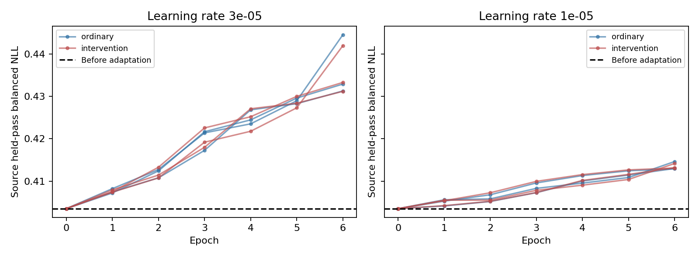

# 源端早停与小步更新验证

2026-11-09。**结论：源端早停能识别本轮不该继续更新，但没有产生更好的适配模型。** 两组、三个种子、两档学习率的12条轨迹都选择第0轮。因此保留现有完整M1/M2/M3，不把退化权重替换进去；当前干预选样并未获得独立新增收益。

## 1. 做了什么

遵循预先固定的`PROTOCOL_ZH.md`，不改模块和损失：原学习率3e-5与较小学习率1e-5；普通同类别配额选样与干预选样；17/29/43三个适配种子；最多6轮，每条轨迹54步。共12次、648步。

只在241条source_adapt中划分：按四类齐全且样本最多，预先选S1A_011268的105条作适配阶段留出；其余去除6条相同船只，剩130条、3个过境训练。训练类别数量43/16/22/49，留出38/10/24/33。干预掩码取已有合法筛选的子集，71条，配额23/12/18/18；普通组逐类同配额。全部130条原图均参与CE。

当前教师历史上已经见过这些源样本，所以这不是全流程未见源验证。来源复核还确认194条既有selection未进入所选教师训练链，但它和源集存在过境交叠，严格125条已有扩围评价用途，本轮没有将其重新命名为源端使用。详见`SOURCE_VALIDATION_AUDIT_ZH.md`。

仍只更新layer3[5]三个卷积，所有首批梯度均为有限非零；其余模块、分类头及BN统计不变。缓存重放沿用已验证路径。所有轮次只计算105条源留出的balanced NLL，包含不更新的第0轮；先写出`locked_selection.json`，再运行目标评价。普通与干预对照同等选择机会。

## 2. 早停选了什么

**全部选第0轮。** 原始源留出balanced NLL为0.403490，12条轨迹第1至6轮均高于初始值。较小学习率使曲线上升更缓慢，但没有低于初始模型。第0轮的学习率字段记录为1e-5只是并列时取较小值，不代表实际发生了该学习率更新。

第0轮模型两组完全相同，因此所选模型三种子的零标准差来自同一初始权重，不是独立重复训练获得的稳定提升。

## 3. 固定后目标结果

| 方案 | 评价378 OA% | BA% | NLL | Brier |
|---|---:|---:|---:|---:|
| 当前完整模型 | 62.434 | 59.963 | 1.146052 | 0.556159 |
| 普通组源端早停所选 | 62.434 | 59.963 | 1.146052 | 0.556159 |
| 干预组源端早停所选 | 62.434 | 59.963 | 1.146052 | 0.556159 |
| 普通组1e-5强行训练到末轮 | 61.199 ± 0.764 | 58.543 ± 0.685 | 1.157255 | 0.563855 |
| 干预组1e-5强行训练到末轮 | 60.847 ± 0.700 | 58.253 ± 0.608 | 1.160480 | 0.564977 |

同学习率下保留第0轮相对强制末轮，普通组平均OA/BA高1.235/1.419个百分点，干预组高1.587/1.709。**这是避免退化，不是超过原模型。** 原组与干预组源端所选权重相同，不能从这一结果宣称干预选择优于普通选择。

源训练130条OA由87.692升至90.000，NLL从0.408降至约0.325；源留出105条OA则由90.476降至89.524，NLL从0.404升至约0.418。目标也下降，说明不是只有目标结果才能看到这一风险：在当前适配阶段跨过境留出上已经有同向退化。

本轮130条54步与上轮241条96步的数据和训练预算不同，不能把两轮间退化程度的差值全归因于学习率或早停。对早停的直接比较是本轮同一训练轨迹的第0轮与末轮。

## 4. 原始chip与反例

检查了四张查询的原始尺度VV/VH、检测框及实际合法源参考。黑色补零不是海面，图中参考按固定库内区域描述余弦选近例，不是注意力最大值。

| 案例 | 可见事实与分差 | 说明 |
|---|---|---|
| 000214，化学品/成品油轮，seed43 | 小型目标，VV与VH的框内亮响应分布不同；同类及普通货参考都有近似亮结构。真实类分差初始+0.1134，普通末轮−0.4445，干预末轮−0.4550。 | 两种继续训练均误伤；早停保住原预测。不能据外观断言特定极化或物理原因。 |
| 000266，集装箱，seed17 | VV有集中亮响应，VH有几个局部亮点；同类和普通货参考都有细长散射结构。分差初始−0.3067，普通末轮+0.2276，干预末轮+0.2130。 | 继续训练确实能救回个别样本；停止同时会放弃这些收益，不能只展示避免误伤。 |
| 000133，普通货，seed43 | 原始chip较小，框内目标亮，若干实际参考缺少VV。原分差+0.0152，干预末轮+0.3274。 | 两组源端所选模型保持原来的正确预测；继续训练可增强这例分差，但不等于总体值得训练。 |
| 002765，散货，seed43 | 目标框内有多个亮点、VV/VH响应范围不同；一个同类参考006462的显著亮响应位于OBB外。原分差−9.1673，干预末轮−9.7331。 | 原有难例没有被修复，继续训练还强化错误优势。参考存在复杂对应现象，但本轮未做替换检验，不能把它认定为错误根因。 |

干预末轮相对第0轮，在三种子累计产生6次救回、24次误伤；这是重复种子事件，不是30艘独立船。所选干预与所选普通完全相同，组间为0救回/0误伤。案例页的`earlystop_protection`比较保留模型与强制末轮，不能称为干预特有救回。

## 5. 收口判断

1. 追加适配对当前源样本的过度拟合/迁移退化解释获得进一步支持。将学习率降低、用源端过境早停，可以避免采用退化模型。
2. 本轮没有找到同时更新参数且优于原模型的配置。所有选优回到第0轮，不继续向更小学习率无限搜索。
3. 结果不证明干预信息没有价值，但已说明当前“标记样本＋保护原教师分差”训练方式没有提供新增净收益。其算法目标仍不同于学习干预后的具体改善。
4. 正式模型、参考库和当前模块保持原样。论文补充源端停止依据，干预发现与追加训练收益分开表述。若以后改变损失或训练阶段，作为新的、单独论证的研究，不冒充本轮已修好。

复现：使用同一ClearSAR环境依次运行`run.py fit`、`run.py evaluate`、`run.py analyze`。参数、源划分、源选择、最终评价分阶段存档；原始缓存、样本清单、检查点仅保留本机。
