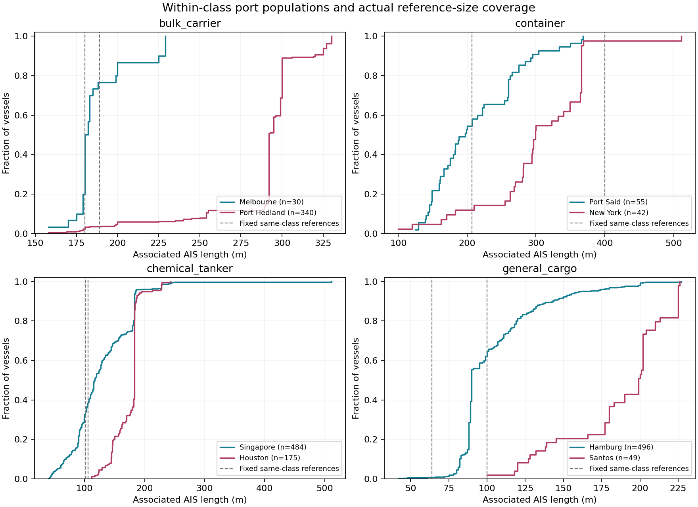

# 港口类内原型差异研究

先读 [研究结论](FINDINGS_ZH.md)。本轮不训练、不修改当前模型或标签。

## 统计图

可编辑矢量版本：[四类CDF](selected_ports_ecdf.svg)、[全部类别港口分布](port_length_distributions.svg)。后者tug/offshore已标记需标签核查，不能直接作真实谱系解释。

## 本地原始图像对照

以下原图及身份信息仅保留本地，不同步公开仓库。

- [集装箱近中位船舶](container_median_local.png) / [同尺寸、不同港口](container_matched_local.png)
- [油化近中位船舶](chemical_tanker_median_local.png) / [同尺寸、不同港口](chemical_tanker_matched_local.png)
- [散货近中位船舶](bulk_carrier_median_local.png) / [同尺寸、不同港口](bulk_carrier_matched_local.png)
- [杂货近中位船舶](general_cargo_median_local.png) / [同尺寸、不同港口](general_cargo_matched_local.png)
- [同AIS身份跨港对照](same_vessel_cross_port_local.png)
- [油化样本与实际固定参考](chemical_actual_references_local.png)
- [原图查看记录](RAW_REVIEW_LOCAL.md) / [标签来源核查](LABEL_AUDIT_LOCAL.md)

## 复现顺序

在既有ClearSAR环境运行 `analyze.py`、`images.py`、`controls.py`、`subtypes.py`。依赖本机已有manifest、AIS sidecar、类别映射审计表与原始PNG；不自动下载或重建它们。只生成本目录内的派生文件。

`*_local.csv/json/png`、`*_LOCAL.md`为本地明细和原图，不在公开归档清单中。
