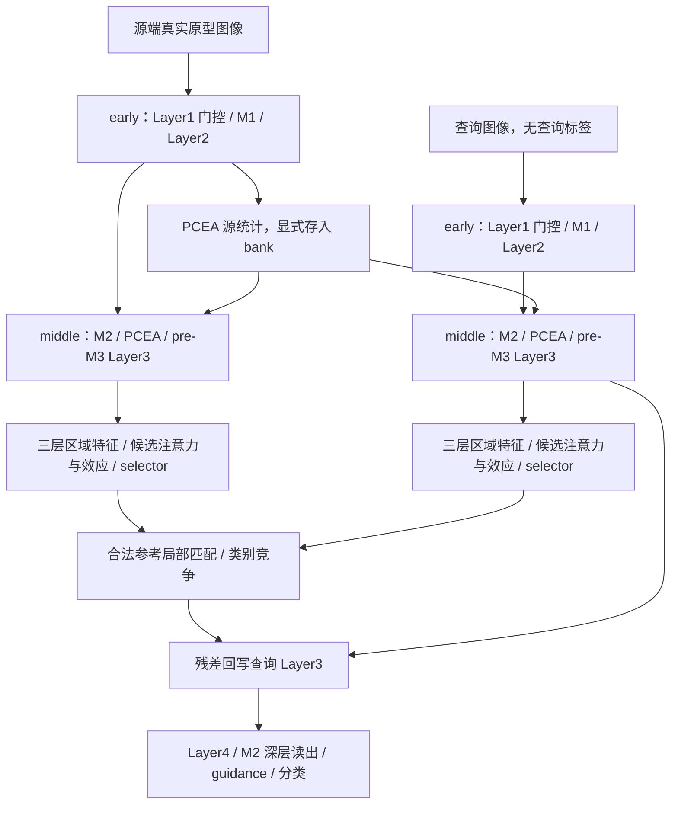

# 原始尺度 SAR 跨港原型模型

本目录提供独立的 PyTorch 实现：原始尺度双极化输入、ResNet-50/M1/M2 分类通路、源端 PCEA 统计、真实船只原型库、多尺度局部对应与 Layer3 回写、源端教师先验/干预效应蒸馏，以及可选第三层特征和通道门控。代码不依赖历史实验脚本的动态导入，也不自动加载历史权重。

当前交付是实现与小规模正确性验证，尚未产生新的正式跨港收益结论。示例训练步数和损失权重是运行入口，不是已经验证的最优配方；最终结论需要同折、同预算对照和原始 chip 案例分析。文献与历史代码的复用范围见 `REFERENCE_NOTES.md`。

完整三层配置的计算顺序如下。关闭相应模块时沿同一通路跳过该操作；参考端不执行 M3，不会出现参考依赖自身匹配结果的循环。



## 环境与入口

需要 Python 3.10+、NumPy、PyTorch 2.1+、torchvision 0.16+、Pillow、SciPy；精确依赖见 `pyproject.toml`。优先使用现有研究环境。在本目录直接运行，无需安装本包：

```powershell
Set-Location 'E:\临时会话\port_prototype_model_20261121'
python -m sar_port.cli --help
python -m unittest discover -s tests -v
```

需要安装入口时可执行 `python -m pip install -e .`，之后使用 `sar-port`。所有 CLI 默认 `--device cpu`；已有可用 CUDA 环境时显式传 `--device cuda:0`。代码不自动下载权重。示例中的文件、港口名称和数据路径需替换为实际值。

## Manifest 与输入约定

Manifest 是 UTF-8 JSON 数组，也可写成 `{"records": [...]}`。训练、划分与评价需要每条记录的 `id`、`label`、`vessel_id`、`port`、`group_id`；`id` 唯一，`vessel_id` 标识船只，`group_id` 标识采集组。`label` 使用一致的 `0..classes-1` 整数映射。

```json
[
  {
    "id": "obs_0001",
    "label": 0,
    "vessel_id": "vessel_001",
    "port": "Port_A",
    "group_id": "acquisition_001",
    "vv": {
      "image": "chips/obs_0001_VV.png",
      "alignment_valid": true,
      "target_index": 0,
      "detections": [
        {
          "corners": [[40, 50], [100, 50], [100, 70], [40, 70]],
          "confidence": 0.99,
          "shape_usable": true
        }
      ]
    },
    "vh": null
  }
]
```

- 图片相对路径相对 manifest 所在目录；也支持绝对路径。OBB 的四角按轮廓顺序给出，坐标对应原图，x 向右、y 向下。`target_index` 指向目标 OBB。
- 支持 8 bit 显示 chip，图像模式为 L/RGB/RGBA，后两者转灰度；除以 255 输入网络。本入口不把原始复数 SAR 或 16 bit 辐射数据静默转成显示图。
- 保持像素尺度，以目标为中心裁剪/补零到 160×160，不 resize。目标范围超过 160 像素会报错，需要另行明确数据方案。
- OBB 置信度需不低于 0.25 且形状可用。至少一个极化必须有对齐有效的目标；缺失极化填 `null`，其输入、区域和可用性为零。
- 同一物体的 VV/VH 必须采用对应目标及正确坐标。训练 D4 变换同时作用于图像和原始掩膜，再积分到各层网格。

几何细分为 BODY 8、SIDE 8、ENDS 4，共 20 个细区域，另有 8 个父区域。它们是原始像素覆盖的分区，并不代表独立散射中心。区域级教师/PCEA 张量采用 BODY、ENDS、SIDE 顺序。现有八类实验的标签顺序是 bulk_carrier、fishing、general_cargo、chemical_tanker、container、crude_oil_tanker、tug、offshore；包允许调整类别数，但数据、配置、教师和结果解释必须采用同一映射。

## 一折完整流程

下面以 `Port_C` 为目标测试港、`Port_B` 为源侧验证港，其余港口为训练来源。单目标港对应 LOPO；CLI 也允许显式列出多个目标港。完整 LOPO 需按预先确定的各折重复流程，本命令不会自动循环所有港口。

### 1. 划分与初始化原型库

```powershell
python -m sar_port.cli split --manifest data/manifest.json --target-ports Port_C --validation-ports Port_B --output runs/fold_C/split.json
python -m sar_port.cli select-bank --manifest data/manifest.json --split runs/fold_C/split.json --per-class 4 --method random --seed 17 --output runs/fold_C/bank_random.json
```

划分先保留目标港，再从其他集合排除与目标共享船只或采集组的记录；源训练还排除与源验证共享的船只或采集组。排除项写入 split。闭集评价涉及的类别若在源训练缺失，训练/评价会拒绝继续，不会静默删除难类。不要手改 split 的行号；manifest 行顺序变化时重建 split。

原型是有真实图像和类别的源端代表船，不是自由学习的类别中心。每艘船最多一个代表观察，同一船的重复 chip 不增加原型票数。同类船只不足时实际数目可小于 `--per-class`，不会复制补齐。默认平衡源港，`--no-port-balance` 可关闭。

### 2. 用源端 CE 训练 bootstrap

```powershell
python -m sar_port.cli train --manifest data/manifest.json --split runs/fold_C/split.json --bank runs/fold_C/bank_random.json --config configs/bootstrap.json --steps 1000 --batch 8 --seed 17 --eval-every 50 --device cuda:0 --output runs/fold_C/bootstrap
```

`bootstrap.json` 与 `full.json` 都开启第三层和门控，模型结构相同；bootstrap 的先验、效应、一致性和预算损失权重为零，先通过源端分类 CE 与辅助 CE 形成可用教师。它仍有可学习先验/selector，不能把未训练初始化称为有效教师。

可在上面命令加入 `--imagenet weights/resnet50_imagenet.pth`，仅显式初始化 torchvision ResNet-50 骨干；加载时只剔除 ImageNet 的 `fc.weight/fc.bias`，其余键严格匹配。权重来源由操作者确认，不能把接触过全部港口的研究 checkpoint 改名当作 ImageNet。默认不指定时为随机初始化。

### 3. 在同一源训练集合选择覆盖原型

```powershell
python -m sar_port.cli select-bank --manifest data/manifest.json --split runs/fold_C/split.json --checkpoint runs/fold_C/bootstrap/best.pt --per-class 4 --method coverage --seed 17 --batch 8 --device cuda:0 --output runs/fold_C/bank_coverage.json
```

coverage 用源端模型描述子，在每类唯一船只候选上采用类均值近邻种子、最远点扩展，再做一次代表更新；启用港口平衡时保留相应约束。它不是收敛 K-means，也不把不同船的空间 token 混成一张虚拟船。比较 random/coverage 时保持每类预算、港口平衡、种子和训练设置一致。

### 4. 同折教师蒸馏与联合训练

```powershell
python -m sar_port.cli train --manifest data/manifest.json --split runs/fold_C/split.json --bank runs/fold_C/bank_coverage.json --config configs/full.json --initialize runs/fold_C/bootstrap/best.pt --teacher runs/fold_C/bootstrap/best.pt --steps 1000 --batch 8 --seed 17 --eval-every 50 --lr 0.0001 --backbone-lr 0.00001 --device cuda:0 --output runs/fold_C/full
```

`--initialize` 严格加载结构兼容的源折完整模型；`--teacher` 冻结同折教师及其自身原型库。两者均检查训练来源和历史验证选择港是否与当前目标折冲突。bootstrap/full 结构一致，因此可以严格加载；两层/基础模型不能直接当作完整三层模型的严格初始化。`--initialize` 与 `--imagenet` 互斥。

训练原型身份固定，但每一步用当前模型重新编码，源端和查询端梯度均可通过匹配传播。没有跨 optimizer step 重用旧计算图。ResNet BatchNorm 的运行统计始终保持 eval，仿射参数仍可训练，避免参考编码 batch 改变 running stats；随机初始化时也遵循这一约定。AdamW 的 `--backbone-lr` 仅用于 `backbone.resnet.*`，M1/M2、guide 与新模块使用 `--lr`，权重衰减为 0.01，梯度范数上限为 5。

可重复传入 `--freeze PREFIX` 固定参数，例如 `--freeze backbone.resnet --freeze student.effect_heads`。冻结通过参数前缀选择并记录在运行元数据中，不将整个模块包进 `no_grad`，因此仍可让梯度穿过冻结模块传给上游可训练模块。模块开关改变计算路径，冻结参数改变优化范围，两者需按对照目的分别设置。

输出目录必须尚不存在。每次运行保存完整配置、训练历史、`best.pt` 和 `last.pt`；best 只按源验证 BA、其次 OA 选择。`--steps 0` 只验证和保存初始化，不构成训练实验。训练命令不会读取目标图像参与优化或选择；manifest 元数据用于预先划分与闭集类别检查。

### 5. 目标评价与冻结部署

```powershell
python -m sar_port.cli evaluate --checkpoint runs/fold_C/full/best.pt --manifest data/manifest.json --split runs/fold_C/split.json --partition test --batch 8 --device cuda:0 --output runs/fold_C/test.json
python -m sar_port.cli export --checkpoint runs/fold_C/full/best.pt --device cuda:0 --output runs/fold_C/deploy.pt
python -m sar_port.cli predict --checkpoint runs/fold_C/deploy.pt --manifest data/unlabelled_queries.json --batch 8 --device cuda:0 --output runs/fold_C/predictions.json
```

evaluate 输出 OA、真实出现类别上的 BA、真实或预测出现类别并集上的 macro F1、混淆矩阵和逐样本 logits；指标单位为百分数。测试港结果不用于修改本折选择策略。

export 固定当前模型与编码后的原型 token/PCEA 源统计，移除参考图像及路径；部署不需访问参考原图。它仍保存来源和身份元数据，不能直接视为匿名公开数据。普通训练 checkpoint 保留参考图像路径，用于活编码；冻结导出的 bank 仅适用于导出时模型，之后更新权重需要重新导出。

predict 的查询 manifest 可省略 `label`、`vessel_id`、`group_id`、`port`；仍需图像和目标 OBB。已知船只/采集组时填写真实值，程序据此排除同船/同组参考；未知身份不会伪造为同一身份。输出 softmax 概率，不保证概率已经校准。

## 模块与可调参数

所有配置字段位于 `sar_port/model.py::ModelConfig`；JSON 可只覆盖部分字段，其余使用默认值。四份配置作用如下：

| 配置 | 结构与用途 | 默认辅助损失 |
|---|---|---|
| `configs/bootstrap.json` | 三层 + 门控的完整结构，源端教师预训练 | aux 0.02，其余 0 |
| `configs/full.json` | 与 bootstrap 同结构，联合蒸馏 | aux 0.02，prior/effect/consistency 各 0.1，budget 0.01 |
| `configs/two_layer.json` | 两层，关闭门控，其余原型通路保留 | aux 0.02，其余 0 |
| `configs/baseline.json` | M1/M2/guidance 分类基线，关闭 PCEA/M3/先验/效应/selector/第三层/门控 | aux 0.02，其余 0 |

`configs/ablations/` 提供逐项关闭模块、固定粒度、匹配方式和港口聚合对照；可用 `python scripts/make_ablation_configs.py --base configs/full.json --output configs/ablations` 从指定基准重新生成，脚本不会训练。`no_m3` 只关闭匹配回写，其他辅助监督保留，不等于移除所有关联模块。改变层数、门控、selector 条件维度或 matcher 参数形状的配置不能直接严格互载 checkpoint；需为该结构准备对应源端初始化，不能忽略不匹配键后声称同初始化对照。

| 字段 | 默认值与实际作用 |
|---|---|
| `classes` | 8；改变分类、候选先验和效应输出维度 |
| `m1`, `m2`, `guidance`, `pcea`, `m3` | 独立模块开关；默认 true |
| `priors`, `effects`, `dynamic_selection` | 候选类别注意力、效应条件和动态粗细选择；默认 true |
| `third_layer`, `gate` | ModelConfig 默认 false；full/bootstrap 显式 true |
| `m1_strength`, `m2_strength`, `pcea_strength` | 0.3、1.0、0.1，实际残差强度 |
| `prior_hidden`, `selector_hidden`, `gate_hidden` | 64、32、16；对应隐藏维度 |
| `initial_gate` | 0.95；全宽通道门控的初始内容比例 |
| `selection_mode` | `soft`；也可 `hard`、`fine`、`coarse`，训练/推理使用同一显式模式 |
| `selector_temperature`, `selector_threshold` | 1.0、0.5；软门控温度和硬选择阈值 |
| `layer_matching` | `concat`；也可 `same`、`cross`，分别为拼接、同层和允许跨层对应 |
| `pair_matching` | `paired` 保留完整对应；`aggregate` 仅用行列边际重建局部聚合，同层模式逐层重建 |
| `axis_matching` | true；允许船轴方向假设，不推断物理船首/船尾 |
| `dustbin`, `rejection_gate`, `class_competition` | true；不匹配质量、可信回写衰减、类别竞争 |
| `port_aggregation` | `flat`；`hierarchical` 先按源港聚合再按类别聚合 |
| `geometry_weight`, `scale_weight`, `layer_weight` | 0.25、0、0；对应匹配代价权重 |
| `residual_scale` | 0.1；M3 在 Layer3 的回写强度 |
| `match_dim`, `match_temperature`, `sinkhorn_steps` | 32、0.1、60；投影维度、匹配温度和迭代数 |
| `consistency_temperature`, `intervention_strength` | 1.0、0.5；交换一致性蒸馏温度、教师原始图像干预强度 |
| `aux_weight`, `prior_weight`, `effect_weight`, `consistency_weight`, `budget_weight` | 分类辅助、注意力 KL、效应 Huber、交换一致性和预算正则的权重 |

关闭 M1 只关闭关系反馈，类别响应 reader 仍保留，可继续用于辅助监督和独立先验。关闭 M2 时其区域读出置零，guidance 有独立开关。关闭 priors 使用有效区域均匀先验；关闭 effects 移除 selector 的效应条件。关闭 dynamic_selection 使用细区域模式，但缺乏可分辨子区域的父区域仍不强行细分。独立消融时同步把对应损失权重设为零；配置校验会拒绝部分相互矛盾的组合。

`budget_weight` 优化归一化的**期望额外活跃 token 数**，查询和参考两端各占一半。当前匹配张量仍以 28 个候选槽位填充；soft/hard 模式均不能据此宣称 FLOPs 或实测时延降低。硬阈值结果需单独验证，不把软训练结果当作硬部署结果。

`hard` 使用阈值判断，分类梯度不能穿过该决定训练 selector。因此 `hard_selection.json` 用于软模型训练后的固定权重对照：加载同结构软 checkpoint，执行零步保存并重新编码 bank，然后评价。例如：

```powershell
python -m sar_port.cli train --manifest data/manifest.json --split runs/fold_C/split.json --bank runs/fold_C/bank_coverage.json --config configs/ablations/hard_selection.json --initialize runs/fold_C/full/best.pt --teacher runs/fold_C/bootstrap/best.pt --steps 0 --batch 8 --seed 17 --device cuda:0 --output runs/fold_C/hard_fixed
python -m sar_port.cli evaluate --checkpoint runs/fold_C/hard_fixed/best.pt --manifest data/manifest.json --split runs/fold_C/split.json --partition test --batch 8 --device cuda:0 --output runs/fold_C/hard_fixed_test.json
```

模板仍含非零教师损失，因此零步入口也要求 `--teacher`；此处没有参数更新。阈值如需选择，只使用源验证集。

第三层特征来自 M2/PCEA 后、M3 回写前的 Layer3，查询和参考采用同一语义位置；参考编码不递归调用 M3。Layer3 全局上下文可条件化先验，但不会被称为新恢复的细像素信息。多层分别匹配时分配质量，避免增加层数直接增加证据票数。

门控在 Layer1 上计算 256 通道 sigmoid，不把通道硬切成两半。正常查询和参考使用内容分量；交换训练融合自己的内容和另一合法样本的剩余分量。donor 需极化可用条件一致、不同船且不同采集组，不要求同类；缺少合法 donor 时跳过对应一致性项。此机制是可检验的解耦假设，并非已经证明剩余分量只含环境。

## 教师目标与标签边界

学生一次前向预测所有候选类别的注意力和有符号效应，不接收查询真标签。标签只用于源端分类损失、教师正确性/真类注意力掩膜，以及参考原型的类别元数据。query 的身份只用于合法参考筛选，港口不作为查询分类特征。

冻结源教师为每个训练 batch 测量原图一次、2 极化 × 3 区域 × 2 频段干预 12 次，以及对应亮度对照 12 次，共 25 次教师前向。高频为 `x-G_sigma1(x)`，中频为 `G_sigma1(x)-G_sigma2(x)`；在原始像素区域内以边缘渐变衰减，默认强度 0.5。这里的区域是 BODY/ENDS/SIDE，不是每个细 token 的真值。

候选类 margin 为 `z_c-max(z_其他类)`，效应为原图 margin 减去干预后 margin：正值表示该干预削弱该候选类别的优势。竞争类别在每次前向重新确定。教师预测错误时，仅取消真类注意力弱监督，合法的所有候选效应仍可监督学生。注意力来自现有 M1 响应，采用 KL；效应采用有符号 Huber，教师目标均停止梯度。

亮度对照匹配有符号强度变化总和，**不是能量匹配**。当前训练损失不减去亮度对照效应，也不以其作为额外监督；它保留为测量诊断，不能据此声称已经隔离真实物理频率机制。教师目标当前在线计算；未提供把旧 all-port 干预缓存直接作为干净 LOPO 标签的入口。

M3 的合法参考筛选排除同船和同采集组，并处理极化可用性；PCEA 使用整个合法源训练 bank 的共享统计，不按查询标签校准。源统计显式随 bank 传入，不依赖全局 mutable 状态；交替使用不同 bank 不应串用校准。

## Python 接口与结果保存

```python
import numpy as np  # 本地 Windows 环境先导入 NumPy
import torch
from sar_port.data import load_records, prepare_batch
from sar_port.model import ModelConfig, PortPrototypeModel
from sar_port.protocol import legal_reference_mask

reference_rows = load_records("data/source_references.json")
query_rows = load_records("data/queries_with_identity.json")
model = PortPrototypeModel(ModelConfig(third_layer=True, gate=True)).eval()
reference_labels = torch.tensor([r["label"] for r in reference_rows])
legal = torch.as_tensor(legal_reference_mask(query_rows, reference_rows))
with torch.no_grad():
    bank = model.encode_reference(prepare_batch(reference_rows))
    output = model(prepare_batch(query_rows), bank, reference_labels, legal=legal)
    predictions = output["logits"].argmax(-1)
```

上述仅展示接口，随机模型预测没有研究意义；实际运行加载经过来源验证的训练 checkpoint。直接调用 Python API 时，由调用者遵守 source split 与合法参考约定，CLI 已提供这些检查。`forward(..., details=True)` 可获取详细匹配证据，`m3_on=False` 可对同一模型关闭 M3 回写作配对诊断。

实验归档应保留 split、原型成员/实际每类数、配置、初始化与教师来源、种子、验证选择记录、逐样本预测和配对对照。每轮正式实验后查看代表性的持续正确、持续错误、救回与误伤原始 chip，VV/VH 分开展示，并同时检查实际同类和混淆类原型。代码与汇总可同步研究仓库；原始数据、权重、大型缓存与私人路径不随代码公开。正确性测试和合成样本 smoke run 不替代正式数据收益或机制证据。
