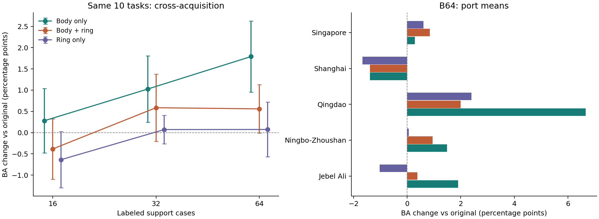

# 船体/环带完整消融与可解释性补充

2026-10-15。已完成；未增加数据集、未训练骨干、未调整权重。

## 核心结论

新增的仅船体对照改变了归因：原来的组合增益不能直接讲成船体与框外互补。共同10任务跨采集下，仅船体在B16/B32/B64的BA增益约+0.279/+1.026/+1.791个百分点，均超过组合。尤其B64，仅船体OA/BA从63.224/53.246提高至63.820/55.037，五次支持抽样BA均为正，4/5港口平均为正。优先保留浅层框内读出候选，组合和环带保留有边界的作用，不抹掉已有收益。

这里的仅船体指新增的局部补充只来自框内；原有整体特征、双路模型和类别关系仍保留，并非整套模型只看框内或改成单骨干。

这不是说框外信息无效：B32全19任务，组合BA56.450高于仅船体56.291；B64新加坡组合BA24.499高于仅船体23.947。组合跨采集概率NLL/Brier也优于仅船体，但top-1较弱。因此需区分平均分类收益、概率风险、具体港口与预算，不将各指标混成一种结论。

## 固定查询的预算对照

| budget | arm | oa | ba |
| --- | --- | --- | --- |
| 16.0000 | 船体+环带 | 60.2460 | 51.0512 |
| 16.0000 | 原模型 | 60.3333 | 51.4364 |
| 16.0000 | 仅环带补充 | 59.9153 | 50.7981 |
| 16.0000 | 仅船体补充 | 60.6005 | 51.7158 |
| 32.0000 | 船体+环带 | 61.8759 | 53.6656 |
| 32.0000 | 原模型 | 61.8332 | 53.0800 |
| 32.0000 | 仅环带补充 | 61.4714 | 53.1516 |
| 32.0000 | 仅船体补充 | 62.4050 | 54.1057 |
| 64.0000 | 船体+环带 | 63.3244 | 53.8049 |
| 64.0000 | 原模型 | 63.2240 | 53.2458 |
| 64.0000 | 仅环带补充 | 62.7830 | 53.3192 |
| 64.0000 | 仅船体补充 | 63.8198 | 55.0369 |

共同10任务、625个查询；同一任务支持案例嵌套。先平均支持抽样，再港内任务平均、最后等港平均。固定局部核能量和25%替换比例，不按目标标签选择方案。

左图误差棒是五次配对支持抽样净增益的样本标准差，不是置信区间；右图是B64逐港均值，港内任务数不完全相同。

## 全覆盖结果

| budget | arm | oa | ba |
| --- | --- | --- | --- |
| 16.0000 | 船体+环带 | 58.9715 | 54.6733 |
| 16.0000 | 原模型 | 58.8547 | 54.5272 |
| 16.0000 | 仅环带补充 | 58.5256 | 54.4237 |
| 16.0000 | 仅船体补充 | 59.0770 | 54.7067 |
| 32.0000 | 船体+环带 | 62.0361 | 56.4503 |
| 32.0000 | 原模型 | 62.1321 | 56.2368 |
| 32.0000 | 仅环带补充 | 61.7277 | 56.0892 |
| 32.0000 | 仅船体补充 | 62.1542 | 56.2913 |
| 64.0000 | 船体+环带 | 63.3244 | 53.8049 |
| 64.0000 | 原模型 | 63.2240 | 53.2458 |
| 64.0000 | 仅环带补充 | 62.7830 | 53.3192 |
| 64.0000 | 仅船体补充 | 63.8198 | 55.0369 |

B16/B32/B64分别覆盖20/19/10任务。因此不能将全覆盖绝对准确率当作相同队列的学习曲线。B32仅船体在全19任务上的BA净增仅+0.054，而共同10任务为+1.026；这个差异来自任务组成，不应只报告较好的子集。

## 数据组成与误伤

B64仅船体相对原模型有50次救回、31次误伤，共涉及76个不同MMSI。次数是五次支持抽样累计，不是独立船数。排除青岛后，其余四港等权平均BA仍净增0.572个百分点；这仅是解释集中性的描述，不替换主结果。

青岛B64具体类别贡献（类别编号按原数据，未猜测物理含义）：

| truth | query_count | rescues | harms | ba_contribution_pp |
| --- | --- | --- | --- | --- |
| 0.0000 | 10.0000 | 4.0000 | 0.0000 | 2.6667 |
| 1.0000 | 50.0000 | 0.0000 | 0.0000 | 0.0000 |
| 2.0000 | 5.0000 | 3.0000 | 0.0000 | 4.0000 |

青岛只有一个B64可行采集、查询65个，类别0/1/2分别10/50/5。某类少数改判可明显影响BA；这仍是有效的局部收益，但不能说覆盖该港全部船型或许多独立场景。逐类贡献使用完整任务BA分母，已核对加总等于每任务真实BA差。

## 可解释到哪一步

输入：stem框内逐通道峰值64维，而非纯船体分割；环带为VV/VH各自像素均值/标准差4维。二者按源端变换并归一化。仅船体核为s_q·s_i，组合局部核为0.5(s_q·s_i)+0.5(b_q·b_i)。在同一固定替换比例下比较的是局部证据配比，不是给组合增加更大核强度。

接入：源先验和基础分支固定，局部核替换专家D18核的25%，随后与原类别关系组合，重新求解支持残差系数，再做原双路概率融合。该方法不重新学习图像表征，而是显式读出已存在的浅层局部响应，改变已标注案例如何影响分类。

案例解释：逐支持贡献和改判链条见[改判案例报告](CASE_FINDINGS_ZH.md)、case_*.csv。已用独立NumPy读出核对150组保存概率（最大误差1.83e-15），208个改判事件的分差分解最大误差8.59e-15。核相似度改变与支持系数重新求解会同时影响分类；原模型到框内补充的81个改判中，61个的两项作用方向相反。报告用对称分解进行精确分数记账，不把分数分解冒充物理因果或最终概率的线性归因。典型案例同时展示救回与误伤，不按最有利的个例证明总体机制。

具体例子：Jebel Ali的returned_20260915_0000449，真实类别2，原模型误判3；框内补充将真实类相对类别3的融合概率差从-0.951变为+0.401个百分点，成功救回；加入环带后变为-0.268，又误判3。另一例returned_local_knowledge_0002794真实类别3，框内补充使其误判2，但环带组合将概率差从-0.169变为+0.830个百分点并救回。这两例来自同一支持抽样，说明环带并非总有害，也不是固定加入就一定互补。

当前支持的解释是浅层框内响应提供了原读出未充分利用的案例匹配证据，尤其在这批B64任务中体现为更多正确改判。但B64仅船体宏MAP@R低于原模型约0.00022，说明不能讲成整体检索排序普遍变好；相似度与支持系数的联合变化才是应追踪的计算路径。是否对应船体结构、散射点或观测条件仍未被本轮识别。

## 边界与后续

本轮保留全部旧结果。20港口-采集任务对应17采集；858观测/821MMSI，不是新的独立数据集。暂不扩到公开数据集，不训练动态新模块，不按目标结果选港或权重。仅船体相对原模型的收益不证明stem优于所有合理多层读出，也不证明峰值提供纯因果信息；后续如需提升机制论证，围绕实际发生改判的案例验证局部证据，而不先增加网络复杂度。
