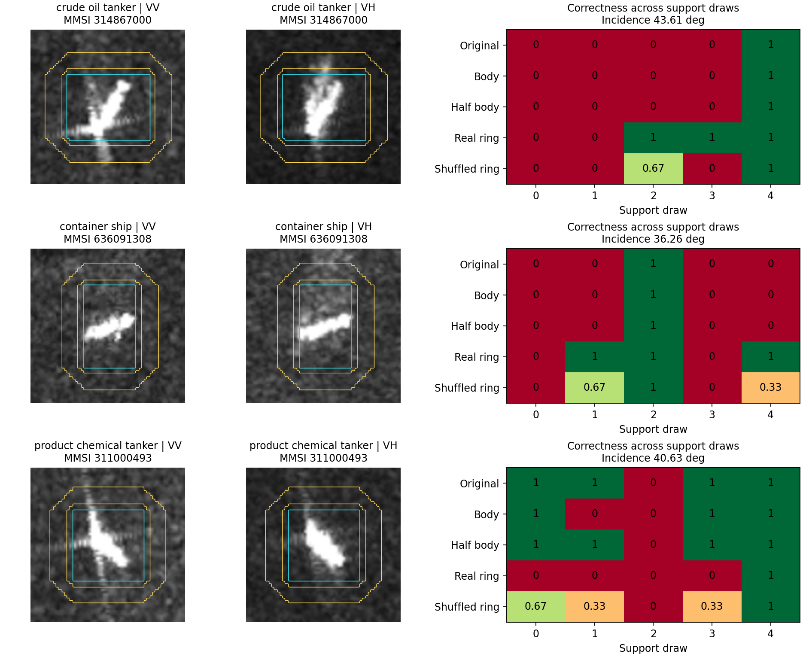

# 哪些船、哪些条件下环带补充了框内证据

2026-10-15。完成既有任务的配对对照与条件描述；未训练新模型、未扩公开数据集。

## 结论

发现了实际、可重复的个案补证，但尚未得到跨预算稳定的物理条件开关。最明确的实例是新加坡的原油轮314867000和集装箱船636091308：B64五次支持抽样中，真实组合分别比框内补充多判对两次，原模型及减半框内强度对照均未取得这两次救回。两艘船、两个采集，不是普遍船型规律，也不是两次独立数据集验证。

在更广范围，真实环带未普遍胜过同采集内置乱环带；部分收益可以由减少框内替换幅度解释。环带有局部作用与当前固定组合的整体净收益不足可以同时成立。本轮只建立可解释边界，不据此训练或发布新门控。

## 两个对照回答什么

减半框内：只将原D18核的12.5%换成框内核，保留其他原核，不加入环带。真实组合中框内同样占12.5%，另12.5%给环带。故比较可区分环带内容与单纯框内强度变化。

显式环带置乱：三个固定种子，把环带坐标在同采集、同查询/支持角色内重排；框内、源先验、标签和权重不变，并重新求解支持系数。本次置乱的是分类核中的环带，不是此前仅门控输入。它保留采集级分布，主要检验逐船对应关系；不能区分所有场景级语义与统计正则作用。

## 全部配对净效果

| budget | origin | delta_ba_vs_ship | delta_ba_vs_half | delta_ba_vs_shuffle | rescues | harms | new_vs_original | restore_original |
| --- | --- | --- | --- | --- | --- | --- | --- | --- |
| 16.0000 | cross | -0.0335 | -0.1093 | -0.1011 | 27.0000 | 34.0000 | 10.0000 | 17.0000 |
| 16.0000 | same | 0.0147 | 0.0203 | 0.0147 | 24.0000 | 21.0000 | 9.0000 | 15.0000 |
| 32.0000 | cross | 0.1591 | -0.0082 | -0.1724 | 25.0000 | 33.0000 | 6.0000 | 19.0000 |
| 32.0000 | same | 0.2026 | 0.0527 | -0.1093 | 32.0000 | 28.0000 | 14.0000 | 18.0000 |
| 64.0000 | cross | -1.2320 | -0.1574 | -0.3388 | 16.0000 | 28.0000 | 8.0000 | 8.0000 |
| 64.0000 | same | -0.1079 | 0.2931 | 0.2751 | 26.0000 | 27.0000 | 8.0000 | 18.0000 |

所有差值均为真实组合减对照，BA单位为百分点。顺序为抽样内样本/类别、港内任务、等港汇总。B16/B32/B64分别20/19/10任务，预算覆盖不同。救回/误伤是重复支持抽样事件，不是独立船数。

重要区别：B64跨采集的16次相对框内救回中，8次原模型也错，是相对原模型的新救回；另8次原模型本来正确，是恢复框内补充造成的损失。11次未被减半框内救回，2次三种环带置乱均未救回，其中1次原模型也错。最后一项是更强的个案线索，不是必须全满足才认可有效的标准。

## 哪些船有具体证据

| mmsi | vessel | incidence | ring_std | contrast | rescues | harms | body_correct | real_ring_correct | half_body_correct | shuffled_correct_expected |
| --- | --- | --- | --- | --- | --- | --- | --- | --- | --- | --- |
| 314867000 | crude_oil_tanker | 43.6109 | 0.0754 | 2.4286 | 2.0000 | 0.0000 | 1.0000 | 3.0000 | 1.0000 | 1.6667 |
| 636091308 | container_ship | 36.2560 | 0.0557 | 2.7038 | 2.0000 | 0.0000 | 1.0000 | 3.0000 | 1.0000 | 2.0000 |
| 311000493 | product_chemical_tanker | 40.6252 | 0.0677 | 2.5696 | 0.0000 | 2.0000 | 3.0000 | 1.0000 | 4.0000 | 2.3333 |

表中correct为同一查询五次支持抽样的判对次数；置乱为三个种子判对次数的期望平均。并非五个独立船只。正例按重复救回和对照表现事后选取，用于解释而非估计平均收益；末行为边界反例，按与原油轮相近的环带起伏、框内外对比选取，不用于拟合阈值。

图中是模型实际uint8输入：青色为框内边界、黄色为环带边界，并非分割出的纯船体。热图为各次支持抽样的分类正确性；置乱行是三个种子的平均。

## 从案例中能解释的机制

集装箱船636091308：入射角36.26度，VV环带标准差0.0557、框内外标准化对比2.704。两次救回的支持抽样中，框内Top3类内相似度聚合都更偏向原油轮，环带聚合都更偏向真实的集装箱船；环带真实类对最强异类的相似度优势分别+0.145和+0.486。其他抽样中这种支持证据并不存在。这是同一张查询、相同观测条件，仅支持船改变的对照，说明可用案例是否提供相符类别证据比仅看角度更关键。该简单聚合只用于解释，不是实际分类器。

原油轮314867000：入射角43.61度，VV环带标准差0.0754、对比2.429，两次救回。但环带最近类别聚合并没有直接把真实类排第一；原有逐支持分差分解显示核关系变化与系数重求解联合把概率差推过边界。因此不能将所有收益都讲成环带找到同类最近邻。

反例311000493是成品/化学品船，入射角40.63度、环带标准差0.0677、对比2.570，与上述原油轮的统计条件接近，却两次被组合误伤。这排除了将这几个数值直接当作可靠启用规则的简单解释，但不否认特定船与支持组合中的净收益。

## 观测条件结论

1. 改判集中于框内补充模型的临界预测：所有跨采集救回和误伤均落入预测Top2间距最低三分组；实际间距最高约2.51个百分点。这解释了环带为何能改变这些决策，但困难并不等于适合加环带，误伤也集中在那里。
2. VV环带起伏较小的B32子组有正信号：相对框内BA+2.611、相对减半框内+0.558、相对置乱均值+1.487个百分点；但只有7次救回/5次误伤，跨船型与场景组成会影响条件内BA。保持同场景同类、两端各至少3个不同查询的对照仅有2个可用单元，尚不足以把它写成低起伏条件定律。
3. 40度以上入射角在B16有正信号，但B32/B64未延续。相对方向只有66/858查询可用，按方向分组的改判事件很少且预算间方向不一致；不能给出可靠角度窗口。速度没有建立可靠样本级关联，本轮不解释运动状态。
4. 支持集本身是条件的一部分。B16/B32固定同一查询、仅比较框内均判错的不同抽样时，救回抽样的真实类环带优势较高的查询分别15/22、14/22；B64仅5/14。说明有案例匹配路径，但不是统一解释。此指标使用查询真实类作事后诊断，不可用于部署选择。

像素统计是已拉伸输入的0到1量，不是sigma0、dB或海况。未将高标准差直接命名为强杂波，也未将框内对比定义为真实信噪比。连续分组使用无标签协变量三分位数，未按结果扫描阈值；本轮子组结果仍是探索，不是独立确认。

## 逐港与逐船型

| budget | condition | level | ships | rescues | harms | delta_ba_vs_ship | delta_ba_vs_half | delta_ba_vs_shuffle |
| --- | --- | --- | --- | --- | --- | --- | --- | --- |
| 16.0000 | port | Jebel Ali | 188.0000 | 15.0000 | 10.0000 | 0.7442 | 0.4417 | 0.7415 |
| 16.0000 | port | Ningbo-Zhoushan | 173.0000 | 2.0000 | 6.0000 | 0.3178 | -0.1275 | -0.0404 |
| 16.0000 | port | Qingdao | 125.0000 | 0.0000 | 5.0000 | -1.0000 | -0.5000 | -0.7716 |
| 16.0000 | port | Shanghai | 121.0000 | 1.0000 | 0.0000 | 0.1111 | 0.0000 | -0.2963 |
| 16.0000 | port | Singapore | 217.0000 | 9.0000 | 13.0000 | -0.3404 | -0.3607 | -0.1386 |
| 32.0000 | port | Jebel Ali | 171.0000 | 7.0000 | 10.0000 | -0.2842 | 0.1338 | -0.3682 |
| 32.0000 | port | Ningbo-Zhoushan | 173.0000 | 2.0000 | 3.0000 | 0.4448 | 0.5660 | 0.2879 |
| 32.0000 | port | Qingdao | 125.0000 | 2.0000 | 1.0000 | 0.8333 | -0.1852 | -0.1333 |
| 32.0000 | port | Shanghai | 121.0000 | 4.0000 | 4.0000 | -0.1806 | 0.0833 | -0.5833 |
| 32.0000 | port | Singapore | 217.0000 | 10.0000 | 15.0000 | -0.0181 | -0.6389 | -0.0653 |
| 64.0000 | port | Jebel Ali | 171.0000 | 4.0000 | 14.0000 | -1.5136 | -0.7774 | -0.2749 |
| 64.0000 | port | Ningbo-Zhoushan | 127.0000 | 0.0000 | 2.0000 | -0.5317 | 0.8939 | -0.0185 |
| 64.0000 | port | Qingdao | 65.0000 | 0.0000 | 4.0000 | -4.6667 | -0.6667 | -1.3333 |
| 64.0000 | port | Shanghai | 42.0000 | 0.0000 | 0.0000 | 0.0000 | -0.8333 | 0.2778 |
| 64.0000 | port | Singapore | 196.0000 | 12.0000 | 8.0000 | 0.5522 | 0.5964 | -0.3450 |

| budget | condition | level | ships | rescues | harms | delta_ba_vs_ship | delta_ba_vs_half | delta_ba_vs_shuffle |
| --- | --- | --- | --- | --- | --- | --- | --- | --- |
| 16.0000 | class_name | bulk_carrier | 173.0000 | 3.0000 | 9.0000 | -0.5656 | -0.5332 | -0.2473 |
| 16.0000 | class_name | container_ship | 37.0000 | 1.0000 | 2.0000 | -0.5556 | -1.5079 | -0.6349 |
| 16.0000 | class_name | crude_oil_tanker | 40.0000 | 4.0000 | 0.0000 | 1.8651 | 0.8929 | 0.8995 |
| 16.0000 | class_name | fishing_vessel | 252.0000 | 0.0000 | 4.0000 | -0.0712 | -0.0348 | 0.0128 |
| 16.0000 | class_name | general_cargo | 95.0000 | 6.0000 | 5.0000 | 0.2583 | 0.3333 | -0.1563 |
| 16.0000 | class_name | offshore_supply | 42.0000 | 4.0000 | 3.0000 | 0.1602 | -0.0620 | -0.6777 |
| 16.0000 | class_name | product_chemical_tanker | 154.0000 | 6.0000 | 9.0000 | -0.3175 | -0.6217 | -0.1208 |
| 16.0000 | class_name | tug_towing | 28.0000 | 3.0000 | 2.0000 | 0.2698 | -0.1667 | 0.5450 |
| 32.0000 | class_name | bulk_carrier | 165.0000 | 9.0000 | 6.0000 | 0.4233 | 0.3039 | -0.2467 |
| 32.0000 | class_name | container_ship | 37.0000 | 0.0000 | 1.0000 | -0.4762 | -1.0317 | 0.0000 |
| 32.0000 | class_name | crude_oil_tanker | 40.0000 | 1.0000 | 3.0000 | -1.0833 | -1.0833 | -1.7870 |
| 32.0000 | class_name | fishing_vessel | 251.0000 | 0.0000 | 3.0000 | -0.0682 | 0.0227 | 0.0372 |
| 32.0000 | class_name | general_cargo | 87.0000 | 6.0000 | 4.0000 | 0.9917 | 0.6722 | 0.2835 |
| 32.0000 | class_name | offshore_supply | 42.0000 | 2.0000 | 3.0000 | -0.2540 | -0.6508 | -0.7595 |
| 32.0000 | class_name | product_chemical_tanker | 154.0000 | 7.0000 | 12.0000 | -0.6455 | -0.7103 | -1.0106 |
| 32.0000 | class_name | tug_towing | 28.0000 | 0.0000 | 1.0000 | -0.3333 | -0.3333 | 1.1111 |
| 64.0000 | class_name | bulk_carrier | 67.0000 | 0.0000 | 5.0000 | -1.2968 | 1.2571 | -0.0661 |
| 64.0000 | class_name | container_ship | 37.0000 | 2.0000 | 2.0000 | 0.0000 | 0.0000 | -0.1587 |
| 64.0000 | class_name | crude_oil_tanker | 40.0000 | 3.0000 | 1.0000 | 0.0833 | -0.8095 | -2.2540 |
| 64.0000 | class_name | fishing_vessel | 182.0000 | 0.0000 | 1.0000 | -0.0556 | 0.0606 | -0.0185 |
| 64.0000 | class_name | general_cargo | 49.0000 | 2.0000 | 5.0000 | -2.3238 | -0.8873 | -0.4862 |
| 64.0000 | class_name | offshore_supply | 42.0000 | 3.0000 | 3.0000 | 0.1732 | 1.2554 | 1.7167 |
| 64.0000 | class_name | product_chemical_tanker | 154.0000 | 5.0000 | 10.0000 | -1.0939 | -1.8135 | -0.9753 |
| 64.0000 | class_name | tug_towing | 28.0000 | 1.0000 | 1.0000 | -1.1905 | -1.1905 | -0.7011 |

## 预设条件全表

| budget | condition | level | ships | rescues | harms | delta_ba_vs_ship | delta_ba_vs_half | delta_ba_vs_shuffle |
| --- | --- | --- | --- | --- | --- | --- | --- | --- |
| 16.0000 | standardized_contrast_vv_bin | high | 278.0000 | 8.0000 | 8.0000 | 0.3928 | 0.6525 | 1.2914 |
| 16.0000 | standardized_contrast_vv_bin | low | 280.0000 | 12.0000 | 11.0000 | 0.3264 | 0.1429 | -0.2240 |
| 16.0000 | standardized_contrast_vv_bin | middle | 282.0000 | 7.0000 | 15.0000 | -0.3409 | -0.2610 | -0.5955 |
| 32.0000 | standardized_contrast_vv_bin | high | 276.0000 | 9.0000 | 12.0000 | 0.2518 | 0.0391 | 0.1599 |
| 32.0000 | standardized_contrast_vv_bin | low | 273.0000 | 5.0000 | 12.0000 | -0.1598 | -0.1797 | -0.6163 |
| 32.0000 | standardized_contrast_vv_bin | middle | 274.0000 | 11.0000 | 9.0000 | 0.1881 | -0.1511 | 0.1323 |
| 64.0000 | standardized_contrast_vv_bin | high | 170.0000 | 3.0000 | 6.0000 | -2.3546 | -1.9796 | -1.3891 |
| 64.0000 | standardized_contrast_vv_bin | low | 211.0000 | 5.0000 | 5.0000 | -0.7614 | 0.2365 | -0.0194 |
| 64.0000 | standardized_contrast_vv_bin | middle | 232.0000 | 8.0000 | 17.0000 | -1.1877 | -1.4373 | -0.3726 |
| 16.0000 | raw_ring_vv_std_bin | high | 281.0000 | 16.0000 | 20.0000 | 0.8652 | 0.8469 | -0.3990 |
| 16.0000 | raw_ring_vv_std_bin | low | 279.0000 | 3.0000 | 6.0000 | 0.6347 | -0.1647 | -0.2675 |
| 16.0000 | raw_ring_vv_std_bin | middle | 281.0000 | 8.0000 | 8.0000 | -0.2195 | -0.1824 | -0.2230 |
| 32.0000 | raw_ring_vv_std_bin | high | 264.0000 | 10.0000 | 21.0000 | 0.2454 | -0.7077 | -0.9404 |
| 32.0000 | raw_ring_vv_std_bin | low | 279.0000 | 7.0000 | 5.0000 | 2.6114 | 0.5575 | 1.4874 |
| 32.0000 | raw_ring_vv_std_bin | middle | 281.0000 | 8.0000 | 7.0000 | -0.0177 | 0.6116 | -0.4571 |
| 64.0000 | raw_ring_vv_std_bin | high | 223.0000 | 9.0000 | 15.0000 | -0.0725 | 0.1948 | 0.4132 |
| 64.0000 | raw_ring_vv_std_bin | low | 167.0000 | 2.0000 | 3.0000 | -1.6782 | 1.1790 | 0.6628 |
| 64.0000 | raw_ring_vv_std_bin | middle | 221.0000 | 5.0000 | 10.0000 | -1.9813 | -0.7810 | -0.5739 |
| 16.0000 | incidence_bin | 30to40 | 289.0000 | 13.0000 | 12.0000 | 0.1358 | -0.1217 | -0.4348 |
| 16.0000 | incidence_bin | missing | 177.0000 | 3.0000 | 5.0000 | 0.2639 | 0.7639 | 0.1768 |
| 16.0000 | incidence_bin | over40 | 375.0000 | 11.0000 | 17.0000 | 1.0093 | 0.8186 | 0.9918 |
| 32.0000 | incidence_bin | 30to40 | 288.0000 | 7.0000 | 9.0000 | -0.1411 | -0.1419 | -0.5392 |
| 32.0000 | incidence_bin | missing | 161.0000 | 5.0000 | 2.0000 | 0.9471 | 0.3545 | -0.2236 |
| 32.0000 | incidence_bin | over40 | 374.0000 | 13.0000 | 22.0000 | -0.1549 | -0.2403 | -0.0555 |
| 64.0000 | incidence_bin | 30to40 | 239.0000 | 7.0000 | 9.0000 | -0.8299 | -0.0097 | -0.4465 |
| 64.0000 | incidence_bin | missing | 59.0000 | 0.0000 | 3.0000 | -4.0000 | 0.3333 | -0.2222 |
| 64.0000 | incidence_bin | over40 | 316.0000 | 9.0000 | 16.0000 | -0.5743 | -0.1515 | -0.0419 |
| 16.0000 | body_top2_gap_bin | high | 451.0000 | 0.0000 | 0.0000 | 0.0000 | 0.0000 | 0.0000 |
| 16.0000 | body_top2_gap_bin | low | 524.0000 | 27.0000 | 34.0000 | -0.5157 | -1.8638 | -0.2923 |
| 16.0000 | body_top2_gap_bin | middle | 612.0000 | 0.0000 | 0.0000 | 0.0000 | 0.0000 | 0.0000 |
| 32.0000 | body_top2_gap_bin | high | 414.0000 | 0.0000 | 0.0000 | 0.0000 | 0.0000 | 0.0000 |
| 32.0000 | body_top2_gap_bin | low | 500.0000 | 25.0000 | 33.0000 | 0.5654 | 0.1991 | -0.4624 |
| 32.0000 | body_top2_gap_bin | middle | 585.0000 | 0.0000 | 0.0000 | 0.0000 | 0.0000 | 0.0000 |
| 64.0000 | body_top2_gap_bin | high | 296.0000 | 0.0000 | 0.0000 | 0.0000 | 0.0000 | 0.0000 |
| 64.0000 | body_top2_gap_bin | low | 377.0000 | 16.0000 | 28.0000 | -6.9908 | 0.8570 | -1.1798 |
| 64.0000 | body_top2_gap_bin | middle | 420.0000 | 0.0000 | 0.0000 | 0.0000 | 0.0000 | 0.0047 |
| 16.0000 | ring_support_match_bin | high | 303.0000 | 2.0000 | 6.0000 | -0.2052 | -0.1367 | 0.1348 |
| 16.0000 | ring_support_match_bin | low | 335.0000 | 15.0000 | 17.0000 | -0.0034 | -0.1223 | -0.8349 |
| 16.0000 | ring_support_match_bin | middle | 346.0000 | 10.0000 | 11.0000 | 0.6999 | 0.8615 | 0.6810 |
| 32.0000 | ring_support_match_bin | high | 292.0000 | 5.0000 | 6.0000 | 0.1812 | 0.2576 | -1.2872 |
| 32.0000 | ring_support_match_bin | low | 314.0000 | 11.0000 | 16.0000 | 0.6567 | -0.9959 | -2.0273 |
| 32.0000 | ring_support_match_bin | middle | 320.0000 | 9.0000 | 11.0000 | 0.0671 | 1.2183 | 0.7176 |
| 64.0000 | ring_support_match_bin | high | 223.0000 | 1.0000 | 5.0000 | -0.4423 | 0.0170 | 0.4107 |
| 64.0000 | ring_support_match_bin | low | 228.0000 | 9.0000 | 17.0000 | -1.2053 | 0.3089 | -0.5870 |
| 64.0000 | ring_support_match_bin | middle | 241.0000 | 6.0000 | 6.0000 | -0.8595 | 0.0602 | 0.1219 |

## 文件与后续重点

conditions.csv和CONDITION_SOURCES.md记录4289个查询/支持候选的字段来源；查询677/858有入射角、66/858有相对方向。condition_thresholds.json固定本轮描述分组。rescue_harm_conditions.csv、per_vessel_context.csv和case_*_all_draws.csv可追溯每次救回与误伤。within_scene_class_condition_contrasts.csv保留同场景同类对照，不能把不同类别构成当成物理因果。

验证：490任务单元、七个方案共162610条预测逐行核对概率、argmax、正确性、NLL和Brier；真实组合在15个港口-预算池中回放相符，降强度核代数相符。环带置乱实际改变约96.51%的向量对应关系；不是零作用对照。见VERIFICATION.json。

当前更有证据的方向是描述和验证‘某个临界查询与当前支持集之间，环带能否提供不同且有效的类别关系’，而不是按港口名、船型或入射角设置固定开关。先保留这些局部证据和失败边界；未证实可部署选择器的净收益前，不追加门控训练。
