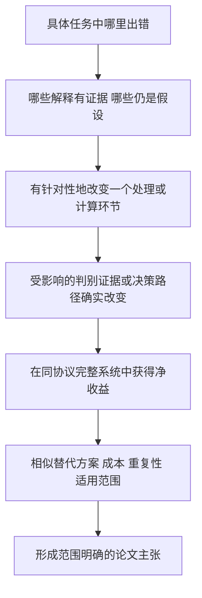

# 论文主张、机制与证据链

日期：2026-10-12。依据用户要求整理；这是当前研究的逻辑图与实验设计，不代表启动或完成了新训练，也不替换现有论文主模型。

## 2026-10-13：开展前的收益判断与最小下一步

**执行更新：用户随后批准，本计划的五档检验现已完成。** 详见 [实验报告](E:/临时会话/residual_strength_path_20261013/FINDINGS_ZH.md)。源FIT选joint25%、global100%；OSS2 B16源选joint OA/BA+0.4012/+0.3002pp，五组BA四正，SD0.5004，相对count+0.8198/+0.2485pp；B128为+0.0640/−0.0980pp，仅减轻原joint退化。交集显示仅保留约25%/27%的端点救回，同时撤销约79%/74%的误伤，不是只去掉坏更新。joint B128所有已测非零档平均BA负，但global25%/50%有诊断正收益，源端选100%未迁移。由此保留小预算候选、暂停扩大逐类幅度研发；下一步若推进，先检验共享力度选择信息，而非直接换损失。源108/外部10单元、零新拟合，两个测试及独立审阅完成。**以下保留开展前计划与判断，过去的“尚未执行”以本更新为准。**

用户要求先分析、判断收益可能性再开展。本节只复核已有CSV、实现和协议；**没有运行新模型、拟合、强度扫描或训练**。下面的强度路径检验仍是计划，不是新结果。

### 判断：值得做低成本判别，不支持立即扩大模块研发

目前有“修正能救回样本”的直接证据，但没有充分证据证明我们已经能可靠保留这些救回、同时减少误伤。上一轮局部均值正收益应该保留，但不能当作后续必然涨点的保证。

复核OSS2 B16的五组配对BA差：

| joint的参照 | 五组均值/百分点 | 支持抽样描述性标准差 | 去掉收益最大一组后其余四组均值 |
|---|---:|---:|---:|
| raw | +0.5311 | 1.4241 | −0.0257 |
| global | +0.6712 | 1.2799 | +0.2115 |
| count | +0.4794 | 1.5773 | −0.1341 |

最后一列仅用于说明对单次抽样的敏感性，不删除该抽样、不改正式五组结论，也不是新的显著性检验。结论是：相对共享强度有值得追踪的信号；相对原模型和现有计数方案的稳定优势仍不充分。不能直接说所有退化只是随机波动。

现有class_summary.csv提供的完整联合模型救回/误伤，均用原查询集的类别分母计算：

| 范围 | B | 救回贡献/BA点 | 误伤贡献/BA点 | 净BA变化 | 假设救回完全保留，持平raw至少要去掉多少误伤 |
|---|---:|---:|---:|---:|---:|
| OSS2 | 16 | 4.6152 | 4.0841 | +0.5311 | 已有净正收益 |
| OSS2 | 64 | 3.2937 | 3.7811 | −0.4874 | 12.89% |
| OSS2 | 128 | 4.7268 | 5.4966 | −0.7698 | 14.00% |
| 23港 | 64 | 2.0324 | 2.6234 | −0.5910 | 22.53% |
| 23港 | 128 | 1.7880 | 3.1106 | −1.3226 | 42.52% |
| F_0921 | 64 | 2.4426 | 3.8465 | −1.4039 | 36.50% |

这些不是可兑现收益预测。计算式为max(0,误伤−救回)/误伤，仅表示理想保留全部救回时的收支要求；若削弱修正也丢掉救回，所需代价更高。超过已有强count等参照也需要额外收益，不是只持平raw就算新模块成功。

### 最有根据的解释排序

1. **已观察：风险改善与决策改善没有一致兑现。** OSS2 B128的支持到查询风险效用排序相关较高，但BA下降；广覆盖风险改善又大部分可由共享强度复现。不能据此说Brier本身错误，也不能保证换CE或margin就涨点。
2. **已观察：有些范围的效用估计不能迁移。** F_0921 B64的风险效用相关弱且方向不利；支持折外分数被用于拟合gamma，其拟合改善并不是gamma的独立验证。换一个损失未必补上这一信息缺口。
3. **待检验：修正强度可能越过了有用决策区间。** 若救回在较小强度已发生，而误伤主要在更强修正后发生，就可能用更少改动保留净收益；当前没有计算过这条路径，不能把它写成已证实的根因。

本轮独立代码审阅已完成，没有新证据要求重跑梯度或源头检查。暂不加注意力、不增加逐类参数、不全量嵌套CV，也不直接更换训练损失。

### 下一步只检验一个具体假设

**问题：沿现有已学修正方向，是否存在一个可由源端选择、在留船任务仍有用的较弱修正强度？**

```text
已有修正确实救回样本，但误伤抵消收益
  -> 假设部分误伤来自修正过强，而非整条方向无效
  -> 不改变方向/表示，只减弱当前已学修正
  -> 比较救回与误伤分别何时出现
  -> 源端选定的同一个规则是否获得完整净收益
```

拟用现有缓存定义实际专家logit路径：

\[
z_E^{(\alpha)}=z_E^{raw}+\alpha(z_E^{joint}-z_E^{raw}),
\qquad \alpha\in\{0,0.25,0.5,0.75,1\}.
\]

这等价于gamma(alpha)=1+alpha*(gamma_joint−1)，保持源先验与原残差不变。每次重新计算原有softmax及等权概率融合；不是对两套完整概率做线性混合，不把两者混为一谈。alpha=0为raw、1为上一轮joint。

**第一步只做缓存可行性检验。** 使用上一轮固定tau的源FIT81与源HELD27单元；不重新求核、不再训练gamma。源FIT按完整BA选一个跨预算共享alpha，同分选择更小干预，OA与宏Brier同时保留。随后在原源HELD评价这个固定alpha。HELD已被反复用于研发，这里只是留船开发诊断，不称新独立确认。

为避免只给joint额外的强度选择机会，global也走同样五点路径，并在相同源FIT上独立选择一个共享alpha；比较两者实际可选的完整方案，不只比较joint最佳中间点和global旧端点。源端选择冻结后，紧凑观察OSS2 B16/B128的全部五组支持：B128回答风险改善却分类退化，B16观察原有局部收益是否保留。外部完整五点曲线只作预先规定的机制诊断，不反过来选择alpha。若源HELD与OSS2结论不同，分别解释迁移范围，不把源HELD处处获胜设成先验要求。

保留raw、global、count、已有简单衰减的对应配对结果。逐强度观察救回、误伤、BA/OA和主要类别，而不是只报每个任务最高点。诊断曲线上的任务最优alpha可以说明该路径是否有空间，但不能当成可部署结果；同一规则要靠源FIT选择，不能按查询真值逐图、逐类或逐目标挑选。

**根据结果直接作设计决定：**

- 若较弱强度保留大部分救回、明显减少误伤，而且源端选定规则在留船或上述外部诊断的明确范围内兑现净收益，保留这种最简规则，再补相邻预算及必要范围，不先扩大架构。加入相同选择机会的global、已有count强参照，不仅对raw比较。外部发现的范围仍标为探索性，不改成事前确认。
- 若曲线有可观空间，但源端选择不能兑现，则下一步只研究哪些预测时可得信息能识别有益更新；候选限于原/新决策间隔、更新幅度与支持交叉拟合信号，先低维判别，不堆深层门控。是否能预测救回和误伤必须在未用于该判别器拟合的船上评价。
- 若这些固定方向的中间强度也不能产生值得成本的净收益，就不继续微调八维幅度；保留原方案、计数锚定和局部正结果，把这条路径降优先级。该结论只适用于本有限方向/强度范围，不能说所有适配方法都无效。

没有必要先重跑25任务，也不需要为一个尚无净收益的候选增加三个神经训练种子。只有这一步给出可利用的完整收益，才讨论更复杂的“决策相关效用模块”或损失改造；简单规则已足够时，不为模块数量增加复杂性。

### 值不值得做的当前结论

**值得做上述缓存级小检验，不值得现在直接扩大训练或承诺换损失能涨点。** OSS2已有较大救回量和部分可迁移风险效用，是优先研究线索；F_0921 B64和23港B128当前证据更弱，不应先把它们设为必须攻克的全面提升目标。不要求每个港口、每次抽样都赢，但新增收益需超出最相关的简单替代，且不能只依赖事后选出的最好一组。

这次计划的新增问题是“修正方向与修正幅度能否分开”，不同于重复调原残差强度或重复验证Brier下降。即使成功，常规收缩本身也不包装为核心创新；后续贡献应由可解释的效用利用机制与任务证据支撑。

证据来源：classwise_utility_adaptation_20261012下target_comparisons.csv、class_summary.csv、utility_alignment_summary.csv、core.py、FROZEN_CHOICE.json与TEST_AUDIT_ZH.md。未产生新实验结果。

## 更新：逐类残差效用模块已完成

2026-10-12后续实际执行见 [FINDINGS_ZH.md](E:/临时会话/classwise_utility_adaptation_20261012/FINDINGS_ZH.md)。以下新增证据不覆盖下文较早快照，也不将侧线输入证据与本轮增益相加。

| 逻辑环节 | 新证据 | 当前主张 |
|---|---|---|
| 问题 | 前轮23港B128低支持类限制使BA下降0.943pp；高支持类更新有OA收益但伴随BA损失 | 数量不能直接代表修正可靠性，需要关心真实任务效用 |
| 针对性改变 | 用船级支持交叉拟合预测，在实际双路概率融合下联合优化8个残差幅度；只用原B个标签 | 已实现低维、完整系统感知的逐类适配候选，而非新增表示或纯因果因素 |
| 简单替换 | 共享1个幅度、各类各自拟合、原修正器与计数锚定；tau只在源FIT选 | 逐类自由度的价值主要看joint-global；joint-self包含多个设计差异 |
| 完整正收益 | OSS2 B16 OA/BA+0.2965/+0.5311pp；对共享强度+0.8663/+0.6712pp，五组BA四正；源HELD B128也有正信号 | 保留小预算的局部新增价值，不要求各处获胜 |
| 机制边界 | OSS2 B128风险效用排序Spearman0.796，却BA−0.7698pp；23港B128宏Brier−0.02399、BA−1.3226pp | 风险效用可学与分类收益需要分别评价；大部分广覆盖风险改善可被共享强度复现 |
| 估计可靠性 | 23港B128效用符号一致75.8%，不胜一律猜有益75.9%；F64效用相关−0.294 | 当前OOF风险也用于拟合gamma，不是其独立验证；不能宣称已可靠避害 |

下一步尚未运行：先独立检验gamma效用估计，并分析可预测的救回/误伤空间，再决定是否需要改变损失；不自动追加模块或选择目标最优策略。主模型保持不变。

## 1. 先定论文要回答的问题

工作主线候选：中低分辨率SAR跨港识别中，不同表示的任务贡献会随输入条件改变，少量目标支持案例的校正作用也随预算和组成改变；研究怎样利用有用证据，在明确的任务范围内取得可解释、值得成本的净收益。

目前已分别观察到“输入处理依赖”和“支持预算依赖”，尚未证明两者由同一个机制导致。不能先把它们命名为一个统一创新，再用彼此不对应的实验拼接论证。

写作前采用以下逻辑，而非先列三四个模块：



当前两条研究线的关系：

```text
侧线：输入处理改变 -> 两路的实际任务收益改变             [已有紧凑模型证据]
                     -> 哪种因素、哪类证据主导           [尚待拆分]

主线：支持预算/组成改变 -> 原修正器的完整系统收益改变       [已有扩大覆盖证据]
                        -> 如何事先判断何时修正          [尚未解决]

共同机制 -> 针对性修复 -> 在完整模型中兑现                 [待验证，不画成已证实箭头]
```

## 2. 核心主张与当前证据

| 主张 | 已有证据 | 目前能说什么 | 关键缺口 |
|---|---|---|---|
| C1：输入处理影响第二路的任务贡献 | 同先验专家T-R的BA收益，OSS1原图+3.1505点、拉伸后+0.8655；OSS2为+2.4742到+0.7204；同支持、同网络，配套重求支持系数 | 在这套紧凑模型和处理下，第二路收益依赖输入呈现 | 亮度、对比度、截断尚未单独隔离；不是唯一物理根因 |
| C2：第二路包含相对现有重建器仍有用的表示部分 | 公开集P/E分解、固定先验、重求支持核后有风险收益；拉伸后剩余部分仍有作用 | 当前第二路与给定第一路/重建器存在任务互补 | 不能说任何单骨干都无法获得，也不能直接命名为两种独立物理机制 |
| C3：少标注时支持修正在特定范围有用 | F_0921 B16原修正器OA+0.2179、BA+0.8684，五组BA四正一负、类别宏Brier改善；B64没有相同收益 | 保留F小预算的局部效用 | 为什么是这些类别/支持关系获益，尚需针对性定位；当前不是通用启用规则 |
| C4：分支变好不保证系统同幅改善 | 完整接法的先验/专家/融合分层结果；固定候选及支持CV扩大覆盖 | 要对实际部署的完整决策链评价，而不是拿教师或先验收益代替系统收益 | 不能据此承诺任何新损失必然奏效；现有CV选择在部分任务失败 |
| C5：新增预算训练优于已有修正 | 同14港B64拆分训练相对原修正器仅+0.0016 BA；OSS2 B128约+0.0001 | 暂不升格为核心贡献，已有修正的收益继续保留 | 如无新的可利用收益空间，不继续堆训练复杂度 |

上述数值分别来自不同协议，只用于各自的配对论证，不相加、不混用绝对分数。C1/C2的紧凑对照不是最新完整模型；C3的公共查询也不同于完整接法原查询。

## 3. 每个组件必须交代什么

不是所有工程组件都要包装成创新模块。拟保留的组件至少应说明：输入和输出是什么；针对哪个已观察问题；改变了哪条计算路径；什么结果将支持或削弱该解释；和最接近的简单替代相比多了什么。

| 组件或设计 | 应回答的问题 | 针对性证据与合理替代 |
|---|---|---|
| 第二路表征 | 增益来自可重建部分、剩余表示、分类先验，还是它们的交互？ | 复用已完成的先验/核交叉与重建对照；强单路在公平完整协议下比较。既有对照不重跑，新的因素结论才需要对应补测 |
| 分频表示与频带权重 | 是分频表示本身有用，还是逐样本动态选择有用？ | 分开比较固定融合与已学到的固定偏好、真实动态选择；沿用已有结果，不因权重图不同就声称注意力有效 |
| 支持修正及核 | 是否改善跨港同类案例关系，还是只改变分数强度？ | 同先验同支持下重新求解核系数，配合跨港跨船检索、连续风险与完整OA/BA；最相关替代是无修正、现有简单衰减及原修正器，不先增加大量距离函数 |
| 先验与最终融合 | 改好的证据在哪一步被保留、削弱或误伤？ | 分层分数、救回/误伤、先验/核交叉；复用四种固定接法及CV结果，不挑选目标最优接法作为新算法 |

若论文以后具体主张某种相似度或聚合形式不可替代，再加入少量合理替换，例如匹配尺度的点积/余弦，或等权/固定可学习/条件融合。各方法获得相当的源侧选择与优化机会，不能只把替代方案设成弱基线。

## 4. 下一轮最小针对性设计

以下尚未执行，也不在本次文档整理时自动启动。

### 第一步：定位输入因素，而不开发新模块

复用侧线固定模型和已有样本。把原显示拉伸拆成浮点亮度平移、保持均值的对比度缩放、截断开关；8位取整另作实现因素，不能混入某个所谓纯因素。每个变换先确认实际改变了什么，而不是只凭函数名称命名。

- 问题：哪种操作真正改变了第二路相对第一路的帮助？
- 固定：样本、支持身份、模型、评价规则；同时处理支持与查询，按既定流程重求系数。
- 观察：实际灰度统计、同先验T-R和PE-P的风险/BA增量、逐类救回与误伤；总分只是其中一项。
- 判别：若不截断的对比度改变仍影响第二路收益，则不能把全部效应归给截断；若只在截断后出现，则优先研究极端灰度细节。结果可为交互效应，不强求唯一因素。
- 参数范围先用源侧或无标签输入统计确定并冻结，不根据目标准确率挑选。操作是模型敏感性探针，不冒充真实SAR物理成像干预。

### 第二步：区分旧模型不匹配与有效线索损失

只对第一步有明确任务效应的因素，比较固定源模型与源/目标一致处理、配套重拟合几何/先验/重建器的版本。保持数据与信息预算，包含同样重拟合的原图参照；不同时叠加新骨干或新损失。

问题是：观察到的损失是否能被一致的源侧学习恢复？若恢复，支持“既有源模型与输入不匹配”这条解释；若未恢复，不能立刻证明信息已丢失，还需区分当前学习器能力与变换信息损失。仅在已有证据能够利用收益空间时进入方法开发。

### 第三步：对准因素改方法，再验证完整链

若第一、二步支持一个可利用的具体问题，再选择最小修改。必须同时回答：方法是否改变了被定位的中间证据；哪些原本受影响的样本/类别获得改善；对照替换是否能同样做到；完整模型是否保留增益及其成本。

保留原始结果和明确的失败情形。不要求每港每类全胜，但不能只展示成功例。输入处理与预算修正是否存在有益交互应在此阶段直接测量，不能把两条独立路线的涨幅相加。

## 5. 统计与可解释性口径

正式保留的随机训练方法，计划至少三个真实训练种子，报告均值、标准差和配对效应；训练种子与支持抽样分开。已有两个种子的训练结果仍按两个报告，不临时把五组支持当作五个训练种子，也不为每个已否定的探索方案补齐三次训练。

配对t检验不是对所有表格的机械要求。先说清结论针对固定模型的新查询、支持抽样变化、训练随机性还是新港口，再确定配对单位和检验。Bootstrap同样要保留同船/采集等真实依赖；不能把同一艘船的多张图或同一查询在多次支持下的重复预测当成独立新样本。固定模型的查询置信区间不能替代训练波动或支持波动。

t-SNE/UMAP、注意力和激活图用来展示或发现线索，不单独承担机制证明。表示更好优先用跨港跨船类别检索和任务读出定量支持；说某条证据导致收益，则需要对应干预、替换或受控路径比较。中间指标改善和完整系统提升分别报告，不以其中之一否定另一层已证实的进展。

主要看效应大小、区间、成本和适用范围，不把某个p值当作论文录用开关。统计可重复性也不把长期研发数据变成独立确认数据。

## 6. 证据来源

- 本地主线：`E:/临时会话/frozen_candidate_coverage_20261012/FINDINGS_ZH.md`及readout/budget配对CSV。
- 本地侧线：`E:/临时会话/ports_input_controls_20261012/FINDINGS_ZH.md`、`cue_primary.csv`；侧边聊天2026-10-12 18:31前实际讨论。
- 本地表示对照：`E:/临时会话/dual_cue_decomposition_20261012/FINDINGS_ZH.md`、`E:/临时会话/ports_public_data_study_20261012/FINDINGS_ZH.md`。
- 方法学参考：Wattenberg, Viegas, Johnson, How to Use t-SNE Effectively, Distill, 2016, DOI 10.23915/distill.00002，支持降维图解读的局限性。
- 方法学参考：Demsar, Statistical Comparisons of Classifiers over Multiple Data Sets, JMLR 7, 1-30, 2006，支持按评价问题与统计条件选择比较方法，不机械套t检验。
- 方法学参考：Bouthillier et al., Accounting for Variance in Machine Learning Benchmarks, MLSys, 2021，支持区分数据抽样、初始化及其他变异来源。以上文献不替代我们自身的方法机制证据。

## 写进论文的规则

每个方法小节先回答“为解决哪个已证实问题”，再写公式；每个实验小节先写它检验哪个主张，最后回到该主张及边界。新增贡献仍须有清楚的意义与已有工作的区别，但不追求绝对原创，也不靠模块数量或更复杂的训练叙事补足证据。
