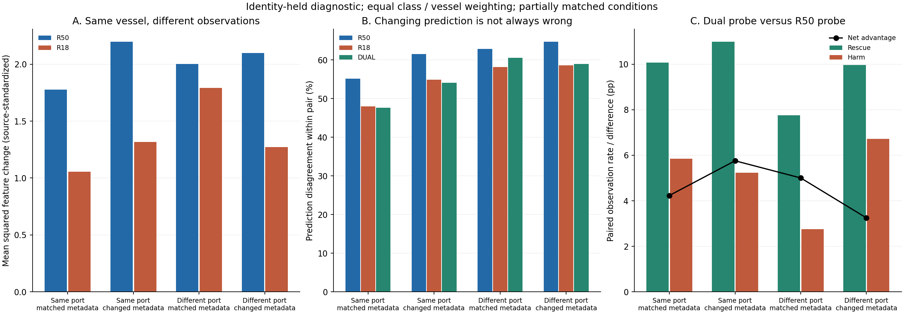
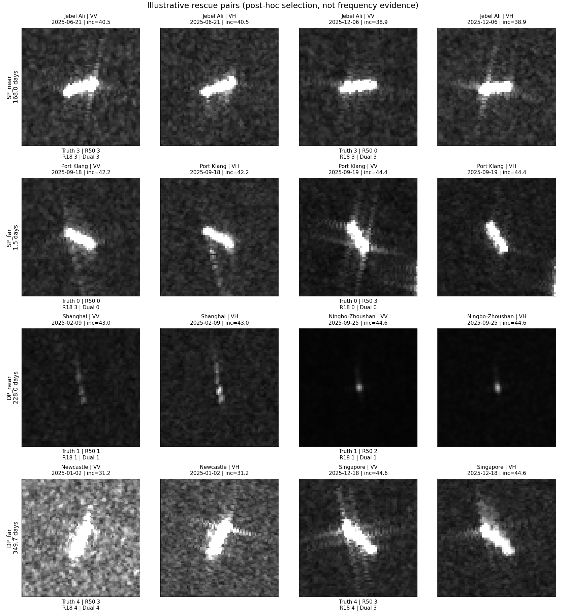
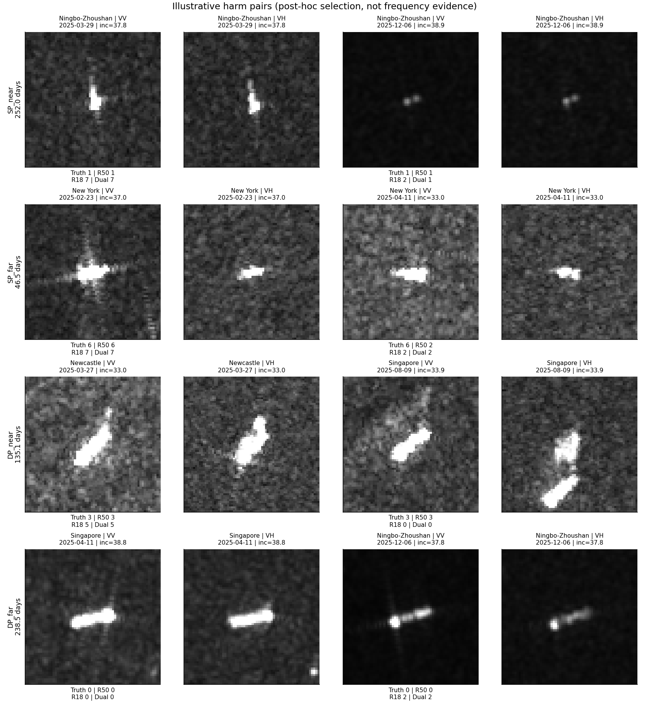

# 同船、跨港与观测条件：四组诊断

日期：2026-10-10。已完成元数据分组、三折按MMSI留出的冻结表示诊断和正负案例。未修改主模型。

## 先说清楚这轮测了什么

- 每对真实重复观测使用相同的网络缓存、源拟合标准化/PCA、分类头及64个参考案例，避免把不同港口模型混入成像变化。
- 使用共有的ImageNet R50配对VV/VH特征，以及源任务训练前的冻结SAR-SSL R18特征。不是当前各港分别训练过的R18专家，不是完整模型性能复测。
- 三折按MMSI分离；标准化、PCA128/64和岭分类头只拟合另外两折。类别/船舶等权拟合；相同船的全部港口和时相只出现在一折。
- 诊断分类头使用拟合折全部标签；64个参考案例用于邻近关系诊断，不是论文64目标标签适配协议。不存在新增64标签方法增益声明。
- MMSI为身份代理，既有冻结预训练曝光未撤销。训练与留出折可能共享港口及采集场景；结果不是物理因果鉴定，也不是独立外部确认。

## 配对覆盖

| 组别 | 观测对 | 船舶身份 | 类别数 | 时间差中位数/天 | 相对方向可比对 | 方向差≤10° |
|---|---:|---:|---:|---:|---:|---:|
| 同港/条件近似匹配 | 8919 | 2454 | 8 | 72.0 | 552 | 104 |
| 同港/条件明显不同 | 2035 | 787 | 8 | 81.5 | 152 | 18 |
| 跨港/条件近似匹配 | 574 | 370 | 8 | 108.0 | 3 | 1 |
| 跨港/条件明显不同 | 2174 | 1041 | 8 | 96.0 | 63 | 7 |

近似条件：同卫星平台、同升降轨方向、入射角差≤2°。明显不同：平台/升降轨变化或入射角差≥5°。未假定船体相对方向、背景、海况、载荷与航行状态一致。方向代理相近仍不等于所有条件相同。
全部配对及未匹配组在pairs.csv；配对共享船舶/影像，不是独立样本。以下组均值先船内平均，再类内船等权，再类别等权。

## 原始分组结果

| 组别 | R50特征变化 | R18特征变化 | R50预测变化% | R18预测变化% | 双路预测变化% | R50配对正确率% | 双路配对正确率% | 双路净纠错pp |
|---|---:|---:|---:|---:|---:|---:|---:|---:|
| 跨港/条件明显不同 | 2.099 | 1.273 | 64.69 | 58.60 | 58.97 | 38.96 | 42.21 | +3.25 |
| 跨港/条件近似匹配 | 2.001 | 1.791 | 62.83 | 58.17 | 60.53 | 45.97 | 50.98 | +5.00 |
| 同港/条件明显不同 | 2.197 | 1.317 | 61.55 | 54.84 | 54.10 | 43.22 | 48.98 | +5.76 |
| 同港/条件近似匹配 | 1.777 | 1.055 | 55.11 | 47.93 | 47.59 | 44.26 | 48.49 | +4.23 |

特征变化为拟合折标准化后的维均方差；更小不自动意味着保留了更多类别信息。预测变化包括纠错，不能全部当成退化。配对正确率按上述层级平均两端正确率，不是LOPO主表OA/BA。

## 时间与样本构成核对

公共类别×时间间隔格：13个。每格四组均至少5个MMSI，格内先船等权，再公共格等权。此对照仍未控制所有船舶及观测因素。

| 组别 | R50变化 | R18变化 | R50预测变化% | 双路净纠错pp |
|---|---:|---:|---:|---:|
| 跨港/条件明显不同 | 2.070 | 1.327 | 64.44 | +6.62 |
| 跨港/条件近似匹配 | 2.198 | 1.676 | 63.84 | +9.79 |
| 同港/条件明显不同 | 2.324 | 1.265 | 63.53 | +5.82 |
| 同港/条件近似匹配 | 1.833 | 1.066 | 60.36 | +4.80 |

## 同一批船内比较

只保留同时有两种配对情形的船：先分别求每艘船的组内均值，再相减，最后类别等权。区间为300次类内船舶重采样的描述性95%区间；不代表控制全部混杂后的因果效应。

| 对照 | 共同船舶 | R50特征变化差 | R18特征变化差 | R50预测变化差pp | 双路净纠错差pp |
|---|---:|---:|---:|---:|---:|
| same_port_condition | 413 | +0.228 | +0.365 | +2.216 | +0.369 |
| port_under_near_metadata | 126 | -0.162 | +0.288 | +10.919 | +9.495 |
| cross_port_condition | 121 | +0.121 | -0.630 | +6.259 | +7.635 |
| port_under_far_metadata | 165 | +0.194 | +0.458 | -0.486 | +3.577 |

完整区间见common_ship_contrasts.csv；公共格明细见common_class_time_cells.csv。稀疏子集只能作线索，不能推广到全部船型。
实际发现部分共同船舶对照中的类别只有1—2个MMSI；该类重采样不能反映未观测船舶的变异，不能据此把原区间解释为总体显著性。

### 稀疏类别根源检查

以下是看到上述稀疏性后增加的解释性检查：只统计每类至少5艘共同船，原全类别结果不替换，不据此调模型。

| 对照 | 共同船舶 | 保留类别 | R50特征变化差 | R18特征变化差 | 双路净纠错差pp |
|---|---:|---:|---:|---:|---:|
| same_port_condition | 413 | 8 | +0.228 | +0.365 | +0.369 |
| port_under_near_metadata | 121 | 4 | -0.033 | +0.047 | +1.743 |
| cross_port_condition | 116 | 4 | +0.087 | +0.034 | +2.770 |
| port_under_far_metadata | 156 | 5 | +0.203 | +0.143 | +0.973 |

按类的贡献与船数见common_ship_class_contrasts.csv。条件组差异不是一个可自动解释为物理强弱的连续等级。

## 完整观测集的诊断读出

| 读出 | 观测OA% | 观测类别平均召回BA% |
|---|---:|---:|
| r50 | 49.194 | 45.377 |
| r18 | 50.252 | 46.112 |
| dual | 53.852 | 49.998 |

这是跨身份、混合港口的冻结表示探针，不是目标港完全留出的跨港准确率。不能与论文当前主表数值直接比较。

## 可追溯案例

每组分别选择存在双路救回/误伤的候选中，R50特征变化处于中位位置的一对；不是随机频率估计。选择规则、行号在case_selection.csv。原图不作重新成像或方向模拟。

## 下一步解释边界

- 若同港条件变化的关联在公共时间格、共同船舶中仍在，支持继续研究观测条件响应，而不是直接删除全部同船变化。
- 跨港近似匹配仍缺相对方向等控制，剩余差异不能直接命名为港口物理效应。
- 第二路更稳定与第二路有用是两件事，需联合净纠错及类别/案例关系变化判断；不能从网络名字分配轮廓或散射职责。
- 若要归因当前任务训练后的R18，需要在共同且身份隔离的训练设定下提取配对两端；本轮不借用不同港口的不同权重作这种证明。
