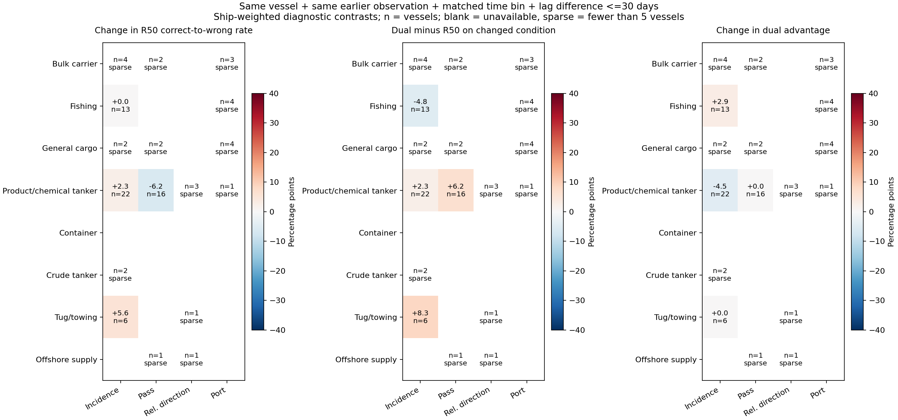
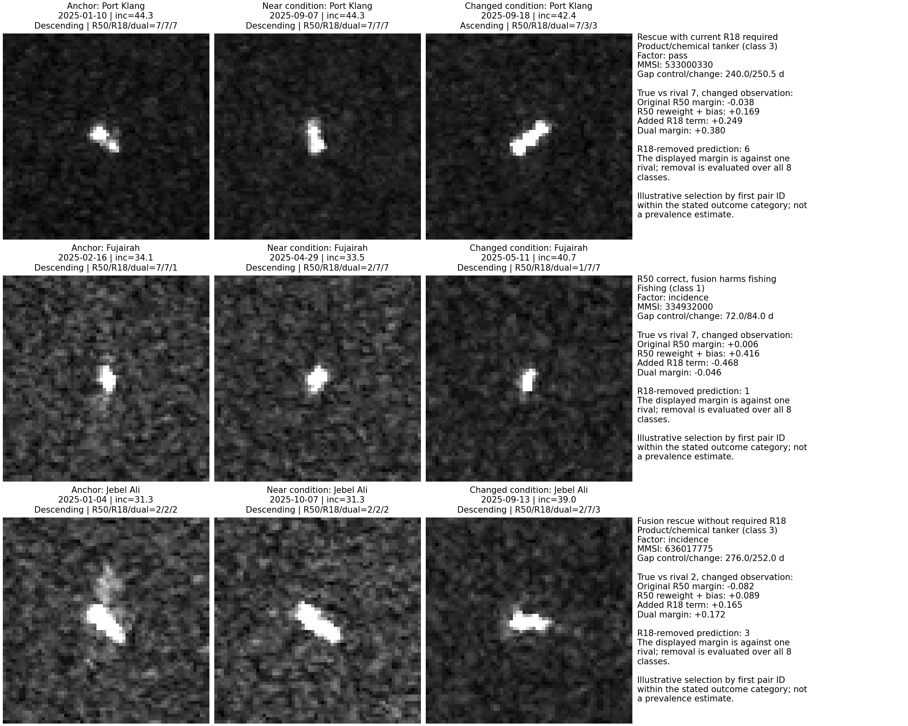

# 条件变化破坏了什么，第二路对哪些船型有用

2026-10-10。沿用已冻结的三折身份留出诊断模型，只做分析与分数干预；没有重新训练，没有改动论文主模型。

## 结论先说

**找到了明确的船型差异和模型内部的救回/误伤来源，但尚未建立“某种条件变化普遍破坏同类关系，再由第二路修复”的完整因果链。**

不能把这轮解释成没有结果：现在已经能区分“第二路确实提供必要证据”“联合训练改变第一路权重即可救回”“第二路反而压过正确证据”三种情况。它们对后续设计的要求并不相同。

## 1. 这次具体做了什么

分析四类变化，全部来自真实重复观测，不拿图像旋转代替真实观测方向变化：

| 因素 | 变化组 | 对照组与已匹配条件 |
|---|---|---|
| 入射角 | 差值至少5度 | 差值至多2度；同港、同平台、同升降轨 |
| 升降轨 | 升降轨不同 | 升降轨相同；同港、同平台、入射角差至多2度 |
| 相对方向 | 轴向差至少25度 | 轴向差至多10度；同港、同平台、同升降轨、入射角差至多2度 |
| 港口 | 港口不同 | 港口相同；同平台、同升降轨、入射角差至多2度 |

这里的“控制”只针对已知元数据。没有控制海况、装载状态、背景，也没有把缺失的相对方向当作相同。相对方向还是图像估计的船体轴与雷达距离轴的关系，不是已验证的真实航向。

新增严格三时相配对：同一艘船、同一个较早参考观测，各找一个近似条件和一个变化条件的后续观测；两者与参考观测处于同一个时间间隔档，间隔差不超过30天。按时间差最近进行一对一匹配，不查看预测结果。每艘船内部先平均，再按船等权。

| 因素 | 原变化配对数 | 严格三时相组数 |
|---|---:|---:|
| 入射角 | 959 | 93 |
| 升降轨 | 269 | 46 |
| 相对方向 | 314 | 8 |
| 港口 | 574 | 14 |

总计161组三时相对照，涉及82艘不同MMSI船舶。同船可能贡献多组，不能把161组当成独立船舶。入射角和升降轨有部分可分析船型；严格相对方向和跨港对照在每个船型中均不足5艘。

## 2. 先回答：哪些船型的第二路值得保留

下表用于定位候选，不是条件因果效应。采用变化组全部可用观测，后时相去重后先在船内平均、再按船等权。单元格为“联合相对R50净变化/百分点（船数）”；它不是整套数据集的OA或BA。

| 船型 | 入射角变化 | 升降轨变化 | 相对方向变化 | 跨港、已知条件近似 |
|---|---:|---:|---:|---:|
| 散货船 | +9.52（68） | +17.39（23） | 0.00（11） | +11.57（193） |
| 渔船 | -0.45（164） | 0.00（1，稀疏） | 无数据 | +0.66（76） |
| 杂货船 | +17.38（35） | 0.00（14） | 0.00（4，稀疏） | +9.78（52） |
| 成品油/化学品船 | +0.48（104） | +2.84（35） | +3.47（96） | +8.33（18） |
| 集装箱船 | +13.16（19） | 0.00（13） | -25.00（8） | +9.09（11） |
| 原油船 | +17.41（27） | -11.11（3，稀疏） | -17.62（15） | +7.69（13） |
| 拖轮 | +3.33（30） | +6.25（8） | +5.88（17） | 0.00（6） |
| 海工补给船 | -33.33（3，稀疏） | -35.00（4，稀疏） | 0.00（4，稀疏） | 0.00（1，稀疏） |

**值得继续利用的候选：**入射角变化子集中的散货、杂货、集装箱、原油船，以及跨港子集中的散货和杂货船。这里的样本量与收益都有实际参考价值，但尚不能说收益由特定物理变化导致。

**需要保护的失效子集：**相对方向变化子集中的集装箱船、原油船。前者8艘、后者15艘，不能当成普遍定律，但负结果不应忽略。去重前后原油船分别为-19.52和-17.62个百分点，方向一致，不能仅用重复配对解释掉。

## 3. 为什么渔船和其他船型受益不同

入射角变化子集、后时相去重后：

| 船型 | R50正确率/% | 救回占比/% | 误伤占比/% | 联合净变化/pp |
|---|---:|---:|---:|---:|
| 渔船 | 94.72 | 1.68 | 2.13 | -0.45 |
| 杂货船 | 26.95 | 21.52 | 4.14 | +17.38 |
| 原油船 | 57.78 | 21.11 | 3.70 | +17.41 |

这些是同一套诊断读出、同一统计口径。渔船已有约95%识别正确，可救回空间很小，少量误伤便抵消收益；杂货船和原油船的收益来自救回明显多于误伤。**收益机会不同，是已经能量化的原因；“某船型独有某种散射机制”，这轮没有证明。**

相对方向变化子集中，原油船R50正确率约69.52%，独立R18约40.95%，联合约51.90%；集装箱船分别50%、12.5%、25%。这说明这些子集中第二路的独立判别证据较弱，并且联合没有有效保护第一路的优势。两路独立预测对错仍不能替代联合头内贡献分析。

## 4. 严格同船同参考对照，没有支持简单的条件损伤故事

只将每个条件-船型至少5艘的结果放进主表，其他原始结果保留在CSV。这个数量只是展示门槛，不等于统计充分。

| 因素与船型 | 船数 | 条件变化后R50由对变错率增加/pp | 变化观测中的联合净收益/pp | 相对近似条件，联合优势变化/pp |
|---|---:|---:|---:|---:|
| 入射角：渔船 | 13 | 0.00 | -4.81 | +2.88 |
| 入射角：成品油/化学品船 | 22 | +2.27 | +2.27 | -4.55 |
| 入射角：拖轮 | 6 | +5.56 | +8.33 | 0.00 |
| 升降轨：成品油/化学品船 | 16 | -6.25 | +6.25 | 0.00 |

注意最后一列：拖轮的+8.33、升降轨组的+6.25，并没有比近似条件时更多。因此“这个条件下联合有效”不等于“联合专门抵消了这个条件的变化”。

四个有最低样本支撑的单元中，R50同类参考关系优势的变化差值均为正，且船级重采样区间均跨零；没有证据支持在这些配对中它普遍恶化。成品油/化学品船入射角组由对变错率差值+2.27个百分点，描述性95%区间约[-11.36, 15.91]。

目前不能据此认定条件没有作用：分类响应可能非单调，平均会抵消异向变化；相对方向及未记录条件未完全控制；配对覆盖也有限。上述是剩余解释，不是已经查明的物理根因。本轮不再调整角度阈值寻找正结果。

## 5. 第二路究竟在哪个环节起作用

保持联合分类头不变，把R18输入换为其PCA源均值，检查完整八分类预测。这里测的是当前联合头对R18输入的依赖，不是与重新训练的单骨干公平比较，也不代表第二路训练过程没有影响第一路权重。

- 入射角、成品油/化学品船严格配对：联合救回占4.55%，误伤2.27%，净收益2.27个百分点；这些救回在移除当前R18输入后仍然保留。不能全记为第二路直接补回信息。
- 入射角、拖轮严格配对：救回8.33%，误伤0；这些救回依赖当前R18输入。但只有6艘船，5艘来自纽约，不能扩大为普遍机制。
- 升降轨、成品油/化学品船严格配对：救回12.50%，误伤6.25%，净收益6.25个百分点；这些救回依赖当前R18输入。16艘中14艘来自巴生港，仍存在港口/场景集中。
- 入射角、渔船全部变化配对：12条误伤记录全部在移除R18后恢复正确。它确实可能把正确证据压过去，而不只是第一路重拟合产生差异。条数不是独立船数。

图中给出三组真实三时相案例及精确分数拆解，分别展示依赖R18的救回、R18误伤、以及移除R18仍能救回。案例按对应类型中的最小配对ID选择，用于展示存在的决策路径，不用于估计比例。

分数是“真类对某个竞争类”的差值；移除R18后的预测则比较全部八类。可能出现对所列竞争类仍为正、却输给第三类的情况，两者不矛盾。

## 6. 下一步应该改什么

建议将模块目标具体化为：**保留已有效的补充证据，同时避免它压过第一路已经可靠的类别区分证据。** 不是“角度一变就信第二路”，也不是“把同船变化全部抹掉”。

优先研发可以检验的候选是按竞争类别和两路可靠性约束残差校正；先在源身份留出数据上检验是否能保留散货/杂货等救回并减少渔船、方向变化子集的误伤。推理输入只能使用预测概率、两路分歧、可用观测条件等，不可输入本报告事后使用的真实类别或同类优势真值。

这轮没有训练该模块，也没有报告它的收益。是否值得部署双骨干，仍需对计算匹配的强单骨干比较；本分析解释的是既有冻结组合何时帮忙、何时出错。

## 文件与验证

- `PROTOCOL.json`：配对规则与阈值，读取结果前固定。
- `metadata_matches_*.csv`、`matched_triplets.csv`：元数据配对与每组结果。
- `matched_condition_class.csv`：全部条件-船型统计及描述性船级区间。
- `matched_ship_contrasts.csv`、`matched_port_breakdown.csv`：船级与港口分解。
- `descriptive_condition_class.csv`：全部变化组和近似条件组的配对统计。
- `unique_target_outcomes.csv`：后时相去重后的救回、误伤及分数干预结果。
- `illustrative_cases.csv`：图中案例的身份、观测索引、分数与选择规则。
- 两项配对实现检查通过：不使用预测结果、无重复使用配对、遵守参考时相与时间间隔条件、排除缺失轨道元数据。
- 图已实际渲染检查；原有第一、二轮结果未覆盖。

解释边界：MMSI仍是身份代理；采用冻结R50和任务适配前R18的诊断读出，不是论文完整LOPO模型；64个参考案例只用于关系诊断，分类器训练使用训练折全部标签；历史预训练曝光、共享港口/场景仍存在。区间按船重采样，未建模场景相关性、未校正多重比较，不能作为物理因果显著性的证据。
