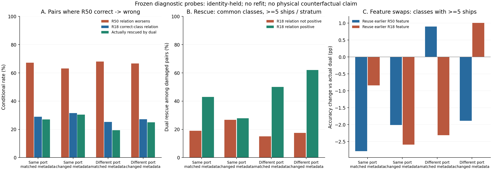
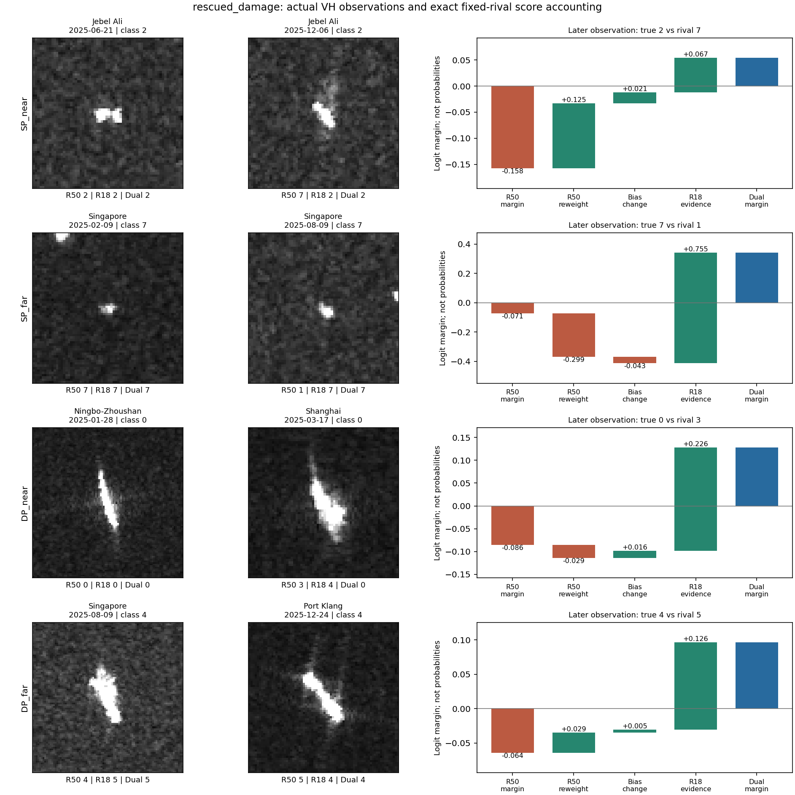
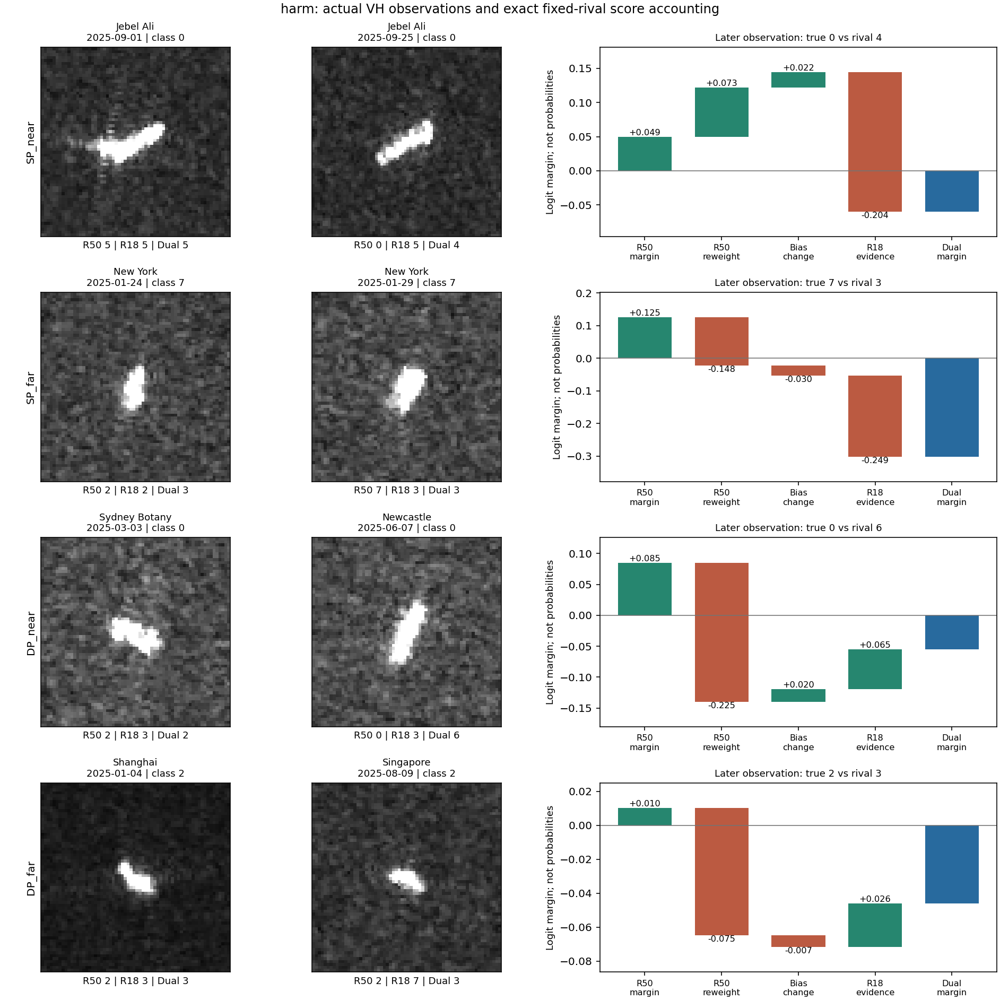

# 同船条件变化：判别关系与第二路贡献

2026-10-10。沿用上一轮三折身份留出的冻结探针；未重训、未调参、未改主模型。所有分类预测与参考关系均重放核对。

## R50从正确变错误时发生了什么

以下仅分析时间较早观测R50正确、较晚观测R50错误的配对。百分比先船内平均，再类内船等权，再类别等权；不同条件子集不一定具有相同类别构成。

| 组别 | 退化观测对 | 船舶 | R50同类关系变差% | R50同类优势由正变非正% | R18后时相同类优势为正% | 双路实际救回% |
|---|---:|---:|---:|---:|---:|---:|
| 同港/条件近似匹配 | 852 | 440 | 67.25 | 23.29 | 28.91 | 27.05 |
| 同港/条件明显不同 | 285 | 183 | 63.10 | 19.91 | 31.53 | 30.42 |
| 跨港/条件近似匹配 | 66 | 61 | 67.98 | 26.55 | 25.24 | 19.35 |
| 跨港/条件明显不同 | 344 | 265 | 66.64 | 16.88 | 27.19 | 24.96 |

同类关系定义：固定64参考案例（每类8艘）中，正确类别的平均点积相似度减去最强错误类别的平均相似度。它是描述性关系指标，不是这个岭分类头的实际参考案例权重，也不直接代表物理散射机制。

## 关系仍有用时，双路是否更容易救回

| 组别 | R18后时相同类优势为正 | 配对 | 船舶 | 双路救回率% |
|---|---|---:|---:|---:|
| 同港/条件近似匹配 | False | 623 | 336 | 18.40 |
| 同港/条件近似匹配 | True | 229 | 131 | 37.58 |
| 同港/条件明显不同 | False | 218 | 146 | 18.42 |
| 同港/条件明显不同 | True | 67 | 49 | 42.23 |
| 跨港/条件近似匹配 | False | 50 | 45 | 9.76 |
| 跨港/条件近似匹配 | True | 16 | 16 | 56.67 |
| 跨港/条件明显不同 | False | 262 | 210 | 14.53 |
| 跨港/条件明显不同 | True | 82 | 65 | 44.46 |

这不是随机干预，也不是可直接部署的路由规则：判断“正确类别优势”用到了事后真值。这里仅用于验证关系指标与纠错是否吻合。
上表两种关系状态的类别构成不同。下表仅在两种状态每类均至少5艘船的共同类别中比较，先类内船等权再共同类等权：

| 组别 | 共同类别ID | 同类优势非正时救回% | 同类优势为正时救回% |
|---|---|---:|---:|
| 跨港/条件明显不同 | 0,2,5 | 17.53 | 62.08 |
| 跨港/条件近似匹配 | 0 | 15.00 | 50.00 |
| 同港/条件明显不同 | 0,3,5 | 26.72 | 27.90 |
| 同港/条件近似匹配 | 0,1,2,3,4,5,7 | 19.02 | 42.95 |

共同类对照仍是关联，不是控制全部观测条件后的因果结论。若只剩一个类别，只能对该类子集作说明。

## 分数贡献拆解

固定同一个真实类别和竞争类别，双路相对R50的分数优势变化精确等于：

`R50原有特征权重变化 + 截距变化 + 新增R18证据`。

同船两个时相在同一双路分类器中的分数变化，则精确等于：`R50路径的时相变化 + R18路径的时相变化`，截距相同抵消。

救回案例竞争类别取R50错误预测；误伤案例取双路错误预测。所有项单位均为logit，不是概率。净准确率贡献不能按这些项线性相加。

| 组别 | 实际救回的退化配对数 | 将R18坐标置源PCA均值后不再救回的配对数 |
|---|---:|---:|
| 同港/条件近似匹配 | 208 | 140 |
| 同港/条件明显不同 | 67 | 54 |
| 跨港/条件近似匹配 | 15 | 10 |
| 跨港/条件明显不同 | 94 | 78 |

置源均值是固定双路分类头下的计算干预，不是重新训练的单骨干对照，更不能证明任何单骨干都无法取得该收益。配对数有重复观测，不是独立船数。

## 把某一路换回前一次观测会怎样

保持后时相的分类器和另一条路径不变，把一条路径替换为同船前时相的真实特征。下表是后时相正确率相对实际双路的变化；正值表示替换帮助，负值表示替换损害。

| 组别 | 换回前时相R50/pp | 换回前时相R18/pp |
|---|---:|---:|
| 跨港/条件明显不同 | -1.887 | +1.008 |
| 跨港/条件近似匹配 | +0.786 | +10.480 |
| 同港/条件明显不同 | -2.008 | -2.589 |
| 同港/条件近似匹配 | -2.782 | -0.839 |

每类至少5艘船的子集结果如下；原全类结果保留。

| 组别 | 类别数 | 换回前时相R50/pp | 换回前时相R18/pp |
|---|---:|---:|---:|
| 跨港/条件明显不同 | 8 | -1.887 | +1.008 |
| 跨港/条件近似匹配 | 7 | +0.899 | -2.309 |
| 同港/条件明显不同 | 8 | -2.008 | -2.589 |
| 同港/条件近似匹配 | 8 | -2.782 | -0.839 |

混合时相特征不一定对应任何真实可成像状态，只能检验该分类器内部路径变化的影响。不是物理反事实、不是可直接部署的新模型，也没有用这项结果选择替换策略。

## 图与案例

每组各在退化救回或误伤候选中，按R50特征变化排序选中位位置的一对。后验说明性案例，不代表总体频率。两路各自最近3个参考案例的身份、类别、图像路径在case_nearest_references.csv。

## 稀疏性与边界

- transition_summary.csv同时保留所有类别和每类至少5艘船两种统计。后一种不替换原结果；缺失类别不能自动补零。
- condition_subsets.csv将入射角明显变化、升降轨变化及相对方向可用的子集单列。这些只匹配已知条件，不是独立物理因子。
- 全部工作仍是共有冻结R50/R18及诊断分类头，不是论文当前各港任务训练后的完整模型。
- 训练与留出按身份隔离，但可共享港口与场景；既有预训练曝光未撤销。
- 单个观测可出现在多个配对中，不能把观测对数当作独立样本量。
