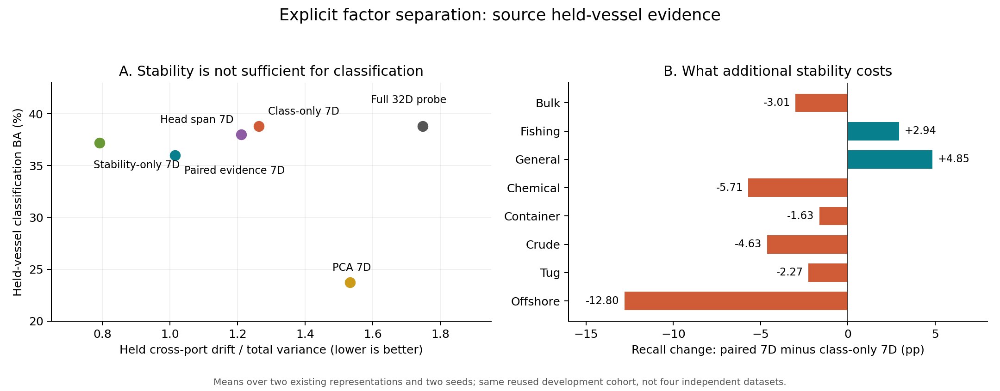

# 显式证据因素分离与过拟合定位

日期：2026-10-11。实验、身份匹配对照、根因诊断及模型导出均完成，原主模型未替换。

## 结论

已将现有32维表示显式分解为7维候选证据和25维剩余信息，导出可用于新样本的映射及可解释分数。候选更稳定，但额外稳定化未产生可靠的增量识别收益，不称为已经识别出纯因果因素。

两个问题必须分开：

- **表示取舍**：配对7维比普通类别7维的未见船跨港漂移低约19.6%，独立类别探针BA却下降约2.8个百分点。普通类别7维已经保留完整32维线性探针的分类结果，而且本身比完整空间稳定。
- **新增校正过拟合**：训练支持回合损失下降，新船、新时相验证损失上升且BA退化，源验证因此将配对校正权重选为0。不是模块没接入，也不说明稳定信息不存在。

## 方法与范围

冻结R18的512维特征进入原32维投影，再用共同的源训练统计白化。类间信号B取等类、等船、等采集的类别均值散布；变化D取同MMSI、不同product、不同港的采集均值差分二阶矩，不对差分去均值。

在白化空间求解 `Bv = lambda * (D/(trace(D)/32) + 0.1I)v`，取前7维子空间并正交化。7来自八类均值最多七个独立对比，不由目标成绩选择。25维补空间在白化度量下正交，不叫纯噪声。

同秩对照：只用类别信号、只用低漂移、白化前PCA、原中心化分类头方向。分类头7维保留类别分数差是代数性质，不是因果识别证据。两个原表示（split_task/relation）、两个种子、五种方法，共20份映射；另拟合20个同容量线性增量校正器，无骨干重训。

源训练1296张/525艘；源未见船823张/302艘。三目标港沿用三个64标签抽样，均为已反复使用的研发数据。不是独立确认、完整主模型或全数据集结论。

## 关键证据与判别代价

下表为两个原表示、两个种子的描述性均值，不是四个独立数据集。漂移使用未见船跨港配对，BA使用全部823张未见船样本，队列不同。

| 空间 | 未见船探针BA (%) | 归一化跨港漂移，低较好 |
|---|---:|---:|
| 完整32维重新拟合探针 | 38.795 | 1.747 |
| 普通类别7维 | 38.795 | 1.263 |
| 配对证据7维 | 36.012 | 1.016 |
| 稳定性7维 | 37.219 | 0.792 |
| 原头7维重新拟合探针 | 38.026 | 1.211 |
| PCA7维 | 23.723 | 1.532 |

普通类别7维保留的是该线性探针可见的类别均值信息，不证明其补空间无非线性或条件性信息。其补空间探针趋近常量，双精度argmax可能受浮点微差影响，不解读相应表面BA；见 `mechanism/probe_degeneracy.csv`。

在原分类头上仅保留配对7维，目标BA约37.35%，低于原模型平均37.73%；移除配对7维则降至约30.35%。候选包含原模型实际利用的信息，但其余信息也不能随意删除。这是功能消融，不是物理因果效应。

配对7维相对普通类别7维的未见船召回差：散货-3.01、渔船+2.94、普通货船+4.85、化学品-5.71、集装箱-1.63、原油-4.63、拖船-2.27、海工-12.80个百分点。部分类别在源训练集也已下降，故并非全部损失来自过拟合。

源训练跨港船数依次67、7、45、4、4、2、4、0。海工船没有跨港重复观测约束，不声称该类稳定性已得到验证；覆盖不足与其损失相容，但不能认定唯一根因。

## 身份混淆对照

共同队列233锚点/86艘/359组匹配。异船供体同类、不同MMSI，匹配同船跨港供体所在product/port；已知入射角差不超过2度。165组角度已知、194组未知，覆盖6类，不覆盖拖船/海工。

等覆盖类、等船的“同船跨港距离/条件匹配同类异船距离”：普通任务版由1.0127降至0.9786，关系版由1.0147降至0.9822。配对7维同船距离约下降20%，异船距离也下降约17–18%，相对距离比仅改善3.2–3.4%。绝对稳定化不全是选择性去除同船变化。

共同队列的同船多观测teacher净类别排序纠正为负，不能默认多观测均值更正确。详见 `identity_controls/REPORT.md`。未依照候选正确与否选择队列。

## 过拟合的直接证据

以普通任务版、配对7维、单位校正强度为例，两个种子平均的同一种类别平衡适配后MSE：

| 数据角色 | 原模型 | 加校正 |
|---|---:|---:|
| 400个源训练支持回合 | 0.298013 | 0.292492 |
| 新船验证 | 0.356702 | 0.367815 |
| 新时相验证 | 0.367518 | 0.371819 |

验证BA也下降，不是仅因MSE与BA不同导致。普通类别7维校正同样如此。校正器只有64个线性参数，少参数不保证不发生过拟合。

确认的是过拟合/泛化失败现象；重复拟合基础模型的训练残差、同船/场景相关性及分布差异分别贡献多少，尚未唯一分开。不能因此认定整个原模型都过拟合，也不能认为只是网络太大。

增量校正通过实际固定案例核训练，包含支持分数抵消项及缺失类掩码；实际读出梯度测试通过。源验证从0/0.5/1选权重，所有配对、类别、PCA、稳定性校正均选0；一个原头对照选1但目标BA未提高。没有目标选权或强行加入失败模块。

## 目标诊断结果

下表为因素独立读出后加固定案例核的诊断，不是新主模型选择结果。

| 原表示 | 原模型BA | 类别7维BA | 配对7维BA |
|---|---:|---:|---:|
| 普通任务版 | 37.669 | 36.767 | 36.839 |
| 可靠关系版 | 37.800 | 36.927 | 37.017 |

配对对类别对照平均仅+0.081个百分点，种子一正一负，两者均低于原模型；OA平均约-0.198个百分点。不包装成提纯成功。

## 可用模块与验证

`modules/`有8份配对/原头分解模型。调用 `paired_evidence_factors.factorized_scores(raw_features, mapping)`，输入冻结R18的512维特征，返回候选7维、剩余25维、各自分数贡献、偏置与合成分数：`p = p7 + p25 + bias`。

全部823张未见船样本复原原分数，最大误差低于7e-7，预测改变0；保持原性能不等于产生新收益。`modules/held_margin_decomposition.csv`记录每个样本相对最强竞争类的两部分贡献，可解释哪些因素支持或反对分类，不要求给每维指定物理含义。

5项因素测试、10项身份匹配测试通过；36组历史目标预测精确重放；40组原512维到导出因素映射核对通过。原始负结果、各类别数值、所有预测及模块均保留。

## 下一步设计，未执行

优先用按MMSI分组的源训练交叉拟合产生未见船错误。基础投影和分类头也须排除对应留出船，不能仅重训最后校正器。比较当前训练残差与交叉拟合残差训练，直接检验过拟合来源。

保留完整原判别信息；只有交叉拟合证据支持时，才对具体类别关系启用有界稳定证据校正。推理不使用真实类别；不根据本轮held表直接指定类别开关。暂不增加复杂动态注意力，不再以“所有变化更小”为成功目标。此方案尚未验证，不保证提点或因果可识别。
