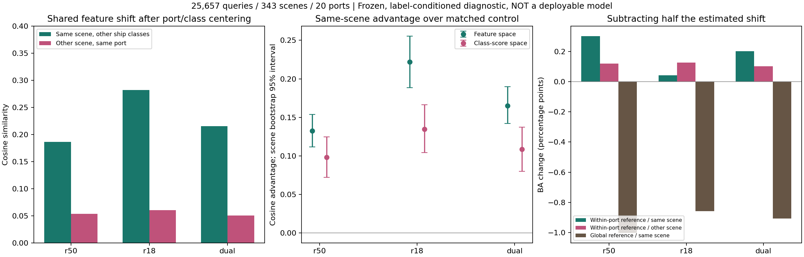

# 同景跨船型：场景共享因素是否进入判别并造成错误

日期：2026-10-10。独立侧会话分析，不修改主模型、原始数据或主线程实验。

## 结论

**已找到跨船型共享、与具体场景有关的特征偏移，而且这种偏移进入了类别分数。它既可能干扰，也可能支持当前判断，不能整体认定为纯噪声。**

直接抑制的结果较弱：控制港口与类别参考后，半量减去同景偏移，R50诊断BA增加0.303个百分点，双路增加0.203个百分点，R18增加0.042个百分点。与同港另一景的匹配偏移相比，额外收益分别为+0.182、+0.101、-0.085个百分点，描述性区间均跨零。因此不能把小幅总收益全部归给精确的同景干扰估计。

这轮支持“场景因素会混入特征并参与决策”这一部分假设；还没有量化它解释了实际同港/跨港性能差距的多少。当前不是新模块完成后的跨港模型成绩。

## 1. 修正后的研究假设

允许船型的判别结构、亚型与状态分布随港口而不同，同时检验共同场景因素是否额外影响分类。没有预设所有非不变信息都应该删除。

比较两种参考：

1. 全部港口的类别参考：每类先按场景求中心，再按场景等权平均。
2. 同一港口的类别参考：仍按场景等权，但只在当前港口内部计算。

第二种参考保留该港口的类别均值差异，主要分析该港口内具体场景的剩余偏移。它不等于已经分离出纯物理场景效应。

## 2. 配对和信息边界

沿用24港数据的三折MMSI身份留出、冻结R50/R18及联合线性诊断头。神经编码器未重训，特征标准化、PCA和分类头均从已有文件重放。

对每个查询场景和待评估船型：

- 只用训练身份折中的其他船型估计偏移，不使用查询船舶身份。
- 至少两种其他船型，每类至少3艘不同船，最多取8艘。
- 在同港寻找时间最近、具备相同支持船型的另一景作为对照。
- 同景和异景使用相同船型组成、每类相同支持数量、同样的平均权重。
- 类别参考同时排除查询景和对照景，每类至少还有两个参考场景。
- 只用元数据和类别覆盖选择支持与对照，不按模型对错挑选。
- 主干预系数预先固定0.5；1.0为预先声明的强度对照，没有选目标最佳系数。

对于类别c在景s中的其他船型k，估计：

`b_same = mean_k[mean(z | s,k) - reference(k)]`

同港异景用相同k及支持数估计`b_other`。再检查它们与查询船型残差`mean(z | s,c) - reference(c)`的方向关系，并计算`score_corrected = score - lambda * W b`。

**标签边界非常重要：查询真类用于定义留出哪种支持船型和分析哪个队列。这是带标签条件的机制诊断，不是可直接部署的去噪器。支持标签也不是论文主模型64个目标标签的设定。已有分类头训练中见过部分相同场景，所以不是未见景或LOPO确认实验。**

## 3. 覆盖范围

- 25,657条查询观测，14,521个不同MMSI。
- 343个场景，20个港口，8类船型。
- 三折共3,125个场景-船型分析单元。
- Fujairah、Melbourne、Mombasa、Newcastle未满足此次跨类别支持及匹配参考条件，不把它们当作分析通过。
- 三折是身份划分，不是三个独立神经训练种子。MMSI仍是身份代理。

## 4. 发现一：确实有跨船型共享的场景偏移

以下采用同港类别参考，先在场景-类别单元汇总，再按类别等权。余弦越大，说明其他船型估计出的偏移与当前船型的实际偏移方向越一致。

| 表征 | 同景其他船型余弦 | 同港另一景余弦 | 同景优势 | 描述性95%区间 |
|---|---:|---:|---:|---:|
| R50 | 0.186 | 0.054 | +0.133 | [0.112, 0.154] |
| R18 | 0.282 | 0.060 | +0.222 | [0.188, 0.255] |
| 双路联合特征 | 0.216 | 0.050 | +0.165 | [0.142, 0.190] |

三个表征的八个船型分别计算时，同景优势均为正。它不只是“某个船型自己的平均形状”，也不能仅用不同港口类别均值解释。不过类内亚型、共同作业状态等仍可能混在其中。

R18在本指标中同景关联更强，不等于R18含有更多纯噪声，也不能推导其物理散射分工。

## 5. 发现二：共享成分确实进入类别决策

把残差经固定分类头映射到去掉共同分数平移的八类分数空间后，同景优势仍然存在：

| 分类头 | 同景分数残差余弦 | 对照余弦 | 同景优势 | 描述性95%区间 |
|---|---:|---:|---:|---:|
| R50 | 0.173 | 0.075 | +0.098 | [0.072, 0.125] |
| R18 | 0.179 | 0.044 | +0.135 | [0.104, 0.166] |
| 联合头 | 0.162 | 0.053 | +0.109 | [0.080, 0.137] |

所以这次不是只找到分类器完全不使用的变化。但这仍不等于所有分数变化都有害。

固定原始最强错误竞争类，统计候选偏移给“竞争类减真类”增加的分数，同港参考下原本判错的样本平均为：R50约0.0221、R18约0.0205、联合约0.0208；同港另一景对照分别约0.0145、0.0111、0.0121。说明所提取成分在部分错误中与不利的分数偏移有关。

这个分组使用事后对错和真类，属于诊断关联，不是推理可用的开关，也不能单独证明因果。

## 6. 发现三：直接减去并没有稳定大幅改善

下表是查询队列的普通OA和八类平均召回BA。所有行使用相同25,657条查询，系数固定0.5。不能与完整24港LOPO成绩混用。

| 模型 | 原OA/% | 校正OA/% | 原BA/% | 同景校正BA/% | 同景相对原始/pp | 异景对照相对原始/pp |
|---|---:|---:|---:|---:|---:|---:|
| R50 | 51.830 | 52.629 | 45.215 | 45.517 | +0.303 | +0.121 |
| R18 | 53.147 | 53.494 | 46.608 | 46.649 | +0.042 | +0.127 |
| 联合 | 56.234 | 56.675 | 50.273 | 50.476 | +0.203 | +0.103 |

同景校正相对异景对照的BA差及场景重采样区间：

- R50：+0.182个百分点，[-0.211, 0.568]。
- R18：-0.085个百分点，[-0.404, 0.248]。
- 联合：+0.101个百分点，[-0.188, 0.395]。

R50、联合的半量校正在三折中均为正；R18两折为负、一折为正。三折并非独立确认，区间也不支持将微小收益说成稳定优势。

系数增至1.0时，同港参考同景校正的BA变化分别为R50 -0.502、R18 -0.566、联合 -0.638个百分点。共享成分不能直接整块删除。

联合头的逐类变化如下，既保留收益也保留误伤：

| 船型 | 同景半量校正召回变化/pp |
|---|---:|
| 散货船 | +1.615 |
| 渔船 | +0.505 |
| 杂货船 | +2.049 |
| 成品油/化学品船 | -0.800 |
| 集装箱船 | -0.638 |
| 原油船 | -0.424 |
| 拖轮 | -0.386 |
| 海工补给船 | -0.296 |

## 7. 退化定位：额外减掉了什么

用全部港口的类别参考估计偏移，再减去一半，三种模型BA分别下降：R50 1.003、R18 0.859、联合0.908个百分点。负结果完整保留。

先排查实现：三折全部原始预测重放一致，最大分类分数误差约1.43e-6；修正符号、类别中心抵消、支持匹配和参考排除检查通过。

然后做一个有区分力的拆分：

`global_residual = within_port_residual + reference_offset`

`reference_offset`是“同港类别参考”相对“全港类别参考”的额外差异，代数上同景与对照景的这部分一致。单独减去它的一半后：

| 模型 | 只减额外参考差异的BA变化/pp |
|---|---:|
| R50 | -1.135 |
| R18 | -0.982 |
| 联合 | -1.079 |

**退化已定位到额外被扣掉的港口条件类别参考成分。** 但还不能把该成分全部称为有用语义：它可能包含真实的类内结构，也可能是当前分类头已经依赖的港口关联。固定头只在测试时受干预，还可能存在训练与校正不协调。这些原因尚未完全分开。

因此本轮没有因为减法退化就否定用户假设，也没有断言找到纯噪声。它说明“跨港类别参考的全部差异都当噪声去掉”这个具体做法不合适。

## 8. 对下一步的约束

接下来值得验证的是：只针对进入类别竞争并造成不利偏移的场景成分学习校正，同时允许类别-港口关系有真实差异。需要在训练阶段同步适配分类器，使用不依赖查询真类的场景估计方式。

确认实验应固定模型后比较同港未见景与未见港，并排除查询身份重叠。只有跨港实际提高、同港不靠退化来缩小差距，才能进一步讨论场景干扰解释了多少性能差距。这轮没有运行该确认实验。

## 图与文件

- `PROTOCOL.json`：分析前固定的估计、匹配、标签与训练边界。
- `fold_*_matches.csv`：全部查询、支持、对照观测索引与数量。
- `fold_*_residual_vectors.npz`：同景、对照和查询残差向量，便于继续分析。
- `geometry_by_class.csv`、`decision_alignment_cells.csv`：跨船型共享与分类分数关联。
- `classification_summary.csv`、`classification_by_class.csv`、`classification_by_port.csv`：完整正负结果。
- `reference_component_summary.csv`：额外参考成分的单独干预。
- `alignment_intervals.csv`、`classification_intervals.csv`：按场景重采样2,000次的描述性区间。
- `fold_*_cases.csv`：救回和误伤案例的观测索引与精确分数差。

所有数值都来自现有开发数据。场景重采样未完全建模跨景重复船舶和共同港口的相关性，未做多重比较校正。编码器历史预训练曝光仍在，不宣称独立确认或识别出具体电磁物理因素。三项核心检查通过，图已渲染查看；单CPU线程，无GPU训练，全部分析进程已退出。
