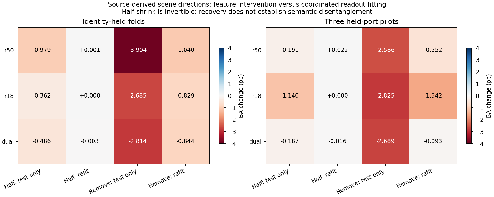
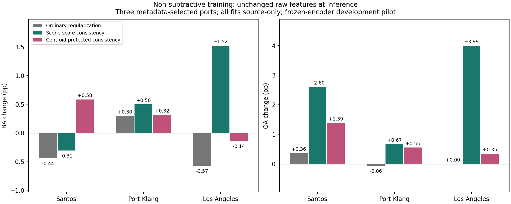

# 场景因素：训练协调检查与非减法方案

2026-10-10。独立侧会话试验，不修改主线程模型、数据或实验。

## 结论先说

**不再把直接减法作为主方案。** 本轮将它保留为机制对照，同时试了不删除输入特征的场景分数一致性约束。

1. 半量压缩候选方向后重拟合分类头，基本恢复基线；但压缩可逆，分类头几乎把它抵消，不能解释成找到了纯噪声。
2. 完全删除候选方向后重拟合，仍有退化。当前候选空间不能视为可无损删除的干扰空间。
3. 非减法的场景分数约束在双路三个跨港任务中平均BA增加0.572个百分点、OA增加2.422个百分点，有可保留的正信号，但一个港口BA下降，单路平均也没有改善。
4. 保护源域类别均值方向的方案未形成更好整体结果。约束本身确实生效，但模型对原始场景方向的总体敏感性反而可能增大，说明只保护类均值不够。

## 1. 与上一轮有什么区别

上一轮按查询真类排除同类支持船，是标签条件的机制诊断，不能直接部署。

本轮保留“同景跨船型共享残差”的提取思想，但将具体估计改成**只从训练数据学习固定场景方向**。推理时不读取查询真类，也不读取查询场景统计或目标支持标签。因此，本轮训练协调结果不是对上一轮逐场景、按真类选支持的具体减法做完全同构的重训；这一边界不能混淆。

骨干仍冻结；所有新训练都是轻量线性分类头，不是端到端神经模型训练。

## 2. 场景方向怎么估计

训练数据流程：

```text
训练港 / 场景 / 船型分组
  -> 每个场景-船型至少3艘不同船，求特征中心
  -> 减去同港其他场景的同类参考中心
  -> 不同船型残差之间的交叉乘积
  -> 场景在港内等权、港口之间等权
  -> 取对称矩阵正谱部分的前8个方向
  -> 用于干预对照或训练约束
```

每个船型参考至少有两个其他场景；每个用于共享估计的场景至少含两个有效船型。使用不同类别之间的交叉项，避免直接将某个类别自身的大方差全部当作共同场景影响。

记方向为U，投影为P=UU^T，正谱矩阵为S。S仍是候选场景相关结构，不是已分离的纯噪声协方差。

## 3. 八个对照做了什么

| 方案 | 训练 | 推理 | 用途 |
|---|---|---|---|
| 原始基线 | 原特征 | 原特征 | 共同参考 |
| 半量压缩，仅测试 | 原特征 | `(I-0.5P)z` | 检查训练/使用不一致 |
| 半量压缩，重拟合 | 压缩后特征 | 压缩后特征 | 检查分类头能否适配 |
| 完全删除，仅测试 | 原特征 | `(I-P)z` | 强干预对照 |
| 完全删除，重拟合 | 删除后特征 | 删除后特征 | 检查不可逆删除的损失 |
| 普通增强正则 | 原特征，加各向同性约束 | 原特征 | 区分场景约束与一般正则收益 |
| 场景分数一致性 | 原特征，约束场景方向引起的类别分数变化 | 原特征 | 非减法主候选 |
| 类均值保护的一致性 | 先将场景约束投影到类均值方向的正交空间 | 原特征 | 非减法备选 |

场景分数一致性在原分类损失和岭正则外增加：

`tau * trace(W^T S W)`

它降低分类头沿候选场景方向的敏感性，但不从输入中删除这些坐标。分类损失仍可要求模型保留有用的权重。

类均值保护版本将S换为`(I-P_class) S (I-P_class)`。P_class来自源域八类均值差异形成的空间，只保护这一几何空间，不保证保护全部语义。

新增正则的迹预先固定为源训练Gram矩阵迹的0.1倍；普通正则具有同样的新增迹。方向数8、压缩量0.5/1.0都预先固定，没有按目标成绩选参数。

## 4. 实验范围与信息边界

- 三折既有MMSI身份留出，另加三个真正留港的后处理/分类头试验。
- 三个港口：Santos、Port Klang、Los Angeles。
- 在具备八类的港口中，按有效多类别场景数排序选前三个；使用覆盖元数据，未按预测结果选港口。
- 三港测试分别1,653、3,425、576条，均为八类闭集。
- 留港任务的训练数据排除整个目标港、目标场景，以及在目标港出现的MMSI；训练样本数分别35,615、32,471、37,181。
- 留港任务重新用源数据拟合标准化、PCA、场景方向及分类头；目标真类不参与拟合或推理。
- 神经编码器仍来自历史冻结缓存，预训练场景/域曝光没有清除，不能称为独立外部确认。
- 不是论文完整模型，也不是64目标标签适配设置；这是简化源训练读出的研发试验。

## 5. 为什么重拟合能恢复，却不代表找到噪声

三折身份留出平均BA变化：

| 方法 | R50 | R18 | 联合 |
|---|---:|---:|---:|
| 半量压缩，仅测试 | -0.979 | -0.362 | -0.486 |
| 半量压缩，重拟合 | +0.001 | 0.000 | -0.003 |
| 完全删除，仅测试 | -3.904 | -2.685 | -2.814 |
| 完全删除，重拟合 | -1.040 | -0.829 | -0.844 |

单位为百分点。半量压缩矩阵是可逆的，线性分类头能够用相反的权重缩放抵消它。三个留港试验中，半量重拟合后的有效权重与原权重相对差异仅约0.028%至0.049%。这解释了“恢复基线”，不证明去掉了有害因素。

完全删除不能这样逆转。重拟合能减轻部分退化，但不是全部恢复：三个留港任务平均BA变化为R50 -0.552、R18 -1.542、联合-0.093个百分点。联合平均接近零掩盖了差异，分别是Santos -2.497、Port Klang -0.178、Los Angeles +2.395个百分点。

所以不能只凭平均接近零就认定删除安全。这也不证明更丰富的模型无法恢复信息，只说明当前读出和候选方向下不宜整块删除。



## 6. 非减法主候选的跨港结果

以下为联合诊断头，保持原始输入特征不变，只在训练时加入场景分数一致性约束。

| 港口 | 基线BA/% | 新BA/% | BA变化/pp | 基线OA/% | 新OA/% | OA变化/pp |
|---|---:|---:|---:|---:|---:|---:|
| Santos | 44.738 | 44.432 | -0.306 | 42.226 | 44.828 | +2.601 |
| Port Klang | 35.145 | 35.645 | +0.500 | 38.307 | 38.978 | +0.672 |
| Los Angeles | 39.481 | 41.002 | +1.521 | 45.139 | 49.132 | +3.993 |
| 港口等权平均 | 39.788 | 40.360 | +0.572 | 41.891 | 44.313 | +2.422 |

同迹普通正则的三港BA变化分别为-0.437、+0.298、-0.571，平均-0.237个百分点。场景方向约束在这三个联合头任务上都优于该普通正则，但并非三个都优于原始基线。

不隐藏单路负结果：场景约束三港平均BA变化为R50 -0.131、R18 -0.632个百分点。身份留出中联合平均也为-0.112个百分点。因此现在只能保留“联合跨港小试有正信号”，不能宣布普遍有效。

## 7. 收益和误伤来自哪里

### Los Angeles

原油船有215条查询，召回由59.535%升至68.837%，净多判对20条，单类贡献约+1.163个BA百分点。散货船净多判对3条、成品油/化学品船多1条、集装箱船少1条，合计净多判对23条。

因此+1.521个BA百分点主要不是由一个极小类别产生；但仍是一个港口、一次固定设定的结果，不是独立复现。

### Port Klang

散货船、杂货船、成品油/化学品船分别净多判对18、6、12条；集装箱船和原油船分别少13、2条。最终净多判对23条，BA增加0.500个百分点，收益并非各类均衡。

### Santos

散货船898条查询中净多判对53条，但其他若干船型退化。最终OA增加2.601个百分点而BA下降0.306个百分点。这里是类别间收益不均衡，不应只报OA掩盖BA负结果。

完整逐类、逐景贡献及类别混淆转移已保存，见`class_gain_attribution.csv`和`dual_scene_constraint_confusions.csv`。

## 8. 非减法为什么可能有效

可直接确认的计算层机制：场景分数一致性使三个留港任务的联合分类头对源候选场景方向的分数响应能量降至基线约18%至22%，同时源类均值的分数区分能量保留约94%。这是有损但可权衡的敏感性约束，不是先删光再识别。

它提供了“保留输入，训练时降低依赖”的可解释实现。但上述均是源域几何指标，不能将94%解释为保留了94%的全部语义，也不能只凭这些指标预测目标港收益。

## 9. 备选为什么未形成更好整体结果

类均值保护版本的联合三港BA变化为：Santos +0.585、Port Klang +0.316、Los Angeles -0.140，平均+0.253个百分点；单路平均更差。

先检查是否未接入：独立测试确认其新增惩罚不作用于声明保护的类均值空间。实际训练后，被它直接约束的响应能量下降约70%至89%，不是约束完全没生效。

但是，对**原始完整候选场景方向**的响应反而增加：三个联合任务分别约+13.5%、+21.7%、+8.5%。将重叠于类别均值的部分排除后，模型仍可通过这些未受约束的方向响应场景变化。

因此已定位到“受约束部分下降，不代表总体场景依赖下降”的问题。源域类别均值空间与场景方向本就重叠，不能把类别均值当作完整的语义/非语义分界。没有用此负结果证明语义保护思路本身无效，也没有继续按目标结果搜索参数。

## 10. 下一步的候选方法

优先保留本轮的场景分数一致性方向，不立即回到逐样本硬减法。下一轮更具体的候选是：

1. **按类别竞争对约束。** 检查哪些场景变化使真类相对特定竞争类失去优势，再用源数据学习选择性的间隔约束，避免要求所有类别分数同等不变。推理不需要真类，约束在训练阶段完成。尚未实现。
2. **场景条件化判别。** 保留完整原始特征，让可观测场景线索调整部分分类权重或校准项，表达“同一线索在不同条件下意义不同”，而非将其删除。需先解决无标签场景估计，尚未实现。

不按三个港口分别挑最优方案；继续研发也要保留本轮固定参数和全部负结果。当前结果不足以确认顶刊级模块或解释全部跨港性能差距。



## 验证与文件

- 三项独立实现检查通过：与sklearn岭分类器一致、隐式校正重拟合与显式变换训练一致、保护空间与等迹正则正确。
- 身份折新基线采用float64求解，相对旧float32单路头最大分数差约7.90e-5，R50第0折和R18第2折各有1条边界预测不同。所有本轮对照统一相对新基线；不能声称所有旧单路预测逐条完全相同。联合头重放无预测差异。
- `PROTOCOL.json`、`COMPLETE.json`：预设方案及六任务完成记录。
- `all_results.csv`、`paired_results.csv`、`mean_results.csv`：全部OA、BA与差值。
- `all_by_class.csv`、`class_gain_attribution.csv`：逐类收益、误伤与样本数。
- `all_sensitivity.csv`、`failure_localization.csv`：响应能量、训练变化和负结果定位。
- `*_models.npz`、`*_predictions.npz`：源拟合参数、预测、训练和测试索引。
- 所有任务使用单CPU线程、未占用GPU；完成记录齐全，实验进程已结束，图片已渲染查看。
