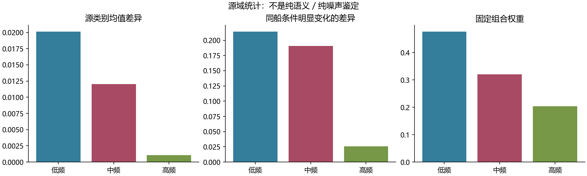
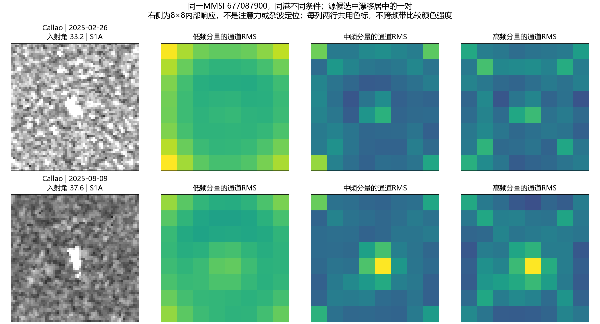

# 空间频率分解与保留主路的残差补偿

## 总体结果

| arm | OA | BA | delta_OA_vs_head | delta_BA_vs_head | delta_OA_vs_full | delta_BA_vs_full |
| --- | --- | --- | --- | --- | --- | --- |
| 全频残差 | 37.231 | 37.997 | 0.036 | -0.307 | 0.000 | 0.000 |
| 只适配分类头 | 37.195 | 38.304 | 0.000 | 0.000 | -0.036 | 0.307 |
| 固定中频残差 | 37.411 | 38.344 | 0.216 | 0.040 | 0.180 | 0.347 |
| 源数据组合残差 | 37.227 | 37.904 | 0.031 | -0.400 | -0.004 | -0.093 |

OA/BA为百分数，差值为百分点。3港各3次64标签支持抽样等权，抽样共享查询人群，不是9个独立数据集。

结论：中频版比匹配的全频版高0.347个百分点BA，但比只适配分类头仅高0.040个百分点；9次任务中相对全频只有4次为正。源数据组合版比全频低0.093个百分点。本轮没有得到可确认的性能突破，不能把中频版相对较少的退化说成已经挖出了有效因果因素。

## 这次与旧通道路线有何不同

- 在冻结R18的layer3之后、整个layer4之前插入残差，输入256通道8×8空间图；不在旧4×4通道图上继续修改。
- 这里低/中/高频指内部特征图的空间变化快慢，不是SAR传感器的电磁波段，也不直接等于某种散射机制。
- 保留原特征主路，只添加经过选择的空间频率分量：h_new=h+gate*branch(h)。每版仅256个可训练系数，从0初始化，界限为-0.25到0.25。
- 全频、中频和源数据组合三版具有相同参数量、插入位置、24步Adam和训练损失；不包含token注意力，不是Causal-Tune完整复现。
- 源域逐通道匹配分支RMS到原特征RMS，减少不同频带能量大小带来的修正强度混淆；实际训练后的更新幅度仍单独报告。
- 沿用前轮修正后的目标缺类损失处理、源分数保持和源八类监督。原939个源标签、9个64目标支持划分、查询身份排除均不变。
- 与历史1024参数、不同插入位置的仿射适配比较不能单独归因于频率；本轮频率作用看三个严格匹配版本之间的对照。

## 源数据给出的频带证据

| band | class_centroid_signal | same_vessel_far_drift | signal_drift_ratio | weight |
| --- | --- | --- | --- | --- |
| low | 0.020 | 0.214 | 0.094 | 0.476 |
| middle | 0.012 | 0.191 | 0.063 | 0.320 |
| high | 0.001 | 0.026 | 0.040 | 0.204 |

权重由源类别均值差异除以同船条件变化差异，再归一化得到。固定高斯低通半径0.2和0.7，其差为中频；半径按8×8频率平面角点归一化。没有目标港截止频率搜索。

低频47.6%、中频32.0%、高频20.4%是固定源统计组合，不是逐样本自适应注意力。类别均值差异可能包含港口相关性；同船差异也可能包含有效状态变化，因此不能称为纯语义或纯噪声分解。

| group | low_drift | middle_drift | high_drift | pairs | vessels | classes |
| --- | --- | --- | --- | --- | --- | --- |
| DP_far | 0.302 | 0.247 | 0.033 | 341 | 70 | 6 |
| DP_near | 0.160 | 0.160 | 0.023 | 39 | 21 | 4 |
| SP_far | 0.126 | 0.134 | 0.019 | 286 | 52 | 8 |
| SP_near | 0.101 | 0.123 | 0.018 | 798 | 136 | 8 |

先船内平均，再类别内船等权，再类等权。不同组的船和类别构成不同，组间数值不是控制全部混杂后的条件因果效应。高斯软分量相互重叠，能重建原图但各频带能量不要求相加为总能量。

数据引导版本额外使用已有标注源船的未标注重复观测与MMSI关联。它没有新增船型标签，但不是与不使用同船信息的版本严格等信息量；不能把差异全部归为结构优势。

图中原始VH裁片与内部通道RMS只展示实际分解，不能从图直接指认某处为杂波。选例为SP_far候选中分量漂移总和居中的一对，不是正确率证据。

## 分港结果与缺类误伤

| port | arm | OA | BA | delta_OA_vs_head | delta_BA_vs_head | delta_OA_vs_full | delta_BA_vs_full |
| --- | --- | --- | --- | --- | --- | --- | --- |
| Los Angeles | 全频残差 | 42.150 | 38.912 | 1.746 | 0.236 | 0.000 | 0.000 |
| Los Angeles | 只适配分类头 | 40.404 | 38.676 | 0.000 | 0.000 | -1.746 | -0.236 |
| Los Angeles | 固定中频残差 | 41.109 | 38.797 | 0.705 | 0.122 | -1.041 | -0.115 |
| Los Angeles | 源数据组合残差 | 41.939 | 38.377 | 1.535 | -0.299 | -0.211 | -0.535 |
| Port Klang | 全频残差 | 33.054 | 33.323 | -0.241 | 0.889 | 0.000 | 0.000 |
| Port Klang | 只适配分类头 | 33.295 | 32.434 | 0.000 | 0.000 | 0.241 | -0.889 |
| Port Klang | 固定中频残差 | 34.057 | 33.430 | 0.762 | 0.997 | 1.002 | 0.108 |
| Port Klang | 源数据组合残差 | 33.145 | 33.427 | -0.150 | 0.994 | 0.090 | 0.105 |
| Santos | 全频残差 | 36.489 | 41.757 | -1.397 | -2.047 | 0.000 | 0.000 |
| Santos | 只适配分类头 | 37.886 | 43.803 | 0.000 | 0.000 | 1.397 | 2.047 |
| Santos | 固定中频残差 | 37.068 | 42.805 | -0.818 | -0.998 | 0.579 | 1.048 |
| Santos | 源数据组合残差 | 36.596 | 41.908 | -1.290 | -1.895 | 0.108 | 0.151 |

| arm | coverage | recall | task_groups |
| --- | --- | --- | --- |
| 全频残差 | absent | 26.689 | 4 |
| 全频残差 | multiple | 37.348 | 9 |
| 全频残差 | singleton | 37.927 | 5 |
| 只适配分类头 | absent | 33.503 | 4 |
| 只适配分类头 | multiple | 36.869 | 9 |
| 只适配分类头 | singleton | 38.375 | 5 |
| 固定中频残差 | absent | 31.366 | 4 |
| 固定中频残差 | multiple | 37.242 | 9 |
| 固定中频残差 | singleton | 37.809 | 5 |
| 源数据组合残差 | absent | 26.689 | 4 |
| 源数据组合残差 | multiple | 37.116 | 9 |
| 源数据组合残差 | singleton | 39.593 | 5 |

缺类组只含4个任务；先在任务内平均缺类召回，再在任务间平均，不是总体BA。

| arm | positive_vs_full | negative_vs_full |
| --- | --- | --- |
| 全频残差 | 0 | 0 |
| 只适配分类头 | 6 | 3 |
| 固定中频残差 | 4 | 5 |
| 源数据组合残差 | 5 | 4 |

## 是否真的进行了内部更新

| arm | gate_rms | relative_update_rms | negative_activation_fraction |
| --- | --- | --- | --- |
| 全频残差 | 0.166 | 0.165 | 0.000 |
| 固定中频残差 | 0.178 | 0.182 | 0.288 |
| 源数据组合残差 | 0.162 | 0.162 | 0.266 |

relative_update_rms基于支持特征；匹配源分支能量不保证训练后各模型的更新幅度完全相同。中频修正可令原非负特征的部分位置变负，本轮不额外截断。

中频分支的直流为零，因此它在当前插入层不改变每个通道的空间平均值，只改变空间分布。这是已验证的算子性质，不代表后续卷积和非线性之后的最终特征均值或分类分数不变。它是否解释了较少的缺类误伤，还需与保留全部非直流频率的匹配残差比较，当前没有完成这项归因。

## 验证与边界

- 原13项测试及新增通道均值保持测试通过，包括空间维DCT/逆DCT、分量重建、中频直流为零、RMS匹配、零初态原路与梯度、已有支持头公式和缺类损失。
- 完整原骨干输出的源头预测回放一致，9个任务的只适配头预测回放一致，详见REPLAYS.json。
- 完成9个任务、27次适配，CPU单线程耗时912.3秒；未修改主模型或占用其GPU。
- 这是开发阶段的小型冻结R18实验，支持/查询可能共享大景，预训练曝光未撤销，不是完整双路模型成绩或物理因果证明。

## 负响应是否是失效根因

固定已学到的残差系数，不再训练神经网络；分别原样前向、将更新后的特征截为非负，再用同一64标签重拟合相同分类头。18次原样预测回放全部一致。全频版本来不产生负值，截断是恒等操作，不是独立新增训练对照。

| arm | mode | OA | BA | delta_OA | delta_BA |
| --- | --- | --- | --- | --- | --- |
| full | raw | 37.231 | 37.997 | 0.000 | 0.000 |
| full | rectified | 37.231 | 37.997 | 0.000 | 0.000 |
| middle | raw | 37.411 | 38.344 | 0.000 | 0.000 |
| middle | rectified | 37.464 | 38.035 | 0.053 | -0.309 |
| source_guided | raw | 37.227 | 37.904 | 0.000 | 0.000 |
| source_guided | rectified | 37.239 | 37.971 | 0.012 | 0.067 |

| arm | mode | coverage | recall |
| --- | --- | --- | --- |
| full | raw | absent | 26.689 |
| full | raw | multiple | 37.348 |
| full | raw | singleton | 37.927 |
| full | rectified | absent | 26.689 |
| full | rectified | multiple | 37.348 |
| full | rectified | singleton | 37.927 |
| middle | raw | absent | 31.366 |
| middle | raw | multiple | 37.242 |
| middle | raw | singleton | 37.809 |
| middle | rectified | absent | 29.046 |
| middle | rectified | multiple | 37.002 |
| middle | rectified | singleton | 38.342 |
| source_guided | raw | absent | 26.689 |
| source_guided | raw | multiple | 37.116 |
| source_guided | raw | singleton | 39.593 |
| source_guided | rectified | absent | 26.360 |
| source_guided | rectified | multiple | 37.268 |
| source_guided | rectified | singleton | 38.760 |

中频版截断后BA下降0.309个百分点，缺类召回从31.366%降至29.046%；源组合版BA仅上升0.067个百分点。结果不支持“只要消除负响应就能解决退化”的简单解释。

| arm | original_negative_fraction | original_zero_fraction | new_negative_fraction | negative_energy_vs_update | negative_rms_vs_original | raw_relative_channel_mean_shift | rectified_relative_channel_mean_shift |
| --- | --- | --- | --- | --- | --- | --- | --- |
| full | 0.000 | 0.540 | 0.000 | 0.000 | 0.000 | 0.165 | 0.165 |
| middle | 0.000 | 0.540 | 0.288 | 0.101 | 0.058 | 0.000 | 0.051 |
| source_guided | 0.000 | 0.540 | 0.266 | 0.005 | 0.011 | 0.180 | 0.175 |

原特征约54.0%的位置为零，因此负位置占比不能直接表示破坏程度。中频的负值能量约占更新能量10.12%，源组合约0.45%。中频原样更新的相对通道均值变化约4.49e-9，截断后变为0.0513；截断同时改变空间分布、均值与更新幅度，不能单独隔离负号本身的作用。

| port | arm | mode | OA | BA | delta_OA | delta_BA |
| --- | --- | --- | --- | --- | --- | --- |
| Los Angeles | full | raw | 42.150 | 38.912 | 0.000 | 0.000 |
| Los Angeles | full | rectified | 42.150 | 38.912 | 0.000 | 0.000 |
| Los Angeles | middle | raw | 41.109 | 38.797 | 0.000 | 0.000 |
| Los Angeles | middle | rectified | 41.281 | 38.027 | 0.172 | -0.771 |
| Los Angeles | source_guided | raw | 41.939 | 38.377 | 0.000 | 0.000 |
| Los Angeles | source_guided | rectified | 42.003 | 38.770 | 0.064 | 0.393 |
| Port Klang | full | raw | 33.054 | 33.323 | 0.000 | 0.000 |
| Port Klang | full | rectified | 33.054 | 33.323 | 0.000 | 0.000 |
| Port Klang | middle | raw | 34.057 | 33.430 | 0.000 | 0.000 |
| Port Klang | middle | rectified | 34.237 | 33.727 | 0.181 | 0.297 |
| Port Klang | source_guided | raw | 33.145 | 33.427 | 0.000 | 0.000 |
| Port Klang | source_guided | rectified | 33.074 | 33.335 | -0.070 | -0.092 |
| Santos | full | raw | 36.489 | 41.757 | 0.000 | 0.000 |
| Santos | full | rectified | 36.489 | 41.757 | 0.000 | 0.000 |
| Santos | middle | raw | 37.068 | 42.805 | 0.000 | 0.000 |
| Santos | middle | rectified | 36.875 | 42.351 | -0.193 | -0.454 |
| Santos | source_guided | raw | 36.596 | 41.908 | 0.000 | 0.000 |
| Santos | source_guided | rectified | 36.639 | 41.808 | 0.043 | -0.100 |

该回放不是针对非负约束重新训练的模型，也不是物理因果干预。中频截断在Port Klang略好，在另两港变差；不按目标港挑选版本，不将事后诊断结果冒充预先确定的新方法。

## 收口判断与下一项可区分实验

本轮证明实现确实改变了内部空间响应，且中频相对全频少一些缺类误伤；没有证明提取了纯噪声、跨域因果因素，也没有得到超过只适配分类头的明确收益。源统计加权的版本不值得直接加入主模型。

下一项最小对照应区分两个解释：中频本身更有用，还是仅仅因为它不改通道均值。可在相同参数、能量归一化和训练预算下比较“保留全部非直流频率的残差”与当前中频残差。若前者相当或更好，应改为研究保均值的空间响应适配，而不是继续强化特定中频或因果滤波的叙事。这项对照尚未运行。
