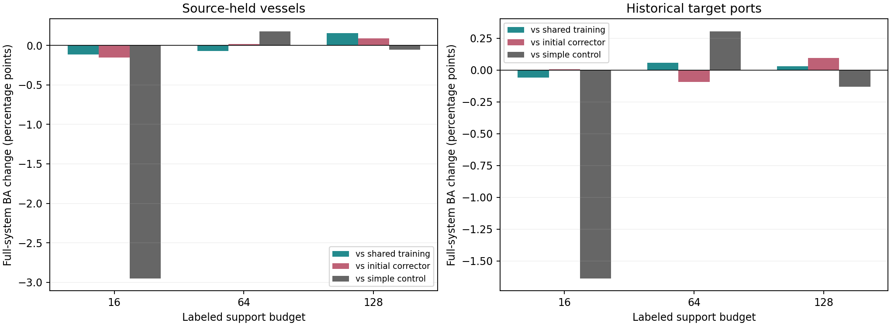

# 按支持预算拆分训练：结果

日期：2026-10-12。

18个新修正器均已完成，三个预算各30步，每个几何版本/种子合计90步。未重训骨干，未搜索超参数。
评价完成范围：source, target。目标结果仅在有源端任务信号后以冻结模型评估。

## 完整模型OA与BA

| 范围 | 支持标签数 | 方法 | OA (%) | BA (%) |
|---|---:|---|---:|---:|
| source | 16 | 无修正 | 46.6773 | 42.5621 |
| source | 16 | 原修正器 | 49.1760 | 44.5298 |
| source | 16 | 源选简单对照 | 49.6810 | 47.3247 |
| source | 16 | 继续重建训练 | 49.3753 | 44.2817 |
| source | 16 | 共享任务训练 | 49.0829 | 44.4876 |
| source | 16 | 按预算分别训练 | 49.0564 | 44.3751 |
| source | 64 | 无修正 | 47.3153 | 46.5451 |
| source | 64 | 原修正器 | 47.5013 | 46.7067 |
| source | 64 | 源选简单对照 | 47.3153 | 46.5451 |
| source | 64 | 继续重建训练 | 47.6209 | 46.8316 |
| source | 64 | 共享任务训练 | 47.5944 | 46.7935 |
| source | 64 | 按预算分别训练 | 47.6077 | 46.7246 |
| source | 128 | 无修正 | 48.0595 | 48.5758 |
| source | 128 | 原修正器 | 48.0330 | 48.4363 |
| source | 128 | 源选简单对照 | 48.0595 | 48.5758 |
| source | 128 | 继续重建训练 | 48.0861 | 48.5070 |
| source | 128 | 共享任务训练 | 48.0330 | 48.3677 |
| source | 128 | 按预算分别训练 | 48.0728 | 48.5226 |
| target | 16 | 无修正 | 46.0129 | 37.4055 |
| target | 16 | 原修正器 | 48.0699 | 38.8919 |
| target | 16 | 源选简单对照 | 48.2567 | 40.5348 |
| target | 16 | 继续重建训练 | 48.4915 | 39.3615 |
| target | 16 | 共享任务训练 | 48.1035 | 38.9584 |
| target | 16 | 按预算分别训练 | 48.1511 | 38.8990 |
| target | 64 | 无修正 | 47.9627 | 42.9328 |
| target | 64 | 原修正器 | 48.2614 | 43.3327 |
| target | 64 | 源选简单对照 | 47.9627 | 42.9328 |
| target | 64 | 继续重建训练 | 48.0165 | 43.0865 |
| target | 64 | 共享任务训练 | 48.1337 | 43.1797 |
| target | 64 | 按预算分别训练 | 48.2429 | 43.2380 |
| target | 128 | 无修正 | 49.2759 | 46.6056 |
| target | 128 | 原修正器 | 49.2964 | 46.3798 |
| target | 128 | 源选简单对照 | 49.2759 | 46.6056 |
| target | 128 | 继续重建训练 | 49.2846 | 46.4023 |
| target | 128 | 共享任务训练 | 49.3028 | 46.4466 |
| target | 128 | 按预算分别训练 | 49.3232 | 46.4750 |

## 拆分新增收益与概率风险

| 范围 | 支持标签数 | 对照 | BA变化 (百分点) | OA变化 (百分点) | 类均衡NLL收益 | 类均衡Brier收益 |
|---|---:|---|---:|---:|---:|---:|
| source | 16 | 原修正器 | -0.1547 | -0.1196 | -0.002114 | -0.000726 |
| source | 16 | 源选简单对照 | -2.9496 | -0.6247 | -0.016869 | -0.004835 |
| source | 16 | 共享任务训练 | -0.1124 | -0.0266 | +0.000997 | +0.000294 |
| source | 64 | 原修正器 | +0.0178 | +0.1063 | +0.000055 | +0.000051 |
| source | 64 | 源选简单对照 | +0.1795 | +0.2924 | +0.000993 | +0.000393 |
| source | 64 | 共享任务训练 | -0.0690 | +0.0133 | -0.000459 | -0.000175 |
| source | 128 | 原修正器 | +0.0863 | +0.0399 | -0.000009 | +0.000011 |
| source | 128 | 源选简单对照 | -0.0532 | +0.0133 | +0.000015 | +0.000051 |
| source | 128 | 共享任务训练 | +0.1549 | +0.0399 | -0.000182 | -0.000070 |
| target | 16 | 原修正器 | +0.0072 | +0.0812 | -0.000263 | -0.000016 |
| target | 16 | 源选简单对照 | -1.6358 | -0.1057 | -0.009322 | -0.003334 |
| target | 16 | 共享任务训练 | -0.0594 | +0.0476 | +0.000830 | +0.000209 |
| target | 64 | 原修正器 | -0.0947 | -0.0185 | +0.000010 | +0.000008 |
| target | 64 | 源选简单对照 | +0.3052 | +0.2802 | +0.000634 | +0.000154 |
| target | 64 | 共享任务训练 | +0.0583 | +0.1092 | +0.000109 | +0.000038 |
| target | 128 | 原修正器 | +0.0951 | +0.0268 | +0.000006 | +0.000007 |
| target | 128 | 源选简单对照 | -0.1306 | +0.0474 | +0.000406 | +0.000117 |
| target | 128 | 共享任务训练 | +0.0284 | +0.0204 | +0.000073 | +0.000025 |

风险收益为对照风险减新风险，正值表示改善。样本均值与港类均衡风险另存，不与类均衡口径混用。

## 两个训练抽样种子

| 范围 | 种子 | 支持标签数 | 相对共享训练BA变化 | 相对原修正器BA变化 |
|---|---:|---:|---:|---:|
| source | 31415 | 16 | -0.3913 | -0.3977 |
| source | 31415 | 64 | -0.1563 | -0.0210 |
| source | 31415 | 128 | +0.1609 | +0.1111 |
| source | 27182 | 16 | +0.1664 | +0.0884 |
| source | 27182 | 64 | +0.0183 | +0.0567 |
| source | 27182 | 128 | +0.1489 | +0.0615 |
| target | 31415 | 16 | +0.0704 | -0.0012 |
| target | 31415 | 64 | +0.0661 | -0.1584 |
| target | 31415 | 128 | +0.0195 | +0.0360 |
| target | 27182 | 16 | -0.1891 | +0.0155 |
| target | 27182 | 64 | +0.0506 | -0.0309 |
| target | 27182 | 128 | +0.0373 | +0.1543 |

## 同曝光量的拟合probe

拆分的第10/20/30步对应共享训练第30/60/90步，各预算训练案例曝光相同。probe只在源拟合船上，不是独立验证。

| 每预算更新次数 | 支持标签数 | 拆分相对共享CE收益 | 拆分相对共享BA变化 |
|---|---:|---:|---:|
| 0 | 16 | +0.000000 | +0.0000 |
| 0 | 64 | +0.000000 | +0.0000 |
| 0 | 128 | +0.000000 | +0.0000 |
| 10 | 16 | -0.000857 | -0.8025 |
| 10 | 64 | -0.000521 | -0.3472 |
| 10 | 128 | +0.000059 | +0.3472 |
| 20 | 16 | -0.000726 | -0.4600 |
| 20 | 64 | -0.000484 | -0.1736 |
| 20 | 128 | +0.000306 | +0.0000 |
| 30 | 16 | -0.000990 | -0.9538 |
| 30 | 64 | -0.000310 | -0.0579 |
| 30 | 128 | +0.000526 | +0.0000 |

## 解释范围与成本

- 两组所有训练观测ID和预算内顺序一致；原五组baseline的OA/BA/NLL/Brier重放一致，全部新配对满足救回减误伤等于BA变化，阈值1e-10。
- 本轮干预是取消不同预算间的参数与Adam矩估计共享，不是仅改变梯度范数。拆分还改变了每个修正器的总更新数及优化器历史，因此不能唯一归因于梯度冲突。
- 三个预算仍分别使用既有dose1/.5/.25和lambda8B/64；梯度差异也包含这些已有算子的影响，不是单独由样本数造成。
- 18个新修正器训练循环合计19.48秒，含固定拟合probe，不含缓存准备、诊断重放与留出/目标预测。每个332352参数，模型库存三份，但已知预算只用一份，未新增查询骨干。
- 源54个预测单元复用418条查询/156条船，三个geometry context不等于三个独立源港；目标若评估为LA/Klang/Santos三历史港、两个训练抽样种子和五组支持。不是完整23港，不是独立确认。
- 同时保留专家层、完整融合、逐港逐类、支持抽样胜平负；不要求每个单元获胜，不把小退化自动叫随机噪声。
- 单步梯度/Adam诊断见diagnostics目录；它定位局部更新方向，不替代正式留出效果，也不提供物理因果分离证明。

