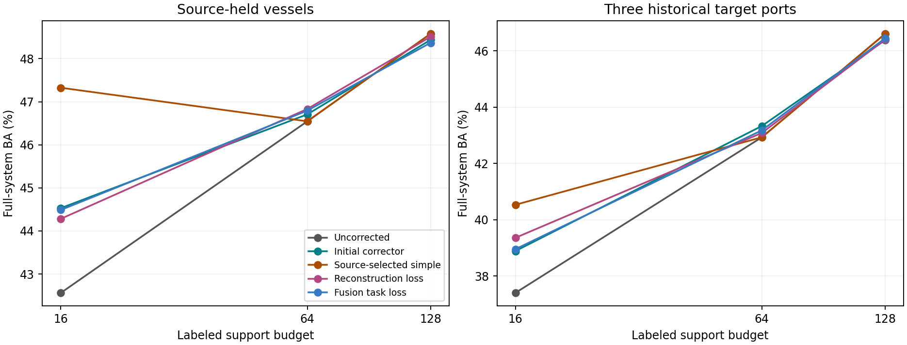

# 支持修正器损失对齐：完成结果与边界

日期：2026-10-12。12组仿射修正器训练、54组源留出和90组目标预测单元已完成；不重训骨干。

## 结论先说

认可明确任务范围内可重复、值得成本的净收益，不要求处处获胜。本轮保留支持修正的已有有效范围，但暂不把新任务损失升级为主方案：它学会降低拟合任务损失，却没有稳定超过原修正器及简单对照。不能把相对无修正模型的全部收益归功于改损失。

## 完整模型结果

| 评价范围 | 标签预算 | 方法 | OA (%) | BA (%) |
|---|---:|---|---:|---:|
| 源留出 | 16 | 无修正 | 46.6773 | 42.5621 |
| 源留出 | 16 | 原修正器 | 49.1760 | 44.5298 |
| 源留出 | 16 | 源选简单对照 | 49.6810 | 47.3247 |
| 源留出 | 16 | 继续重建训练 | 49.3753 | 44.2817 |
| 源留出 | 16 | 完整任务损失训练 | 49.0829 | 44.4876 |
| 源留出 | 64 | 无修正 | 47.3153 | 46.5451 |
| 源留出 | 64 | 原修正器 | 47.5013 | 46.7067 |
| 源留出 | 64 | 源选简单对照 | 47.3153 | 46.5451 |
| 源留出 | 64 | 继续重建训练 | 47.6209 | 46.8316 |
| 源留出 | 64 | 完整任务损失训练 | 47.5944 | 46.7935 |
| 源留出 | 128 | 无修正 | 48.0595 | 48.5758 |
| 源留出 | 128 | 原修正器 | 48.0330 | 48.4363 |
| 源留出 | 128 | 源选简单对照 | 48.0595 | 48.5758 |
| 源留出 | 128 | 继续重建训练 | 48.0861 | 48.5070 |
| 源留出 | 128 | 完整任务损失训练 | 48.0330 | 48.3677 |
| 三目标港均值 | 16 | 无修正 | 46.0129 | 37.4055 |
| 三目标港均值 | 16 | 原修正器 | 48.0699 | 38.8919 |
| 三目标港均值 | 16 | 源选简单对照 | 48.2567 | 40.5348 |
| 三目标港均值 | 16 | 继续重建训练 | 48.4915 | 39.3615 |
| 三目标港均值 | 16 | 完整任务损失训练 | 48.1035 | 38.9584 |
| 三目标港均值 | 64 | 无修正 | 47.9627 | 42.9328 |
| 三目标港均值 | 64 | 原修正器 | 48.2614 | 43.3327 |
| 三目标港均值 | 64 | 源选简单对照 | 47.9627 | 42.9328 |
| 三目标港均值 | 64 | 继续重建训练 | 48.0165 | 43.0865 |
| 三目标港均值 | 64 | 完整任务损失训练 | 48.1337 | 43.1797 |
| 三目标港均值 | 128 | 无修正 | 49.2759 | 46.6056 |
| 三目标港均值 | 128 | 原修正器 | 49.2964 | 46.3798 |
| 三目标港均值 | 128 | 源选简单对照 | 49.2759 | 46.6056 |
| 三目标港均值 | 128 | 继续重建训练 | 49.2846 | 46.4023 |
| 三目标港均值 | 128 | 完整任务损失训练 | 49.3028 | 46.4466 |

## 新损失真正新增多少

| 范围 | 标签预算 | 相对对照 | BA变化 (百分点) | 类均衡NLL收益 | 类均衡Brier收益 |
|---|---:|---|---:|---:|---:|
| source | 16 | 原修正器 | -0.0422 | -0.003111 | -0.001021 |
| source | 16 | 继续重建训练 | +0.2058 | -0.008885 | -0.003221 |
| source | 16 | 源选简单对照 | -2.8371 | -0.017866 | -0.005129 |
| source | 64 | 原修正器 | +0.0868 | +0.000514 | +0.000226 |
| source | 64 | 继续重建训练 | -0.0381 | +0.000673 | +0.000248 |
| source | 64 | 源选简单对照 | +0.2485 | +0.001452 | +0.000567 |
| source | 128 | 原修正器 | -0.0686 | +0.000173 | +0.000081 |
| source | 128 | 继续重建训练 | -0.1393 | +0.000338 | +0.000130 |
| source | 128 | 源选简单对照 | -0.2081 | +0.000197 | +0.000121 |
| target | 16 | 原修正器 | +0.0665 | -0.001093 | -0.000225 |
| target | 16 | 继续重建训练 | -0.4031 | -0.002875 | -0.000814 |
| target | 16 | 源选简单对照 | -1.5764 | -0.010152 | -0.003543 |
| target | 64 | 原修正器 | -0.1530 | -0.000099 | -0.000029 |
| target | 64 | 继续重建训练 | +0.0932 | +0.000315 | +0.000092 |
| target | 64 | 源选简单对照 | +0.2468 | +0.000524 | +0.000117 |
| target | 128 | 原修正器 | +0.0668 | -0.000067 | -0.000019 |
| target | 128 | 继续重建训练 | +0.0443 | +0.000238 | +0.000081 |
| target | 128 | 源选简单对照 | -0.1590 | +0.000333 | +0.000092 |

概率风险收益以旧风险减新风险计算，正值为改善；这里是类均衡口径，原评价目录同时保留样本均值与港口/类别均衡Brier，不能混用。

## 学到了什么与为什么没全面兑现

1. 实现层已核对：独立原始空间ridge、质心/能量约束、有限差分梯度、真实融合CE共4项测试通过。9个真实训练episode初始化分数与原NumPy求解最大差约1.73e-14，源/目标原修正器重放均通过1e-10阈值。没有发现断梯度或替错baseline的问题。
2. 学习确实发生：下表是固定源拟合probe，不是独立验证。任务训练主动牺牲特征重建精度来改善分类概率目标，说明它不是仅仅模仿旧特征。

| 训练目标 | 标签预算 | MSE开始→结束 | 类均衡任务CE开始→结束 |
|---|---:|---|---|
| 继续重建训练 | 16 | 0.000914 → 0.000665 | 1.757850 → 1.756906 |
| 继续重建训练 | 64 | 0.000979 → 0.000687 | 1.716027 → 1.714774 |
| 继续重建训练 | 128 | 0.000946 → 0.000670 | 1.713248 → 1.712942 |
| 完整任务损失训练 | 16 | 0.000914 → 0.001027 | 1.757850 → 1.754395 |
| 完整任务损失训练 | 64 | 0.000979 → 0.001082 | 1.716027 → 1.713845 |
| 完整任务损失训练 | 128 | 0.000946 → 0.001053 | 1.713248 → 1.712756 |

3. 功能层定位：只有支持端表示与重新求解后的支持系数改变，查询特征、源先验、基础分支和融合规则固定。收益或误伤通过案例关系/支持校正路径发生，不是新骨干或新物理知识的收益。
4. 泛化边界：拟合CE下降不等于留出CE下降，也不等于top-1改善。源64标签对旧修正器的微弱正信号没有在目标64标签保持；这支持效用迁移受限，但还不能唯一判定是容量过拟合、源目标关系差异还是小样本抽样。没有以退化为理由无限调参。
5. 抽样解释：两个训练episode种子与重复支持抽样分开报告；不能把同一查询船上的多个几何版本当作独立样本。局部负结果不是一票否决，但有重复同向退化时也不直接称为随机波动。

## 目标端救回与误伤

| 标签预算 | 对照 | 救回BA贡献 | 误伤BA贡献 | 净BA变化 |
|---|---|---:|---:|---:|
| 16 | 原修正器 | 1.3462 | 1.2797 | +0.0665 |
| 16 | 源选简单对照 | 3.1175 | 4.6939 | -1.5764 |
| 64 | 原修正器 | 0.1353 | 0.2883 | -0.1530 |
| 64 | 源选简单对照 | 0.7426 | 0.4958 | +0.2468 |
| 128 | 原修正器 | 0.0982 | 0.0314 | +0.0668 |
| 128 | 源选简单对照 | 0.1864 | 0.3454 | -0.1590 |

救回减误伤与每一个配对BA差逐项相等，阈值1e-10；明细见error_flow.csv和port_class_changes.csv。它解释决策变化的直接来源，不等于物理因果机制。

## 成本与范围

- 每个修正器332352个参数，12个训练循环累计8.79秒；含固定拟合probe，不含缓存准备、离线预测与报告。不是端到端总耗时。
- 两种训练损失的推理结构相同；修正支持向量并重求系数属于支持集适配阶段，查询仍用既有SAR特征，没有新查询骨干前向。未另测端到端延迟。
- 1296条拟合观测相对旧初始化1040条的扩展同时用于两种训练目标；任务与重建对比匹配，但相对旧初始化的变化混有继续训练和数据扩展，不能单独归因于损失。
- 源先验新拟合排除留出船，历史骨干/几何并非完全未见留出。三个目标港是Los Angeles、Port Klang、Santos，不是完整23港，也不是三个新数据集。目标支持/查询按历史行级排除，可能含同船不同观测。
- 两种子控制训练episode抽样，不是两次骨干重训。历史研发数据、非独立确认；不能据此声称分离出了纯因果因素。

## 本轮决策

保留16标签源选简单衰减、64标签原修正器的各自已有证据，128标签仍以无修正为强对照；这只是研发范围总结，不事后用目标结果拼出新的已验证选择策略。新任务损失暂列局部信号，不覆盖主模型。下一步如继续训练，应先证明候选表示或修正方向在未见船上有可利用的增量，再决定是否增加模型复杂度；本轮不追加无依据的参数网格。

