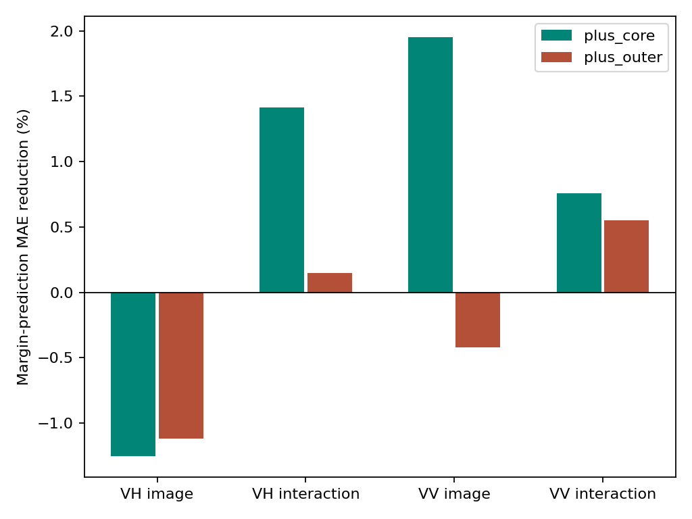
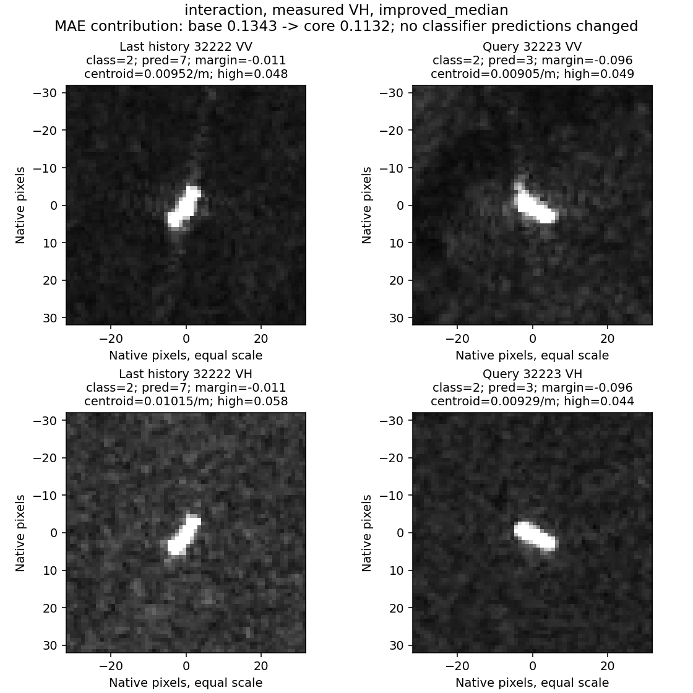
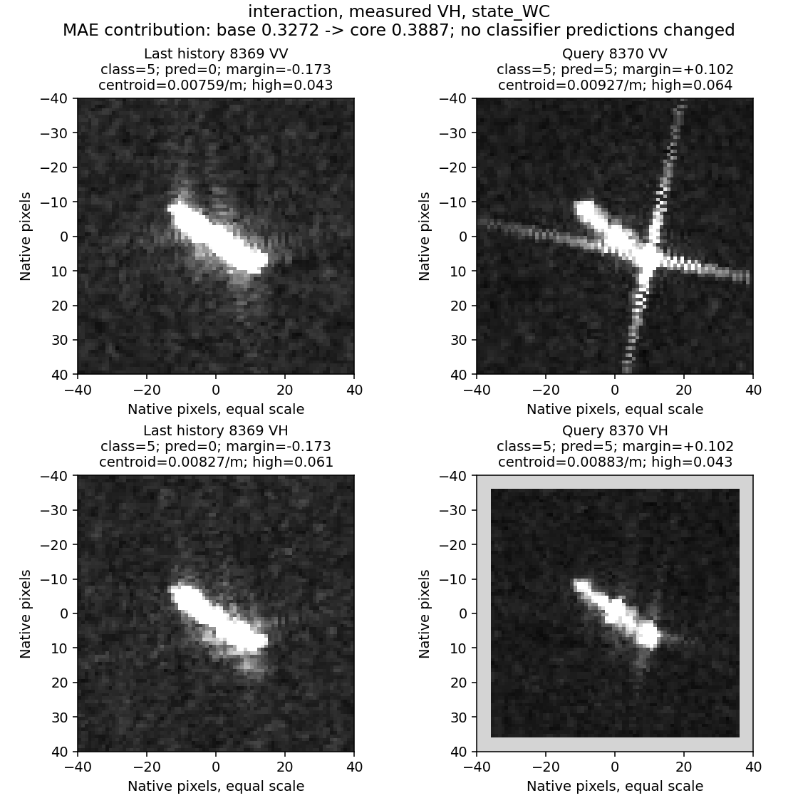

# 05：频域与类别分差的关系

完成：2026-10-24。诊断结果已保存，不改原分类器、图像或标签。

## 结论

有小幅、限定范围的可保留信号：中心频谱对既有“图像×几何交互”分类器的分差变化有增量解释，VH较一致；普通图像分类器结果不一致，外围频谱很弱。没有新增分类准确率，也没有证明物理因果关系。

上一轮的VH中心频谱重心8.67%是频谱预测误差下降，本轮约1.42%是类别分差预测误差下降，二者不是同一指标，不能相乘或相加。

## 实际流程与覆盖

1. 读取原多时相队列的1172张有效PNG频谱、空间测量和旧分类器分差；它们涉及119艘至少有一张有效视图的船。每极化586张，VV119船、VH118船。
2. 固定VV/VH各114个末次查询，至少3次同船有效历史；不把两个极化算成228艘独立船。
3. 源斜率从其他整折、查询之前且非查询过境的船学习。源船内去均值、每船等总权重，Ridge正则10，不调参。
4. 用查询船历史真实类别分差均值作参照，预测其末次分差。真实类别分差=真实类别分数减最高错误类别分数，可能为负，直接拟合而非取log。
5. 比较空间+几何、增加中心频谱两项、增加外围两项、同时增加，以及长度/宽度平方两维对照。

这里的image/interaction均是父目录conditional_evidence_pilot中的冻结表征诊断分类器，不是当前完整模型。两者均使用图像表征；本轮VV/VH分别指诊断特征来自哪个极化，不表示训练了两个独立单极化分类器。

队列有7类，没有LPG类。VH查询为成品/化学品油轮62、原油轮16、散货10、集装箱10、海工7、杂货6、拖船3；VV分别63、15、11、10、6、6、3。源训练均值、稀有类及重复开发限制仍在，不能代表完整八分类任务。

## 数值

相对“空间+几何”分差预测MAE的下降比例；正值更好，负值更差：

| 旧分类器 | 测量极化 | 加中心频谱 | 加外围频谱 | 两者都加 | 加普通平方项 |
|---|---|---:|---:|---:|---:|
| image | VV | +1.952% | -0.419% | +1.401% | +0.073% |
| image | VH | -1.252% | -1.119% | -1.471% | -0.165% |
| interaction | VV | +0.760% | +0.552% | +1.302% | -0.056% |
| interaction | VH | **+1.416%** | +0.149% | +1.527% | -0.083% |

VH interaction：MAE0.229656到0.226404，63船改善、51船退化，5/5折平均改善；过境组配对bootstrap的绝对误差收益95%区间约[-0.000503,0.009878]，仍跨0。相对同样增加两维的普通平方项约改善1.498%，但也未建立强统计区分。

不能只对比增强基线。简单历史平均的MAE为VH interaction0.229760、VV image0.205259；加中心频谱分别为0.226404、0.206656。前者仍有约1.46%的净改善，后者没有超过简单历史平均。VV interaction加中心也略差于历史平均，加入两种频谱才略好。

判断“旧分类器这次会不会判对”的分差正负准确率没有同步改善：VH interaction历史/空间几何均71.93%，加中心71.05%；VV image历史77.19%，加中心73.68%。这不是船型分类OA，而是诊断器判断原模型对错的准确率。因此目前不能拿该诊断器直接控制何时修正分类。

## 分类型边界

VH interaction中心频谱在7类中6类平均分差误差改善，杂货船6艘退化。并非只由最多的成品/化学品油轮支撑；原油轮16艘平均绝对误差收益0.01162、海工7艘0.01330，成品/化学品油轮62艘0.00109。小组样本有限，不据此开发类别硬开关。

普通image分类器的VH总体退化；同一频谱量不具有统一的“好/坏”含义。分组结果完整保存在strata.csv，不筛掉负组。

## 原图回看与可解释计算

已查看12幅双时相VV/VH面板，包含8个按改善/退化中位选出的诊断案例及4个按原模型对错变化选出的代表案例。原图保持相同像素坐标尺度；灰边仅为不同画布尺寸的显示留白，不进入计算。图上分类分数来自原双路分类器，两行重复同一决策是为了对照不同极化图像。

| 观测与对照 | 图像可见事实 | 本轮证据与解释 |
|---|---|---|
| 32222→32223，VH interaction | VH背景由较亮变暗，主体从斜向变近水平；中心高频占比0.058到0.044 | 原模型两次均错。分差误差0.1343到0.1132；新增频域项直接使预测分差降低0.01547，原有项重新拟合再降低0.00566。只是更接近真实负分差，没有救回类别。 |
| 7628→7629，VH interaction | VV新图交叉延伸明显；VH主体仍较紧凑，两次中心高频占比均约0.046 | 真实分差下降，但频域项与重拟合合计把预测提高0.01690，误差增大。单看VH两个谱摘要不足以跟随这次决策变化，无法只凭图认定物理原因。 |
| 24369→24370，VV image | VV背景和局部延伸变化，中心高频0.058到0.088；VH却0.064到0.037 | 原模型两次都对，诊断误差下降0.02071；其中频域项-0.06301被其他项重拟合+0.04230抵消。不能把总改善全部归于单个频域项。 |
| 8369→8370，VV image与VH interaction | 同一8370 VV有强交叉延伸，VH紧凑；不同模型看到相同图像 | image误判散货、interaction正确判原油轮。不能把出现延伸亮纹本身当作必然失败原因。两种诊断设置均出现退化，说明两维谱摘要尚不能可靠解释模型如何利用该结构。 |
| 25622→25623，VH interaction，持续对 | 历史图中心外另有两团亮目标状响应，查询没有同样邻域布局 | 两次仍判对、优势增加，但频域诊断变差。没有确认外围亮目标身份，不能强行说邻船导致变化。 |
| 26869→26870，VH interaction，对变错 | 主体从近水平变近纵向，背景和纵向延伸均改变 | 分差由+0.111到-0.347；加频域后诊断误差0.1813到0.1162，较好描述了退化，但没有改变分类，也未隔离朝向、背景、响应结构的独立作用。 |
| 30780→30781，VH interaction，持续错 | 历史图局部亮响应分散，查询更紧凑 | 分差更负，诊断误差0.5019到0.4480；仍是对已有错误的描述，不是正确判别证据的恢复。 |

其余7035、33850的正负案例以及固定旧案例28992/383/25586/26309均有表可追溯。完整案例索引case_images.csv记录真实路径、尺寸、角度、饱和程度、旧预测。term_contributions.csv将所有诊断项贡献拆开，重构预测最大误差8.05e-16，排除了本轮贡献拆解与预测接线不一致的问题。

## 针对这次结果的原因判断

**已证实**：频域与判别变化的关系依赖极化与具体分类器；粗粒度中心频谱能描述一部分分差变化，外围更弱；预测负分差更准不等于恢复分类。

**有数据支持但仍是假设**：径向重心和高频占比把“亮响应出现在哪里、沿什么方向、与主体是否连接”压成两数，可能不足以描述8370等局部结构。对错依赖的是内容与几何的使用方式，而不是一个全局频率标签。

**尚未区分**：这是表示过粗、共享线性斜率不适合各船型，还是现有观测本身不足。不能据此直接否定频域或因果关系，也不继续通过倍率调参追求更好数字。

## 收口与下一步

保留两层结果：上一轮成像描述正信号；本轮较弱的判别关联正信号。不把它升级为已有效的频域分类模块或因果发现。

若继续，优先用现有案例比较保留位置/方向的局部频带图，判断相近径向谱却不同局部结构是否对应不同类别证据；位置/方向表示应允许坐标一致变换而不把绝对船向变成类别先验。随后才是源端训练、固定查询的类别关系/分类收益验证，不先造一个大频域网络。物理因果识别仍沿一致定标输入及可区分条件组合的路线推进，不能由本诊断替代。

