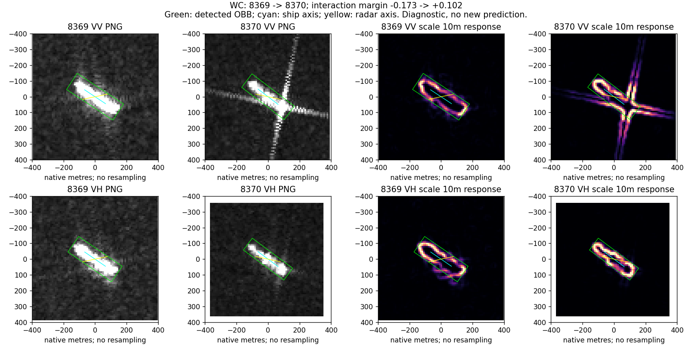

# 第06轮：同船空间—尺度—方向联合案例诊断

完成：2026-10-24。本轮先在侧边聊天只读计算，现将方法、固定案例和结果重放落盘。不是独立重复实验；未训练或修改分类器。

## 研究问题

整体频谱重心和高频占比可能遗漏变化发生的位置。联合观察框内、轴端和侧向的尺度响应，区分局部结构改变与仅由船向改变引起的方向统计变化。该假设用于解释图像变化，不预设高频是噪声，也不预设外围必然有益。

## 方法与数据

- 固定四组：26869→26870、8369→8370、25622→25623、30780→30781；4艘船、8次观测、16张VV/VH原图。
- 图像来自原同船队列，10米原生网格；不旋转、缩放或改写图像，不混用VV/VH。
- 尺度归一化高斯一阶导数，sigma=10/20/40米，截断3 sigma；10/20米是主诊断。它是空间—尺度分析，不是互不重叠的频带，也不代表10米真实可分辨率或SAR多普勒。
- 框内、长轴两端向外80米、短轴两侧向外80米分别读出。端部横向放宽20米；不识别船首、船尾。
- 同时保存各自框与配对统一长宽结果。统一长宽取两次检测框均值，位置和角度仍各自独立，不是精确配准。
- 能量比为E10/E20，可以大于1，不是能量占比。方向使用梯度方向，不等于亮线延伸方向。
- 转向对照将旧归一化梯度张量按检测船轴角差旋转，再与新张量比较；没有对图像做插值，也没有实施真实观测几何干预。

## 主要发现

### 1. 框内与外围、VV与VH可以呈相反变化

8369→8370在旧interaction分类器中由错变对，分差-0.173→+0.102。配对统一区域尺寸后的E10/E20：

| 区域 | VV前→后 | VH前→后 |
|---|---:|---:|
| 框内 | 0.5012→0.6218 | 0.5288→0.6273 |
| 轴端 | 0.3661→0.7548 | 0.3621→0.2736 |
| 侧向 | 0.3173→0.7513 | 0.3478→0.2290 |

原图后一次VV有较强交叉延伸，VH未出现同等延伸。联合分区确实区分了整体谱摘要未表达的变化位置；但还不能说交叉延伸导致改对。旧image分类器在同一查询仍然判错。

### 2. 大方向变化可能主要由转向解释

26869→26870的VV框内雷达轴梯度占比0.2577→0.8449。只将旧张量按船轴转向旋转，得到0.7851。VH为0.2443→0.8496，转向对照0.7872。

这个结果不等于解释了某个百分比的真实物理变化，也不能说所有剩余差异来自雷达条件；它只说明巨大方向统计变化未必需要新的成像机制解释。

### 3. 区域定义影响部分案例

30780→30781的VH轴端E10/E20：各自框0.6505→0.4503，统一大小后0.7323→1.4729，变化方向反转。原图中检测框与高响应范围明显缩小，固定与动态区域实际读取了不同像素。不能把这个案例的端部频率变化写成稳健物理事实。完整两套结果保存在pairs.csv。

## 四类原图回看

| 状态 | 配对 | 可见事实及解释边界 |
|---|---|---|
| 对→错 | 26869→26870 | 主体转向、背景和纵向延伸变化；框内方向差异大幅受转向解释，但判别为何退化仍未定位。 |
| 错→对 | 8369→8370 | VV交叉延伸增强，VH相对紧凑；不支持“出现延伸必然有害”。 |
| 对→对 | 25622→25623 | 旧图有额外亮目标状响应，新图邻域布局不同；类别判断仍对，未确认额外响应身份。 |
| 错→错 | 30780→30781 | 后图紧凑、检测范围明显小；仍然判错，且端部测量对区域大小敏感。 |

尺度响应图的亮环主要位于亮目标边缘，这是导数算子强调边界的直接表现，不能当成发现了新散射结构或内部纹理稳定性。

其余面板：case_26870.png、case_25623.png、case_30781.png。四幅均实际查看；是诊断分类器结果，不是新完整模型结果。

## 复现与结论

执行 `python -B joint_probe.py --round pilot`，输出本目录。常量导数误差0，90度旋转张量误差1.73e-18，已报告固定案例比值重放误差7.75e-7（相对四位小数）。原图路径在measurements.csv。

保留：联合位置、尺度、方向与极化值得扩围，能区分整体谱掩盖的局部变化。未证明：物理因果关系、独立判别机制或分类涨点。第07轮扩围不把这四组再次计为独立确认。
