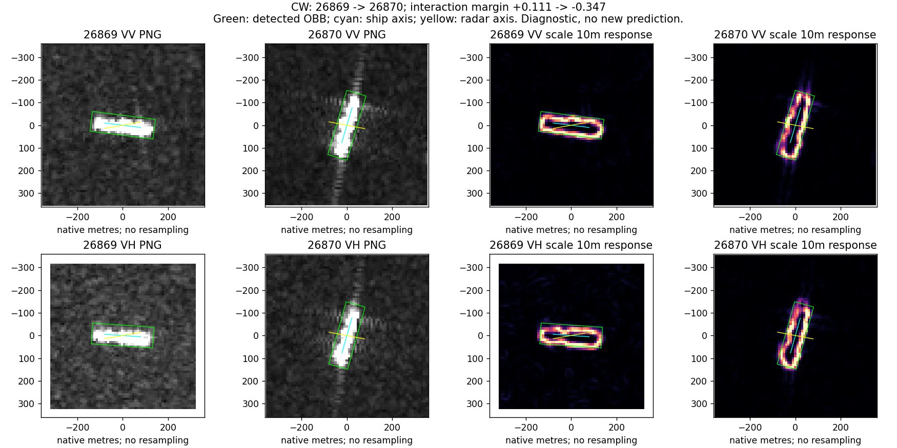

# 第07轮：联合诊断扩围与转向解释的边界

完成：2026-10-24。事前口径见PROTOCOL_ZH.md；代码为上级joint_probe.py。未训练分类器，无新增OA/BA成绩，无物理因果效应估计。

## 一、覆盖与实际完成内容

沿用第05轮固定查询，VV/VH各114个查询—最近有效历史配对，每极化114艘船。合并116艘船、117个不同观测对、6港、26个查询过境和25个历史过境；不同极化可选择不同有效历史，不把228个配对视图称为228个独立样本。无配对因时间、身份字段或同过境而排除。

类别不均衡：VH中成品/化学品油轮62、原油轮16、散货10、集装箱10、海工7、杂货6、拖船3；VV分别63、15、11、10、6、6、3。只有这7类，不能代表完整八分类任务。

每个极化的旧interaction状态：持续对7、对变错23、错变对20、持续错64。这是所选相邻观测对的状态，不是新模型表现或全数据集OA。

采用10/20/40米尺度导数测量，主分析使用10/20米。输出包含逐观测测量、逐配对变化、类别分层、区域定义敏感性及全部描述关联。10/20米各区域覆盖率均为100%；40米最低覆盖率约58.78%，仅保留探索测量，不混入主比较。

## 二、框内方向变化，大部分配对可由转向更好地描述

表中为配对统一大小区域、归一化梯度张量距离的中位数；“变好比例”指船轴旋转后距离小于原距离的样本比例，**不是解释掉的能量比例，也不是分类准确率**。

| 极化/区域 | 直接比较距离 | 按船轴转向后距离 | 距离减小的配对比例 |
|---|---:|---:|---:|
| VV框内 | 0.3426 | 0.1256 | 87.72% |
| VH框内 | 0.3800 | 0.1290 | 85.09% |
| VV轴端 | 0.3963 | 0.3627 | 45.61% |
| VH轴端 | 0.3226 | 0.2733 | 59.65% |
| VV侧向 | 0.3994 | 0.2249 | 64.91% |
| VH侧向 | 0.3945 | 0.2069 | 78.95% |

可保留解释：框内梯度方向结构经常随检测船轴共同转向；外围不能一概当作同一个随船刚性旋转的结构。不能进一步宣称外围一定跟雷达转，或框内已提取出不变类别信息。

重要边界：船轴来自同一张图的检测，导数响应又常集中在目标轮廓，二者存在测量耦合。本轮表格不是独立验证成像物理规律，不能说发现了此前未知的“船体稳定因果空间”。

## 三、剩余变化尚不能被单一条件解释

配对统一大小口径，框内旋转残差与入射角变化绝对值的Spearman：VV -0.012、VH +0.160；按类别中心化后的秩相关约+0.039、+0.231。与饱和变化绝对值为VV +0.193、VH +0.128。

这些是探索性、重复开发队列中的描述关联，没有多重比较或独立确认，过境共享也未被当成独立重复。它们既不支持“剩余变化主要由入射角决定”，也不证明入射角没有作用。仍未区分显示处理、非刚性响应变化、检测偏差、真实观测/环境差异等因素。

## 四、局部尺度变化与旧分类分差的单变量关联较弱

E10/E20的对数变化，与interaction真实类别分差变化的Spearman：

| 区域 | VV | VH |
|---|---:|---:|
| 框内 | +0.059 | +0.106 |
| 轴端 | -0.061 | -0.073 |
| 侧向 | +0.027 | +0.135 |

普通image分类器对应关联也弱，完整结果在associations.csv。按类别中心化未改变弱关联的总体判断。不能据此提出“高频多就应当增强/抑制”的统一分类规则；也不能用此结果否定复杂条件下的局部作用。

## 五、区域大小不是无关紧要的实现细节

各自框与配对平均长宽口径中，尺度比变化符号相同的比例：

| 区域 | VV | VH |
|---|---:|---:|
| 框内 | 82.46% | 87.72% |
| 轴端 | 85.96% | 76.32% |
| 侧向 | 89.47% | 79.82% |

总体多数同向，但部分局部结论依赖读到了哪些像素。例如30780→30781的VH轴端变化方向反转，不能选有利的一套解释。两种定义都不是独立船体分割真值；统一长宽也没有解决中心和方向误差。

## 六、原图回看：实际看到了什么

按四种状态中绝对分差变化居中选择，恰好仍选中第06轮的四组案例。它们是重复回看，不是四组新增独立证据。已实际查看本轮重新生成的四幅VV/VH原图与10米尺度响应面板。

| 配对 | 原图和响应事实 | 能说明与不能说明 |
|---|---|---|
| 25622→25623，持续对 | 旧图上下各有一团较强亮响应，新图不存在同样布局；导数图突出这些响应的边缘。 | 当前模型能在这对图上保持判断；没有确认这些响应是邻船，也没有隔离模型是否用到它们。 |
| 26869→26870，对变错 | 主体由近水平转为近纵向；强导数主要绕亮目标外缘分布，新图另有纵向延伸。 | 转向能描述大部分框内方向差异，不能解释为什么分类分差下降0.457。 |
| 8369→8370，错变对 | 新VV十字状延伸在尺度响应图中仍明显；新VH主要是紧凑主体轮廓。 | 支持位置/极化分开测量；不支持将所有延伸当作有害因素。 |
| 30780→30781，持续错 | 旧响应分散、检测范围较大；新响应紧凑、框更小，仍然判错。 | 单一“变紧凑”不保证有用；该例端部测量对区域大小特别敏感。 |

这些图不是神经网络注意力图，而是明确滤波算子的局部输出。图中显示所有位置，主表仅使用指定区域及通过边界覆盖检查的像素。强边缘响应符合该算子的定义，不能反过来当成新物理机制证明。

## 七、当前判断与下一轮方向

已落实的进展：把原先“整图频谱变了”拆到位置、尺度、方向与极化；在更大同船队列上量化了转向可解释部分及残差，并发现区域组织的实质影响。

尚未完成：没有识别独立物理因果因素，没有证明剩余响应是分类失败的原因，没有新模块或新分类收益。第04轮频谱预测、第05轮分差解释与本轮张量/尺度诊断是不同指标，不可相加为累计收益。

下一轮应先检验残差的来源，而不是再拟合一个门控器：

1. 区分目标轮廓/饱和边界与框内非边界结构，判断“随船转向”的主要证据是否仅来自轮廓。
2. 对外围比较船轴、雷达轴和图像坐标的方向参照，检查哪种更能描述真实变化；这仍是机制候选筛选，不直接等同因果效应。
3. 对已有少数匹配观测恢复一致定标输入，检查PNG显示处理是否改变关键关系；再连接旧模型或完整模型证据。

下一轮尚未执行。无需现在把三项变成三个网络，也不先要求所有类别获胜。

## 八、产物和复现

- `python -B joint_probe.py --round coverage`；输出本目录，2线程BLAS。
- manifest.json：实际覆盖、排除记录和实现检查；excluded.csv为空但保留表头。
- measurements.csv：原始路径、区域像素数、覆盖与尺度响应；pairs.csv：逐配对条件、分差和测量变化。
- summary.csv、class_summary.csv、associations.csv、region_size_sensitivity.csv：全部正负结果。
- review_selection.csv和4张case图：案例选择及原图分析。

常量导数检查为0；90度图像旋转张量一致性误差1.73e-18。第06轮数值重放通过。没有将这些实现检查说成科学假设验证。
